# CMD Connector (CMC) - Architecture & Design Document

**Doc_Type:** Architecture & Design
**Category:** (C) Connector
**Name:** CMD Connector
**Acronym:** CMC
**Version:** 1.3.0
**Date:** 2026-11-01
**Author:** Martin Kecka & Gemini AI
**Status:** Active

---

## 1. Introduction & Purpose 📜

The **CMD Connector (CMC)** is a deterministic, headless Python microservice and schema-aware automation gateway that serves as the authoritative interface between the SERA/GIA ecosystem and the enterprise **CMD GraphQL API**. Its core purpose is to insulate calling applications across the platform from the complexities of GraphQL query construction, OAuth2 token lifecycle management, rate limiting, and pagination.

CMC operates as a generic, upstream-agnostic enterprise connector. Any application across the ecosystem—including AI assistants, analyzers, ingestors, processors, and administrative utilities (such as FBA, CAA along with BSI/RMI, CLA, LDA, LDP, HAU, HRU, Orchestrator, or any future microservice)—can leverage CMC whenever enterprise CMD data is required. While specific domain RPCs exist to support common patterns (e.g., client lookups, open invoice snapshots, bank account currency mappings, dunning profiles, and ticket/network site lookups), the connector does not couple its internal architecture to specific upstream workflows.

The CMC fulfills four primary operational pillars:

1. **Deterministic GraphQL Gateway (`core/cmd_client.py`):** Encapsulates 36+ parameterized `.gql` queries behind resilient, strongly-typed Python methods with automated OAuth2 `client_credentials` authentication, token expiry tracking, and `tenacity`-driven exponential backoff.
2. **High-Speed Local Asset Generation & Caching (`core/rule_generator.py`):** Periodically extracts live open ERP transactions (`billing_erp_transactions`) and legal entity banking records (`billing_legal_entities_banking_info`) to synthesize local analytical assets—including document regex/length parsing rules (`invoice_rules.json`), account-to-currency mappings (`bank_currency_map.json`), and consolidated open invoice snapshots (`live_open_invoices.csv`).
3. **Dual-Environment gRPC Data Provider (`grpc_api/cmc_service.py`):** Exposes 28 domain-specific RPCs alongside the universal SERA Standard telemetry contract over port `50053`, supporting dynamic per-request routing between **Production** (`cmd_prod`) and **Pre-Production** (`cmd_preprod`) via gRPC invocation metadata (`x-use-preprod: true`).
4. **Schema Introspection & Developer Tooling (`cli/cmc_cli.py`, `core/discovery.py`):** Provides an AMU-compliant nested Click CLI (`NestedHelpGroup`) for downloading full GraphQL introspection schemas (`cmd_schema.json`), filtering noise types into human- and AI-readable entity summaries (`core/targeted_explorer.py`), inspecting individual GraphQL types (`core/schema_explorer.py`), and executing raw queries or gRPC calls directly from the terminal.

---

## 2. Architecture & Ecosystem Integration 🏗️

The CMC operates as a **Category (C) Connector** microservice. It is strictly headless and stateless with respect to relational databases, relying on live outbound HTTPS GraphQL queries to the CMD API Gateway and local filesystem caching (`assets/`) protected by thread-level synchronization (`threading.Lock()`).

### Ecosystem Touchpoints
* **Upstream Consumers (Inbound gRPC on `0.0.0.0:50053`):**
  * **SERA / GIA Ecosystem Applications:** Any registered assistant, analyzer, ingestor, processor, or utility across the platform can connect as a gRPC client to query client profiles, ERP balances, open invoices, banking info, BAN details, tickets, and network sites. CMC is upstream-agnostic and does not track or depend on upstream caller logic—it reliably serves any authorized ecosystem microservice via standard Protobuf contracts.
  * **Application Management Utility (AMU) & SAM UI:** Periodically polls the universal `sera.standard.v1.SeraAppService` (`GetAppInfo`, `GetDeepHealth`, `GetChangelog`, `GetDocs`, `GetFeedback`) and standard gRPC Health (`grpc.health.v1.Health`) for real-time ecosystem observability and portfolio tracking.
  * **Operator / Developer CLI:** Direct or `--grpc` command execution via `cmd_connector.py` for administration, schema inspection, asset cache refreshes, and diagnostics.
* **Downstream Dependencies (Outbound HTTPS on Port `443`):**
  * **CMD Keycloak IDP (Prod & Preprod):** OAuth2 token endpoints (`/idp/realms/prod/protocol/openid-connect/token` and `/idp/realms/preprod/protocol/openid-connect/token`).
  * **CMD GraphQL API Gateway (Prod & Preprod):** Hasura-backed GraphQL endpoints (`/cmd/graphql/` and `/cmd-preprod/graphql/`).

```mermaid
flowchart TD
    subgraph Upstream["Ecosystem Consumers (Upstream-Agnostic)"]
        APPS["SERA / GIA Applications\n(Assistants, Ingestors, Processors, Utilities)"]
        AMU["AMU / SAM UI & Orchestrator"]
        CLI_USER["Operator / Developer CLI"]
    end

    subgraph CMC["CMD Connector (CMC) - Port 50053"]
        CLI["Click CLI (cli/cmc_cli.py)\nNestedHelpGroup"]
        GRPC_SRV["gRPC Server (grpc_api/services.py)\nThreadPoolExecutor (max_workers=10)"]
        CMC_SVC["CmdConnectorService\n(grpc_api/cmc_service.py)"]
        SERA_SVC["SeraStandardServiceImpl\n(grpc_api/sera_standard_service.py)"]
        TXN_LOG["RPC Transaction Logger\n(utils/rpc_transaction_logger.py)"]
        RULE_GEN["Asset & Rule Generator\n(core/rule_generator.py)"]

        subgraph Clients["Dual CmdClient Instances (core/cmd_client.py)"]
            PROD_CL["prod_client\n(cmd_prod)"]
            PREPROD_CL["preprod_client\n(cmd_preprod)"]
        end

        subgraph LocalStorage["Local Filesystem Storage"]
            ASSETS[("assets/\nlive_open_invoices.csv\ninvoice_rules.json\nbank_currency_map.json\nbu_bank_info_complete_validation.csv")]
            DISCOVERY[("discovery/\ncmd_schema.json\nschema_summary.txt")]
            LOGS[("/ai/assets/logs/cmd_connector/\ncmc_app.log & transactions/")]
        end
    end

    subgraph External["External CMD Infrastructure (HTTPS :443)"]
        IDP_PROD["CMD Keycloak IDP (Prod)\napi-gateway.gtt.net"]
        GQL_PROD["CMD GraphQL API (Prod)\napi-gateway.gtt.net/cmd/graphql/"]
        IDP_PRE["CMD Keycloak IDP (Preprod)\napi-gateway-preprod.gtt.net"]
        GQL_PRE["CMD GraphQL API (Preprod)\napi-gateway-preprod.gtt.net/cmd-preprod/graphql/"]
    end

    APPS -->|gRPC Unary Calls| GRPC_SRV
    AMU -->|SERA Standard & Health gRPC| GRPC_SRV
    CLI_USER -->|Direct Python or --grpc| CLI

    CLI -->|gRPC Stubs| GRPC_SRV
    CLI -->|Direct Mode| PROD_CL & PREPROD_CL
    CLI -->|schema discover / inspect| DISCOVERY
    CLI -->|asset refresh| RULE_GEN

    GRPC_SRV --> CMC_SVC & SERA_SVC
    CMC_SVC -->|Audit JSON| TXN_LOG
    TXN_LOG --> LOGS
    CMC_SVC -->|Stale > 3600s Lock| RULE_GEN
    CMC_SVC -->|Read CSV / JSON| ASSETS
    RULE_GEN -->|Write CSV / JSON| ASSETS
    RULE_GEN -->|Fetch ERP & Banks| PROD_CL

    CMC_SVC -->|Default Route| PROD_CL
    CMC_SVC -->|x-use-preprod: true| PREPROD_CL

    PROD_CL -->|OAuth2 Client Credentials| IDP_PROD
    PROD_CL -->|GraphQL POST (.gql)| GQL_PROD
    PREPROD_CL -->|OAuth2 Client Credentials| IDP_PRE
    PREPROD_CL -->|GraphQL POST (.gql)| GQL_PRE
```

---

## 3. Module File Map 📂

```plaintext
/ai/cmd_connector
├── bootstrap_helper.py                                     # Virtual environment bootstrapping and dependency verification
├── cmd_connector.py                                        # Main application entrypoint; loads config/settings.yaml, configures logging, invokes Click CLI
├── README.md                                               # Repository overview and links to central SERA guides
├── requirements.txt                                        # Pinned Python dependencies (grpcio<=1.75.1, pandas, numpy, tenacity, click, graphql-core)
├── config/
│   └── settings.yaml                                       # Master configuration for gRPC server, Prod/Preprod CMD endpoints, logging, and stub paths
├── docs/
│   ├── CHANGELOG.yaml                                      # Local machine-readable release history parsed by AMU
│   └── cmc_design.md                                       # Symlink -> /ai/assets/guides/tool_guides/cmc_design.md
├── cli/
│   ├── cmc_cli.py                                          # Root Click group (NestedHelpGroup), --preprod/--grpc flags, start-grpc-server command
│   ├── utils.py                                            # gRPC client stub factories, MetadataClientInterceptor, error decorator, JSON printer
│   └── commands/
│       ├── __init__.py                                     # Package marker for CLI domain command groups
│       ├── asset_cmds.py                                   # 'asset' group: refresh, run-query, open-invoices, bank-info, rules
│       ├── billing_cmds.py                                 # 'billing' group: list, validate, mrr-summary
│       ├── client_cmds.py                                  # 'client' group: get, get-basic, search, contacts, by-email, by-ban, group-clients
│       ├── module_cmds.py                                  # 'module' group: info (GetAppInfo), check-health (GetDeepHealth)
│       ├── network_cmds.py                                 # 'network' group: segment-a-site, gnid-a-site
│       └── schema_cmds.py                                  # 'schema' group: discover, inspect-targeted, inspect-type, list-queries
├── core/
│   ├── cmd_client.py                                       # CmdClient class: OAuth2 token management, tenacity retries, 30+ GraphQL query methods
│   ├── discovery.py                                        # Full GraphQL schema introspection query runner (run_schema_discovery)
│   ├── query_lister.py                                     # Parses cmd_schema.json to list all top-level query_root fields and arguments
│   ├── rule_generator.py                                   # Local asset generator: builds live_open_invoices.csv, invoice_rules.json, bank_currency_map.json
│   ├── schema_explorer.py                                  # Deep-dive field and argument inspector for specific GraphQL OBJECT/INPUT_OBJECT types
│   ├── targeted_explorer.py                                # Filters introspection schema by TARGET_PREFIXES and strips NOISE_SUFFIXES into schema_summary.txt
│   └── graphql/                                            # Static parameterized GraphQL query files (.gql / .graphql)
│       ├── dump_billing_inquiry.gql                        # Diagnostic dump of latest 3 billing_inquiry records
│       ├── get_account_mrr_by_ban.gql                      # Queries client_billing_account for fully_loaded_mrr and status by BAN
│       ├── get_all_client_data_by_id.gql                   # Queries client_by_pk for full profile, company, and client_billing_accounts
│       ├── get_all_client_data_by_name.gql                 # Queries client by exact name for full profile, company, and client_billing_accounts
│       ├── get_ban_collections_profile.gql                 # Calls get_ban_collections_profile stored query for credit limit, autopay, PON, MRR/NRR
│       ├── get_banking_info.gql                            # Queries billing_legal_entities_banking_info for account numbers, currencies, BUs
│       ├── get_billing_details_by_ban.gql                  # Queries client_billing_account for billing_cycle_label and client.json_columns
│       ├── get_billing_inquiries.gql                       # Queries billing_inquiry with dynamic bool_exp filter, pagination, and nested client info
│       ├── get_billing_inquiry_by_id.gql                   # Queries billing_inquiry_by_pk for ticket IDs, assignees, status, and BAN details
│       ├── get_billing_inquiry_matrix.gql                  # Queries inquiry_assignee_matrix_list for sales division/region/team approver mappings
│       ├── get_billing_tickets.gql                         # Queries ticket table with dynamic bool_exp filter and pagination
│       ├── get_client_ban_notes.gql                        # Queries client_ban_notes with min_updated_on arg, maxUpdatedOn, and body _ilike filter
│       ├── get_client_basics_by_id.gql                     # Queries client_by_pk for id, name, status, network_code, and company
│       ├── get_client_basics_by_ids.gql                    # Batch queries client table where id _in $clientIds
│       ├── get_client_contact_emails.gql                   # Queries client_person by client_id for person_id, email, and fullname
│       ├── get_client_id_by_ban.gql                        # Resolves client_billing_account name (_eq: $ban) to client_id
│       ├── get_client_id_by_domain.gql                     # Queries client_person where contact.email _like $domainPattern
│       ├── get_client_id_by_email.gql                      # Queries client_person (limit 1) where contact.email _eq $email
│       ├── get_client_ids_by_domain_ilike.gql              # Case-insensitive (_ilike) domain lookup on client_person
│       ├── get_clients_by_contact_email.gql                # Case-insensitive (_ilike) contact email lookup returning all matching client_person rows
│       ├── get_clients_by_group_id.gql                     # Queries company by id and returns all nested clients
│       ├── get_clients_by_group_name.gql                   # Queries company by exact name and returns all nested clients
│       ├── get_client_site_address.gql                     # Batch queries client_site where id _in $siteIds
│       ├── get_clients_with_disputes.gql                   # Queries client_with_dispute view for active dispute client IDs and names
│       ├── get_client_to_collector_mapping.gql             # Queries client_collectors for client-to-collector assignments
│       ├── get_country_by_address.gql                      # Queries client_site_foreign_writable by address and postal code for country/lat/long
│       ├── get_country_by_id.gql                           # Queries country table by id for name, code, and iso3
│       ├── get_crm_service_by_gtt_service_id.gql           # Queries crm_service by exact gtt_service_id match
│       ├── get_disputes_by_client_id.gql                   # Queries client_dispute_by_id_and_created within a timestamp range
│       ├── get_dunning_letters_history.gql                 # Queries dunning_letter_history by client_name
│       ├── get_erp_transactions.gql                        # Queries billing_erp_transactions with dynamic bool_exp and optional limit
│       ├── get_erp_transactions_audit.gql                  # Queries billing_erp_transactions including balance_date for audit workflows
│       ├── get_extra_ban_details.gql                       # Queries ban_details_by_client for LPC, dunning exclusions, collector, payment terms
│       ├── get_invoices_by_ban.gql                         # Queries billing_erp_transactions for a specific BAN and posting_date >= $startDate
│       ├── get_monthly_exchange_rate.gql                   # Queries monthly_exchange_rates for a specific date ($timePeriod)
│       ├── get_mrr_and_services.gql                        # Queries crm_service by client_id for MRR, USD MRR, currency, and service status
│       ├── get_persons_by_ids.gql                          # Batch resolves CMD person IDs to fullname and email
│       ├── get_recent_emails.gql                           # Queries client_ban_notes by min_updated_on, client_name (_ilike), and bodyPattern
│       ├── get_recent_inquiries.gql                        # Queries email-created billing_inquiry records with id > $since_id (ascending)
│       ├── get_reporting_hirearchy_for_collections_team.gql# Queries ai_collections_reporting_hierarchy view
│       ├── get_segment_a_site.gql                          # Batch queries segment table by segmentIds for A-Site address, POC, and country
│       ├── get_segments_by_pon_id.gql                      # Queries service_order by ponId for nested service segments
│       ├── get_service_order_site_ids.gql                  # Batch queries service_order by orderIds (GNIDs) for a_site_id and z_site_id
│       ├── get_summary_data_by_ban.gql                     # Queries latest 5 billing_invoices records for a BAN
│       ├── get_wienerberger_comms.gql                      # Diagnostic query for client_ban_notes on client_id 73417
│       ├── search_clients_by_name.gql                      # Fuzzy _ilike search across both client and company tables
│       ├── test_country.graphql                            # Diagnostic query testing client_site country_id field
│       ├── test_country2.graphql                           # Diagnostic query testing country lookup by countryId
│       ├── test_country3.graphql                           # Diagnostic query testing countryByCountryId relationship on client_site
│       ├── test_fallback.graphql                           # Diagnostic query testing nested country code on client_site
│       ├── test_fallback2.graphql                          # Diagnostic query testing client_site address fields without country
│       └── validate_invoices.gql                           # Legacy billing_invoices validation query (superseded by get_erp_transactions.gql)
├── discovery/
│   ├── all_queries.txt                                     # Saved output of top-level GraphQL queries
│   ├── all_types.txt                                       # Saved list of discovered GraphQL types
│   ├── cmd_schema.json                                     # Full Production GraphQL introspection schema JSON (~952k lines)
│   ├── cmd_schema_preprod.json                             # Full Preprod GraphQL introspection schema JSON (~958k lines)
│   ├── schema_summary.txt                                  # Noise-filtered Production entity summary generated by targeted_explorer.py
│   └── schema_summary_preprod.txt                          # Noise-filtered Preprod entity summary generated by targeted_explorer.py
├── grpc_api/
│   ├── __init__.py                                         # Package marker for gRPC API module
│   ├── cmc_service.py                                      # CmdConnectorServiceServicer implementation (28 domain RPCs, dynamic routing, CSV/JSON cache)
│   ├── generate_stubs.py                                   # Dynamic protoc compiler for cmc_service.proto and sera_standard.proto
│   ├── sera_standard_service.py                            # Universal SeraAppServiceServicer implementation (GetAppInfo, GetDeepHealth, etc.)
│   ├── services.py                                         # gRPC server bootstrap, thread pool setup, health & reflection registration
│   └── protos/
│       └── cmc_service.proto                               # Protobuf v3 contract defining CmdConnectorService and all request/response messages
├── scripts/                                                # Maintenance and one-off testing scripts (e.g., debug_llm_payload.py)
└── utils/
    ├── logging_setup.py                                    # Root logger setup with stderr StreamHandler and 5MB RotatingFileHandler
    └── rpc_transaction_logger.py                           # JSON audit logger for all gRPC transactions with automated retain_count pruning
```

---

## 4. Core Processing Lifecycle ⚙️

### 4.1. Boot & Initialization Sequence
1. **Environment Bootstrapping (`cmd_connector.py` -> `bootstrap_helper`):** Upon execution, `cmd_connector.py` ensures `SCRIPT_DIR` is in `sys.path` and invokes `bootstrap_helper.bootstrap_and_reexecute_if_needed()` to guarantee execution inside the module's isolated virtual environment.
2. **Configuration Loading (`cmd_connector.py` -> `load_config()`):** Reads `/ai/cmd_connector/config/settings.yaml` via `yaml.safe_load()`. Any I/O or YAML parsing error prints `[FATAL]` to `sys.stderr` and terminates with `sys.exit(1)`.
3. **Logging Initialization (`utils/logging_setup.py` -> `setup_logging()`):** Guarded by the module-level `_LOGGING_CONFIGURED` singleton flag:
   * Configures the root logger at `logging.DEBUG` level with format `%(asctime)s - %(levelname)-5s - [%(name)s] - %(message)s`.
   * Attaches a `StreamHandler(sys.stderr)` set to the configured `logging.level` (`INFO`).
   * If `logging.enable_file_logging` is `True`, creates `/ai/assets/logs/cmd_connector/cmc_app.log` using a `RotatingFileHandler` (`maxBytes=5*1024*1024` [5 MB], `backupCount=5`, `level=logging.DEBUG`).
   * Suppresses noisy third-party loggers (`hpack`, `httpx`, `httpcore`, `urllib3`) to `logging.WARNING`.
4. **CLI Context & Target Selection (`cli/cmc_cli.py` -> `cli()`):**
   * Evaluates `--preprod` flag: sets `config['active_cmd_target']` to `config['external_services']['cmd_preprod']` if `True`, otherwise defaults to `config['external_services']['cmd_prod']`.
   * Injects `/ai/assets/protos/cmd_connector/generated` (and its 3-level parent directory) into `sys.path` via `ensure_stubs_path_in_sys(config)`.
   * If the invoked subcommand is not `start-grpc-server`, instantiates `CmdClient(config)` and initializes gRPC client stubs (`get_cmc_stub()`, `get_sera_stub()`) wrapped with `MetadataClientInterceptor('x-client-id', 'CMC-CLI')`.
5. **gRPC Server Startup (`cli/cmc_cli.py` -> `start_server()` -> `grpc_api/services.py` -> `serve()`):**
   * Invokes `check_and_generate_stubs(config)` (`grpc_api/generate_stubs.py`), which compares file modification timestamps (`os.path.getmtime()`) of `cmc_service.proto` and `/ai/assets/protos/sera_standard/sera_standard.proto` against their `_pb2.py` stubs in `/ai/assets/protos/cmd_connector/generated`, compiling via `grpc_tools.protoc` if missing or stale and creating `__init__.py` files up the directory tree (`_ensure_init_files()`).
   * Instantiates `grpc.server(futures.ThreadPoolExecutor(max_workers=10))`.
   * Initializes `CmdConnectorService(config)`, which creates both `self.prod_client` (`cmd_prod`) and `self.preprod_client` (`cmd_preprod`), sets `self.cmd_client = self.prod_client`, ensures `assets/` exists, and loads `assets/bank_currency_map.json` into memory (`_load_bank_currency_map()`).
   * Registers `CmdConnectorService`, `SeraStandardServiceImpl`, `grpc_health.v1.health.HealthServicer` (setting `sera.standard.v1.SeraAppService` to `SERVING`), and enables server reflection (`reflection.enable_server_reflection`).
   * Binds to `0.0.0.0:50053` (`server.add_insecure_port()`) and blocks on `server.wait_for_termination()`.

### 4.2. Inbound gRPC Request & Dynamic Environment Routing Workflow
Every inbound domain RPC on `CmdConnectorService` (`grpc_api/cmc_service.py`) follows a deterministic execution lifecycle:

1. **Client Application Extraction (`_extract_client_app(context)`):** Inspects `context.invocation_metadata()` for the `client_application` header, defaulting to `"UNK"` if absent.
2. **Environment Routing (`_get_client(context)` vs. `self.cmd_client`):**
   * RPCs supporting dynamic environment switching (`GetClientBanNotes`, `GetRecentEmails`, `GetBillingInquiries`, `GetOpenInquiriesByClient`, `GetRecentInquiries`, `GetBillingTickets`, `GetExceptionTickets`, `GetGroupMRRSummary`, `GetBillingInquiryMatrix`, `GetClientCollectorMappings`, `GetCollectorsReportingHierarchy`, `GetMonthlyExchangeRates`, `GetCycleAndCreditLimitByBanName`, `GetClientsWithDisputes`, `GetClientDisputes`, `GetDunningLettersHistory`, `GetExtraBanDetails`, `GetBanCollectionsProfile`) call `self._get_client(context)`.
   * `_get_client(context)` inspects `context.invocation_metadata()`: if `'x-use-preprod': 'true'` is present, it routes execution to `self.preprod_client`; otherwise it routes to `self.prod_client`.
   * Core passthrough RPCs (`GetClientByEmail`, `GetClientAllData`, `GetClientBasicInfo`, `GetSegmentASite`, `GetGnidASite`, `ValidateInvoices`, `GetInvoicesByBan`, `GetClientByBan`, `GetBillingInquiryById`, `SearchClientsByName`, and `_list_rpc` methods) execute against `self.cmd_client` (`self.prod_client`).
3. **OAuth2 Token Acquisition & GraphQL Execution (`core/cmd_client.py`):**
   * `CmdClient._execute_query()` calls `_get_valid_token()`. If `self._access_token` is `None` or `time.time() >= self._token_expiry_time` (calculated as `time.time() + expires_in - 60`, default `expires_in=86400`), `_get_auth_token()` sends an HTTP `POST` with `grant_type=client_credentials` and Basic Auth `(client_id, client_secret)` to `self.token_url`.
   * `_execute_query()` sends an HTTP `POST` to `self.api_url` with `Authorization: Bearer <token>` and JSON payload `{"query": query, "variables": variables}`. If the response JSON contains `"errors"`, it raises `ValueError(f"GraphQL Error: {error_details[0]['message']}")`.
4. **Protobuf Struct Serialization (`dataframe_to_struct_list()` / `dict_list_to_struct_list()`):**
   * Cleans `pd.NaT`, `np.nan`, and `None` values from Python dictionaries or Pandas DataFrames and serializes them into `google.protobuf.struct_pb2.Struct` messages via `google.protobuf.json_format.ParseDict()`.
5. **Transaction Auditing (`utils/rpc_transaction_logger.py` -> `log_transaction()`):**
   * Writes a timestamped JSON file `cmc_txn_YYYY-MM-DDTHH-MM-SS-mmmZ.json` to `/ai/assets/logs/cmd_connector/transactions/` containing `timestamp_utc`, `rpc_method`, `success`, `request_payload`, `response_data`, `error_message`, and `client_application`.

### 4.3. Local Asset Refresh & Stale Cache Lifecycle
When `GetOpenInvoices` is invoked via gRPC (or `asset refresh` is run via CLI):

```mermaid
stateDiagram-v2
    [*] --> CheckFreshness: GetOpenInvoices RPC Called
    CheckFreshness --> ServeCSV: live_open_invoices.csv exists AND age <= 3600s
    CheckFreshness --> AcquireLock: File missing OR age > 3600s
    AcquireLock --> DoubleCheckFreshness: Acquire self._refresh_lock (threading.Lock)
    DoubleCheckFreshness --> ServeCSV: Another thread already refreshed (age <= 3600s)
    DoubleCheckFreshness --> FetchERP: Still stale -> Call refresh_all_assets(cmd_client)
    FetchERP --> FetchBanks: get_erp_transactions(balance != 0, timeout=300s)\nSave live_open_invoices.csv (sep=';')
    FetchBanks --> GenRules: get_legal_entities_banking_info()
    GenRules --> GenBankMap: _generate_invoice_rules() -> Save invoice_rules.json
    GenBankMap --> GenValidationCSV: _generate_bank_info_map() -> Save bank_currency_map.json
    GenValidationCSV --> ServeCSV: _generate_complete_bank_info() -> Save bu_bank_info_complete_validation.csv
    ServeCSV --> FilterDates: _read_and_parse_csv() with optional start_date / end_date
    FilterDates --> [*]: Return GetOpenInvoicesResponse
```



---

## 5. Detailed Business Logic, Rules & HITL 🧠

### 5.1. Client Identification & Disambiguation Engine (`core/cmd_client.py`)

* **Trigger Condition & Priority:** Invoked by calling applications across the ecosystem when resolving an inbound sender email, domain, Billing Account Number (BAN), or GTT Service ID to a CMD Client record.
* **Status Code Mapping (`_map_client_status()`):** Maps integer `client.status` values from CMD to canonical lowercase strings via `CLIENT_STATUS_MAP`:
  * `0` $\rightarrow$ `"prospect"`
  * `1` $\rightarrow$ `"active"`
  * `2` $\rightarrow$ `"inactive"`
  * `3` $\rightarrow$ `"duplicate"`
  * `None` $\rightarrow$ `"unknown"`, any other integer `n` $\rightarrow$ `"unknown (n)"`.
* **Legacy Two-Tier Email Resolution (`CmdClient.get_client_by_email()`):**
  1. **Attempt 1 (Exact Match + Group Expansion):** Executes `get_client_id_by_email.gql` (`client_person` where `contact.email == $email`, `limit: 1`). If a `client_id` is found, fetches basic details (`get_client_basics_by_id.gql`). If the client belongs to a `group_name` (`company.name`), expands the result by calling `get_clients_by_group_name(group_name)` (`get_clients_by_group_name.gql`), marking `client["is_primary_match"] = (client["id"] in exact_client_ids)` and sorting primary matches first. Returns `match_type: "EXACT_MATCH"`.
  2. **Attempt 2 (Domain Fallback with Contact Frequency Ranking):** If Attempt 1 yields no client, splits `email` on `@`. Explicitly blocks internal domain `gtt.net` (`domain.lower() == 'gtt.net'` $\rightarrow$ returns `success: False, match_type: "NO_MATCH"`). Otherwise queries `get_client_id_by_domain.gql` (`_like: "%@domain"`), counts contact occurrences per `client_id` via `collections.Counter`, batch-fetches client basics (`get_client_basics_by_ids.gql`), attaches `contact_count`, and sorts descending by `contact_count`. Returns `match_type: "DOMAIN_MATCH"`.
* **Strict Contact & Domain Lookups (`get_clients_by_contact_email()`, `get_clients_by_domain()`):**
  * Designed for deterministic 1:1 contact linking workflows where group expansion is undesirable.
  * `get_clients_by_contact_email()` executes `get_clients_by_contact_email.gql` (`_ilike: $email`, no limit), counts contacts per `client_id`, enriches via `_client_basics_by_ids()`, and sorts deterministically by `key=lambda c: (c.get("status") != "active", -c.get("contact_count", 0))` (active clients first, then highest contact count).
  * `get_clients_by_domain()` strips `@`, rejects `gtt.net` or strings without `.`, executes `get_client_ids_by_domain_ilike.gql` (`_ilike: "%@domain"`), and applies the identical active-first, contact-count-descending sort.
* **Direct BAN & Service ID Resolution (`get_client_by_ban()`, `get_client_by_service_id()`):**
  * `get_client_by_ban(ban)`: Executes `get_client_id_by_ban.gql` (`client_billing_account` where `name == $ban`, `limit: 1`), resolves `client_id` via `_get_client_basics_details()`, and returns `match_type: "EXACT_MATCH"`.
  * `get_client_by_service_id(service_id)`: Validates `len(sid) >= 6 and "/" in sid` (e.g., `"GTT/002972006"`, `"GI/Ethernet/00349180"`). Executes `get_crm_service_by_gtt_service_id.gql`, batch-fetches owning client basics via `_client_basics_by_ids()`, and returns all matching CRM service rows.

### 5.2. Automated Invoice Rule & Bank Currency Map Synthesis (`core/rule_generator.py`)

* **Trigger Condition:** Invoked via CLI (`./cmd_connector.py asset refresh`) or automatically during `CmdConnectorService.GetOpenInvoices()` when `assets/live_open_invoices.csv` is missing or older than `3600` seconds (`_check_and_refresh_invoices()`).
* **Pass 0 — Live ERP Extraction (`refresh_all_assets()`):**
  * Calls `client.get_erp_transactions()` (`balance != 0`, `timeout_override=300`), maps GraphQL fields (including CMD's misspelled `assigned_remittannce_bank_account` column) to standardized CSV headers (`Posting date`, `Doc type`, `Doc No`, `Business Unit`, `Currency`, `Assigned Remittance Bank Acct`, `Assigned Remittance Bank Name`, `Legal Entity`), and writes `assets/live_open_invoices.csv` (`sep=';'`).
* **Pass 1 — Invoice Rule Generation (`_generate_invoice_rules()` & `extract_rule_key()`):**
  1. Filters `df_invoices` to rows where `Posting date` year equals `pd.Timestamp.now().year`.
  2. Filters `Doc type` to `['Invoice', 'Credit Memo']`.
  3. Excludes re-issued documents where `Doc No` ends with `'.REDO'` (`~df_rules['Doc No'].str.endswith('.REDO', na=False)`).
  4. Extracts `Rule_Key` for each `Doc No` via regex `r'([a-zA-Z]*)(\d+.*)'` (`extract_rule_key()`):
     * Concatenates leading letters with the first 2 digits (`f"{letters}{numbers[:2]}"` if `len(numbers) >= 2` else `f"{letters}{numbers}"`).
     * If no digits exist, matches `r'([a-zA-Z]+).*'` or falls back to `"No_Pattern"`.
  5. Computes `Doc_Length = df_rules['Doc No'].str.len()`.
  6. **Mess Record Filter:** Removes anomalous 7-character purely numeric keys: excludes rows matching `(Doc_Length == 7) & (Rule_Key.str.match(r'^\d{2}$'))`.
  7. Groups by `['Business Unit', 'Doc type', 'Rule_Key', 'Doc_Length']`, aggregates the first `Doc No` as `Example_Doc_No`, sorts by the grouping keys, and writes `assets/invoice_rules.json`.
* **Pass 2 & Pass 3 — Bank Currency Map & Validation Matrix (`_generate_bank_info_map()`, `_generate_complete_bank_info()`):**
  * Groups open invoices by `['Assigned Remittance Bank Acct', 'Business Unit']` to collect distinct remitted `Currency` lists into `assets/bank_currency_map.json` (`{account_number: {business_unit: [currencies]}}`).
  * Merges `get_legal_entities_banking_info()` (`get_banking_info.gql`) with `bank_currency_map` to populate `primary_currency` and `secondary_currencies` (`[c for c in all_currencies if c != primary_currency]`), saving `assets/bu_bank_info_complete_validation.csv`.
  * *Note on Runtime `GetBuBankInfo` (`grpc_api/cmc_service.py`):* When `GetBuBankInfo` is called over gRPC, it queries live primary banks via `self.cmd_client.get_legal_entities_banking_info()` and enriches them against `self.bank_currency_map`.

### 5.3. Group MRR Aggregation & Service Bucketing (`core/cmd_client.py` -> `get_group_mrr_summary()`)

* **Trigger Condition:** Invoked via `GetGroupMRRSummary` RPC or `billing mrr-summary --group-id <id>` CLI command.
* **Step-by-Step Logic:**
  1. Fetches company and nested clients via `get_clients_by_group_id.gql`.
  2. Iterates through every client in the company and queries `get_mrr_and_services.gql` (`crm_service(args: {client_id: $clientId})`).
  3. Classifies each service's `status` (lowercased) into one of four canonical buckets via `_get_status_bucket(status)`:
     * `"Valid"`: `status_lower in ("active", "pending disconnect")`
     * `"Confirmed"`: `status_lower == "confirmed"`
     * `"Inactive"`: `status_lower in ("cancelled", "disconnected")`
     * `"Pending/Other"`: all other status strings.
  4. Accumulates per-client, per-bucket totals by native currency (`bucket_totals[bucket][currency] += mrr`), total USD (`bucket_totals_usd[bucket] += mrr_usd`), unique status sets (`bucket_statuses`), and granular service-type breakdowns (`bucket_type_summary[bucket][service_type][currency]` $\rightarrow$ `{"count": int, "mrr": float, "mrr_usd": float}`).

### 5.4. Billing Inquiry, Ticket & Assignee Resolution (`core/cmd_client.py`)

* **Open Inquiry Filtering (`CLOSED_INQUIRY_STATUS_IDS = [4]`):**
  * CMD does not expose a status-label reference table for `billing_inquiry`. Based on empirical verification, `status_id = 4` represents closed inquiries, while `1, 2, 3, 5` represent open/new/assigned/in-progress states.
  * `get_open_inquiries_by_client(client_id, limit=50)` queries `get_billing_inquiries.gql` with `where: {"client_id": {"_eq": client_id}, "status_id": {"_nin": [4]}}`.
* **Batch Person ID Resolution (`get_persons_by_ids.gql`):**
  * In `get_billing_inquiry_by_id()`, `get_open_inquiries_by_client()`, and `get_recent_inquiries()`, raw numeric `assigned_to_id` and `assigned_cam_id` fields on `billing_inquiry` are collected into a deduplicated list and resolved in a single batch query against `person(where: {id: {_in: $ids}})` to populate `assigned_to_name`, `assigned_to_email`, and `assigned_cam_name`.
* **Billing Tickets vs. Exception Tickets:**
  * `get_billing_tickets()` queries the `ticket` table (`get_billing_tickets.gql`) and enforces a mandatory email filter: `{"_or": [{"customer_email": {"_ilike": "%billing@gtt.net%"}}, {"contact_email": {"_ilike": "%billing@gtt.net%"}}]}`.
  * `get_exception_tickets()` queries `billing_inquiry` (`get_billing_inquiries.gql`) for unlinked inbound email inquiries: `{"client_id": {"_is_null": True}, "is_created_by_email": {"_eq": 1}}`.
* **BAN Notes Header Pattern Construction (`get_client_ban_notes()`):**
  * Constructs a composite SQL `_ilike` wildcard pattern from optional `from_filter`, `to_filter`, and `subject_filter` parameters: joins present filters as `"%" + "%".join(["FROM: ...", "TO: ...", "SUBJECT: ..."]) + "%"` and binds it to `$bodyPattern` in `get_client_ban_notes.gql`.

### 5.5. Bulk Network A-Site & GNID Resolution (`core/cmd_client.py`)

* **Segment A-Site (`get_segment_a_site(segment_ids: List[int])`):**
  * Executes `get_segment_a_site.gql` (`segment(where: {id: {_in: $segmentIds}})`), extracts `qj_client_id` across all returned segments, batch-fetches client basics via `get_client_basics_by_ids.gql`, and attaches `seg["client"]`.
* **GNID / PON A-Site (`get_gnid_a_site(gnids: List[int])`):**
  * Performs a 4-stage relational join across GraphQL entities:
    1. Queries `get_service_order_site_ids.gql` (`service_order(where: {id: {_in: $orderIds}})`) to map each GNID (`service_order.id`) to its `a_site_id`.
    2. Queries `get_client_site_address.gql` (`client_site(where: {id: {_in: $siteIds}})`) for physical site addresses and `country_id`.
    3. Iterates over unique `country_id` values and queries `get_country_by_id.gql` to attach `s["country"]` (`code`, `iso3`, `name`).
    4. Batch-queries `get_client_basics_by_ids.gql` for unique `client_id` values to attach `s["client"]`.

### 5.6. Schema Discovery & Noise Filtering Engine (`core/targeted_explorer.py`)

* **Trigger Condition:** Invoked via `./cmd_connector.py schema inspect-targeted`.
* **Filtering Rules:**
  * Scans all types in `discovery/cmd_schema.json` (or `cmd_schema_preprod.json`).
  * Retains only `OBJECT` and `INPUT_OBJECT` kinds whose names start with or equal `TARGET_PREFIXES`: `["billing_", "client_", "company", "crm_", "email_", "person", "segment", "service_order_"]`.
  * Strips Hasura-generated boilerplate types matching `NOISE_REGEX` (`NOISE_SUFFIXES`), which excludes 29 suffix patterns including `_aggregate`, `_bool_exp`, `_insert_input`, `_order_by`, `_set_input`, `_mutation_response`, and `_comparison_exp`.

### 5.7. HITL & Learning Loops
Not applicable for this module. The CMC is a deterministic, headless data gateway; interactive Human-in-the-Loop (HITL) exception handling and learning overrides occur in upstream consuming applications (such as CAA or CLA).

---

## 6. AI, LLM & Machine Learning Execution 🤖

Not applicable for this module. The CMC is strictly deterministic and executes no LLM or machine learning inference internally, serving instead as a structured data and tool provider for upstream AI orchestrators and assistants.

---

## 7. Data Models, State, Storage & Auditing 🗄️

### 7.1. Database Schemas
Not applicable for this module. The CMC does not maintain a local relational database (PostgreSQL/SQLite) or SQLAlchemy ORM models; all master data resides in the upstream CMD GraphQL API.

### 7.2. State Enumerations
* **Client Statuses (`core/cmd_client.py` -> `CLIENT_STATUS_MAP`):** `"prospect"` (`0`), `"active"` (`1`), `"inactive"` (`2`), `"duplicate"` (`3`), `"unknown"` (`None`).
* **Email/BAN Lookup Match Types (`grpc_api/protos/cmc_service.proto`):** `"EXACT_MATCH"`, `"DOMAIN_MATCH"`, `"NO_MATCH"`.
* **MRR Service Buckets (`core/cmd_client.py` -> `_get_status_bucket()`):** `"Valid"`, `"Confirmed"`, `"Pending/Other"`, `"Inactive"`.
* **Closed Inquiry Status IDs (`core/cmd_client.py` -> `CLOSED_INQUIRY_STATUS_IDS`):** `[4]`.

### 7.3. In-Memory Caching & Thread Safety
* **OAuth2 Token Cache (`CmdClient._access_token`, `CmdClient._token_expiry_time`):** Each `CmdClient` instance (`prod_client` and `preprod_client`) caches its Bearer token in memory and refreshes it 60 seconds prior to expiration (`expires_in - 60`).
* **Bank Currency Map Cache (`CmdConnectorService.bank_currency_map`):** Loaded into memory at service startup (`_load_bank_currency_map()`) from `assets/bank_currency_map.json`.
* **Thundering-Herd Refresh Lock (`CmdConnectorService._refresh_lock`):** A `threading.Lock()` instance employing double-checked locking inside `_check_and_refresh_invoices()` so concurrent `GetOpenInvoices` gRPC requests do not trigger simultaneous 300-second ERP transaction downloads when `live_open_invoices.csv` becomes stale (`> 3600` seconds).

### 7.4. File System Storage & Auditing
* **Local Cached Assets (`/ai/cmd_connector/assets/`):**
  * `live_open_invoices.csv`: Semicolon-delimited (`;`) snapshot of open ERP transactions (`balance != 0`), auto-refreshed when `os.path.getmtime()` age exceeds `3600` seconds.
  * `invoice_rules.json`: JSON array of derived document numbering rules (`Business Unit`, `Doc type`, `Rule_Key`, `Doc_Length`, `Example_Doc_No`).
  * `bank_currency_map.json`: Nested JSON object mapping remittance bank accounts and business units to remitted currencies.
  * `bu_bank_info_complete_validation.csv`: Semicolon-delimited (`;`) merged validation table of legal entity bank accounts with `primary_currency` and `secondary_currencies`.
* **GraphQL Introspection Schemas (`/ai/cmd_connector/discovery/`):**
  * `cmd_schema.json` & `cmd_schema_preprod.json`: Full GraphQL introspection dumps.
  * `schema_summary.txt` & `schema_summary_preprod.txt`: Filtered entity definitions for AI context building.
* **Application & RPC Transaction Audit Logs (`/ai/assets/logs/cmd_connector/`):**
  * `cmc_app.log`: Rotating application log (`5 MB` max size, `5` backups).
  * `transactions/cmc_txn_<ISO8601_UTC>.json`: Individual JSON audit payloads for every gRPC call (`utils/rpc_transaction_logger.py`). Includes `cleanup_transactions(config)` utility to prune oldest files beyond `retain_count: 50`.

---

## 8. APIs, Observability & Communication Contracts 📡

### 8.1. Inbound Domain gRPC API (`cmd_connector.CmdConnectorService`)
Exposed on `0.0.0.0:50053` (`grpc_api/protos/cmc_service.proto` -> `grpc_api/cmc_service.py`). Supports dynamic Preprod routing when metadata header `x-use-preprod: true` is passed on supported RPCs.

| RPC Method | Request Message | Response Message | Operational Description |
| :--- | :--- | :--- | :--- |
| `GetClientByEmail` | `GetClientByEmailRequest` (`email`) | `GetClientByEmailResponse` (`match_type`, `clients`) | Resolves contact email via exact match (with company group expansion) or domain fallback (`_like`), excluding `gtt.net`. |
| `GetClientAllData` | `GetClientAllDataRequest` (`oneof`: `client_id` \| `client_name`) | `GetClientAllDataResponse` (`client_data`) | Fetches full client profile, company, and `client_billing_accounts` (Oracle IDs, VAT, currency, payment terms). |
| `GetClientBasicInfo` | `GetClientBasicInfoRequest` (`oneof`: `client_id` \| `client_name`) | `GetClientBasicInfoResponse` (`client_id`, `client_name`, `group_id`, `group_name`) | Lightweight lookup returning client ID/name and parent company group ID/name. |
| `SearchClientsByName` | `SearchClientsByNameRequest` (`name_pattern`) | `SearchClientsByNameResponse` (`clients_matched`, `groups_matched`) | Fuzzy `_ilike` search across `client` and `company` tables; groups sorted descending by client count. |
| `ValidateInvoices` | `ValidateInvoicesRequest` (`repeated invoice_numbers`) | `ValidateInvoicesResponse` (`repeated invoices_data`) | Queries `billing_erp_transactions` where `doc_no _in invoice_numbers`. |
| `GetInvoicesByBan` | `GetInvoicesByBanRequest` (`ban`, `months_back=6`) | `GetInvoicesByBanResponse` (`repeated invoices`) | Fetches ERP transactions for `ban` with `posting_date >= now - (months_back * 30 days)`. |
| `GetClientByBan` | `GetClientByBanRequest` (`ban`) | `GetClientByBanResponse` (`match_type`, `client`) | Deterministically resolves a BAN (`client_billing_account.name`) to its single owning client. |
| `GetClientsByContactEmail` | `GetClientsByContactEmailRequest` (`email`) | `GetClientsByContactEmailResponse` (`repeated clients`) | Case-insensitive `_ilike` contact lookup without group expansion or domain fallback; sorted active-first. |
| `GetClientsByDomain` | `GetClientsByDomainRequest` (`domain`) | `GetClientsByDomainResponse` (`repeated clients`) | Case-insensitive `_ilike` domain lookup (`%@domain`, excluding `gtt.net`) with `contact_count`; active-first. |
| `GetClientByServiceId` | `GetClientByServiceIdRequest` (`service_id`) | `GetClientByServiceIdResponse` (`repeated services`) | Exact match lookup on `crm_service.gtt_service_id` (e.g., `"GTT/002972006"`) enriched with client basics. |
| `GetClientContacts` | `GetClientContactsRequest` (`client_id`) | `GetClientContactsResponse` (`repeated contacts`) | Returns all registered contact persons (`person_id`, `email`, `fullname`) on a client. |
| `GetOpenInvoices` | `GetOpenInvoicesRequest` (`start_date`, `end_date`) | `GetOpenInvoicesResponse` (`repeated items`) | Serves open ERP transactions from `live_open_invoices.csv` (auto-refreshing if `> 3600s` old) with optional `Posting date` filtering. |
| `GetBuBankInfo` | `GetBuBankInfoRequest` | `GetBuBankInfoResponse` (`repeated items`) | Fetches live legal entity bank accounts enriched with `secondary_currencies` from `bank_currency_map.json`. |
| `GetInvoiceRules` | `GetInvoiceRulesRequest` | `GetInvoiceRulesResponse` (`repeated items`) | Serves generated invoice numbering/length rules from `assets/invoice_rules.json`. |
| `GetClientBanNotes` | `GetClientBanNotesRequest` (`min_updated_on`, `limit`, `offset`, `max_updated_on`, `order_by`, `from_filter`, `to_filter`, `subject_filter`) | `GetClientBanNotesResponse` (`repeated notes`) | Queries `client_ban_notes` with timestamp range, pagination, and composite `FROM:/TO:/SUBJECT:` body pattern matching. |
| `GetRecentEmails` | `GetRecentEmailsRequest` (`min_date`, `client_name`, `body_pattern`) | `GetRecentEmailsResponse` (`repeated emails`) | Queries `client_ban_notes` (limit 100) for recent emails matching `client_name` (`_ilike`) and `body_pattern`. |
| `GetGroupMRRSummary` | `GetGroupMRRSummaryRequest` (`group_id`) | `GetGroupMRRSummaryResponse` (`summary_data`) | Aggregates `crm_service` MRR and USD MRR across all clients in a company group into `Valid`, `Confirmed`, `Pending/Other`, and `Inactive` buckets. |
| `GetBillingInquiries` | `GetBillingInquiriesRequest` (`client_id`, `category_id`, `min_created_on`, `max_created_on`, `limit`, `offset`) | `GetBillingInquiriesResponse` (`repeated inquiries`) | Filtered query on `billing_inquiry` ordered by `id: desc`. |
| `GetOpenInquiriesByClient` | `GetOpenInquiriesByClientRequest` (`client_id`, `limit=50`) | `GetOpenInquiriesByClientResponse` (`repeated inquiries`) | Returns non-closed (`status_id not in [4]`) billing inquiries for a client with assignee/CAM IDs resolved to names. |
| `GetRecentInquiries` | `GetRecentInquiriesRequest` (`since_id`, `limit=500`) | `GetRecentInquiriesResponse` (`repeated inquiries`) | Returns email-created inquiries (`is_created_by_email == 1`) with `id > since_id` (ascending) and resolved assignee names/emails. |
| `GetBillingInquiryById` | `GetBillingInquiryByIdRequest` (`inquiry_id`) | `GetBillingInquiryByIdResponse` (`inquiry`) | Resolves a single `billing_inquiry_by_pk` to its ticket number, BAN, client, and resolved assignee/CAM names and emails. |
| `GetBillingTickets` | `GetBillingTicketsRequest` (`client_id`, `category_id`, `min_created_on`, `max_created_on`, `limit`, `offset`) | `GetBillingTicketsResponse` (`repeated tickets`) | Queries `ticket` table filtered to `billing@gtt.net` (`customer_email` or `contact_email`). |
| `GetExceptionTickets` | `GetExceptionTicketsRequest` (`min_created_on`, `max_created_on`, `limit`, `offset`) | `GetExceptionTicketsResponse` (`repeated tickets`) | Queries `billing_inquiry` where `client_id is null` and `is_created_by_email == 1`. |
| `GetSegmentASite` | `GetSegmentASiteRequest` (`repeated segment_ids`) | `GetSegmentASiteResponse` (`repeated segment_data`) | Bulk resolves segment IDs to A-Site address, POC, country, and owning client details. |
| `GetGnidASite` | `GetGnidASiteRequest` (`repeated gnids`) | `GetGnidASiteResponse` (`repeated site_data`) | Bulk resolves GNIDs (`service_order.id`) to `client_site` A-Site addresses, country metadata, and client details. |
| `GetBillingInquiryMatrix` | `GetBillingInquiryMatrixRequest` (`limit`, `offset`) | `GetBillingInquiryMatrixResponse` (`repeated matrix`) | Queries `inquiry_assignee_matrix_list` for sales division/region/team approver rules. |
| `GetClientCollectorMappings` | `GetClientCollectorMappingsRequest` | `GetClientCollectorMappingsResponse` (`repeated mappings`) | Queries `client_collectors` for `client_id`, `client_name`, and `collector_name`. |
| `GetCollectorsReportingHierarchy` | `GetCollectorsReportingHierarchyRequest` | `GetCollectorsReportingHierarchyResponse` (`repeated hierarchy`) | Queries `ai_collections_reporting_hierarchy` for collections team reporting structure. |
| `GetMonthlyExchangeRates` | `GetMonthlyExchangeRatesRequest` (`time_period`) | `GetMonthlyExchangeRatesResponse` (`repeated exchange_rates`) | Queries `monthly_exchange_rates` for a specific date string (e.g., `"2026-09-01"`). |
| `GetCycleAndCreditLimitByBanName` | `GetCycleAndCreditLimitByBanNameRequest` (`name`) | `GetCycleAndCreditLimitByBanNameResponse` (`repeated client_details`) | Queries `client_billing_account` by BAN name for `billing_cycle_label` and `client.json_columns`. |
| `GetClientsWithDisputes` | `GetClientsWithDisputesRequest` | `GetClientsWithDisputesResponse` (`repeated clients`) | Queries `client_with_dispute` view for all clients with active disputes. |
| `GetClientDisputes` | `GetClientDisputesRequest` (`client_id`, `created_from`, `created_to`) | `GetClientDisputesResponse` (`repeated disputes`) | Queries `client_dispute_by_id_and_created` for a client within a timestamp window. |
| `GetDunningLettersHistory` | `GetDunningLettersHistoryRequest` (`client_name`) | `GetDunningLettersHistoryResponse` (`repeated letters`) | Queries `dunning_letter_history` by `client_name`. |
| `GetExtraBanDetails` | `GetExtraBanDetailsRequest` (`client_name`) | `GetExtraBanDetailsResponse` (`repeated details`) | Queries `ban_details_by_client` for LPC settings, dunning exclusions, collector, and payment terms. |
| `GetBanCollectionsProfile` | `GetBanCollectionsProfileRequest` (`ban_name`) | `GetBanCollectionsProfileResponse` (`repeated profile_records`) | Queries `get_ban_collections_profile` for credit limit, financial health, autopay, PON, and service statuses. |

### 8.2. Universal SERA Standard Contract (`SeraAppService`)
In addition to `CmdConnectorService`, the gRPC server exposes the universal `sera.standard.v1.SeraAppService` contract (`grpc_api/sera_standard_service.py`)—centrally maintained and deployed by the Application Management Utility (`amu_design.md`)—providing standardized `GetAppInfo`, `GetDeepHealth`, `GetFeedback`, `GetChangelog`, and `GetDocs` endpoints alongside `grpc.health.v1.Health` and server reflection for SAM UI and AMU telemetry integration.

### 8.3. Outbound Client Contracts
* **CMD OAuth2 Token Endpoints (`cmd_prod` & `cmd_preprod`):**
  * Protocol: HTTPS `POST` (`application/x-www-form-urlencoded`) with HTTP Basic Auth `(client_id, client_secret)` and body `{"grant_type": "client_credentials", "scope": self.scope}`.
  * Timeout: `30` seconds (`timeout`), retried up to `3` times with a fixed `2`-second wait (`tenacity`).
* **CMD GraphQL API Gateway (`cmd_prod` & `cmd_preprod`):**
  * Protocol: HTTPS `POST` (`application/json`) over a persistent `requests.Session()` with header `Authorization: Bearer <token>`.
  * Timeouts: `30` seconds standard (`timeout`); `300` seconds (`long_timeout`) for full open ERP transaction pulls (`get_erp_transactions()`).
* **CLI Outbound gRPC Client (`cli/utils.py`):**
  * Connects to `localhost:50053` via `grpc.insecure_channel` and injects metadata `('x-client-id', 'CMC-CLI')` via `MetadataClientInterceptor`.

---

## 9. User Interface (UI) & Visualizations 🖥️

Not applicable for this module. The CMC is a headless backend connector; its operational health, documentation, and changelog telemetry are rendered in the **SAM UI** (via AMU), while its business data is surfaced in calling application UIs across the ecosystem (such as the Cash Application Assistant or Collections Analysis Assistant).

---

## 10. Background Services & Workers 🛠️

| Worker / Service Name | Entrypoint / Location | Trigger & Schedule | Concurrency & Locking | Operational Responsibility & Retry Policy |
| :--- | :--- | :--- | :--- | :--- |
| `cmc-grpc.service` | `cmd_connector.py start-grpc-server` $\rightarrow$ `grpc_api/services.py:serve()` | `systemd` daemon (continuous runtime) | `futures.ThreadPoolExecutor(max_workers=10)` | Hosts `CmdConnectorService`, `SeraAppService`, Health, and Reflection on `0.0.0.0:50053`. |
| Lazy Asset Refresh Worker | `grpc_api/cmc_service.py` $\rightarrow$ `_check_and_refresh_invoices()` | On-demand during `GetOpenInvoices` RPC when `live_open_invoices.csv` age `> 3600s` (or missing) | `self._refresh_lock` (`threading.Lock()`) with double-checked freshness | Invokes `refresh_all_assets(self.cmd_client)` to regenerate `live_open_invoices.csv`, `invoice_rules.json`, `bank_currency_map.json`, and `bu_bank_info_complete_validation.csv`. |

---

## 11. CLI, Tooling & Testing 💻

### 11.1. CLI Command Reference
Implemented in `cli/cmc_cli.py` using `NestedHelpGroup` and modular domain groups under `cli/commands/`. All commands inherit global options `--preprod` (switches `active_cmd_target` to `cmd_preprod`) and `--grpc` (routes execution through the local gRPC server and outputs raw protobuf JSON via `print_grpc_json()`).

| Command | Arguments & Options | Operational Description |
| :--- | :--- | :--- |
| `start-grpc-server` | *(None)* | Compiles `.proto` stubs if missing/stale and starts the CMC gRPC server on `0.0.0.0:50053`. |
| `client get` | `--id <int>`, `--name <str>`, `--grpc` | Fetches exhaustive client data (`client_by_pk` or `client`) including billing accounts. |
| `client get-basic` | `--id <int>`, `--name <str>`, `--grpc` | Fetches basic client info (`client_id`, `client_name`, `group_id`, `group_name`). |
| `client search` | `--pattern <str>` *(req)*, `--grpc` | Fuzzy searches client and company group names containing `--pattern`. |
| `client contacts` | `--id <int>` *(req)*, `--grpc` | Fetches all contact persons registered for a specific client ID. |
| `client by-email` | `--email <str>` *(req)*, `--grpc` | Resolves a contact email address to client(s) via exact or domain match. |
| `client by-ban` | `--ban <str>` *(req)*, `--grpc` | Resolves a Billing Account Number (BAN) directly to its owning client. |
| `client group-clients` | `--group-name <str>` *(req)*, `--grpc` | Fetches all clients belonging to an exact company group name. |
| `billing list` | `--ban <str>` *(req)*, `--months <int=6>`, `--grpc` | Lists ERP transactions (`billing_erp_transactions`) for a specific BAN over the last N months. |
| `billing validate` | `--invoice-numbers <str>` *(req, multiple)*, `--grpc` | Validates and retrieves ERP transaction details for one or more invoice numbers. |
| `billing mrr-summary` | `--group-id <int>` *(req)*, `--grpc` | Computes and prints the aggregated MRR summary by bucket and service type for a Group ID. |
| `network segment-a-site` | `--id <int>` *(req)*, `--grpc` | Fetches A-Site location, country, and client info for a Segment ID. |
| `network gnid-a-site` | `--id <int>` *(req)*, `--grpc` | Fetches A-Site location, country, and client info for a GNID (PON / Service Order ID). |
| `schema discover` | `--grpc` | Executes `INTROSPECTION_QUERY` and saves `cmd_schema.json` (or `cmd_schema_preprod.json`) to `discovery/`. |
| `schema inspect-targeted` | `--grpc` | Filters the discovered schema by `TARGET_PREFIXES` and `NOISE_SUFFIXES`, saving `schema_summary.txt`. |
| `schema inspect-type` | `<type_name>` *(req)*, `--grpc` | Inspects fields, types, and `*_arguments` for a specific GraphQL `OBJECT` or `INPUT_OBJECT`. |
| `schema list-queries` | `--grpc` | Lists all available top-level `query_root` queries and their input arguments from the local schema. |
| `asset refresh` | `--grpc` | Runs `refresh_all_assets()` to pull live open invoices and banking info and regenerate all `assets/` files. |
| `asset run-query` | `<filename>` *(req)*, `--vars / -v <json>`, `--grpc` | Executes any `.gql` file from `core/graphql/` directly with optional JSON variables. |
| `asset open-invoices` | `--grpc` *(default=True)* | Retrieves cached open ERP invoices via the `GetOpenInvoices` gRPC endpoint. |
| `asset bank-info` | `--grpc` *(default=True)* | Retrieves enriched business unit banking info via the `GetBuBankInfo` gRPC endpoint. |
| `asset rules` | `--grpc` *(default=True)* | Retrieves generated invoice parsing rules via the `GetInvoiceRules` gRPC endpoint. |
| `module info` | `--grpc` | Calls `SeraAppService.GetAppInfo` to display module metadata, version, and dependencies. |
| `module check-health` | `--grpc` | Calls `SeraAppService.GetDeepHealth` to display overall health and TCP dependency reachability. |

### 11.2. CLI Quick Execution Examples

```bash
# --- Server & Module Health Operations ---
./cmd_connector.py start-grpc-server
./cmd_connector.py module info
./cmd_connector.py module check-health
./cmd_connector.py module check-health --grpc

# --- Client & Contact Lookups (Direct GraphQL vs. gRPC Mode) ---
./cmd_connector.py client get --id 73417
./cmd_connector.py client get-basic --name "Acme Corp" --grpc
./cmd_connector.py client search --pattern "Foot Locker"
./cmd_connector.py client by-email --email "ap@example.com" --grpc
./cmd_connector.py client by-ban --ban "T194919"
./cmd_connector.py client contacts --id 73417 --grpc
./cmd_connector.py --preprod client search --pattern "Test Client"

# --- Billing, Invoices & Group MRR ---
./cmd_connector.py billing list --ban "T194919" --months 6
./cmd_connector.py billing validate --invoice-numbers "INV001" --invoice-numbers "INV002" --grpc
./cmd_connector.py billing mrr-summary --group-id 4501

# --- Network Segment & GNID A-Site Lookups ---
./cmd_connector.py network segment-a-site --id 987654 --grpc
./cmd_connector.py network gnid-a-site --id 123456 --grpc

# --- Local Asset Refresh & Raw Query Execution ---
./cmd_connector.py asset refresh
./cmd_connector.py asset rules
./cmd_connector.py asset bank-info
./cmd_connector.py asset run-query get_account_mrr_by_ban.gql --vars '{"ban": "T194919"}'

# --- GraphQL Schema Discovery & Inspection ---
./cmd_connector.py schema discover
./cmd_connector.py --preprod schema discover
./cmd_connector.py schema inspect-targeted
./cmd_connector.py schema inspect-type "billing_erp_transactions"
./cmd_connector.py schema list-queries
```

---

## 12. Configuration, Security & Hardware Affinity 🔒

### 12.1. Configuration Reference (`config/settings.yaml`)

*(Note: Universal SERA boilerplate blocks—`module_info.*`, standard `logging.*`, and standard protobuf `paths.*`—are omitted below; see `conf_concept.md`.)*

| Configuration Key | Default / Production Value | Operational Purpose |
| :--- | :--- | :--- |
| `system_services.grpc` | `"cmc-grpc.service"` (`0.0.0.0:50053`, `10` workers) | Systemd unit, bind address/port, and `ThreadPoolExecutor` worker count. |
| `external_services.cmd_prod.api_url` | `"https://api-gateway.gtt.net/cmd/graphql/"` | Production CMD GraphQL endpoint (`dependency_name: "cmd_graphql_prod"`). |
| `external_services.cmd_prod.token_url` | `"https://api-gateway.gtt.net/idp/realms/prod/protocol/openid-connect/token"` | Production CMD Keycloak OAuth2 token endpoint. |
| `external_services.cmd_prod.client_id` / `client_secret` | `"c370ec73-..."` / `"<secret>"` | OAuth2 client credentials for Production CMD API. |
| `external_services.cmd_prod.vault_path` | `"secret/cmd/external/apps/cmd_connector_prod"` | Reference HashiCorp Vault path for production credentials. |
| `external_services.cmd_prod.scope` | `"plan:default api:graphql"` | OAuth2 scope requested during `client_credentials` grant. |
| `external_services.cmd_prod.timeout` / `long_timeout` | `30` / `300` | Standard HTTP timeout (seconds) and extended timeout for bulk `get_erp_transactions` queries. |
| `external_services.cmd_preprod.*` | `https://api-gateway-preprod.gtt.net/...` | Pre-production GraphQL URL, token URL, credentials, `scope: "preprod:graphql"`, and timeouts (`30` / `300`). |
| `transaction_logging.enabled` | `true` | Enables per-RPC JSON audit logging in `utils/rpc_transaction_logger.py`. |
| `transaction_logging.directory` / `retain_count` | `"transactions"` / `50` | Subdirectory under `logging.directory` and maximum retained RPC transaction JSON files. |

### 12.2. Security & Cryptographic Key Handling
* **OAuth2 Client Credentials Flow (`core/cmd_client.py`):** Authenticates against the CMD Keycloak Identity Provider using `client_id` and `client_secret` over HTTPS (`TLS`). Access tokens are stored strictly in process memory (`self._access_token`) and never written to disk or transaction logs.
* **Vault Path Reference:** Production (`secret/cmd/external/apps/cmd_connector_prod`) and Preprod (`secret/cmd/external/apps/cmd_connector_preprod`) Vault paths are cataloged in `config/settings.yaml` for secrets management alignment.
* **DSN Sanitization (`grpc_api/sera_standard_service.py` -> `sanitize_dsn()`):** Any configured connection strings inspected during `GetDeepHealth` have passwords stripped via `urllib.parse` before being emitted in `DependencyHealth.connection_metadata`.

### 12.3. Hardware Affinity & Execution Boundaries
* **CPU-Only Execution Profile:** The CMC requires **zero GPU resources**. It runs entirely on standard CPU nodes, performing network I/O (HTTPS/gRPC) and lightweight in-memory Pandas DataFrame transformations (`core/rule_generator.py`, `grpc_api/cmc_service.py`).
* **Concurrency & Memory Footprint:** Bounded to `max_workers: 10` threads in `grpc.server`. Peak memory usage occurs during `refresh_all_assets()` and `GetOpenInvoices` when loading `live_open_invoices.csv` into a Pandas DataFrame (~50–150 MB RAM depending on open ERP invoice volume).

---

## 13. Error Handling & Resilience 🛡️

* **Exponential Backoff & HTTP Rate-Limit Resilience (`core/cmd_client.py` -> `_is_retryable_error()`, `_execute_query()`):**
  * `_execute_query()` is decorated with `@retry(wait=wait_exponential(multiplier=1, min=2, max=30), stop=stop_after_attempt(5), retry=retry_if_exception(_is_retryable_error), reraise=True)`.
  * `_is_retryable_error()` explicitly catches `requests.exceptions.HTTPError` for status codes `[429, 502, 503, 504]` (rate limiting and gateway timeouts) as well as `ConnectionError`, `Timeout`, and `ChunkedEncodingError`, logging a warning and backing off up to 30 seconds before failing.
* **OAuth2 Token Acquisition Retry & Proactive Expiry Buffer (`core/cmd_client.py` -> `_get_auth_token()`):**
  * Decorated with `@retry(stop=stop_after_attempt(3), wait=wait_fixed(2), retry=retry_if_exception_type(requests.exceptions.RequestException), reraise=True)`.
  * Deducts a 60-second safety buffer from `expires_in` (`time.time() + token_data.get("expires_in", 86400) - 60`) to prevent mid-flight `401 Unauthorized` errors on boundary timestamps.
* **Thundering-Herd Cache Refresh Protection (`grpc_api/cmc_service.py` -> `_check_and_refresh_invoices()`):**
  * Protects `refresh_all_assets()` with `self._refresh_lock` (`threading.Lock()`) and re-verifies `_is_asset_stale(LIVE_INVOICES_FILE, max_age_seconds=3600)` after acquiring the lock so concurrent RPC callers wait for the single active refresh rather than stampeding the CMD GraphQL API.
* **NaN / NaT Protobuf Serialization Guards (`grpc_api/cmc_service.py` -> `dataframe_to_struct_list()`, `dict_list_to_struct_list()`):**
  * Protobuf `Struct` serialization (`ParseDict`) crashes on Pandas `NaT` or NumPy `nan` floats. Both helper functions explicitly scrub `{pd.NaT: None, np.nan: None}` prior to `ParseDict()`.
* **Leading-Zero Document Number Preservation (`grpc_api/cmc_service.py` -> `_read_and_parse_csv()`):**
  * Inspects the header row (`nrows=0`) of `live_open_invoices.csv` and forces `dtype={"Doc No": str}` during `pd.read_csv()` so numeric invoice numbers with leading zeros are never corrupted into integers or floats.
* **Graceful Client Initialization Isolation (`grpc_api/cmc_service.py` -> `__init__()`):**
  * Initializes `self.prod_client` and `self.preprod_client` in separate `try...except ValueError` blocks so a misconfigured `cmd_preprod` block does not prevent the Production gRPC service from starting.

---

## 14. Future Enhancements & Roadmap 🚀

The CMC's future development path aligns it with the **SERA Smart Connector Pattern** (Category C), transforming it from a simple data pipe into a fully discoverable and intelligent asset for the entire ecosystem, while resolving known technical debt identified across the codebase.

### 14.1. Formalize AI-Centric Discoverability

The CMC must formally register its capabilities with the Orchestrator, ensuring all **Assistants** and **Processors** can use it dynamically.

* **Tool Definition Contract:** Create a `tools.d/cmd_connector.yaml` file in the Orchestrator's config. This file will map the gRPC methods (e.g., `GetClientByEmail`, `ValidateInvoices`) to clear, simple, LLM-readable descriptions and input schemas, adhering to the SERA standard (Section 10.2).
* **Dynamic Stub Placement:** Ensure the build process (`grpc_api/generate_stubs.py` -> `check_and_generate_stubs()`) places the compiled gRPC stubs (`cmc_service_pb2.py`, `cmc_service_pb2_grpc.py`, etc.) into the shared asset path (`/ai/assets/protos/cmd_connector/generated`), enabling the Orchestrator to load them dynamically at runtime without static dependencies.
* **LLM Instruction Guide:** Create a detailed `cmc_llm_guide.md` (adhering to the `LLM_Guide` standard) to instruct the Orchestrator's reasoning model on the nuances of using CMC functions (e.g., how to interpret `DOMAIN_MATCH` vs. `EXACT_MATCH` results, when to use strict contact lookups like `GetClientsByContactEmail` vs. group-expanding `GetClientByEmail`, or when to fall back from a live call to a local asset).

### 14.2. Implement Data Analysis Utility for Efficiency (The "Panda" Tool)

To prevent the LLM from being overwhelmed by large datasets returned by queries (a major architectural challenge, as detailed in SERA Section 6.2), the CMC should include a simple internal analytical tool.

* **Internal `_analyze_data()` Method:** Implement a private utility method in `grpc_api/cmc_service.py` that can load the data from `GetOpenInvoices` (`assets/live_open_invoices.csv`) into a `pandas.DataFrame`. This method would accept structured, AI-generated parameters (e.g., `filter_by: { "business_unit": "US100BU" }`, `aggregate: "sum(balance)"`).
* **Expose Simple RPC:** Expose a minimal RPC (e.g., `GetAggregatedInvoices`) in `grpc_api/protos/cmc_service.proto` that calls the internal analysis utility, allowing the Orchestrator to retrieve a small, pre-processed summary (e.g., total open balance for a BU) instead of streaming the entire dataset.

### 14.3. Enforce User Identity Auditing

Adhering to the SERA **Header-Based RBAC** standard (Section 6.6), the CMC must record the actual end-user who initiated the request alongside the calling service (`client_application`).

* **Inbound Header Logging:** Update `CmdConnectorService` in `grpc_api/cmc_service.py` and `log_transaction()` in `utils/rpc_transaction_logger.py` to read the `X-Forwarded-User` header (passed from the Orchestrator via `context.invocation_metadata()`) and include it in the **Transaction Logging** JSON entry (`cmc_txn_*.json`). This ensures the full audit trail links every executed CMD API call back to the authenticated SERA end-user.

### 14.4. Enhance Client Lookup Resilience

* **Contextual Client Disambiguation:** The current `CmdClient.get_client_by_email()` logic (`core/cmd_client.py`) returns multiple clients on a `DOMAIN_MATCH` (or multiple group members on an `EXACT_MATCH`). The future enhancement is to pass the resulting candidate list and the original `payer_name` from an external source (like a BSI transaction) to the Orchestrator. The Orchestrator's reasoning LLM can then perform a fuzzy name comparison against the candidate clients, making an **intelligent decision** on the best match before returning the final `client_id`.

### 14.5. Smart Proxy Caching (Lazy-Loaded Tiered Sync)

To support multiple AI applications (like the Legal Document Assistant and Collections Analysis Assistant) without causing bottlenecks on the slow CMD GraphQL API, the CMC will implement a **Smart Proxy Cache**.

* **On-Demand (Lazy) Loading:** Instead of brute-forcing daily syncs of all customers, the CMC will fetch customer financial data (MRR, Open Balances, etc.) only when specifically requested by a downstream application via gRPC.
* **Tiered Background Refresh:** Once a customer is cached in the CMC local cache, a background worker will periodically refresh records based on activity tiers (e.g., active/high-volume clients refreshed frequently, dormant clients refreshed on a daily schedule), ensuring cached data remains accurate without unnecessary load on the upstream GraphQL API.
