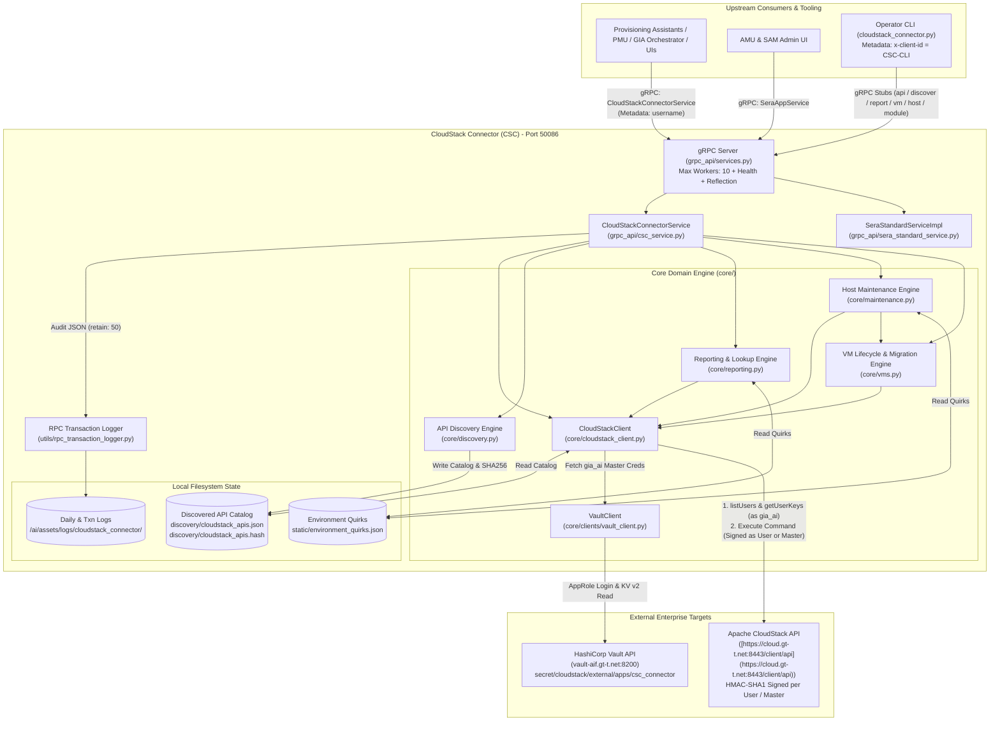
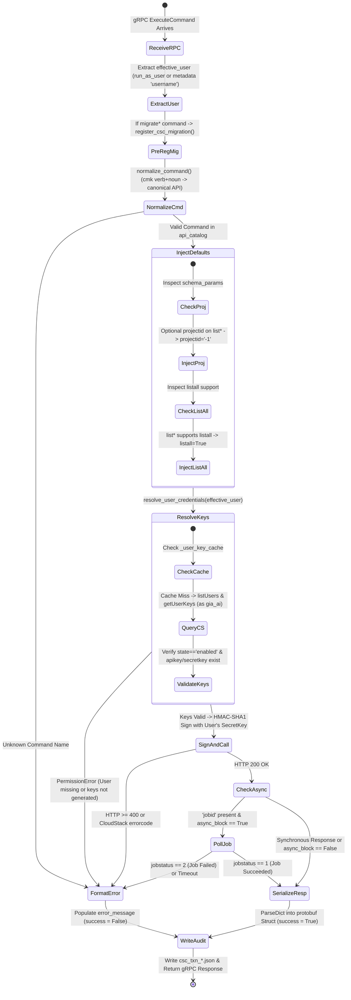

# CloudStack Connector (CSC) - Architecture & Design Document

**Doc_Type:** Architecture & Design
**Category:** (C) Connector
**Name:** CloudStack Connector
**Acronym:** CSC
**Version:** 0.1.5
**Date:** 2026-11-08
**Author:** Martin Kecka & Gemini AI
**Status:** Active

---

## 1. Introduction & Purpose 📜

The **CloudStack Connector (CSC)** is a deterministic, native gRPC gateway microservice within the SERA/GIA ecosystem (`config/settings.yaml` -> `module_info`). Acting as the single authoritative bridge to the enterprise Apache CloudStack API (`https://cloud.gt-t.net:8443/client/api`), CSC provides upstream applications, AI assistants, and orchestration services with a unified execution interface that enforces **strict per-user attribution, RBAC, and auditability**.

Unlike shared-account connectors where all actions execute under a single generic identity, CloudStack's permission model, project/account scoping, and internal action event logs are strictly bound to the cryptographic HMAC-SHA1 signature of the user's personal `apiKey` and `secretKey`. CSC solves this by utilizing a dedicated `gia_ai` master service account (stored in HashiCorp Vault at `secret/cloudstack/external/apps/csc_connector`) exclusively to look up the calling user's personal API and Secret keys via `listUsers` and `getUserKeys`, and then signs and executes every target CloudStack command directly under that user's identity.

Its core functional pillars include:

1. **Per-User API Key Attribution & Strict Guardrails (`core/cloudstack_client.py` -> `CloudStackClient.resolve_user_credentials()`):** Resolves incoming gRPC `username` metadata (or explicit `run_as_user` overrides) to the user's active CloudStack account and personal `apikey`/`secretkey`. If a user has not generated their API keys in CloudStack, CSC refuses execution with an actionable `PermissionError` instructing them to generate keys in the CloudStack Web UI first—never auto-creating keys for uninitialized users.
2. **Dual Native & CloudMonkey (`cmk`) Command Normalization (`core/discovery.py` & `CloudStackClient.normalize_command()`):** Introspects all 864 CloudStack commands via `listApis` into `discovery/cloudstack_apis.json`, allowing callers to invoke either native camelCase API commands (`listVirtualMachines`, `deployVirtualMachine`) or CloudMonkey-style `verb noun` commands (`list virtualmachines`, `deploy virtualmachine`) with inline `key=value` token parsing.
3. **Schema-Driven `projectid=-1` & `listall=True` Auto-Injection (`CloudStackClient.execute_command()` & `execute_master_command()`):** Automatically inspects the discovered parameter schema for every executed command and injects `projectid="-1"` and `listall=True` on project-capable `list*` queries whenever omitted by the caller, ensuring queries return resources across all enterprise projects (`SysEng`, `DevOps`, `Cyber Security`, `NMS`, `AI Factory`) rather than being locked to the empty root project context.
4. **Automatic `map`/`list` Parameter Serialization & Async Job Polling (`CloudStackClient._flatten_params()`, `_wait_for_async_job()`):** Flattens nested Python dictionaries and lists into CloudStack's indexed map query format (`details[0].cpuNumber=4`) and automatically polls `queryAsyncJobResult` until completion whenever `async_block=True` (with optional per-command `async_timeout` overrides).
5. **Master-Account Infrastructure Reporting & Concurrent Instance Lookup (`core/reporting.py` & `CloudStackClient.execute_master_command()`):** Provides read-only, cache-friendly gRPC reporting endpoints (`GetHealthReport`, `GetStorageReport`, `GetSystemVmsReport`, `GetCertsReport`) supporting comma-separated zone, cluster, and host filters, alongside concurrent multi-type VM instance resolution (`LookupVmInstances`) executed directly under the master `gia_ai` account without requiring caller user credentials.
6. **Quirk-Aware KVM Host Maintenance Orchestration & Live Progress Streaming (`core/maintenance.py`, `ManageHostMaintenance` & `WatchHostMaintenance`):** Orchestrates putting KVM hypervisors into or out of Maintenance with pre-flight `Real (Ops)` memory & CPU-group compatibility checks (`static/environment_quirks.json`), active `PrepareForMaintenance` state-machine monitoring with 20s heartbeats, 2-consecutive-failure circuit breakers, incoming/in-flight migration drain loops (`WAIT_MIGRATING`), post-evacuation VM crash auto-recovery (`VM_RECOVERY`), and strict post-validation.
7. **Fleet-Wide Stopped VM Bulk Start & Live Migration Tracking (`core/vms.py`, `ListStoppedVms`, `WatchStoppedVms`, `ListMigratingVms`):** Lists `Stopped` and `Starting` User VMs across all zones/projects with optional parallel bulk-start (`startVirtualMachine` with `considerlasthost=true` and live progress streaming), and tracks all in-flight `Migrating` VMs (User VMs, System VMs, Virtual Routers) with multi-signal source (`From Host`) and destination (`To Host`) hypervisor resolution.

---

## 2. Architecture & Ecosystem Integration 🏗️

CSC operates as a headless, multi-threaded Python gRPC server (`grpc_api/services.py` -> `serve()`) listening on `0.0.0.0:50086` with `max_workers=10`. It registers four gRPC services on the same port:
1. **`cloudstack_connector.CloudStackConnectorService`** (`grpc_api/csc_service.py`): Domain RPCs for per-user command execution, user key verification, live API discovery, schema introspection, infrastructure reporting, VM instance lookup, KVM host maintenance orchestration, stopped VM bulk start, and live migration tracking (`ExecuteCommand`, `ResolveUser`, `RunDiscovery`, `ListApis`, `GetApiSchema`, `GetHealthReport`, `GetStorageReport`, `GetSystemVmsReport`, `GetCertsReport`, `LookupVmInstances`, `ManageHostMaintenance`, `WatchHostMaintenance`, `ListStoppedVms`, `WatchStoppedVms`, `ListMigratingVms`).
2. **`sera.standard.SeraAppService`** (`grpc_api/sera_standard_service.py`): Universal SERA observability, deep health, changelog, and documentation contract.
3. **`grpc.health.v1.Health`**: Standard gRPC health checking protocol reporting `SERVING` for both `cloudstack_connector.CloudStackConnectorService` and `sera.standard.SeraAppService`.
4. **`grpc.reflection.v1alpha.ServerReflection`**: Live protobuf descriptor reflection enabling zero-proto `grpcurl` introspection and automated testing (`cli/commands/test_cmds.py`).

- **Upstream Callers (Inbound gRPC, Port `50086`):**
  * **Provisioning Assistants, Patch Management Utility (PMU), GIA Orchestrator & Ecosystem Microservices:** Invoke `CloudStackConnectorService` RPCs over `:50086`, passing caller attribution (`username` / `x-forwarded-user` and `client_application` / `x-client-id`) via gRPC invocation metadata.
  * **Application Management Utility (AMU) & Sera Admin Module (SAM):** Poll `SeraAppService` (`GetAppInfo`, `GetDeepHealth`, `GetChangelog`, `GetDocs`) to monitor `csc-grpc.service` status and verify TCP reachability to `vault-aif.gt-t.net:8200` (`vault-aif_api`) and `cloud.gt-t.net:8443` (`cloudstack_api_prod`).
  * **Operator / Developer CLI (`cloudstack_connector.py`):** Connects to `localhost:50086` via `MetadataClientInterceptor` (`cli/utils.py` -> `get_csc_stub()`, `get_sera_stub()`), routing all CLI commands (`api`, `discover`, `report`, `vm`, `host`, `module`) through the running gRPC service.
- **Downstream Targets (Outbound HTTPS REST):**
  * **HashiCorp Vault (`https://vault-aif.gt-t.net:8200`):** Authenticates via AppRole (`role_id` / `secret_id`) on startup to fetch the dedicated `gia_ai` master credentials from KV v2 mount `secret/cloudstack/external/apps/csc_connector` (`core/clients/vault_client.py` -> `VaultClient.get_cloudstack_credentials()`).
  * **Apache CloudStack Production API (`https://cloud.gt-t.net:8443/client/api`):** Executes HMAC-SHA1 signed `GET` requests over a persistent, proxy-isolated `requests.Session` (`session.trust_env = False`, `verify=False`, `timeout=60s`, `HTTPAdapter(pool_connections=32, pool_maxsize=32)`).



---

## 3. Module File Map 📂

```plaintext
/ai/cloudstack_connector
├── __init__.py                        # Package root marker
├── cloudstack_connector.py            # Main CLI & daemon entrypoint; runs bootstrap_helper, loads YAML config, initializes logging
├── bootstrap_helper.py                # Self-healing venv manager; installs requirements.txt and re-execs via os.execv
├── requirements.txt                   # Python dependencies (grpcio, grpcio-tools, grpcio-health-checking, grpcio-reflection, protobuf, requests, PyYAML, thefuzz, python-Levenshtein, click, hvac)
├── .gitignore                         # Git ignore rules for venv, cache, output, logs, and __pycache__
├── README.md                          # Repository overview and links to central SERA guides
├── cli/                               # Click-based Command Line Interface (gRPC client architecture)
│   ├── __init__.py                    # Package marker
│   ├── csc_cli.py                     # Root Click group (NestedHelpGroup); initializes gRPC stubs and registers api, discover, report, vm, host, module, clean, run-tests, start-grpc-server
│   ├── utils.py                       # MetadataClientInterceptor (unary-unary & unary-stream), ensure_stubs_path_in_sys, get_csc_stub, get_sera_stub, print_grpc_json, handle_grpc_errors
│   └── commands/                      # CLI subcommand modules
│       ├── __init__.py                # Package marker
│       ├── api_cmds.py                # 'api' group: exec (ExecuteCommand RPC), resolve-user (ResolveUser RPC)
│       ├── discover_cmds.py           # 'discover' group: init (RunDiscovery RPC), list (ListApis RPC), inspect (GetApiSchema RPC)
│       ├── report_cmds.py             # 'report' group: health (GetHealthReport RPC), storage (GetStorageReport RPC), systemvms (GetSystemVmsReport RPC), certs (GetCertsReport RPC)
│       ├── vm_cmds.py                 # 'vm' group: lookup (LookupVmInstances RPC), list_stopped / list-stopped (ListStoppedVms / WatchStoppedVms RPCs), migrating / list_migrating / list-migrating (ListMigratingVms RPC)
│       ├── host_cmds.py               # 'host' group: maintenance, maintenance-enable, maintenance-disable (ManageHostMaintenance / WatchHostMaintenance RPCs), comments (listAnnotations / removeAnnotation via ExecuteCommand RPC)
│       ├── module_cmds.py             # 'module' group: SERA Standard introspection commands (info, health)
│       └── test_cmds.py               # 'run-tests' command: automated 10-scenario grpcurl integration test suite
├── config/                            # Configuration files
│   └── settings.yaml                  # Master runtime configuration (system_services, external_services, vault_paths, discovery, logging, transaction_logging, paths)
├── core/                              # Core business logic and CloudStack / external clients
│   ├── __init__.py                    # Package marker
│   ├── clients/                       # External service clients
│   │   ├── __init__.py                # Package marker
│   │   └── vault_client.py            # VaultClient: AppRole authentication and KV v2 secret retrieval with in-memory caching
│   ├── cloudstack_client.py           # CloudStackClient: HMAC-SHA1 signer, user key resolver, cmk normalizer, projectid=-1 injector, async job poller, master command executor
│   ├── discovery.py                   # run_api_discovery, search_discovered_apis, get_api_schema_details, _split_verb_noun
│   ├── reporting.py                   # build_health_report, build_storage_report, build_systemvms_report, build_certs_report, lookup_vm_instances, load_environment_quirks
│   ├── maintenance.py                 # manage_host_maintenance: pre-flight Real (Ops) & quirk checks, native prepare/cancel maintenance, circuit-breaker fallback evacuation, incoming migration drain loop, post-evacuation VM crash auto-recovery, post-validation
│   └── vms.py                         # list_or_start_stopped_vms, list_migrating_vms, register_csc_migration, get_csc_migration, numeric host ID cache resolution
├── static/                            # Static environment metadata and hardware compatibility quirks
│   └── environment_quirks.json        # Cluster/host CPU migration compatibility groups (e.g. USDFW-LINUX 2100 MHz vs 2900 MHz split)
├── discovery/                         # Generated CloudStack API schema catalog
│   ├── cloudstack_apis.json           # Full parameter & verb/noun catalog of all 864 discovered CloudStack APIs
│   └── cloudstack_apis.hash           # 64-character SHA256 hex digest of the discovered catalog
├── docs/                              # Module documentation
│   ├── CHANGELOG.yaml                 # Structured release history parsed by SeraStandardServiceImpl and AMU
│   └── csc_design.md                  # Symlink to /ai/assets/guides/tool_guides/csc_design.md
├── grpc_api/                          # gRPC server and protobuf definitions
│   ├── __init__.py                    # Package marker
│   ├── generate_stubs.py              # Pre-flight mtime checker and grpc_tools.protoc compiler for csc_service.proto & sera_standard.proto
│   ├── services.py                    # Multi-servicer gRPC server bootstrapper (CloudStackConnectorService, SeraAppService, Health, ServerReflection)
│   ├── csc_service.py                 # CloudStackConnectorServiceServicer implementation with transaction audit logging and server-streaming workers
│   ├── sera_standard_service.py       # Standardized SERA v1.2-universal observability service implementation
│   └── protos/                        # Protocol Buffer contracts
│       └── csc_service.proto          # RPC definitions (ExecuteCommand, ResolveUser, RunDiscovery, ListApis, GetApiSchema, GetHealthReport, GetStorageReport, GetSystemVmsReport, GetCertsReport, LookupVmInstances, ManageHostMaintenance, WatchHostMaintenance, ListStoppedVms, WatchStoppedVms, ListMigratingVms)
└── utils/                             # Cross-cutting utilities
    ├── __init__.py                    # Package marker
    ├── logging_setup.py               # MultiProcessSafeDailyLogger (14-day retention) and server-vs-CLI console handler initialization
    └── rpc_transaction_logger.py      # Per-RPC JSON audit file writer (csc_txn_*.json) and sliding-window retention pruner
```

---

## 4. Core Processing Lifecycle ⚙️

### 4.1. Boot & Initialization Sequence

1. **Virtual Environment Self-Bootstrap (`cloudstack_connector.py` -> `bootstrap_helper.bootstrap_and_reexecute_if_needed()`):**
   * Checks if `/ai/cloudstack_connector/venv` and `venv/.installed` exist and whether `requirements.txt` has a newer modification timestamp (`needs_pip_install()`).
   * If missing or outdated, creates `venv`, upgrades `pip`, installs all packages from `requirements.txt`, writes `venv/.installed`, and re-executes the process inside the virtual environment via `os.execv`.
2. **Configuration & Mode-Aware Logging Initialization (`cloudstack_connector.py` -> `main()` & `utils/logging_setup.py` -> `setup_logging()`):**
   * Loads `config/settings.yaml` via `yaml.safe_load()`.
   * Configures the root logger (`logging.DEBUG`) guarded by `_LOGGING_CONFIGURED`:
     * **Console Handler (`StreamHandler(sys.stderr)`):** Inspects `sys.argv` for `'start-grpc-server'`. In server mode (`is_server_mode == True`), sets console output to `logging.level` (`INFO`); in CLI mode, clamps console output to `logging.WARNING` so CLI stdout remains clean.
     * **Daily Rotating File Handlers:** When `logging.enable_file_logging` is `true`, initializes two `MultiProcessSafeDailyLogger` handlers writing to `/ai/assets/logs/cloudstack_connector/csc.log.YYYY-MM-DD` (`DEBUG` level) and `csc_err.log.YYYY-MM-DD` (`WARNING` level) with `backup_count_days=14`.
     * **Noisy Logger Suppression:** Clamps `hpack`, `httpx`, `httpcore`, `urllib3`, `zeep`, and `requests` loggers to `logging.WARNING`.
3. **Dynamic Protobuf Stub Compilation (`cli/csc_cli.py` -> `serve_cmd()` -> `grpc_api/generate_stubs.py` -> `check_and_generate_stubs()`):**
   * Compares file modification times (`os.path.getmtime()`) of `grpc_api/protos/csc_service.proto` and `/ai/assets/protos/sera_standard/sera_standard.proto` against compiled targets `csc_service_pb2.py` and `sera_standard_pb2.py` in `/ai/assets/protos/cloudstack_connector/generated`.
   * If missing or outdated, creates `__init__.py` markers along the target path, compiles both `.proto` files via `grpc_tools.protoc.main()`, and returns `(True, True)`. When `regenerated == True`, `serve_cmd()` re-executes the Python process via `os.execv(sys.executable, [sys.executable, "-u"] + sys.argv)` to cleanly load the newly generated stubs.
4. **Servicer Initialization, Vault Auth & Startup Discovery (`grpc_api/services.py` -> `serve()`):**
   * Runs `cleanup_transactions(config)` (`utils/rpc_transaction_logger.py`) to prune `/ai/assets/logs/cloudstack_connector/transactions/` to `retain_count: 50`.
   * Instantiates `CloudStackConnectorService(config)` (`grpc_api/csc_service.py`), which initializes `self.cs_client = CloudStackClient(config)`:
     * Authenticates with HashiCorp Vault (`core/clients/vault_client.py` -> `VaultClient`) and caches the `gia_ai` master credentials (`url`, `username`, `apikey`, `secretkey`) in `CloudStackClient._cached_vault_creds`.
     * Loads `discovery/cloudstack_apis.json` into `self.api_catalog` and `self.lowercase_command_map`. If the file does not exist and `discovery.auto_discover_on_startup` is `true`, automatically executes `run_api_discovery(self.cs_client)`.
   * Registers `CloudStackConnectorService`, `SeraStandardServiceImpl`, `HealthServicer`, and `ServerReflection` on a `ThreadPoolExecutor(max_workers=10)` gRPC server bound to `0.0.0.0:50086`.

### 4.2. Inbound gRPC Command Execution Lifecycle (`ExecuteCommand`)

1. **Metadata & User Attribution (`grpc_api/csc_service.py` -> `CloudStackConnectorService.ExecuteCommand()`):**
   * Generates a `UUID4` `txn_id` and extracts `username` (checking `username` then `x-forwarded-user`) and `client_application` (checking `client_application` then `x-client-id`) from `context.invocation_metadata()`.
   * Determines `effective_user`: uses `request.run_as_user` if explicitly provided in the protobuf payload, otherwise falls back to the metadata `username`.
   * Checks `params_dict` for an optional `_async_block` override key; otherwise uses `bool(request.async_block)`.
2. **Pre-Migration Source/Destination Registration (`register_csc_migration()`):**
   * If `request.command` is `migrateVirtualMachine`, `migrateVirtualMachineWithVolume`, or `migrateSystemVm`, inspects the VM's current `hostid`/`hostname` and target `hostid` before execution and records the active migration in `_ACTIVE_CSC_MIGRATIONS` (`core/vms.py`) so concurrent `ListMigratingVms` calls retain exact `From Host` and `To Host` attribution even after CloudStack overwrites `vm.hostid`.
3. **Command Normalization & Schema Parameter Injection (`core/cloudstack_client.py` -> `CloudStackClient.execute_command()`):**
   * Calls `normalize_command(command)` to split inline `key=value` tokens and map `cmk`-style `verb noun` strings (e.g., `"list virtualmachines"`) or camelCase strings (`"listVirtualMachines"`) to the canonical CloudStack command name.
   * Checks `self.api_catalog[canonical_cmd]["params"]`:
     * Automatically injects `projectid="-1"` if `projectid` is supported, optional, and not already provided by the caller (for `list*` or `-1`-capable commands).
     * Automatically injects `listall=True` if `listall` is supported on a `list*` command and not already provided by the caller.
4. **Per-User Key Lookup & Validation (`CloudStackClient.resolve_user_credentials()`):**
   * Resolves `effective_user` against `CloudStackClient._user_key_cache` or queries CloudStack via `gia_ai` (`listUsers` + `getUserKeys`). Raises `PermissionError` if the user is missing, disabled, or lacks generated API keys.
5. **HMAC-SHA1 Signed Execution & Async Job Polling (`CloudStackClient._raw_call()`, `_wait_for_async_job()`):**
   * Flattens parameters (`_flatten_params()`), signs the sorted query string with the **acting user's `secretkey`** (`_sign_request()`), and executes `GET https://cloud.gt-t.net:8443/client/api?...`.
   * If the response contains `"jobid"` and `async_block == True`, enters `_wait_for_async_job()`, polling `queryAsyncJobResult(jobid=...)` every `2.0s` (using the user's keys) until `jobstatus == 1` (returns `jobresult`) or `jobstatus == 2` (raises `ValueError`).
6. **Protobuf Struct Serialization & Audit Logging:**
   * Populates `ExecuteCommandResponse` (`command`, `executed_as`, `account`, `job_id`, `response_data` via `ParseDict(..., Struct())`, `success = True`) and unconditionally writes `/ai/assets/logs/cloudstack_connector/transactions/csc_txn_<timestamp>Z.json`.



### 4.3. Master-Account Reporting & Instance Lookup Lifecycle (`GetHealthReport`, `GetStorageReport`, `GetSystemVmsReport`, `GetCertsReport`, `LookupVmInstances`)

1. **Zero-User Attribution & Master Credential Execution (`grpc_api/csc_service.py` & `core/cloudstack_client.py` -> `execute_master_command()`):**
   * Infrastructure reporting and VM lookup RPCs do not require a caller `username` in gRPC metadata. Instead, they invoke `self.cs_client.execute_master_command()`, which normalizes the command, injects `projectid="-1"` and `listall=True` where supported, and signs the request directly with `self.master_api_key` and `self.master_secret_key` (`gia_ai`).
2. **Decoupled Report Aggregation (`core/reporting.py`):**
   * **Cluster & Host Health (`build_health_report()`):** Supports comma-separated and exact-match-preferred filtering on `zone_name`, `cluster_name`, and `host_name` (UUID, FQDN, or short prefix). Queries `listClusters` (filtering out placeholder `hypervisortype == "None"` clusters unless explicitly requested), `listHosts(type="Routing")`, and spawns a 16-worker `ThreadPoolExecutor` to concurrently fetch per-cluster `listCapacity`, per-host running User VM counts (`listVirtualMachines` with `retrieveonlyresourcecount=true`), running System VMs (`listSystemVms`), running Virtual Routers (`listRouters`), and host annotations (`listAnnotations(entitytype="HOST", annotationfilter="all")`). Computes Memory (`type=0`), CPU (`type=1`), and CPU Core (`type=90`) capacities, per-cluster **Theoretical** and **Real (Ops)** KVM evacuation tolerance (`capacity.evacuation`), per-host and per-cluster VM counts, host comments (`comment_count`, `comments`), and per-host OS (`details["Host.OS"]`, `details["Host.OS.Version"]`) and Kernel (`details["Host.OS.Kernel.Version"]`) versions.
   * **Primary Storage Capacity (`build_storage_report()`):** Queries `listStoragePools`, separating shared (`CLUSTER`/`ZONE` scope) storage pools from host-local (`HOST` scope / `Filesystem`) storage pools and computing physical disk usage percentages and overprovision-adjusted allocation percentages grouped by Zone.
   * **System VMs & Virtual Routers (`build_systemvms_report()`):** Queries `listSystemVms`, `listRouters(projectid="-1", listall=True)`, and `listHosts` (correlating SecondaryStorageVM/ConsoleProxy host records by name to enrich each System VM with live `agent_state` and `agent_version`).
   * **KVM Host CA Certificates & Renewal Risk (`build_certs_report()`):** Supports comma-separated and exact-match-preferred filtering on `zone_name`, `cluster_name`, and `host_name`. Queries `listConfigurations(keyword="ca.")` (extracting `ca.framework.cert.validity.period`, `ca.framework.cert.expiry.alert.period`, and `ca.framework.background.task.delay`), `listHosts(type="Routing", listall=True)`, `listAlerts(type=31)` (`ALERT.CA.CERT`), and `listEvents(type="CA.CERTIFICATE.PROVISION")`. Correlates each host's annual certificate cycle, connection/resource state, `details["secured"]` flag, active vs. recovered auto-renewal failure alerts, and manual provisioning events to classify hosts into `RENEWAL_FAILED`, `AT_RISK`, `IN_RENEWAL_WINDOW`, `RECENTLY_RENEWED`, or `HEALTHY`.
   * **Multi-Tier VM Instance Lookup (`lookup_vm_instances()`):** Spawns an 8-worker `ThreadPoolExecutor` over the requested instance names, querying `listVirtualMachines(keyword=..., projectid="-1", listall=True)` first (matching `instancename`, `name`, `displayname`, or `id` and extracting affinity groups and all primary/secondary NIC IPs), falling back to `listSystemVms`, and finally `listRouters` so user VMs (`i-x-y-VM`), system VMs (`s-x-VM`, `v-x-VM`), and routers (`r-x-VM`) resolve in a single RPC call.
3. **Summary Audit Logging:**
   * Serializes the structured `zones` / `results` and `summary` dicts into `google.protobuf.Struct` messages and records a compact summary transaction log (`csc_txn_*.json`) attributed to `gia_ai`.

### 4.4. KVM Host Maintenance Orchestration Lifecycle (`ManageHostMaintenance` & `WatchHostMaintenance`)

1. **Target Resolution & Pre-Flight Safety Check (`core/maintenance.py` -> `manage_host_maintenance()`):**
   * Resolves the target KVM host by UUID, full FQDN, or unique short prefix (`_resolve_target_host()`), fetches all cluster hosts (`listHosts(type="Routing", clusterid=...)`), and retrieves the live VM inventory (`Running`, `Migrating`, `Starting`, `Stopping`) on the target host (`_fetch_host_running_inventory()`).
   * Consults `static/environment_quirks.json` (`_find_compatible_group_hosts()`). If the host belongs to a hardware compatibility subgroup (e.g., `USDFW-LINUX` `usdfw_linux_2100mhz` vs. `usdfw_linux_2900mhz`), restricts surviving candidate destination hosts to `Up + Enabled` hosts within that exact CPU group.
   * Computes `surviving_free_mem` across compatible `Up + Enabled` hosts (`surviving_total_mem - surviving_alloc_mem`) and verifies `surviving_free_mem >= target_mem_alloc` (and `>= 1` surviving compatible host). Refuses execution with `method_used = "aborted_by_preflight"` unless `--force` is passed.
2. **Quirk Cluster Pre-Evacuation & Circuit Breaker (`Step 1` -> `QUIRK_EVAC`):**
   * When `requires_manual_vm_evacuation == True` in `static/environment_quirks.json` and the host has running VMs, if the host is currently locked in `PrepareForMaintenance` or `ErrorInPrepareForMaintenance`, calls `cancelHostMaintenance` first to unlock VMs, and then runs `_evacuate_host_vms_manually()` to migrate all System VMs, Virtual Routers, and User VMs onto compatible CPU-group hosts **before** calling `prepareHostForMaintenance`.
   * If `_evacuate_host_vms_manually()` hits 2 consecutive VM migration failures (circuit breaker) and VMs remain on the host in a quirk cluster, sets `quirk_aborted = True` and skips `Step 2` and `Step 3` to prevent CloudStack from attempting incompatible cross-CPU-group migrations.
3. **Native `prepareHostForMaintenance` & Asynchronous Background Monitoring (`Step 2` -> `_monitor_native_prepare_for_maintenance()`):**
   * Invokes `prepareHostForMaintenance` with a fast `PREPARE_ASYNC_JOB_TIMEOUT_SECONDS` (`60s`) timeout so that if CloudStack's Management Server queues concurrent `PrepareForHostMaintenanceCmd` jobs and leaves the second job pending (`jobstatus=0`, `resourcestate=Enabled`), CSC falls back to manual evacuation after 60s instead of blocking for 1800s.
   * Enters an active 5-second monitoring loop (`_monitor_native_prepare_for_maintenance()`):
     * Streams `[MONITOR_PREPARE]` progress events immediately on VM count/state changes and every `20s` as a periodic heartbeat (listing remaining VM instance names or reporting `All VMs evacuated from '<host>' (0 VMs remaining); waiting for CloudStack to finalize 'PrepareForMaintenance' -> 'Maintenance'`).
     * Immediately succeeds if `resourcestate == "Maintenance"`.
     * Immediately breaks out to Step 3 Fallback if CloudStack transitions the host to `resourcestate == "ErrorInPrepareForMaintenance"`, or if the remaining VM count on the source host fails to decrease for `NATIVE_PREPARE_STALL_SECONDS` (`180s`).
4. **Unlock, Circuit-Breaker Manual Evacuation & Incoming Migration Drain Loop (`Step 3` -> `_evacuate_host_vms_manually()` & `WAIT_MIGRATING`):**
   * Enters a wait-and-drain loop (bounded by `INCOMING_MIGRATION_MAX_WAIT_SECONDS = 1800s`):
     * If `resourcestate` is `ErrorInPrepareForMaintenance` or `PrepareForMaintenance` with VMs still on the host, calls `cancelHostMaintenance` to unlock the VMs (`FALLBACK_CANCEL`).
     * Evacuates appliances in order: **System VMs (`migrateSystemVm`) -> Virtual Routers (`migrateSystemVm`) -> User VMs (`migrateVirtualMachine` or `migrateVirtualMachineWithVolume`)**, sorting `Running` VMs ahead of `Migrating`/`Starting` VMs (and largest memory first) so active VMs evacuate without waiting on in-flight migrations.
     * Pre-registers each migration in memory via `register_csc_migration()`, checks live `state` and `hostid` via `_wait_for_vm_if_migrating()`, enforces `PER_VM_MIGRATION_TIMEOUT_SECONDS` (`300s`), and aborts immediately if **2 consecutive VM migrations fail** (circuit breaker for wedged `cloudstack-agent` threads).
     * If `0` `Running` VMs remain on the host but in-flight `Migrating`/`Starting`/`Stopping` VMs exist (e.g., an incoming Cluster DRS migration), emits `[WAIT_MIGRATING]` every 20s until the in-flight migration finishes, evacuates any newly arrived `Running` VMs off the target host, and then finalizes `prepareHostForMaintenance` (with a 15-second settle check if `ErrorInPrepareForMaintenance` occurs with `0` VMs remaining, and automatic handling of `"already in state PrepareForMaintenance"`).
5. **Post-Validation, Ghost `Migrating` DB Quirk & Post-Evacuation VM Crash Auto-Recovery (`Step 4` & `Step 4B`):**
   * Verifies `final_rstate == "Maintenance"` and checks remaining VMs on `host_id` (marking `PASSED (WITH WARNING)` if only ghost `Migrating` DB entries remain).
   * **Post-Evacuation VM Crash Check & Auto-Recovery (`Step 4B` / `VM_RECOVERY`):** Queries the live state of all User VMs and Virtual Routers that were initially running on the host prior to maintenance. If any evacuated VM or Virtual Router dropped into `Stopped` or `Error` state during QEMU handoff (when CloudStack transitions `Migrating` -> `Stopped` without triggering HA), CSC automatically calls `startVirtualMachine` / `startRouter` to recover it and records the result in `validation.recovered_vms` (while allowing large-RAM VMs still finalizing `state == "Migrating"` on destination hosts to continue without blocking host maintenance).

### 4.5. Stopped VM Bulk Start & Live Migration Tracking Lifecycle (`ListStoppedVms`, `WatchStoppedVms`, `ListMigratingVms`)

1. **Stopped & Starting VM Discovery & Parallel Bulk Start (`core/vms.py` -> `list_or_start_stopped_vms()`):**
   * Resolves optional `location` (zone name, UUID, or domain substring) and `project` filters, then queries `listVirtualMachines` across all projects (`projectid="-1"`, `listall="true"`) for both `state="Stopped"` and `state="Starting"`.
   * Aggregates total stopped/starting vCPUs and GiB RAM alongside `by_zone` and `by_project` breakdowns, marking any VM already in `Starting` state as `SKIPPED_STARTING`.
   * When `start_vms=True`, executes a two-phase parallel bulk start using a `ThreadPoolExecutor(max_workers=min(workers, 32))`:
     * **Phase 1 (Non-Blocking Dispatch):** Submits `startVirtualMachine(id=..., considerlasthost="true"|"false")` via `client._raw_call()` for all `Stopped` VMs concurrently, capturing each returned async `jobid` and streaming `[QUEUED]` events over `WatchStoppedVms`.
     * **Phase 2 (Parallel Async Job Polling):** Polls `queryAsyncJobResult` concurrently across all pending `jobid`s every `2.0s` (up to `1800s`), streaming `[STARTED]` (with destination `started_on_host`) or `[FAILED]` events as each VM finishes booting.
2. **Fleet-Wide Live Migration Tracking & Source/Destination Host Resolution (`core/vms.py` -> `list_migrating_vms()`):**
   * Queries `listVirtualMachines(state="Migrating")`, `listSystemVms(state="Migrating")`, and `listRouters(state="Migrating")` across all matching zones and projects, plus `listClusterDrsPlan(page=1, pagesize=15)` and `listHosts(type="Routing")`.
   * Spawns a `ThreadPoolExecutor(max_workers=16)` to enrich each migrating appliance concurrently, resolving `source_host_name` (`From Host`), `destination_host_name` (`To Host`), `elapsed_human`, and `migration_type` using a 6-tier priority cascade:
     1. **Priority 0 — CSC In-Memory Migration Registry (`get_csc_migration()`):** Exact source, destination, and trigger recorded by CSC prior to `FALLBACK_EVAC`, `QUIRK_EVAC`, or `ExecuteCommand` migration calls.
     2. **Priority 1 — `VM.MIGRATE` Event Correlation (`listEvents`):** Queries `listEvents(resourceid=..., resourcetype="VirtualMachine", type="VM.MIGRATE")` without pagination truncation, sorts descending by `created`, extracts `"to host Id: <dest_id>"` via `_resolve_host_identifier()` (resolving both UUIDs and internal numeric DB host IDs via `_NUMERIC_ID_Cache`), and correlates the most recent prior `Completed` `VM.MIGRATE` event when `lasthostid` is empty.
     3. **Priority 2 — Cluster DRS Plan Correlation (`listClusterDrsPlan`):** Matches `sourcehostname` and `destinationhostname` from active Cluster DRS plans (`migration_type = "Cluster DRS"`).
     4. **Priority 3 — VM `lasthostname` vs. `hostname`:** Uses `lasthostname` as source and `hostname` as destination when both are populated and differ.
     5. **Priority 4 & 5 — Cluster Host Maintenance Correlation:** Checks if a host in the same cluster (or the VM's current host) is in `PrepareForMaintenance` or `ErrorInPrepareForMaintenance` (`migration_type = "Host Maintenance"`).

---

## 5. Detailed Business Logic, Rules & HITL 🧠

### 5.1. Per-User Credential Resolution & Strict Key Guardrail (`core/cloudstack_client.py` -> `CloudStackClient.resolve_user_credentials()`)

* **Trigger Condition & Priority:** Executed prior to every `execute_command()` call and directly via the `ResolveUser` RPC.
* **Step-by-Step Resolution Cascade:**
  1. **Username Normalization:** Strips any AD domain prefix (`DOMAIN\user` -> `user`) and email domain suffix (`user@gtt.net` -> `user`), converting to lowercase `clean_user_lower` for cache indexing.
  2. **Master System Bypass:** If `clean_user_lower == self.master_username.lower()` (`"gia_ai"`), returns the Vault-loaded master credentials immediately.
  3. **Thread-Safe In-Memory Cache Lookup:** Acquires `CloudStackClient._lock` (`threading.Lock()`). If `force_refresh == False` and `clean_user_lower in self._user_key_cache`, returns the cached user context dictionary immediately without network I/O.
  4. **Tier 1 — Exact `username` Lookup (`listUsers`):** Calls `_raw_call("listUsers", {"listall": True, "username": clean_user}, self.master_api_key, self.master_secret_key)`.
  5. **Tier 2 — Keyword & Corporate Email Fallback:** If Tier 1 returns empty (e.g., for users whose CloudStack username is `firstname.lastname` rather than their AD `sAMAccountName`), calls `listUsers(listall=True, keyword=clean_user)` and filters candidates where `username.lower() == clean_user_lower` or `email.lower() == f"{clean_user_lower}@gtt.net"`. If still empty, raises `PermissionError("User '<clean_user>' does not have an account in CloudStack...")`.
  6. **Multi-Account Prioritization & State Check:** Filters for `state.lower() == "enabled"`. If a user owns multiple CloudStack accounts (e.g., both an admin `sAMAccountName` account and a secondary project account), sorts candidates descending by `(username.lower() == clean_user_lower, bool(apikey), roletype == "Admin")` and selects `enabled_users[0]`.
  7. **Personal Key Retrieval & Strict Guardrail (`getUserKeys`):** Calls `_raw_call("getUserKeys", {"id": user_id}, self.master_api_key, self.master_secret_key)`. If either `apikey` or `secretkey` is absent/empty, **strictly refuses to auto-generate keys** and raises:
     `PermissionError("CloudStack user '<cs_username>' ... does not have API keys generated in CloudStack. Please log into the CloudStack Web UI (https://cloud.gt-t.net) -> Accounts -> Users -> '<cs_username>' and click 'Generate Keys' to enable API access for your account.")`

### 5.2. CloudStack HMAC-SHA1 Request Signing & Parameter Flattening (`core/cloudstack_client.py`)

* **Nested Parameter Flattening (`CloudStackClient._flatten_params()`):**
  * **Booleans:** Converted to lowercase `"true"` or `"false"`.
  * **Integer-Valued Floats:** Since Protobuf `google.protobuf.Struct` serializes all JSON numbers as `float` (e.g., `page=1.0`), any `float` where `value.is_integer()` is `True` is coerced back to `str(int(value))` (`"1"`) so CloudStack integer parsers do not reject it.
  * **Dictionaries (`map` parameters):** Flattened into CloudStack's indexed map notation `f"{key}[0].{sub_k}" = str(sub_v)` (or `f"{key}[{idx}].{inner_k}"` for nested dicts).
  * **Lists (`list` or `map` lists):** Lists of dictionaries (e.g., `iptonetworklist` or `nicnetworklist`) are flattened to `f"{key}[{idx}].{sub_k}" = str(sub_v)`; lists of primitives are joined with commas (`","`).
* **Cryptographic Signature Generation (`CloudStackClient._sign_request()`):**
  * Sorts all parameter `(key, value)` pairs alphabetically by `key`.
  * URL-encodes each key and value via `urllib.parse.quote_plus(str(val).encode('utf-8')).replace('+', '%20')` and joins them with `"&"`.
  * Computes the HMAC-SHA1 digest over `query_string.lower().encode('utf-8')` using `secret_key.encode('utf-8')`, Base64-encodes the digest, and URL-encodes the final `signature` parameter:
    $$\text{signature} = \text{quote\_plus}\!\left(\text{Base64}\!\left(\text{HMAC-SHA1}\!\left(\text{secretKey},\, \text{lowercase}(\text{sorted\_query\_string})\right)\right)\right)$$

### 5.3. API Catalog Discovery & `cmk` Command Normalization (`core/discovery.py` & `core/cloudstack_client.py`)

* **Discovery Engine (`core/discovery.py` -> `run_api_discovery()`):**
  * Invokes `client.fetch_all_apis_with_master()` (`listApis`) and iterates over all 864 returned API definitions.
  * Splits each camelCase API name against the 46-verb tuple `VERBS` (`_split_verb_noun()`)—matching the longest prefix where the immediately following character is uppercase (e.g., `deployVirtualMachine` -> `verb="deploy"`, `noun="virtualmachine"`, `cmk_command="deploy virtualmachine"`).
  * Extracts `params` (`name`, `type`, `required`, `description`, `related`) and `required_params`, computes the SHA256 digest (`hashlib.sha256(canonical_json).hexdigest()`), writes `discovery/cloudstack_apis.json` and `discovery/cloudstack_apis.hash`, and triggers `client.reload_schema()`.
* **Command Normalization & Plural/Singular Self-Healing (`CloudStackClient.normalize_command()`):**
  * Splits the raw command string on whitespace, extracting any inline `key=value` tokens into `inline_params` and concatenating the remaining command words into `candidate`.
  * Resolves `candidate.lower()` against `self.lowercase_command_map` (`O(1)` lookup), with automatic singular/plural fallback (`candidate_lower[:-1]` and `candidate_lower + 's'`) so both `"deploy virtualmachine"` and `"deploy virtualmachines"` resolve cleanly to `"deployVirtualMachine"`.

### 5.4. Infrastructure Reporting & Multi-Tier VM Instance Resolution (`core/reporting.py`)

* **Decoupled Four-Report Design for Upstream Caching:**
  * Rather than bundling compute, storage, System VM, and CA certificate queries into a single monolithic call, CSC exposes four independent RPCs (`GetHealthReport`, `GetStorageReport`, `GetSystemVmsReport`, `GetCertsReport`). This allows upstream FastAPI/React dashboards and caching workers to refresh Redis cache keys independently at different TTLs while keeping individual RPC latencies low.
* **KVM Host CA Certificate Expiry & Risk Classification (`build_certs_report()`):**
  * Combines `ca.framework.cert.validity.period` (`365` days) and `ca.framework.cert.expiry.alert.period` (`15` days) with each host's `created` anniversary date, `ALERT.CA.CERT` (`type=31`) alert history, and `CA.CERTIFICATE.PROVISION` events to classify every KVM host before certificates expire and break agent TLS handshakes.
* **Host OS & Kernel Extraction (`build_health_report()`):**
  * Extracts `Host.OS`, `Host.OS.Version`, and `Host.OS.Kernel.Version` directly from the `details` map returned by `listHosts(type="Routing")`, eliminating N+1 per-host `listHosts(id=...)` subprocess calls.
* **Overprovision-Aware Storage Allocation (`build_storage_report()`):**
  * Computes physical usage percentage as `(disksizeused / disksizetotal) * 100` and effective allocation percentage as `(disksizeallocated / (disksizetotal * overprovisionfactor)) * 100`.
* **Three-Tier Instance Lookup Cascade (`lookup_vm_instances()`):**
  * For each unique query string in `instance_names`:
    1. **Tier 1 (User VMs):** Calls `listVirtualMachines(keyword=inst_name, projectid="-1", listall=True)` and verifies an exact case-insensitive match on `instancename`, `name`, or `id`.
    2. **Tier 2 (System VMs):** If not found as a User VM, calls `listSystemVms(name=inst_name)` (with `keyword` fallback) to match `s-x-VM` or `v-x-VM` appliances.
    3. **Tier 3 (Virtual Routers):** If still not found, calls `listRouters(name=inst_name, projectid="-1", listall=True)` to match `r-x-VM` appliances.

### 5.5. HITL & Learning Loops

* **Headless Operation:** Interactive Human-in-the-Loop (HITL) intervention is not applicable directly within CSC, as it operates as a deterministic headless backend connector.
* **Actionable Self-Service Guardrails:** When a user without generated CloudStack API keys invokes an operation through an upstream AI Assistant or CLI, CSC returns the exact UI navigation path (`Accounts -> Users -> <username> -> Generate Keys`) so the user can self-enable their account without administrator intervention.

---

## 6. AI, LLM & Machine Learning Execution 🤖

*Not applicable for this module.* CSC is a strictly deterministic gRPC/REST execution gateway and does not host or invoke LLM or machine learning models internally.

---

## 7. Data Models, State, Storage & Auditing 🗄️

### 7.1. Database Schemas

*Not applicable for this module.* CSC is stateless with respect to relational or vector databases (PostgreSQL/ChromaDB) and persists all discovered API schemas and RPC transaction audits on the local filesystem.

### 7.2. State Enumerations

* **CloudStack Async Job States (`core/cloudstack_client.py` -> `_wait_for_async_job()`):**
  * `0`: Job Pending / In Progress (continues polling every `async_poll_interval_seconds`).
  * `1`: Job Succeeded (returns `res["jobresult"]`).
  * `2`: Job Failed (extracts `errorcode` and `errortext` from `jobresult` and raises `ValueError`).
* **SERA Deep Health Statuses (`grpc_api/sera_standard_service.py` -> `GetDeepHealth()`):**
  * Overall Status: `'HEALTHY'`, `'DEGRADED'`, `'DOWN'`.
  * Dependency Probe Status: `'OK'`, `'DOWN'`, `'UNKNOWN'`.
  * Systemd Service Status: `'running'`, `'stopped'`, `'unknown'`.

### 7.3. In-Memory Caching & Thread Safety

- **Class-Level Vault Master Credentials Cache (`CloudStackClient._cached_vault_creds`):** Protected by `CloudStackClient._lock` (`threading.Lock()`). Caches the `gia_ai` secret dictionary (`url`, `username`, `apikey`, `secretkey`) across `CloudStackClient` instances.
- **Class-Level User Key Cache (`CloudStackClient._user_key_cache`):** Dictionary keyed by `clean_user_lower` caching resolved user metadata and personal `apikey`/`secretkey` pairs in memory (`threading.Lock()` protected). Can be bypassed per-request via `force_refresh=True` (`api resolve-user <user> --refresh`).
- **Active CSC Migration Registry (`core/vms.py` -> `_ACTIVE_CSC_MIGRATIONS`):** In-memory dictionary mapping `vm_id` (or `instance_name`) to `{source_host_id, source_host_name, destination_host_id, destination_host_name, initiated_by, trigger, ts}` with automatic 2-hour (`7200s`) TTL expiration. Populated by `register_csc_migration()` before `ExecuteCommand` and `_evacuate_host_vms_manually()` dispatch migration calls so `ListMigratingVms` always resolves `From Host` even when CloudStack overwrites `vm.hostid` and leaves `lasthostid` empty.
- **Numeric Host DB ID Cache (`core/vms.py` -> `_NUMERIC_ID_Cache`):** Caches mappings from CloudStack internal numeric database host IDs (e.g., `"533"` emitted in `VM.MIGRATE` event descriptions) to `{id: <uuid>, name: <hostname>}`, populated via `listHosts(id=<numeric_id>)` and fallback scanning of `MAINT.PREPARE`, `MAINT.CANCEL`, `CA.CERTIFICATE.PROVISION` events and type `7`/`31` alerts.
- **Intentional Exclusion of Resource/VM Caching:** Live CloudStack infrastructure objects (e.g., `listVirtualMachines`) are intentionally not cached in CSC because CloudStack's API does not support delta `lastupdated` filtering, VM power states (`Running`/`Stopped`/`Migrating`) change dynamically, and visibility is strictly scoped per user's CloudStack account/role.

### 7.4. File System Storage & Auditing

| File / Directory Path | Producer | Retention / Lifecycle | Purpose & Structure |
| :--- | :--- | :--- | :--- |
| `static/environment_quirks.json` | Static repository configuration (`load_environment_quirks()`) | Version-controlled | Documents cluster hardware/CPU migration compatibility subgroups (`USDFW-LINUX` `usdfw_linux_2100mhz` vs. `usdfw_linux_2900mhz`) requiring manual VM pre-evacuation prior to native host maintenance. |
| `discovery/cloudstack_apis.json` | `run_api_discovery()` (`core/discovery.py`) | Regenerated on `discover init` or missing startup file | Full catalog of all 864 CloudStack APIs (`discovered_at_utc`, `total_apis`, `schema_hash`, `apis`). |
| `discovery/cloudstack_apis.hash` | `run_api_discovery()` (`core/discovery.py`) | Updated alongside `cloudstack_apis.json` | 64-character SHA256 hex digest of the canonical API catalog JSON. |
| `/ai/assets/logs/cloudstack_connector/csc.log.YYYY-MM-DD` | `MultiProcessSafeDailyLogger` (`utils/logging_setup.py`) | 14 days (`backup_count_days: 14`) | Daily rotating application and debug log. |
| `/ai/assets/logs/cloudstack_connector/csc_err.log.YYYY-MM-DD` | `MultiProcessSafeDailyLogger` (`utils/logging_setup.py`) | 14 days (`backup_count_days: 14`) | Daily rotating `WARNING` and `ERROR` log. |
| `/ai/assets/logs/cloudstack_connector/transactions/csc_txn_*.json` | `log_transaction()` (`utils/rpc_transaction_logger.py`) | Sliding window of `50` files (`retain_count: 50`) | Per-RPC JSON audit trail containing `transaction_id`, `client_application`, `username`, `timestamp_utc`, `rpc_method`, `success`, `request_payload`, `response_data`, and `error_message`. |

---

## 8. APIs, Observability & Communication Contracts 📡

### 8.1. Inbound Domain gRPC API (`cloudstack_connector.CloudStackConnectorService`)

Defined in `grpc_api/protos/csc_service.proto` and implemented in `grpc_api/csc_service.py` -> `CloudStackConnectorService` (Port `50086`):

| RPC Method | Request Message | Response Message | Operational Description |
| :--- | :--- | :--- | :--- |
| **`ExecuteCommand`** | `ExecuteCommandRequest` (`command`, `Struct params`, `async_block`, `run_as_user`) | `ExecuteCommandResponse` (`success`, `error_message`, `command`, `executed_as`, `account`, `job_id`, `Struct response_data`) | Normalizes native or `cmk` command, auto-injects `projectid=-1` & `listall=True` when supported, pre-registers `migrate*` calls in `_ACTIVE_CSC_MIGRATIONS`, resolves user keys, signs and executes request, and polls async job if `async_block=True`. |
| **`ResolveUser`** | `ResolveUserRequest` (`username`, `force_refresh`) | `ResolveUserResponse` (`success`, `error_message`, `username`, `user_id`, `account`, `domain`, `rolename`, `roletype`, `email`, `has_valid_keys`) | Verifies that a user exists in CloudStack, is `enabled`, and has generated valid API/Secret keys (never exposes raw keys in response or transaction logs). |
| **`RunDiscovery`** | `RunDiscoveryRequest` (Empty) | `RunDiscoveryResponse` (`success`, `error_message`, `total_apis`, `schema_hash`, `discovered_at_utc`) | Queries CloudStack `listApis` via `gia_ai`, regenerates `discovery/cloudstack_apis.json` and `.hash`, and reloads the in-memory schema catalog. |
| **`ListApis`** | `ListApisRequest` (`keyword`, `verb`) | `ListApisResponse` (`success`, `error_message`, `count`, `repeated Struct apis`) | Searches the local discovered API catalog by substring `keyword` and/or command `verb` (`list`, `deploy`, `create`, etc.). |
| **`GetApiSchema`** | `GetApiSchemaRequest` (`command`) | `GetApiSchemaResponse` (`success`, `error_message`, `Struct schema`) | Returns the full parameter specification, types, descriptions, and `required_params` for a specific CloudStack command. |
| **`GetHealthReport`** | `HealthReportRequest` (`zone_name`, `cluster_name`, `host_name`) | `HealthReportResponse` (`success`, `error_message`, `generated_at_utc`, `repeated Struct zones`, `Struct summary`) | Executes under master `gia_ai` account to return structured Zone -> Cluster (CPU, Memory, Cores capacity, Real/Theoretical evacuation headroom) -> Hypervisor Host health, VM counts, host comments (`listAnnotations`), and OS/Kernel versions. |
| **`GetStorageReport`** | `StorageReportRequest` (`zone_name`, `cluster_name`) | `StorageReportResponse` (`success`, `error_message`, `generated_at_utc`, `repeated Struct zones`, `Struct summary`) | Executes under master `gia_ai` account to return structured Primary Storage Pool capacity, usage, overprovisioned allocation, and state grouped by Zone (separating shared cluster/zone pools from host-local pools). |
| **`GetSystemVmsReport`** | `SystemVmsReportRequest` (`zone_name`) | `SystemVmsReportResponse` (`success`, `error_message`, `generated_at_utc`, `repeated Struct zones`, `Struct summary`) | Executes under master `gia_ai` account to return System VMs (`SSVM`/`CPVM` with live agent state & version) and Virtual Routers health grouped by Zone. |
| **`GetCertsReport`** | `CertsReportRequest` (`zone_name`, `cluster_name`, `host_name`) | `CertsReportResponse` (`success`, `error_message`, `generated_at_utc`, `repeated Struct zones`, `Struct summary`) | Executes under master `gia_ai` account to audit KVM host CA certificate renewal cycles, `ALERT.CA.CERT` failures, `CA.CERTIFICATE.PROVISION` events, and disconnected/maintenance renewal risks. |
| **`LookupVmInstances`** | `LookupVmInstancesRequest` (`repeated string instance_names`) | `LookupVmInstancesResponse` (`success`, `error_message`, `found_count`, `not_found_count`, `repeated Struct results`) | Concurrently resolves internal CloudStack instance names (`i-x-y-VM`, `s-x-VM`, `r-x-VM`) or VM names across User VMs, System VMs, and Virtual Routers. |
| **`ManageHostMaintenance`** | `HostMaintenanceRequest` (`target_host`, `action`, `force`, `run_as_user`) | `HostMaintenanceResponse` (`success`, `error_message`, `action`, `host_id`, `host_name`, `cluster_name`, `zone_name`, `executed_as`, `account`, `method_used`, `initial_state`, `initial_resource_state`, `final_state`, `final_resource_state`, `Struct preflight`, `repeated Struct migrations`, `Struct validation`) | Unary RPC that puts a KVM host into Maintenance (`enable`) or cancels Maintenance (`disable`) with pre-flight Real (Ops) memory & CPU-group quirk checks, active `PrepareForMaintenance` monitoring, circuit-breaker fallback evacuation, incoming migration drain loop, post-evacuation VM crash auto-recovery, and post-validation. |
| **`WatchHostMaintenance`** | `HostMaintenanceRequest` (`target_host`, `action`, `force`, `run_as_user`) | `stream HostMaintenanceEvent` (`timestamp_utc`, `stage`, `level`, `message`, `host_state`, `resource_state`, `remaining_vms`, `migrating_vms`, `is_final`, `HostMaintenanceResponse final_response`) | Server-streaming RPC that executes `manage_host_maintenance()` on a background worker thread and streams real-time stage/progress events followed by a final `is_final=True` message carrying `final_response`. |
| **`ListStoppedVms`** | `StoppedVmsRequest` (`location`, `project`, `start_vms`, `consider_last_host`, `workers`, `run_as_user`) | `StoppedVmsResponse` (`success`, `error_message`, `executed_as`, `account`, `location_filter`, `project_filter`, `stopped_count`, `total_stopped_vcpus`, `total_stopped_memory_gib`, `Struct by_zone`, `Struct by_project`, `start_requested`, `consider_last_host`, `started_count`, `repeated Struct started_vms`, `repeated Struct start_errors`, `repeated Struct virtual_machines`) | Unary RPC that lists all `Stopped` and `Starting` User VMs across CloudStack projects (filtered by `location` and `project`) and optionally bulk-starts all `Stopped` VMs in parallel (`considerlasthost=true`). |
| **`WatchStoppedVms`** | `StoppedVmsRequest` (`location`, `project`, `start_vms`, `consider_last_host`, `workers`, `run_as_user`) | `stream StoppedVmsEvent` (`timestamp_utc`, `stage`, `level`, `message`, `completed_count`, `total_count`, `vm_name`, `instance_name`, `host_name`, `is_final`, `StoppedVmsResponse final_response`) | Server-streaming RPC that executes `list_or_start_stopped_vms()` on a background worker thread and streams live `BULK_DISPATCH`, `QUEUED`, `STARTED`, `FAILED`, and `COMPLETE` progress events. |
| **`ListMigratingVms`** | `MigratingVmsRequest` (`location`, `project`) | `MigratingVmsResponse` (`success`, `error_message`, `generated_at_utc`, `location_filter`, `project_filter`, `migrating_count`, `user_vm_count`, `system_vm_count`, `router_count`, `total_migrating_vcpus`, `total_migrating_memory_gib`, `Struct by_zone`, `Struct by_project`, `Struct by_cluster`, `repeated Struct virtual_machines`) | Unary RPC that lists all currently migrating VMs (`UserVM`, `SystemVM`, `VirtualRouter`) across CloudStack and resolves their source (`From Host`), destination (`To Host`), elapsed duration, and migration trigger. |

### 8.2. Universal SERA Standard Contract (`SeraAppService`)

CSC exposes the universal `sera.standard.SeraAppService` gRPC contract (`GetAppInfo`, `GetDeepHealth`, `GetFeedback`, `GetChangelog`, `GetDocs`) via `grpc_api/sera_standard_service.py` -> `SeraStandardServiceImpl`—centrally maintained and deployed by the Application Management Utility (`amu_design.md`)—for SAM UI and AMU telemetry integration, alongside standard `grpc.health.v1.Health` and `grpc.reflection.v1alpha.ServerReflection` services (`grpc_api/services.py`).

### 8.3. Outbound Client Contracts

| Target System | Client Class / Method | Protocol & Endpoint | Timeout & Security / Headers |
| :--- | :--- | :--- | :--- |
| **HashiCorp Vault API** | `core/clients/vault_client.py` -> `VaultClient` | HTTPS REST (`https://vault-aif.gt-t.net:8200`) | AppRole login (`client.auth.approle.login`), KV v2 read (`secret/cloudstack/external/apps/csc_connector`), `verify=False`, `session.trust_env = False`. |
| **Apache CloudStack API** | `core/cloudstack_client.py` -> `CloudStackClient._raw_call()` | HTTPS REST (`https://cloud.gt-t.net:8443/client/api`) | Sync HTTP timeout `60s`, async job poll interval `2s` (max `1800s`, or `60s`/`300s` per-operation overrides), `HTTPAdapter(pool_connections=32, pool_maxsize=32)`, `verify=False`, `session.trust_env = False`, HMAC-SHA1 signed query string (`apiKey`, `command`, `response=json`, `signature`). |

---

## 9. User Interface (UI) & Visualizations 🖥️

*Not applicable for this module.* CSC is a headless backend gRPC connector. Its health telemetry, dependency matrix, changelog, and documentation are consumed and rendered upstream by the **Sera Admin Module (SAM)** UI (via AMU), while its CloudStack execution capabilities are consumed by upstream provisioning assistants and orchestrators.

---

## 10. Background Services & Workers 🛠️

| Worker / Service Name | Entrypoint / Location | Trigger & Schedule | Concurrency & Locking | Operational Responsibility & Retry Policy |
| :--- | :--- | :--- | :--- | :--- |
| **`csc-grpc.service`** | `cloudstack_connector.py start-grpc-server` -> `grpc_api/services.py:serve()` | Persistent `systemd` daemon (`Restart=always`, `RestartSec=5`) | `futures.ThreadPoolExecutor(max_workers=10)` + `CloudStackClient._lock` (`threading.Lock()`) | Hosts `CloudStackConnectorService`, `SeraAppService`, `Health`, and `ServerReflection` on `0.0.0.0:50086`. Runs transaction log cleanup and initial `listApis` discovery on startup. |

---

## 11. CLI, Tooling & Testing 💻

### 11.1. CLI Command Reference

Defined in `cli/csc_cli.py`, `cli/commands/api_cmds.py`, `cli/commands/discover_cmds.py`, `cli/commands/report_cmds.py`, `cli/commands/vm_cmds.py`, `cli/commands/host_cmds.py`, `cli/commands/module_cmds.py`, and `cli/commands/test_cmds.py`. All operational commands execute over gRPC against `localhost:50086` (`x-client-id: CSC-CLI`):

| Command | Arguments & Options | Operational Description |
| :--- | :--- | :--- |
| **`start-grpc-server`** | *None* | Compiles protobuf stubs if needed (`check_and_generate_stubs`), prunes old transaction logs, and starts the CSC gRPC server on port `50086`. |
| **`clean`** | `[--force]` | Deletes and recreates the local `cache/` directory. |
| **`api resolve-user`** | `<username> [--refresh] [--grpc]` | Calls `ResolveUser` RPC to verify that `<username>` exists in CloudStack and has valid API/Secret keys generated. |
| **`api exec`** | `<command> [key=value ...] -u/--user <username> [--no-wait] [--grpc]` | Calls `ExecuteCommand` RPC to run any native API or `cmk`-style command signed with `<username>`'s personal CloudStack keys. |
| **`discover init`** | `[--grpc]` | Calls `RunDiscovery` RPC to refresh `discovery/cloudstack_apis.json` and `.hash` from live CloudStack `listApis`. |
| **`discover list`** | `[-k/--keyword <str>] [-v/--verb <str>] [--grpc]` | Calls `ListApis` RPC to list or filter discovered CloudStack commands, their `cmk` aliases, async flags, and required parameters. |
| **`discover inspect`** | `<command_name> [--grpc]` | Calls `GetApiSchema` RPC to display the full parameter list, types, and descriptions for a command. |
| **`report health`** | `[-z/--zone <str>] [-c/--cluster <str>] [-n/--host <str>] [--grpc]` | Calls `GetHealthReport` RPC to display Zone -> Cluster -> Host capacity, Real/Theoretical KVM evacuation tolerance, state, VM counts, OS version, and Kernel version tables. |
| **`report storage`** | `[-z/--zone <str>] [-c/--cluster <str>] [--include-local] [--grpc]` | Calls `GetStorageReport` RPC to display Primary Storage Pool capacity, usage, and overprovisioned allocation tables (hiding `HOST`-scoped local pools by default unless `--include-local` is set). |
| **`report systemvms`** | `[-z/--zone <str>] [--grpc]` | Calls `GetSystemVmsReport` RPC to display System VMs (`SSVM`/`CPVM`) and Virtual Routers status tables. |
| **`report certs`** | `[-z/--zone <str>] [-c/--cluster <str>] [-n/--host <str>] [--issues-only] [--grpc]` | Calls `GetCertsReport` RPC to display KVM hypervisor CA certificate expiration dates, renewal window status, and active `ALERT.CA.CERT` failures. |
| **`vm lookup`** | `[instances ...] [-f/--file <path>] [--short] [--grpc]` | Calls `LookupVmInstances` RPC to resolve `i-x-y-VM` / `s-x-VM` / `r-x-VM` or VM names into Instance Name, Display Name, Project, OS, Affinity Group, State, Host, and all IP Address(es). |
| **`vm list_stopped`** *(alias: `list-stopped`)* | `[-l/-z/--location/--zone <str>] [-p/--project <str>] [--start] [--consider-last-host/--no-consider-last-host] [-w/--workers <int>] [-u/--user <str>] [--short] [--grpc]` | Calls `ListStoppedVms` (or streams `WatchStoppedVms` when `--start` is passed) to list all `Stopped` and `Starting` User VMs across projects and optionally bulk-start them in parallel. |
| **`vm migrating`** *(aliases: `list_migrating`, `list-migrating`)* | `[-l/-z/--location/--zone <str>] [-p/--project <str>] [--short] [--grpc]` | Calls `ListMigratingVms` RPC (with automatic local fallback if the gRPC server hasn't reloaded new stubs) to list all VMs currently in `Migrating` state along with `From Host (Source)`, `To Host (Destination)`, `Duration`, and `Trigger / Initiator`. |
| **`host maintenance`** | `<host> --enable/--disable [-a/--action <enable\|disable\|prepare\|cancel>] [--force] [-u/--user <str>] [--grpc]` | Streams `WatchHostMaintenance` (or calls `ManageHostMaintenance` when `--grpc` is set) to put `<host>` into Maintenance or cancel Maintenance with pre-flight safety check, fallback evacuation, VM crash recovery, and post-validation. |
| **`host maintenance-enable`** | `<host> [--force] [-u/--user <str>] [--grpc]` | Streams `WatchHostMaintenance` (`action="enable"`) to evacuate `<host>` and verify `0` VMs remain and `resourcestate == Maintenance`. |
| **`host maintenance-disable`** | `<host> [-u/--user <str>] [--grpc]` | Streams `WatchHostMaintenance` (`action="disable"`) to cancel Maintenance on `<host>` and verify `resourcestate == Enabled`. |
| **`host comments`** | `[-z/--zone <str>] [-c/--cluster <str>] [-n/--host <str>] [--delete] [-u/--user <str>] [--grpc]` | Queries `listHosts(type="Routing")` and `listAnnotations(entitytype="HOST", annotationfilter="all")` via `ExecuteCommand` to list all KVM host comments and optionally bulk-delete stale comments on `Up + Enabled` hosts (`--delete` via `removeAnnotation`). |
| **`module info`** | `[--grpc]` | Calls `SeraAppService.GetAppInfo` and prints module metadata and downstream dependencies (`vault`, `cloudstack`). |
| **`module health`** | `[--grpc]` | Calls `SeraAppService.GetDeepHealth` and prints overall health and dependency status checks (`vault-aif_api`, `cloudstack_api_prod`). |
| **`run-tests`** | *None* | Runs the 10-scenario end-to-end `grpcurl` integration test suite against `localhost:50086`. |

### 11.2. CLI Quick Execution Examples

```bash
# ==============================================================================
# SERVICE LIFECYCLE & SERA STANDARD HEALTH DIAGNOSTICS
# ==============================================================================
/ai/cloudstack_connector/cloudstack_connector.py start-grpc-server
/ai/cloudstack_connector/cloudstack_connector.py module info
/ai/cloudstack_connector/cloudstack_connector.py module health
/ai/cloudstack_connector/cloudstack_connector.py module health --grpc

# ==============================================================================
# API CATALOG DISCOVERY & SCHEMA INTROSPECTION (VIA gRPC)
# ==============================================================================
/ai/cloudstack_connector/cloudstack_connector.py discover init
/ai/cloudstack_connector/cloudstack_connector.py discover list --keyword virtualmachine
/ai/cloudstack_connector/cloudstack_connector.py discover list --verb deploy
/ai/cloudstack_connector/cloudstack_connector.py discover inspect "deploy virtualmachine"

# ==============================================================================
# INFRASTRUCTURE HEALTH, STORAGE, SYSTEMVMS & CA CERTS (VIA gRPC)
# ==============================================================================
/ai/cloudstack_connector/cloudstack_connector.py report health
/ai/cloudstack_connector/cloudstack_connector.py report health --zone UKSLO --cluster UKSLO-LINUX
/ai/cloudstack_connector/cloudstack_connector.py report health --host ukslo-csl-kvm24 --grpc
/ai/cloudstack_connector/cloudstack_connector.py report storage
/ai/cloudstack_connector/cloudstack_connector.py report storage --include-local
/ai/cloudstack_connector/cloudstack_connector.py report systemvms
/ai/cloudstack_connector/cloudstack_connector.py report certs
/ai/cloudstack_connector/cloudstack_connector.py report certs --issues-only

# ==============================================================================
# VM LOOKUP, STOPPED VMS BULK START & LIVE MIGRATION TRACKING (VIA gRPC)
# ==============================================================================
/ai/cloudstack_connector/cloudstack_connector.py vm lookup ukslo-crp-ai01
/ai/cloudstack_connector/cloudstack_connector.py vm list_stopped --location ukslo
/ai/cloudstack_connector/cloudstack_connector.py vm list_stopped --location ukslo --project DevOps --start -u keckama
/ai/cloudstack_connector/cloudstack_connector.py vm migrating
/ai/cloudstack_connector/cloudstack_connector.py vm migrating --location usdfw --short

# ==============================================================================
# USER KEY VERIFICATION & PER-USER COMMAND EXECUTION (VIA gRPC)
# ==============================================================================
/ai/cloudstack_connector/cloudstack_connector.py api resolve-user keckama
/ai/cloudstack_connector/cloudstack_connector.py api resolve-user nosalelu --refresh
/ai/cloudstack_connector/cloudstack_connector.py api exec listZones -u keckama
/ai/cloudstack_connector/cloudstack_connector.py api exec "list clusters" -u nosalelu
/ai/cloudstack_connector/cloudstack_connector.py api exec "list virtualmachines" keyword=ukslo -u keckama

# ==============================================================================
# KVM HYPERVISOR HOST MAINTENANCE & HOST COMMENTS (VIA gRPC)
# ==============================================================================
/ai/cloudstack_connector/cloudstack_connector.py host maintenance ukslo-csl-kvm24.slo.gt-t.net --enable
/ai/cloudstack_connector/cloudstack_connector.py host maintenance ukslo-csl-kvm24.slo.gt-t.net --disable
/ai/cloudstack_connector/cloudstack_connector.py host maintenance-enable usdfw-csl-kvm04.dfw.gt-t.net -u keckama
/ai/cloudstack_connector/cloudstack_connector.py host comments
/ai/cloudstack_connector/cloudstack_connector.py host comments --zone UKSLO --delete -u keckama

# ==============================================================================
# END-TO-END INTEGRATION TEST SUITE
# ==============================================================================
/ai/cloudstack_connector/cloudstack_connector.py run-tests
```

---

## 12. Configuration, Security & Hardware Affinity 🔒

### 12.1. Configuration Reference (`config/settings.yaml`)

*(Note: Universal SERA boilerplate blocks—`module_info.*`, standard `logging.*`, and standard protobuf `paths.*`—are omitted below; see `conf_concept.md`.)*

| Configuration Key | Purpose | Default / Production Value |
| :--- | :--- | :--- |
| `system_services.grpc` | Systemd unit, bind address/port, and `ThreadPoolExecutor` worker count | `"csc-grpc.service"` (`0.0.0.0:50086`, `10` workers) |
| `external_services.vault` | HashiCorp Vault endpoint URL and AppRole credentials (`role_id`, `secret_id`) | `"https://vault-aif.gt-t.net:8200"` (`dependency_name: "vault-aif_api"`) |
| `external_services.cloudstack.url` | Production Apache CloudStack API endpoint URL | `"https://cloud.gt-t.net:8443/client/api"` (`dependency_name: "cloudstack_api_prod"`) |
| `external_services.cloudstack.timeout_seconds` | Synchronous HTTP request timeout for CloudStack API calls | `60` |
| `external_services.cloudstack.async_poll_interval_seconds` / `async_timeout_seconds` | Polling interval and maximum wait time for `queryAsyncJobResult` | `2` / `1800` |
| `vault_paths.cloudstack` | Dedicated KV v2 secret path storing `gia_ai` master credentials | `"cloudstack/external/apps/csc_connector"` |
| `discovery.auto_discover_on_startup` | Automatically runs `listApis` discovery on server startup if `cloudstack_apis.json` is missing | `true` |
| `transaction_logging.enabled` | Toggles per-RPC JSON audit file creation | `true` |
| `transaction_logging.directory` / `retain_count` | Subdirectory under `logging.directory` and maximum retained RPC JSON files | `"transactions"` / `50` |

### 12.2. Security & Cryptographic Key Handling

* **Dedicated Vault Secret Isolation (`secret/cloudstack/external/apps/csc_connector`):** Unlike shared tokens, CSC uses a dedicated local CloudStack service account (`gia_ai`) whose credentials (`url`, `username`, `password`, `apikey`, `secretkey`) are stored exclusively in Vault at `secret/cloudstack/external/apps/csc_connector` and retrieved at runtime via AppRole authentication (`core/clients/vault_client.py` -> `VaultClient.get_cloudstack_credentials()`).
* **Zero Key Leakage in RPC Responses & Audit Logs (`grpc_api/csc_service.py` -> `ResolveUser()`):** While `CloudStackClient.resolve_user_credentials()` caches a user's `apikey` and `secretkey` in process memory to sign outbound CloudStack requests, `ResolveUser` strips `apikey` and `secretkey` before constructing `ResolveUserResponse` and before writing `sanitized_user_info` to the transaction log (`csc_txn_*.json`).
* **Strict Proxy & TLS Hygiene:** Both `VaultClient` and `CloudStackClient` set `session.trust_env = False` and `session.proxies = {"http": None, "https": None}` to prevent corporate `HTTP_PROXY`/`HTTPS_PROXY` environment variables from intercepting internal `:8200` and `:8443` traffic.

### 12.3. Hardware Affinity & Execution Boundaries

- **Execution Profile:** Purely CPU-bound, lightweight network I/O gateway service. Requires **zero GPU allocation**.
- **Concurrency & Memory Footprint:** Runs within a single Python process using a 10-worker gRPC `ThreadPoolExecutor` (plus 8-to-32 worker internal `ThreadPoolExecutor` pools in `core/reporting.py` and `core/vms.py` for concurrent cluster capacity, VM instance lookups, bulk VM starts, and migration event enrichment, backed by a 32-connection `requests.adapters.HTTPAdapter` pool). In-memory footprint is ~25 MB (comprising the parsed 864-API `cloudstack_apis.json` dictionary, resolved user key cache, and active migration/host ID caches).

### 12.4. Operational Setup / Instrumentation SOP

1. **Vault Secret Provisioning:** Store the `gia_ai` CloudStack service account credentials in Vault using CMU:
   ```bash
   python3 /ai/utilities/configuration_management_utility/configuration_management_utility.py secret write cloudstack/external/apps/csc_connector \
     url="https://cloud.gt-t.net:8443/client/api" username="gia_ai" password="<pass>" apikey="<key>" secretkey="<secret>"
   ```
2. **Systemd Service Deployment:** Deploy `/etc/systemd/system/csc-grpc.service` executing `/usr/bin/python3 /ai/cloudstack_connector/cloudstack_connector.py start-grpc-server` and enable via `systemctl enable --now csc-grpc.service`.

---

## 13. Error Handling & Resilience 🛡️

1. **Application-Level gRPC Error Encapsulation (`grpc_api/csc_service.py`):** Every RPC handler catches `PermissionError`, `ValueError`, `TimeoutError`, `ConnectionError`, and generic `Exception`, populating `response.success = False` and `response.error_message` while keeping the gRPC transport channel healthy (`StatusCode.OK`) and recording the failed transaction in `/ai/assets/logs/cloudstack_connector/transactions/`.
2. **Corporate Proxy Bypass & Connection Pool Sizing (`core/cloudstack_client.py` & `core/clients/vault_client.py`):** Explicitly sets `self.session.trust_env = False` on `requests.Session()` instances so host-level `HTTP_PROXY` / `HTTPS_PROXY` environment variables never cause `403 Forbidden` tunnel errors, and mounts `HTTPAdapter(pool_connections=32, pool_maxsize=32)` on `CloudStackClient.session` to eliminate `urllib3` connection pool exhaustion during parallel 16–32 worker queries.
3. **Protobuf Float-to-Integer Coercion (`CloudStackClient._flatten_params()`):** Because Protobuf `google.protobuf.Struct` deserializes all numeric values as Python `float` (e.g., `pagesize=10.0`), `_flatten_params()` checks `isinstance(value, float) and value.is_integer()` and converts it to `str(int(value))` (`"10"`) so CloudStack integer parameter parsers never fail.
4. **Envelope Unwrapping & Structured Error Extraction (`CloudStackClient._raw_call()`):** Automatically unwraps CloudStack's `<command>response` JSON envelope and inspects both HTTP status codes (`>= 400`) and payload `"errorcode"` / `"errortext"` keys to surface exact CloudStack error messages.
5. **Host Maintenance State-Machine & Circuit-Breaker Resilience (`core/maintenance.py`):**
   * **60s Initial Prepare Job Timeout (`PREPARE_ASYNC_JOB_TIMEOUT_SECONDS = 60`):** Fails fast to manual VM evacuation if CloudStack's Management Server queues concurrent `PrepareForHostMaintenanceCmd` jobs across clusters and leaves the async job pending (`jobstatus=0`, `resourcestate=Enabled`).
   * **2-Consecutive-Failure Circuit Breaker:** Aborts `_evacuate_host_vms_manually()` immediately if 2 consecutive VM migrations fail or time out (`300s`) due to wedged `cloudstack-agent` worker threads (`virt-ls`/`virt-cat` hang) or storage/network issues, and skips native `prepareHostForMaintenance` if `QUIRK_EVAC` aborts in a heterogeneous CPU-group cluster.
   * **15s Settle Window & Race Prevention on `0` Remaining VMs:** Waits up to `15s` when `ErrorInPrepareForMaintenance` is observed with `0` VMs remaining (allowing CloudStack's background worker to auto-transition to `PrepareForMaintenance` -> `Maintenance`) and catches `"already in state PrepareForMaintenance"` (`HTTP 530`) to resume monitoring rather than failing.
   * **Incoming Migration Drain Loop (`WAIT_MIGRATING`) & Post-Evacuation VM Crash Recovery (`VM_RECOVERY`):** Drains `Running` VMs first without blocking on incoming Cluster DRS migrations, waits up to `1800s` for incoming migrations to land before evacuating newly arrived VMs, and automatically restarts any evacuated User VM or Virtual Router that dropped into `Stopped`/`Error` state during QEMU handoff.
6. **Stub Auto-Regeneration Process Restart (`cli/csc_cli.py` -> `serve_cmd()`):** If `check_and_generate_stubs()` detects a modified `.proto` file and recompiles `_pb2.py` stubs during startup, `serve_cmd()` immediately calls `os.execv()` to restart the interpreter so stale in-memory protobuf descriptors are never used.

---

## 14. Future Enhancements & Roadmap 🚀

### 14.1. Name-to-UUID Resolution Helper RPCs
Introduce optional pre-flight name-to-UUID resolution helpers for high-frequency static CloudStack constructs (`zoneid`, `projectid`, `domainid`, `serviceofferingid`, `diskofferingid`, `templateid`, `networkids`) so upstream AI agents can pass human-readable names (`zone="UKSLO"`, `project="SysEng"`) during VM deployment without executing separate lookup calls first.

### 14.2. Automated Host Evacuation, Storage Migration & Rolling Maintenance RPCs
Port the remaining operational maintenance workflows (`migrate_storage` and `rolling_maintenance` from `scripts/cloudstack_mgmt.py`) into dedicated, OS-version-aware gRPC maintenance RPCs with pre-flight destination host capacity and OS compatibility validation.

### 14.3. LLM Tool Guide (`csc_llm_guide.md`) & `GetLlmGuide` RPC
Author a dedicated `/ai/assets/guides/llm_guides/csc_llm_guide.md` prompt specification and expose a `GetLlmGuide` RPC on `CloudStackConnectorService` so the GIA Orchestrator and Provisioning Assistants can dynamically load CloudStack tool-chaining rules and parameter constraints.

### 14.4. Multi-Step VM Provisioning & NetBox Sync Workflows
Migrate and modernize the legacy VM provisioning and NetBox-to-CloudStack synchronization workflows from `/ai/_old/cloudstack_assistant/tools/netbox_cs.py` into clean, orchestrated upstream assistant pipelines consuming `CSC` (`:50086`) and `NBC` (`:50081`) over gRPC.
