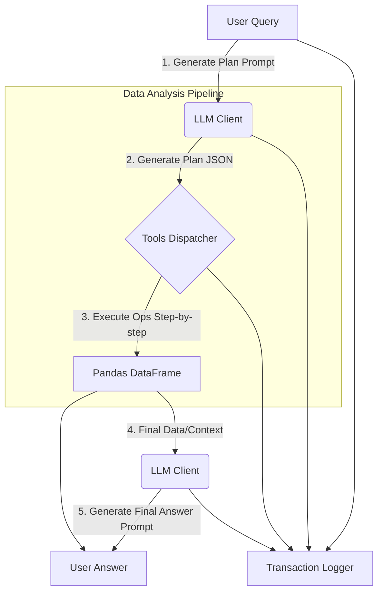

# /ai/assets/docs/tool_guides/eap_design.md
## Excel Analysis Processor (EAP) - Design Document

**Version:** 0.5  
**Date:** 2025-08-12  
**Author(s):** Martin Kecka, Gemini AI
**Category:** Processor (P)
**Acronym:** EAP (Excel Analysis Processor)

---

## 1. Overview
The Excel Analyst AI is a Streamlit-based web application that allows users to upload an Excel file, ask a natural language question about the data, and receive an AI-generated analysis and answer.

The application leverages a Large Language Model (LLM) to act as an intelligent **Analysis Plan Generator**. This allows it to dynamically adapt to new, user-provided data without manual configuration. The core functionality relies on a pipeline that executes this plan using a set of specialized, secure Python functions. 💡

The end-to-end user workflow is as follows:

1.  **File Upload & Schema Analysis**: The user uploads an Excel file. The application sends the column headers and a sample of the data to the LLM, which returns a structured schema, identifying column types (e.g., numeric, currency).
2.  **Dynamic Metadata Generation**: The LLM then generates a human-readable description for each column. This schema and metadata are cached for the session to ensure speed and efficiency.
3.  **User Query & Plan Generation**: The user asks a question in plain English. The question and the new metadata are sent to the LLM, which acts as a "planner," returning a structured JSON analysis plan (e.g., a sequence of `filter`, `group_by_and_agg` steps).
4.  **Safe Execution**: The main application acts as a secure "executor." It parses the AI-generated plan and calls the appropriate pre-defined, developer-vetted functions from its internal tools library.
5.  **Final Answer Generation**: The final, processed result (e.g., a single number or a list) is sent back to the LLM with instructions to format the data into a clear, natural-language answer for the user.

### Future Integration with the SERA Orchestrator

This standalone application is a functional prototype designed to prove the concept of AI-driven data analysis. The long-term plan is to integrate its core functionality into the SERA Orchestrator as an independent gRPC service. This transition will allow SERA to call the Excel Analyst as a specialized tool, providing a single, unified interface for users while leveraging the Excel Analyst's unique data processing capabilities.

The core analysis logic (`run_analysis_pipeline` and the functions in `core/tools.py`) will be refactored into a gRPC server. The Orchestrator will then handle the user interaction, file management, and calling the Excel Analyst tool with the user's query and file context.

---

## 2. How to Use the Analyst AI
Once the application is running, follow these steps:

* Use the sidebar to **upload your `.xlsx` or `.xlsb` data file**.
* Specify the **number of rows to skip** if your file has a title or blank rows before the header row.
* Click "**Load and Process File**."
* Once processing is complete, you can **ask your analytical questions** in the main panel and receive an AI-generated answer.

---

## 3. Architectural Components
The system is composed of several key components, each with a specific responsibility:

### a. Frontend (Streamlit)
* **Role:** Handles the user interface (UI) and user interactions.
* **Key Files:** `excel_analyst.py`.
* **Functionality:**
    * Provides UI elements for file uploads, selecting existing files, and entering questions.
    * Manages the application's state using `st.session_state`.
    * Displays progress bars, data previews, and the final analysis results.

### b. Data Layer
* **Role:** Manages the storage and retrieval of user files and associated metadata.
* **Key Files:** `excel_analyst.py`, `core/data_ingestion.py`.
* **Functionality:**
    * Stores uploaded Excel files and their metadata in a directory structure that is unique to each user (`assets_path: "/ai/assets/xlsx/excel_analyst/{username}/"`).
    * The metadata (`.metadata.json`) contains the AI-generated schema, column descriptions, and other file-specific settings like sheet name and rows to skip.
    * This separation of data and metadata allows for efficient reloading of previously analyzed files without re-running the costly AI analysis.

### c. Core Analysis Pipeline
* **Role:** The central brain of the application that orchestrates the data analysis.
* **Key Files:** `excel_analyst.py`, `core/llm_client.py`, `core/tools.py`.
* **Functionality:**
    * The `run_analysis_pipeline` function takes a user's query and file metadata as input.
    * It first calls the LLM to generate an analysis plan (a JSON list of operations).
    * It then iterates through this plan, calling the appropriate tool function from `core/tools.py` for each step.
    * The `tools.py` module contains robust, specialized functions for common data manipulation tasks (e.g., `filter_data`, `group_by_and_agg`, `calculate_sum`).
    * The final result of the pipeline (either a DataFrame or a summary string) is passed back to the LLM to generate a natural language answer.

### d. LLM Integration
* **Role:** Interfaces with the external Large Language Model to perform intelligent tasks.
* **Key Files:** `core/llm_client.py`, `prompts/`.
* **Functionality:**
    * Uses HTTP requests to communicate with an LLM endpoint (configured in `settings.yaml`).
    * The `llm_client.py` module contains specialized functions for different LLM tasks:
        * `generate_schema_from_data`: Creates a JSON representation of the data's structure.
        * `generate_column_description`: Provides a concise summary of a column's content.
        * `generate_analysis_plan_json`: Translates the user's query into a structured analysis plan.
        * `generate_final_answer`: Crafts a user-friendly answer from the final analysis results.
    * This modular design ensures that the LLM interaction is isolated, making it easier to swap out the model or endpoint in the future.

### e. Configuration & Logging
* **Role:** Manages application settings and provides comprehensive logging for debugging and auditing.
* **Key Files:** `config/settings.yaml`, `core/config_loader.py`, `utils/logging_setup.py`, `utils/transaction_logger.py`.
* **Functionality:**
    * `settings.yaml` centralizes all configurable parameters, such as file paths and LLM endpoint URLs.
    * `config_loader.py` is a simple utility to load and make these settings available throughout the application.
    * `logging_setup.py` configures standard file and console logging to monitor application behavior.
    * `transaction_logger.py` maintains a separate, structured JSON log of all user queries, generated plans, and final answers for auditing and performance analysis.

---

## 4. Data Flow Diagram
The following diagram illustrates the high-level data flow within the application:

## 5. Key Architectural Decisions
* **Modularity:** The application is broken down into distinct modules (`llm_client`, `data_ingestion`, `tools`), making the codebase easier to understand, maintain, and test.
* **LLM Decoupling:** The LLM client is a separate module that interacts with the LLM via a standard API. This makes the application flexible and not tied to a specific model provider or deployment method.
* **State Management:** Streamlit's `st.session_state` is used to persist data (DataFrame, metadata) across user interactions, which is essential for a conversational workflow.
* **Robust Tools:** The core analysis logic is handled by pre-defined tool functions. This approach is more reliable and predictable than asking the LLM to generate Python code directly. The LLM's role is to select and configure these tools, not to write them from scratch.
* **Comprehensive Logging:** The dual logging approach (standard logs for system events and a separate transaction log for user queries) provides a clear and auditable record of all analysis requests.

## 6. Implementation Plan: Integration with the SERA Orchestrator

This section outlines the plan for refactoring this prototype into a modular, SERA-compliant tool.

1.  **Refactor as a gRPC Service** The core analysis pipeline (`run_analysis_pipeline` and the `tools.py` module) will be extracted and wrapped in a gRPC server. This server will be a stateless, high-performance service capable of receiving analysis requests and returning results.

2.  **Define the Tool Interface** A `.proto` file will be created to define the service and its RPC methods. This file will serve as the contract between the SERA Orchestrator and the new Excel Analyst tool. The Orchestrator's `ToolExecutor` will use this definition to dynamically call the tool.

3.  **Update File Handling** The Orchestrator's UI will handle file uploads and schema generation. The resulting file path and metadata will be passed to the Excel Analyst tool via a gRPC request, allowing it to perform the analysis on demand.

4.  **Replace the UI** The Streamlit frontend will be deprecated. All user interaction will occur through the SERA Orchestrator's chat interface, providing a seamless experience for the user while still leveraging the specialized power of the Excel Analyst tool.