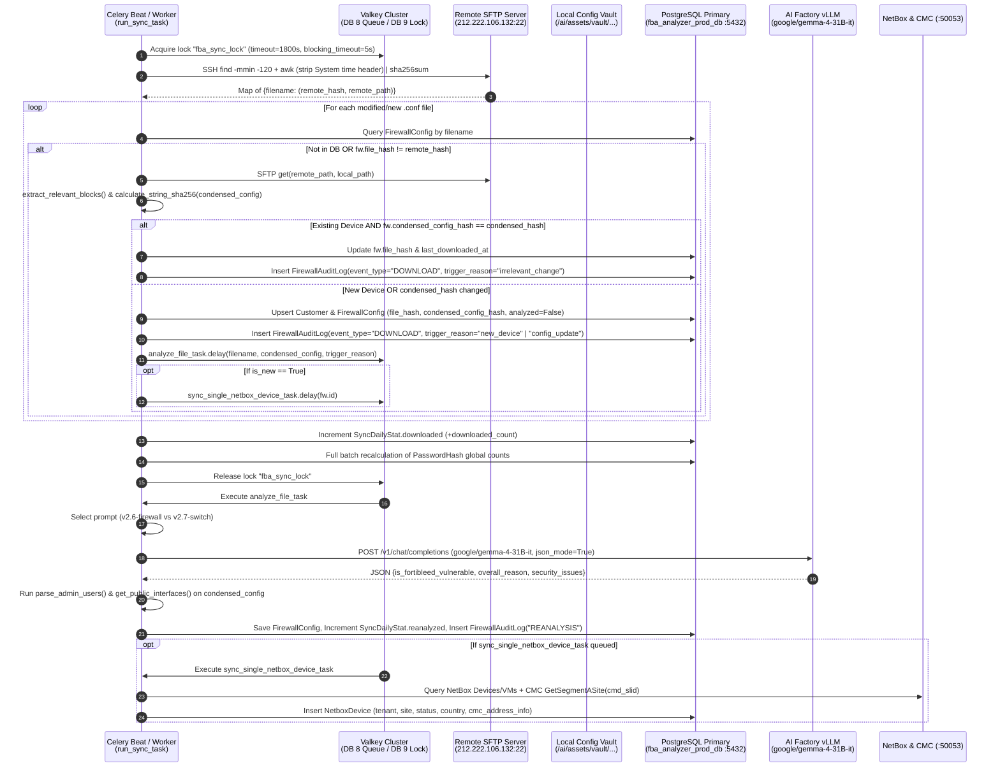

# Fortibleed Analyzer (FBA) - Architecture & Design Document

**Doc_Type:** Architecture & Design
**Category:** (A) Analyzer
**Name:** Fortibleed Analyzer
**Acronym:** FBA
**Version:** 0.4.5
**Date:** 2026-10-26
**Author:** Martin Kecka & Gemini AI
**Status:** Active

---

## 1. Introduction & Purpose 📜

The **Fortibleed Analyzer (FBA)** is an automated network security analysis engine and interactive compliance platform within the SERA/GIA ecosystem (`config/settings.yaml` -> `module_info`). It continuously ingests raw Fortinet configuration backups (`FortiGate`, `FortiWiFi`, and `FortiSwitch` `.conf` files) from the enterprise CPE backup server, extracts security-critical syntax blocks, and combines deterministic cryptographic/IP heuristics with Large Language Model (LLM) reasoning (`google/gemma-4-31B-it`) to detect remote management exposure ("FortiBleed" ACL vulnerabilities), weak or reversible administrator password hashes, and cross-device password reuse across the global CPE estate.

Operating as a hybrid deterministic and cognitive analyzer, FBA solves a critical network security challenge: raw Fortinet backup files often exceed tens of thousands of lines of routing, VPN, and firewall rules, making manual auditing unscalable and raw LLM context injection inaccurate. FBA deterministically condenses configurations by over 80–90% before routing them to device-specific system prompts (`v2.6-firewall` and `v2.7-switch`), persisting structured vulnerability findings, audit trails, and executable CLI remediation scripts in PostgreSQL (`fba_analyzer_prod_db`).

Its primary operational capabilities include:
- **Automated SFTP Delta Backup Synchronization:** Connects hourly to the central CPE backup server (`212.222.106.132:22`), strips volatile terminal timestamp headers via remote `awk` pipelines, compares content SHA-256 (`file_hash`) and condensed-block SHA-256 (`condensed_config_hash`) digests (`core/sync_configs.py` -> `sync_firewall_configs()`), and downloads only modified `.conf` files into the local vault (`/ai/assets/vault/fortibleed_analyzer`).
- **Context-Aware Stack-Based Config Condensing:** Parses raw FortiOS and FortiSwitchOS syntax (`core/analyzer.py` -> `extract_relevant_blocks()`) to isolate interfaces, local-in policies, zones, SD-WAN members, and admin accounts while pruning internal RFC1918/CGNAT interfaces on firewalls and stripping noisy SD-WAN health checks.
- **Deterministic Cryptographic & Public IP Auditing:** Inspects `config system admin` blocks for reversible (`AK1`, DES-based), legacy (`SH2`, SHA-256-based), strong (`AAAA`, PBKDF2-based), and plaintext/custom (`FP&` -> `RAW`) password formats (`core/config_parsers.py` -> `parse_admin_users()`), while maintaining a global `PasswordHash` frequency index to surface shared administrator credentials across devices.
- **Dual-Prompt AI Vulnerability Evaluation:** Dynamically routes condensed configurations to specialized prompts for FortiGate/FortiWiFi firewalls (`v2.6-firewall`) vs. FortiSwitches (`v2.7-switch`) (`core/prompt_selector.py` -> `get_prompt_details()`), generating structured JSON findings (`ACL_EXPOSURE`, `MISCONFIGURATION`, `WEAK_PASSWORD`) and ready-to-execute CLI remediation scripts.
- **Multi-Source CMDB & Geographic Enrichment:** Correlates configurations against **NetBox** (`core/clients/netbox_client.py` -> `NetboxClient`, prioritizing physical `device` records over `vm` records and flagging duplicate entries) and queries the **CMD Connector (CMC)** over gRPC (`connectors/cmc_connector.py` -> `get_segment_a_site()`) to enrich devices with country codes and site addresses.
- **HITL Verification & AI-Assisted Prompt Engineering Loop:** Provides an interactive React WebUI where security engineers can verify findings (`Mark as Correct`), test custom prompts live against real device configs, or submit issue reports (`Report Issue`) that automatically trigger a background LLM meta-analysis (`prompts/feedback_analyzer_prompt.py` -> `v1.0-feedback`) proposing concrete system prompt rules.

---

## 2. Architecture & Ecosystem Integration 🏗️

FBA operates as a three-tier microservice architecture (`fba-api.service`, `fba-worker.service`, `fba-grpc.service`) backed by a High-Availability PostgreSQL cluster (`fba_analyzer_prod_db`), a Valkey Sentinel task broker, and local vault filesystem storage.

### 2.1. Core Architectural Principles & Touchpoints
- **Read/Write Database Isolation (`core/database/database.py`):** Segregates SQLAlchemy sessions into `SessionLocalWriter` (`write_dsn` on `slo-aif-hadb.slo.gt-t.net:5432`) and `SessionLocalReader` (`read_dsn` on `slo-aif-ha.slo.gt-t.net:5433`) with `pool_pre_ping=True`. High-frequency UI dashboard polling, inventory filtering, and external API queries bind exclusively to `get_read_db()`, preventing analytical reads from contending with Celery worker writes.
- **Two-Stage Cryptographic SHA-256 Deduplication (`core/sync_configs.py`):**
  1. *Stage 1 (Remote Content SHA-256 `file_hash`):* Strips dynamic `System time:` terminal headers via remote `awk "/^#config-version=|^config /{flag=1} flag"` piped into `sha256sum` over SSH, avoiding redundant SFTP downloads when backup files are generated without configuration changes (`fw.file_hash == remote_hash`).
  2. *Stage 2 (Condensed Block SHA-256 `condensed_config_hash`):* Computes `calculate_string_sha256(condensed_config)` strictly over the extracted security blocks (`extract_relevant_blocks()`). If a configuration change only modified unrelated firewall rules or routing tables (`fw.condensed_config_hash == condensed_hash`), FBA updates `file_hash` and `last_downloaded_at`, records an `irrelevant_change` audit log, and skips LLM inference.
- **Hybrid Deterministic + Cognitive Disjunction (`core/worker_celery.py` & `core/analyzer.py`):** The final device vulnerability status (`FirewallConfig.vulnerable`) combines the LLM's `is_fortibleed_vulnerable` evaluation (`vuln_acl`) with deterministic password checks (`vuln_password` for `AK1` or `RAW`), ensuring insecure password hashes are never masked by LLM output.
- **GIA Gateway (`GIA-GW`):** Routes authenticated browser traffic to `/app/fortibleed_analyzer/` (injecting `X-Forwarded-User` and `X-Forwarded-Display-Name` headers) and proxies external programmatic requests from `/api/fba/*` to FBA's internal `/api/external/*` router (`rest_api/routers/external.py`).
- **CMD Connector (`CMC` - Port `50053`):** Downlink gRPC service (`connectors/cmc_connector.py`) queried via `GetSegmentASite` using the NetBox `cmd_slid` (Segment ID) to resolve physical country names, ISO-2 country codes, and A-site street addresses.
- **Application Management Utility (`AMU`) & Sera Admin Module (`SAM`):** Poll FBA's `SeraAppService` gRPC server (`fba-grpc.service` on port `50111`) for service health, dependency TCP reachability, version telemetry, and design documentation.

### 2.2. Ecosystem Integration & Data Flow

```mermaid
graph TD
    subgraph External_Infra ["AI Factory & Corporate Infrastructure"]
        SFTP["CPE SFTP Backup Server<br/>(212.222.106.132:22)"]
        NB["NetBox DCIM/IPAM<br/>(https://netbox.gt-t.net)"]
        VAULT["HashiCorp Vault<br/>(https://vault-aif.gt-t.net:8200)"]
        VLLM["AI Factory vLLM Cluster<br/>(google/gemma-4-31B-it)"]
    end

    subgraph SERA_Ecosystem ["SERA Ecosystem Touchpoints"]
        GW["GIA Gateway (OAuth2 Proxy)<br/>/app/fortibleed_analyzer & /api/fba"]
        CMC["CMD Connector (CMC)<br/>(gRPC localhost:50053)"]
        AMU["AMU & SAM Admin UI<br/>(SeraAppService Telemetry)"]
    end

    subgraph FBA_Core ["Fortibleed Analyzer (FBA)"]
        UI["React 18 + MUI v5 WebUI<br/>(Served via FastAPI StaticFiles)"]
        API["FastAPI Server (fba-api.service)<br/>(0.0.0.0:7894)"]
        GRPC["SERA Standard gRPC (fba-grpc.service)<br/>(0.0.0.0:50111)"]
        WORKER["Celery Worker & Beat (fba-worker.service)<br/>(core/worker_celery.py - Concurrency: 8)"]
        ANALYZER["Hybrid Analyzer & Block Condenser<br/>(core/analyzer.py & config_parsers.py)"]
    end

    subgraph Persistence ["Persistence & Messaging Layer"]
        PG_WRITE[("PostgreSQL Primary<br/>(fba_analyzer_prod_db :5432)")]
        PG_READ[("PostgreSQL Read Replica<br/>(fba_analyzer_prod_db :5433)")]
        VALKEY[("Valkey Sentinel Cluster<br/>DB 8 (Queue) / DB 9 (Results & Lock)")]
        FS_VAULT[("Local Config Vault<br/>(/ai/assets/vault/fortibleed_analyzer)")]
    end

    GW -->|HTTPS Proxy + Auth Headers| UI
    GW -->|/api/fba/* -> /api/external/*| API
    UI -->|REST /api/*| API
    AMU -->|gRPC :50111| GRPC

    WORKER -->|1. Hourly SSH/SFTP Delta Sync| SFTP
    WORKER -->|2. Write Raw .conf| FS_VAULT
    WORKER -->|3. Condense & Parse| ANALYZER
    ANALYZER -->|4. JSON Mode Chat Completion| VLLM
    WORKER -->|5. Sync Devices & VMs| NB
    WORKER -->|6. GetSegmentASite (gRPC)| CMC
    WORKER <-->|Queue (DB 8) / Results & Lock (DB 9)| VALKEY
    WORKER -->|SessionLocalWriter| PG_WRITE

    API -->|get_read_db| PG_READ
    API -->|get_write_db| PG_WRITE
    API -->|Dispatch Tasks / Inspect Queue| VALKEY
    API -->|Read Raw/Condensed .conf| FS_VAULT
    API & WORKER -->|AppRole Secret Fetch| VAULT
```

---

## 3. Module File Map 📂

```plaintext
/ai/fortibleed_analyzer
├── bootstrap_helper.py                                     # Self-healing virtualenv bootstrapper; installs requirements.txt and re-execs via os.execv
├── celerybeat-schedule                                     # Persistent local schedule state file generated by Celery Beat
├── deploy.sh                                               # Production deployment script; runs Vite npm build and restarts fba-api & fba-worker
├── fortibleed_analyzer.py                                  # Master executable entrypoint; runs bootstrap_helper and invokes cli/fba_cli.py
├── requirements.txt                                        # Python dependencies (fastapi, uvicorn, sqlalchemy, celery, redis, paramiko, hvac, requests)
├── cli/                                                    # Click-based Command Line Interface
│   ├── fba_cli.py                                          # Root Click group and daemon launchers (start-api-server, start-worker, start-grpc-server)
│   └── commands/                                           # Domain-segregated CLI subcommands
│       ├── analysis_cmds.py                                # CLI commands: analyze, analyze-file, extract-config, test-prompt
│       ├── audit_cmds.py                                   # CLI command: audit compare-names (audits filename vs internal hostname vs NetBox)
│       ├── db_cmds.py                                      # CLI commands: db migrate-json, db sync-inventory
│       ├── netbox_cmds.py                                  # CLI commands: netbox netbox-sync, netbox-missing, cmd-sync
│       ├── queue_cmds.py                                   # CLI commands: queue-status, queue-purge
│       └── sync_cmds.py                                    # CLI command: sync (manual trigger for SFTP backup synchronization)
├── config/                                                 # Application configuration
│   └── settings.yaml                                       # Master configuration (system_services, database DSNs, valkey, connectors, vault, llm_engines)
├── connectors/                                             # Outbound gRPC connectors
│   └── cmc_connector.py                                    # gRPC client wrapper for CMD Connector (init_cmc_connector, get_segment_a_site)
├── core/                                                   # Core domain engines, clients, database models, and Celery workers
│   ├── analyzer.py                                         # extract_relevant_blocks() condenser, run_analysis() batch dispatcher, run_analysis_single_file()
│   ├── config_parsers.py                                   # Deterministic IPv4 public filter (is_public_ip, get_public_interfaces) & parse_admin_users()
│   ├── llm_interface.py                                    # vLLMClient: HTTP inference client with Vault API key resolution, thinking mode, and retry backoff
│   ├── prompt_selector.py                                  # get_prompt_details() & get_prompt_text_by_version() routing Firewall vs Switch prompts
│   ├── sync_cmc.py                                         # sync_cmd_for_device() and sync_missing_cmd_data() enriching NetboxDevice via CMC
│   ├── sync_configs.py                                     # sync_firewall_configs(): SFTP delta discovery, remote awk/sha256sum check, condensed SHA-256 dedup
│   ├── worker_celery.py                                    # Celery app, Sentinel broker config, Beat schedule, and 5 background task definitions
│   ├── clients/                                            # External service clients
│   │   ├── netbox_client.py                                # NetboxClient singleton querying /api/dcim/devices/ and /api/virtualization/virtual-machines/
│   │   ├── ssh_client.py                                   # SSHClientWrapper (Paramiko) for remote command execution and SFTP downloads
│   │   └── vault_client.py                                 # VaultClient (hvac) authenticating via AppRole with in-memory secret caching
│   ├── database/                                           # SQLAlchemy persistence layer
│   │   ├── __init__.py                                     # Package marker
│   │   ├── database.py                                     # Dual-engine setup (engine_write, engine_read), session factories, and auto init_db()
│   │   └── models.py                                       # 7 ORM models: Customer, FirewallConfig, AnalysisFeedback, NetboxDevice, PasswordHash, SyncDailyStat, FirewallAuditLog
│   └── io_handlers/                                        # Database and cache I/O abstractions
│       ├── __init__.py                                     # Package marker
│       ├── cache_handler.py                                # tag_valkey_databases() (__GIA_DB_OWNER__) and get_celery_queue_sizes()
│       ├── sql_reader.py                                   # Read queries: get_stats, get_filters, get_inventory, get_customers, get_external_*, get_audit_logs
│       └── sql_writer.py                                   # Write mutations: create_feedback, delete_feedback, unverify_firewall
├── docs/                                                   # Module documentation
│   ├── CHANGELOG.yaml                                      # Structured release history parsed by SeraStandardServiceImpl and UI
│   └── fba_design.md                                       # Symlink -> /ai/assets/guides/tool_guides/fba_design.md
├── grpc_api/                                               # SERA Standard gRPC server layer
│   ├── __init__.py                                         # Package marker
│   ├── generate_stubs.py                                   # Dynamic grpc_tools.protoc compiler for sera_standard.proto
│   ├── sera_standard_service.py                            # SeraStandardServiceImpl (v1.2-universal) implementing SeraAppService
│   └── services.py                                         # ThreadPool gRPC server bootstrapper listening on port 50111
├── prompts/                                                # Versioned LLM system prompt definitions
│   ├── analyzer_prompt.py                                  # Legacy unified prompt (PROMPT_VERSION = "v2.5-severity")
│   ├── analyzer_prompt_firewall.py                         # Active FortiGate/FortiWiFi firewall prompt (PROMPT_VERSION = "v2.6-firewall")
│   ├── analyzer_prompt_switch.py                           # Active FortiSwitch prompt (PROMPT_VERSION = "v2.7-switch")
│   ├── analyzer_prompt_v24.py                              # Archived historical prompt (PROMPT_VERSION = "v2.4-severity")
│   ├── feedback_analyzer_prompt.py                         # Meta-prompt for engineer feedback analysis (PROMPT_VERSION = "v1.0-feedback")
│   └── test_analyzer_prompt.py                             # Sandbox prompt template for CLI evaluation
├── rest_api/                                               # FastAPI HTTP layer and SPA static hosting
│   ├── main.py                                             # FastAPI app, CORS middleware, router mounting, and React SPA /app/ fallback
│   ├── schemas.py                                          # Pydantic v2 request/response models (FirewallConfigSchema, StatsResponse, etc.)
│   └── routers/                                            # Modular FastAPI route handlers
│       ├── analysis.py                                     # /api/stats, /api/prompt, /api/prompts/{version}, /api/analyze, /api/analyze/test-prompt, /api/analyze/{id}
│       ├── docs.py                                         # /api/docs/config, /content/{doc_id}, /changelog, /download/changelogs/all, /download/{doc_id}
│       ├── external.py                                     # /api/external/* HATEOAS endpoints and custom Swagger UI mapped to /api/fba/*
│       ├── feedback.py                                     # /api/feedback/ CRUD, verification toggling, and process_feedback_task dispatch
│       ├── inventory.py                                    # /api/inventory, /api/inventory/{id}/config, /api/inventory/{id}/audit, /api/filters, /api/customers
│       └── users.py                                        # /api/users/me identity endpoint reading X-Forwarded-User headers
├── scripts/                                                # Maintenance and one-off testing scripts (e.g., debug_llm_payload.py)
├── ui/                                                     # React 18 + Vite + Material-UI v5 Single-Page Application
│   ├── index.html                                          # HTML root template
│   ├── package.json                                        # Frontend dependencies (React 18, MUI 5, TanStack React Query 5, react-markdown, react-country-flag)
│   ├── vite.config.js                                      # Vite config setting base: '/app/fortibleed_analyzer/' and dev proxy to 127.0.0.1:7894
│   └── src/                                                # Frontend source tree
│       ├── App.jsx                                         # Top-level router, AppBar navigation tabs, Gateway theme sync, and What's New dialog
│       ├── CustomThemeProvider.jsx                         # Multi-palette MUI theme provider (dark, light, pink, purple, red, blue)
│       ├── ThemeContext.jsx                                # React Context for active theme mode
│       ├── index.css                                       # Global styles
│       ├── main.jsx                                        # React DOM entrypoint
│       ├── theme.js                                        # MUI component and palette definitions
│       ├── components/common/                              # Shared UI widgets (ChangelogViewer.jsx, CodeBlock.jsx)
│       ├── features/                                       # Feature-scoped components and dialogs
│       │   ├── dashboard/                                  # StatBlock, StatCard, DashboardCharts, and DuplicatePasswordsDialog
│       │   ├── documentation/                              # DocumentationViewer with Mermaid rendering
│       │   ├── feedback/                                   # FeedbackInbox and FeedbackDialog
│       │   └── inventory/                                  # InventoryFlatView, InventoryGroupedView, InventoryFilters, and 5-tab FirewallDetailsDialog
│       ├── pages/                                          # Top-level route pages (DashboardPage, InventoryPage, FeedbackPage, DocumentationPage)
│       └── services/                                       # Axios API service wrappers (analysis, dashboard, documentation, feedback, inventory)
└── utils/                                                  # Shared backend utilities
    ├── config_loader.py                                    # YAML configuration loader (load_config)
    └── logging_setup.py                                    # dictConfig generator with EndpointFilter (/health) and 3 TimedRotatingFileHandlers
```

---

## 4. Core Processing Lifecycle ⚙️

### 4.1. Boot & Initialization Sequence
1. **Virtual Environment Self-Bootstrap (`fortibleed_analyzer.py` -> `bootstrap_helper.bootstrap_and_reexecute_if_needed()`):**
   * Verifies that `/ai/fortibleed_analyzer/venv` and `venv/.installed` exist and compares `os.path.getmtime` of `requirements.txt` against `venv/.installed`.
   * If missing or outdated, creates the virtual environment, installs `requirements.txt`, touches `venv/.installed`, and replaces the current process via `os.execv(venv_python, [venv_python, "-u"] + sys.argv)`.
2. **Configuration & Logging Initialization (`cli/fba_cli.py` & `utils/logging_setup.py` -> `get_logging_config()`):**
   * Loads `config/settings.yaml` into Click's `ctx.obj['config']`.
   * Applies `logging.config.dictConfig(get_logging_config(config))` which attaches an `EndpointFilter` (suppressing `/health` access log noise) and initializes three `TimedRotatingFileHandler` streams in `/ai/assets/logs/fba_analyzer/` (`when="midnight"`, `interval=1`, `backupCount=14`, `encoding="utf-8"`):
     * `fba.log` (`INFO` / root logger + Uvicorn access logs).
     * `fba_error.log` (`WARNING` and above).
     * `fba_sync.log` (`sync_logger`, isolated with `propagate=False` for SFTP sync operations).
3. **Database Dual-Engine Auto-Init (`core/database/database.py`):**
   * When `core.database.database` is imported, it binds `engine_write` (`database.write_dsn` on `slo-aif-hadb.slo.gt-t.net:5432`) and `engine_read` (`database.read_dsn` on `slo-aif-ha.slo.gt-t.net:5433`) with `pool_pre_ping=True`, imports all models from `core.database.models`, and executes `init_db()` (`Base.metadata.create_all(bind=engine_write)`).
4. **Daemon-Specific Startup Paths (`cli/fba_cli.py`):**
   * **API Server (`start-api-server`):** Starts `uvicorn.run("rest_api.main:app", host="0.0.0.0", port=7894, reload=False)`. If no subcommand is passed to `fortibleed_analyzer.py`, `cli()` invokes `start-api-server` by default.
   * **Celery Worker & Beat (`start-worker`):** Imports `celery_app` from `core/worker_celery.py`. On worker process init (`@worker_process_init.connect` -> `dispose_db_connections()`), disposes inherited SQLAlchemy engine connections and calls `tag_valkey_databases()` (`core/io_handlers/cache_handler.py`) to stamp `__GIA_DB_OWNER__` on Valkey DB `8` (`"FBA - Celery Task Queue"`) and DB `9` (`"FBA - Celery Result Backend"`), then launches `celery_app.worker_main(['worker', '--loglevel=info', '--concurrency=8', '-B'])`.
   * **gRPC Server (`start-grpc-server`):** Calls `check_and_generate_stubs(config)` (`grpc_api/generate_stubs.py`) to compile `sera_standard.proto` into `/ai/assets/protos/fortibleed_analyzer/generated` if missing or outdated, prepends `generated_stubs_path` to `sys.path`, and starts `grpc_api/services.py:serve()` on `0.0.0.0:50111` (`max_workers=10`, 50 MB max message length).

### 4.2. Hourly SFTP Delta Sync & Task Dispatch Workflow (`core/sync_configs.py` & `core/worker_celery.py`)



1. **Distributed Lock Acquisition (`core/worker_celery.py` -> `run_sync_task()`):**
   * Scheduled every `3600.0` seconds (`celery.sync_interval_seconds`) by Celery Beat.
   * Connects to Valkey DB `9` (`result_backend`) and acquires `client.lock("fba_sync_lock", timeout=1800, blocking_timeout=5)`. If another worker holds the lock, exits immediately to prevent overlapping SFTP syncs or `PasswordHash` table race conditions.
2. **Remote Backup Folder Discovery (`core/sync_configs.py` -> `sync_firewall_configs()`):**
   * Reads SFTP credentials from `external_services.backup_sync` (`212.222.106.132:22`, `remote_base_dir: "/backups/_CPEs_"`).
   * Opens a Paramiko SSH connection (`SSHClientWrapper`) and executes `ls -1 /backups/_CPEs_ | grep -E '^[0-9]{8}$' | sort -n | tail -n 1` to dynamically locate the latest `YYYYMMDD` backup directory (`/backups/_CPEs_/<latest_dir>/Fortinet`).
3. **Header-Stripped Remote SHA-256 Calculation:**
   * Executes a remote `find` command over SSH for `.conf` files modified within the last `120` minutes (`-mmin -120`, or all files if `force_all=True`):
     `find <remote_target_dir> -type f -name '*.conf' -mmin -120 -exec sh -c 'for f; do awk "/^#config-version=|^config /{flag=1} flag" "$f" | sha256sum | sed "s|  -|  $f|"; done' _ {} +`
   * The `awk` filter strips volatile terminal capture headers (such as `System time:`) appearing before `#config-version=` or `config `, producing a stable SHA-256 `remote_hash`.
4. **Database Hash Comparison, SFTP Download & Condensed SHA-256 Gate:**
   * Queries `FirewallConfig` by `filename`. If the device is not in PostgreSQL or `fw.file_hash != remote_hash`, downloads the file via `sftp.get(remote_path, local_path)` into `/ai/assets/vault/fortibleed_analyzer`.
   * Extracts `device_model`, determines `is_switch = "FortiSwitch" in (db_model or "") or "FSW" in (db_model or "")`, runs `extract_relevant_blocks(content, is_switch)`, and computes `condensed_hash = calculate_string_sha256(condensed_config)`.
   * **Irrelevant Change Bypass:** If the device already exists and `fw.condensed_config_hash == condensed_hash`, updates `fw.file_hash = remote_hash` and `fw.last_downloaded_at = func.now()`, writes a `FirewallAuditLog` (`event_type="DOWNLOAD"`, `trigger_reason="irrelevant_change"`, `file_hash=remote_hash`), and skips LLM analysis.
   * **New Device / Relevant Config Update:** Creates or updates `FirewallConfig` (`file_hash=remote_hash`, `condensed_config_hash=condensed_hash`, `analyzed=False`), writes a `DOWNLOAD` audit log (`trigger_reason="new_device"` or `"config_update"`), and dispatches `analyze_file_task.delay(...)`. If `is_new` is `True`, also dispatches `sync_single_netbox_device_task.delay(fw.id)`.
   * Updates `SyncDailyStat.downloaded += downloaded_count` for today's date (`YYYY-MM-DD`).
5. **Post-Sync Global Password Hash Recalculation (`run_sync_task()`):**
   * After `sync_firewall_configs()` completes, `run_sync_task()` deletes all rows in `password_hashes`, iterates over `FirewallConfig.password_encryption` across all devices in the database to tally global occurrences of each `hash`, and bulk-inserts the updated `PasswordHash(hash_string=h, count=count)` rows before releasing `fba_sync_lock`.

### 4.3. Daily Outdated Prompt Re-Analysis Lifecycle (`reanalyze_outdated_prompts_task`)
1. **Trigger:** Scheduled daily at `00:00 UTC` (`crontab(hour=0, minute=0)`) via Celery Beat (`core/worker_celery.py`).
2. **Execution (`core/analyzer.py` -> `run_analysis(outdated_prompt_only=True)`):**
   * Dynamically imports active prompt versions from both `prompts.analyzer_prompt_firewall` (`v2.6-firewall`) and `prompts.analyzer_prompt_switch` (`v2.7-switch`) (`active_versions = [fw_pv, sw_pv]`).
   * Queries `FirewallConfig` for all records where `prompt_version IS NULL` or `prompt_version NOT IN active_versions`.
   * Reads each matching `.conf` file from `/ai/assets/vault/fortibleed_analyzer`, extracts `condensed_config`, and dispatches `analyze_file_task.delay(..., trigger_reason="prompt_update")`.

---

## 5. Detailed Business Logic, Rules & HITL 🧠

### 5.1. Stack-Based Configuration Condenser (`core/analyzer.py` -> `extract_relevant_blocks()`)
To eliminate token waste and prevent LLM distraction from thousands of unrelated firewall policies or routing entries, `extract_relevant_blocks(config_content, is_switch=False)` executes a line-by-line stack parser:

1. **Target Top-Level Blocks (`relevant_prefixes`):**
   Only the following 6 top-level FortiOS/FortiSwitchOS blocks are captured:
   * `config system interface`
   * `config firewall local-in-policy`
   * `config system global`
   * `config system admin`
   * `config system sdwan`
   * `config system zone`
2. **Customer Code & Device Model Standardization (`core/analyzer.py`):**
   * `extract_customer_code(filename)`: Strips `.conf`/`.tar.gz`, leading `CPE-`, and datacenter prefixes (`r'^[a-z]{3}\d+-'`), normalizes `_` to `-`, and extracts the leading customer token (combining `parts[0]-parts[1]` if `len(parts[0]) < 3`).
   * **Hardware Model Normalization (`run_analysis()`):** Parses `Version: ([\w-]+) (v[\d\.]+)` or `#config-version=([\w-]+)-([\d\.]+)-FW-`. Normalizes Fortinet shortcodes via a lookup map (`FG10E0` -> `FortiGate-1000E`, `FG2K2E` -> `FortiGate-2200E`, `FG40FI` -> `FortiGate-40F-3G4G`, `FG4H0E` -> `FortiGate-400E`, `FG4H0F` -> `FortiGate-400F`, `FG6H0F` -> `FortiGate-600F`, `FGVM64` -> `FortiGate-VM64`, `FGVMA6` -> `FortiGate-VM64-AWS`, `FGVMK6` -> `FortiGate-VM64-KVM`) and prefix rules (`FGT*`/`FG*` -> `FortiGate-*`, `FWF*` -> `FortiWiFi-*`, `FSW*` or `r'S(\d+[A-Z])'` -> `FortiSwitch-*`).
3. **Context-Aware Interface Pruning (`config system interface`):**
   * **FortiSwitch (`is_switch == True`):** Retains **all** `edit "<interface>"` sub-blocks (`keep_current_interface = True`) because FortiSwitches lack local-in policies and are frequently managed via upstream 1:1 NAT on private/CGNAT addresses.
   * **FortiGate / FortiWiFi (`is_switch == False`):** Evaluates each `edit "<interface>"` sub-block at stack depth `2` (`["config", "edit"]`) and retains the interface upon `next` **only** if at least one of the following 4 conditions holds:
     1. **Loopback Interface:** Contains `set type loopback`.
     2. **Legacy `7.*.*.*` Space:** Has `set ip 7.x.x.x ...` (`ip_val.startswith("7.")`).
     3. **Globally Routable Public IPv4:** Has `set ip <ip> <mask>` where `is_public_ip(ip_val)` returns `True`.
     4. **Dynamic WAN Interface:** Has `set mode dhcp` or `set mode pppoe`. For dynamic firewall interfaces, the parser injects `        # HINT: This is a public WAN interface` into the block so the LLM treats the unaddressed interface as externally reachable.
4. **SD-WAN Noise Stripping (`config system sdwan`):**
   * When inside `config system sdwan` at stack depth `2`, if a nested block starts with `config health-check`, `config service`, or `config neighbor`, sets `skip_current_block = True` until its matching `end` statement, achieving an ~80% reduction in Multi-VDOM SD-WAN block size while preserving `config members` and `config zone`.

### 5.2. Deterministic IPv4 & Cryptographic Password Rules (`core/config_parsers.py` & `core/worker_celery.py`)
1. **Public IPv4 Filter (`is_public_ip(ip_str)` & `get_public_interfaces(content)`):**
   * Parses `ip_str` via `ipaddress.ip_address()`.
   * Returns `False` if the address is `is_private`, `is_loopback`, `is_link_local`, `is_multicast`, `is_reserved`, or falls within the Carrier-Grade NAT (CGNAT) range `100.64.0.0/10` (`ipaddress.ip_network('100.64.0.0/10')`).
   * `get_public_interfaces()` parses `config system interface` via `parse_interfaces()` and returns `{"name": if_name, "ip": ip, "type": type, "allowaccess": allowaccess}` for all interfaces with a public IP.
2. **Admin Password Prefix & Vulnerability Classification (`parse_admin_users(content)`):**
   * Scans `config system admin` and inspects every `edit "<username>"` block for `set password ENC <hash>`:
     * `parts.startswith("AK1")` -> `encryption = "AK1"` (**Critical Vulnerability**: weak DES-based reversible Fortinet encryption).
     * `parts.startswith("SH2")` -> `encryption = "SH2"` (**Warning**: moderate SHA-256-based hash).
     * `parts.startswith("AAAA")` -> `encryption = "AAAA"` (**Safe**: strong PBKDF2-based hash).
     * Any other 3-character prefix `parts[:3]`: if `enc_type == "FP&"`, normalizes to `encryption = "RAW"` (**Critical Vulnerability**: insecure raw/custom password); otherwise records the 3-character prefix.
3. **Deterministic Finding Injection (`core/worker_celery.py` -> `analyze_file_task()`):**
   * Scans `condensed_config` via `re.findall(r"set password ENC (AK1|SH2|AAAA)[a-zA-Z0-9+/=]+", condensed_config)` and `parse_admin_users(condensed_config)`:
     * Appends `{"severity": "CRITICAL" if p_type == "AK1" else "WARNING", "category": "WEAK_PASSWORD", "issue": "Password encryption category: <p_type> (<desc>).", "remediation_script": ""}` for each detected encryption category.
     * If `has_ak1` or `has_raw` is `True`, forces `vulnerable = True` and `vuln_password = True`, appends `"Insecure RAW password detected in configuration."` (`CRITICAL` / `WEAK_PASSWORD`) if `RAW` is present, and appends the password vulnerability summary to `reason`.

### 5.3. NetBox CMDB & CMD Connector (CMC) Enrichment Rules (`cli/commands/netbox_cmds.py` & `core/sync_cmc.py`)
1. **NetBox Device vs. VM Priority & Duplicate Detection:**
   * Strips `.conf` from `FirewallConfig.filename` to obtain `device_name`.
   * Queries NetBox REST API (`/api/dcim/devices/?name={device_name}` and `/api/virtualization/virtual-machines/?name={device_name}`) via `NetboxClient.from_config()` (which dynamically resolves the NetBox API token from HashiCorp Vault `netbox/external/shared/gia_ai`).
   * Filters results for exact name matches (`d.get("name") == device_name`). If `len(found_items) > 1`, sets `FirewallConfig.has_netbox_duplicates = True`.
   * Sorts `found_items` by type (`"device"` before `"vm"`) and inserts all matching `NetboxDevice` records so the UI prioritizes physical `device` metadata while surfacing duplicate warnings.
2. **CMD Geographic Enrichment via CMC (`core/sync_cmc.py` -> `sync_cmd_for_device()`):**
   * Parses `NetboxDevice.cmd_slid` (if formatted with a hyphen like `PREFIX-12345`, splits on `"-"[-1]` to extract the numeric segment ID).
   * Calls `get_segment_a_site(slid_int)` (`connectors/cmc_connector.py` -> `CmdConnectorServiceStub.GetSegmentASite` on `localhost:50053`, timeout `20s`, metadata `(('client_application', 'FBA'),)`).
   * Extracts `a_country` (`a_country` or `aCountry`) from `segment_data` and updates `NetboxDevice.country_code = code`, `NetboxDevice.country = name`, and `NetboxDevice.cmc_address_info = segment_data`.
   * If `cmd_slid` is non-numeric or CMC returns no country, stamps `country_code = "UNKNOWN"` and `country = "Unknown"` so `sync_missing_cmd_data()` does not infinitely retry unmapped SLIDs.

### 5.4. HITL Verification & AI Prompt Feedback Loop (`rest_api/routers/feedback.py` & `core/worker_celery.py`)
- **Human Verification (`is_correct = True`):** Security engineers reviewing a device in `FirewallDetailsDialog.jsx` can click **Mark as Correct**, which calls `POST /api/feedback/inventory/{firewall_id}` with `is_correct=True`. This stamps an `AnalysisFeedback` record with the engineer's `X-Forwarded-User` identity and displays a green **Reviewed & Verified** badge across the UI (reversible via `DELETE /api/feedback/inventory/{firewall_id}/verify`).
- **False-Positive Reporting & Meta-Prompt Triage (`is_correct = False`):** Clicking **Report Issue** submits `is_correct=False` and `feedback_text`, which immediately dispatches `tasks.process_feedback_task(feedback_id)` to Celery. The worker feeds the device's condensed config, the original AI findings, and the engineer's critique into `feedback_analyzer_prompt.py` (`v1.0-feedback`), storing the LLM's root-cause `explanation` and `suggested_prompt_addition` in `AnalysisFeedback.ai_analysis` for review in the **Feedback Inbox** (`/feedback`).

---

## 6. AI, LLM & Machine Learning Execution 🤖

FBA integrates with the AI Factory's **vLLM** inference cluster via `core/llm_interface.py` (`vLLMClient`) to evaluate condensed Fortinet configurations and engineer feedback.

### 6.1. Model & Client Configuration (`config/settings.yaml` -> `llm_engines`)
- **Primary Engine (`llm_engines.primary`):**
  * **Model:** `google/gemma-4-31B-it`
  * **Endpoint:** `https://aif-llm-gemma4-31b.aif.gt-t.net/v1/chat/completions`
  * **Parameters:** `max_tokens: 16384`, `temperature: 0.0`, `timeout_seconds: 300`, `ssl_verify: false`, `enable_thinking: "enable"` (passes `chat_template_kwargs: {"enable_thinking": True}`), and `response_format: {"type": "json_object"}` (`json_mode=True`).
- **Secondary Engine (`llm_engines.secondary`):**
  * **Model:** `google/gemma-4-E4B-it`
  * **Endpoint:** `https://aif-llm-gemma4-e4b.aif.gt-t.net/v1/chat/completions`
  * **Parameters:** `max_tokens: 8192`, `temperature: 0.0`, `timeout_seconds: 180`, `ssl_verify: false`, `enable_thinking: "disable"`.
- **Authentication & Retry Backoff (`core/llm_interface.py`):**
  * `vLLMClient` authenticates to HashiCorp Vault (`https://vault-aif.gt-t.net:8200`) via `VaultClient` (AppRole) on first instantiation, fetches the global Bearer token from `vault_paths.llm_api_key` (`haproxy/global/apps/fba-prod`), and caches it at the class level (`vLLMClient._llm_api_key`).
  * `get_chat_completion()` executes up to `max_retries = 3` attempts with exponential backoff (`sleep_time = 2 ** attempt` -> `2s`, `4s`), logging the target firewall filename (`log_prefix`) and stripping markdown code fences (` ```json ... ``` `) before JSON parsing.

### 6.2. Dual-Prompt Routing & Evaluation Rules (`core/prompt_selector.py` & `prompts/`)
`get_prompt_details(device_model, filename)` selects the active system prompt based on whether `"FortiSwitch"` or `"FSW"` appears in `device_model`:

1. **Firewall System Prompt (`prompts/analyzer_prompt_firewall.py` -> `PROMPT_VERSION = "v2.6-firewall"`):**
   * **FortiOS Local-In Policy Implicit Deny Rule:** Instructs the model that in FortiOS, the default action for a `local-in-policy` is `deny` and default lines are hidden in backups. Any rule block missing `set action accept` is an active **DENY** rule that drops traffic.
   * **Zone & SD-WAN Inheritance:** Recognizes that interfaces mapped into `config system zone` or `config system sdwan` inherit any `local-in-policy` targeting that zone.
   * **Critical Vulnerability Condition (`is_fortibleed_vulnerable: true` / `ACL_EXPOSURE`):** Triggered **only if BOTH** conditions are met:
     1. At least one admin account lacks `set trusthost` limits.
     2. At least one physical public/WAN interface (excluding loopbacks, RFC1918, CGNAT `100.64.0.0/10`, and legacy `7.*.*.*`) has a configured public IP with `allowaccess https` or `allowaccess ssh` **and** is not protected by a Local-In deny policy.
   * **Non-Critical Warnings & Misconfigurations:** Even when `is_fortibleed_vulnerable` is `false`, the prompt requires flagging:
     * *Missing Trusthosts:* Admin accounts lacking `set trusthost` (`Severity: WARNING`, `Category: MISCONFIGURATION`).
     * *Exposed Loopback:* Loopback interfaces (`7.*.*.*` or public IP) allowing HTTPS/SSH without a Local-In deny policy (`Severity: WARNING`, `Category: ACL_EXPOSURE`).
     * *Unrestricted Management Rule:* Local-In policies explicitly setting `set action accept` for `srcaddr "all"` on management interfaces with `7.*.*.*` or public IPs (`Severity: CRITICAL`, `Category: MISCONFIGURATION`).
2. **FortiSwitch System Prompt (`prompts/analyzer_prompt_switch.py` -> `PROMPT_VERSION = "v2.7-switch"`):**
   * **FortiSwitchOS Syntax Enforcement:** Forbids FortiOS firewall commands (`local-in-policy`, `zone`, `sdwan`) and enforces indexed trusthost syntax (`set trusthost1 <IP> <Subnet>`).
   * **Mutually Exclusive Mapping Logic:**
     * If an admin lacks `trusthost` **AND** any interface has a configured IP with `allowaccess` (`https`, `ssh`, `telnet`) -> `is_fortibleed_vulnerable: true`, `Category: "ACL_EXPOSURE"`, `Severity: "CRITICAL"`.
     * If an admin lacks `trusthost` **BUT** no interfaces are exposed -> `is_fortibleed_vulnerable: false`, `Category: "MISCONFIGURATION"`, `Severity: "WARNING"`.
   * **Strict Untruncated Remediation:** Requires the generated `remediation_script` to output the complete `config system admin` block preserving all existing parameters (`set accprofile`, `set password`, `set remote-auth`) using `10.0.0.1 255.255.255.255` where a trusthost IP is required.
3. **Feedback Meta-Prompt (`prompts/feedback_analyzer_prompt.py` -> `PROMPT_VERSION = "v1.0-feedback"`):**
   * Evaluates `(1) Original Condensed Configuration`, `(2) Original AI Findings`, and `(3) User's Feedback` to return `{"explanation": "...", "suggested_prompt_addition": "..."}`.

---

## 7. Data Models, State, Storage & Auditing 🗄️

### 7.1. PostgreSQL Schema (`core/database/models.py`)
FBA persists its state in the `fba_analyzer_prod_db` PostgreSQL database (`slo-aif-hadb.slo.gt-t.net:5432` write / `slo-aif-ha.slo.gt-t.net:5433` read):

| Table Name | ORM Class | Primary Key & Indexes | Key Columns & Types | Purpose & Relationships |
| :--- | :--- | :--- | :--- | :--- |
| **`customers`** | `Customer` | `id` (`Integer`, PK, Index)<br/>`customer_code` (`String`, Unique, Index) | `customer_code` (`String`), `created_at` (`DateTime`) | Groups devices by extracted filename customer prefix. 1-to-Many with `FirewallConfig`. |
| **`firewall_configs`** | `FirewallConfig` | `id` (`Integer`, PK, Index)<br/>`filename` (`String`, Unique, Index)<br/>`device_type` (`String(50)`, Index) | `customer_id` (`FK -> customers.id`), `analyzed` (`Boolean`), `vulnerable` (`Boolean`), `vuln_acl` (`Boolean`), `vuln_password` (`Boolean`), `error` (`Boolean`), `reason` (`Text`), `findings` (`JSON`), `public_ips` (`JSON`), `remediation_script` (`Text`), `prompt_version` (`String(50)`), `device_model` (`String(100)`), `device_version` (`String(50)`), `device_type` (`String(50)`), `password_encryption` (`JSON`), `has_netbox_duplicates` (`Boolean`), `file_hash` (`String(64)`), `condensed_config_hash` (`String(64)`), `created_at` (`DateTime`), `updated_at` (`DateTime`), `last_downloaded_at` (`DateTime`), `last_analyzed_at` (`DateTime`) | Central inventory and vulnerability record for each `.conf` device backup. 1-to-Many (`cascade="all, delete-orphan"`) with `NetboxDevice`, `AnalysisFeedback`, and `FirewallAuditLog`. |
| **`analysis_feedbacks`** | `AnalysisFeedback` | `id` (`Integer`, PK, Index) | `firewall_id` (`FK -> firewall_configs.id`), `is_correct` (`Boolean`), `feedback_text` (`Text`), `submitted_by` (`String(255)`), `submitted_at` (`DateTime`), `ai_analysis` (`JSON`) | Tracks engineer verifications (`is_correct=True`) and false-positive reports (`is_correct=False`) with LLM meta-analysis. |
| **`netbox_devices`** | `NetboxDevice` | `id` (`Integer`, PK, Index) | `firewall_id` (`FK -> firewall_configs.id`), `netbox_id` (`Integer`), `netbox_type` (`String(50)`: `"device"` \| `"vm"`), `tenant_name` (`String(255)`), `tenant_desc` (`String(500)`), `status` (`String(50)`), `site_name` (`String(255)`), `os_build` (`String(255)`), `cmd_gnid` (`String(100)`), `cmd_pon` (`String(100)`), `cmd_slid` (`String(100)`), `country` (`String(100)`), `country_code` (`String(10)`), `cmc_address_info` (`JSON`), `created_at` (`DateTime`), `updated_at` (`DateTime`) | Stores NetBox DCIM/VM attributes and CMD Connector (CMC) geographic A-site address enrichment. |
| **`password_hashes`** | `PasswordHash` | `id` (`Integer`, PK, Index)<br/>`hash_string` (`String`, Unique, Index) | `hash_string` (`String`), `count` (`Integer`, default `1`), `created_at` (`DateTime`), `updated_at` (`DateTime`) | Global frequency lookup table counting occurrences of each admin password hash across all devices to flag credential reuse (`count > 1`). |
| **`sync_daily_stats`** | `SyncDailyStat` | `date` (`String(10)`, PK, `YYYY-MM-DD`) | `downloaded` (`Integer`, default `0`), `reanalyzed` (`Integer`, default `0`) | Daily ledger tracking the number of SFTP files downloaded and LLM re-analyses completed per calendar day. |
| **`firewall_audit_logs`** | `FirewallAuditLog` | `id` (`Integer`, PK, Index) | `firewall_id` (`FK -> firewall_configs.id`), `timestamp` (`DateTime`), `event_type` (`String(50)`: `"DOWNLOAD"` \| `"REANALYSIS"`), `trigger_reason` (`String(50)`), `old_vulnerable` (`Boolean`), `new_vulnerable` (`Boolean`), `old_prompt_version` (`String(50)`), `new_prompt_version` (`String(50)`), `old_findings` (`JSON`), `new_findings` (`JSON`), `file_hash` (`String(64)`) | Immutable chronological audit log tracking config downloads, SHA-256 hashes, prompt upgrades, and vulnerability status transitions. |

### 7.2. Audit Log Enumerations (`FirewallAuditLog`)
- **`event_type == "DOWNLOAD"`:** `trigger_reason` is one of `"new_device"`, `"config_update"`, or `"irrelevant_change"`.
- **`event_type == "REANALYSIS"`:** `trigger_reason` is one of `"config_update"`, `"prompt_update"`, or `"manual"`.

### 7.3. Valkey Sentinel Namespaces & In-Memory Caches
- **Valkey DB `8` (`valkey.broker_url`):** Sentinel-managed (`slo-aif-master` across `slo-aif-rds01..03.slo.gt-t.net:26379/8`). Tagged on startup with `__GIA_DB_OWNER__ = "FBA - Celery Task Queue"`. Hosts the `celery` list queue.
- **Valkey DB `9` (`valkey.result_backend`):** HA endpoint (`slo-aif-ha.slo.gt-t.net:6379/9`). Tagged on startup with `__GIA_DB_OWNER__ = "FBA - Celery Result Backend"`. Stores Celery task results (`result_expires = 86400s`) and hosts the `fba_sync_lock` distributed mutex (`timeout = 1800s`).
- **In-Memory Singleton Caches:**
  * `VaultClient._secret_cache`: Caches Vault KV-v2 dictionaries per `(mount_point, path)`.
  * `vLLMClient._llm_api_key`: Class-level singleton caching the global LLM Bearer API key fetched from Vault (`haproxy/global/apps/fba-prod`).
  * `NetboxClient._cached_instance`: Class-level singleton caching the authenticated `NetboxClient` instance across worker tasks.

### 7.4. File System Storage
- **Configuration Vault (`/ai/assets/vault/fortibleed_analyzer`):** Configured via `paths.input_dir`. Stores all raw `.conf` backup files downloaded from SFTP. Read on-demand by the API server (`/api/inventory/{id}/config`, `/api/external/config/{filename}`) and Celery workers.
- **Application & Sync Logs (`/ai/assets/logs/fba_analyzer/`):** Configured via `logging.directory`. Stores daily rotating logs `fba.log`, `fba_error.log`, and `fba_sync.log` with a 14-day retention window (`backupCount: 14`).

---

## 8. APIs, Observability & Communication Contracts 📡

### 8.1. Internal & WebUI FastAPI Endpoints (`rest_api/routers/` - Port `7894`)
Mounted on the FastAPI application in `rest_api/main.py` (interactive OpenAPI documentation served at `/api/swagger` and `/api/redoc`):

| HTTP Method & Path | Router File | Request Parameters / Body | Response Model / Payload | Operational Description |
| :--- | :--- | :--- | :--- | :--- |
| **`GET /api/stats`** | `analysis.py` | *None* | `StatsResponse` (`{success, data}`) | Queries `sql_reader.get_stats()` on `get_read_db()` to return total/safe/vulnerable/error counts, `vuln_acl_firewall`, `vuln_acl_switch`, `vuln_password`, top-100 duplicate hashes, encryption counts, warning counts, prompt version distribution, live Celery queue status (`pending`, `active`, `reserved`), and 7-day `sync_history`. |
| **`GET /api/prompt`** | `analysis.py` | `firewall_id: Optional[int]` | `{"prompt": str}` | Returns the active system prompt text (`v2.6-firewall` or `v2.7-switch`) matching the device's model. |
| **`GET /api/prompts/{version}`** | `analysis.py` | `version: str` | `{"success": True, "prompt": str}` | Resolves historical or active prompt text via `get_prompt_text_by_version(version)` (`v2.7-switch`, `v2.6-firewall`, `v2.5-severity`, `v2.4-severity`). |
| **`POST /api/analyze`** | `analysis.py` | `limit: Optional[int]`, `override: bool = False` | `{"success": True, "message": str}` | Triggers batch `run_analysis(limit, override)` to queue unanalyzed (or all) configs into Celery. |
| **`POST /api/analyze/test-prompt`** | `analysis.py` | `TestPromptRequest` (`firewall_id: int`, `prompt: str`) | `{"success": True, "result": dict}` | Reads the device's `.conf` file from disk, runs `extract_relevant_blocks()`, and executes a live synchronous vLLM call using the custom `prompt` without modifying the database. |
| **`POST /api/analyze/{firewall_id}`** | `analysis.py` | `firewall_id: int` | `{"success": True, "message": str}` | Marks `fw.analyzed = False`, `fw.error = False` in PostgreSQL and dispatches `analyze_file_task.delay(..., trigger_reason="manual")`. |
| **`GET /api/inventory`** | `inventory.py` | `page`, `limit`, `customer`, `firewall`, `group_name`, `status`, `device_model`, `device_version`, `password_encryption`, `warning_type`, `prompt_version`, `device_type` | `InventoryResponse` (`{success, data: {items, total, page, limit}}`) | Paginated inventory query joining `Customer` and `NetboxDevice`, enriching each item's `password_encryption` list with `is_duplicate` and `shared_count` from `PasswordHash` and `is_reviewed` from `AnalysisFeedback`. |
| **`GET /api/inventory/{firewall_id}`** | `inventory.py` | `firewall_id: int` | `{"success": True, "data": dict}` | Returns the single enriched inventory dictionary for `firewall_id`. |
| **`GET /api/inventory/{firewall_id}/config`** | `inventory.py` | `firewall_id: int` | `FirewallConfigDetailResponse` (`filename`, `content`, `condensed_content`) | Reads the raw `.conf` file from `paths.input_dir` and returns both the full raw text and the output of `extract_relevant_blocks()`. |
| **`GET /api/inventory/{firewall_id}/audit`** | `inventory.py` | `firewall_id: int` | `{"success": True, "data": List[dict]}` | Returns all `FirewallAuditLog` rows for `firewall_id` ordered by `timestamp DESC`. |
| **`GET /api/filters`** | `inventory.py` | *None* | `FiltersResponse` (`models`, `versions`, `encryptions`, `warning_types`, `prompt_versions`) | Aggregates distinct hardware models, major.minor OS versions, password encryption types, warning categories, and prompt version counts for UI filter dropdowns. |
| **`GET /api/customers`** | `inventory.py` | `customer`, `firewall`, `status`, `device_model`, `device_version`, `password_encryption`, `warning_type`, `prompt_version`, `device_type` | `CustomersResponse` (`items: List[CustomerItem]`) | Groups devices by `COALESCE(NetboxDevice.tenant_name, Customer.customer_code)`, returning `group_name`, `tenant_desc`, `firewall_count`, and `switch_count`. |
| **`GET /api/feedback/`** | `feedback.py` | *None* | `{"items": List[dict]}` | Lists all issue reports (`AnalysisFeedback.is_correct == False`) ordered by `submitted_at DESC`, including `ai_analysis`. |
| **`POST /api/feedback/inventory/{firewall_id}`** | `feedback.py` | `FeedbackSubmit` (`is_correct: bool`, `feedback_text: Optional[str]`), Header `X-Forwarded-User` | `{"status": "success", "feedback_id": int}` | Creates an `AnalysisFeedback` row; if `not is_correct` and `feedback_text` is provided, dispatches `tasks.process_feedback_task(feedback_id)`. |
| **`GET /api/feedback/inventory/{firewall_id}`** | `feedback.py` | `firewall_id: int` | `{"items": List[dict]}` | Returns all feedback records for a specific firewall. |
| **`DELETE /api/feedback/{feedback_id}`** | `feedback.py` | `feedback_id: int` | `{"status": "success", "message": str}` | Deletes a feedback entry by ID. |
| **`DELETE /api/feedback/inventory/{firewall_id}/verify`** | `feedback.py` | `firewall_id: int` | `{"status": "success", "message": str}` | Deletes all verification (`is_correct == True`) records for `firewall_id` (`unverify_firewall`). |
| **`GET /api/users/me`** | `users.py` | Headers `X-Forwarded-User`, `X-Forwarded-Display-Name` | `{"username": str, "display_name": str}` | Returns the authenticated user's identity from GIA Gateway headers (defaulting to `"unknown_user"` / `"Guest"`). |
| **`GET /api/docs/config`**, **`/content/{doc_id}`**, **`/changelog`**, **`/download/changelogs/all`**, **`/download/{doc_id}`** | `docs.py` | `doc_id: str` (`"fba_design"`) | JSON / PlainText / ZIP stream | Serves `docs/fba_design.md`, parsed `docs/CHANGELOG.yaml`, and downloadable `.zip` changelog archives for the UI Documentation page. |

### 8.2. External Gateway REST API (`rest_api/routers/external.py`)
Proxied by the GIA Gateway from `https://<gateway>/api/fba/*` to FBA's `/api/external/*` endpoints:

| External Gateway URL | Internal FastAPI Path | Query / Path Parameters | Operational Description |
| :--- | :--- | :--- | :--- |
| **`GET /api/fba`** | `GET /api/external` | *None* | HATEOAS directory root returning URLs for `inventory`, `config`, and `docs`. |
| **`GET /api/fba/docs`** | `GET /api/external/docs` | *None* | Custom Swagger UI HTML scoped strictly to `/api/external/*` endpoints (`openapi_url="/api/fba/openapi.json"`). |
| **`GET /api/fba/inventory`** | `GET /api/external/inventory` | `limit` (`1..1000`, default `50`), `offset`, `from_downloaded_date`, `from_analyzed_date`, `firewall`, `tenant` | Paginated external inventory query returning device status summaries and HATEOAS `url` / `config_url` links. |
| **`GET /api/fba/inventory/{filename}`** | `GET /api/external/inventory/{filename}` | `filename: str` | Returns full vulnerability assessment (`vulnerable`, `vuln_acl`, `vuln_password`, `findings`, `remediation_script`, `password_encryption`, `public_ips`, `netbox_devices`) for a specific `.conf` filename. |
| **`GET /api/fba/config`** | `GET /api/external/config` | `limit`, `offset`, `from_downloaded_date`, `from_analyzed_date`, `firewall`, `tenant` | Paginated list of configuration filenames and download URLs matching the filter criteria. |
| **`GET /api/fba/config/{filename}`** | `GET /api/external/config/{filename}` | `filename: str` | Reads the `.conf` file from disk and returns `{"filename": ..., "raw_config": ..., "relevant_config": ...}`. |

### 8.3. Universal SERA Standard Contract (`sera.standard.v1.SeraAppService`)
FBA exposes the universal `sera.standard.v1.SeraAppService` contract on port `50111` (`grpc_api/sera_standard_service.py` -> `SeraStandardServiceImpl`), centrally maintained and deployed by the Application Management Utility (`amu_design.md`), for SAM UI and AMU telemetry integration (`GetAppInfo`, `GetDeepHealth`, `GetFeedback`, `GetChangelog`, `GetDocs`).

### 8.4. Outbound Client Contracts
- **CMD Connector (`connectors/cmc_connector.py` -> `CmdConnectorServiceStub`):**
  * **Endpoint:** `localhost:50053` (insecure gRPC channel, 50 MB max send/receive message length).
  * **RPC Invoked:** `GetSegmentASite(GetSegmentASiteRequest(segment_id=segment_id), timeout=20, metadata=(('client_application', 'FBA'),))`.
- **NetBox REST API (`core/clients/netbox_client.py` -> `NetboxClient`):**
  * **Endpoint:** `https://netbox.gt-t.net` (`Authorization: Token <vault_token>`, `verify_ssl=False`).
  * **Routes Invoked:** `GET /api/dcim/devices/?name={query}` and `GET /api/virtualization/virtual-machines/?name={query}`.
- **Remote SFTP Backup Server (`core/clients/ssh_client.py` -> `SSHClientWrapper`):**
  * **Endpoint:** `212.222.106.132:22` (Paramiko SSH + SFTP with `AutoAddPolicy()`, `timeout=10s`, credentials configured in `external_services.backup_sync`).

---

## 9. User Interface (UI) & Visualizations 🖥️

The FBA WebUI (`ui/src/`) is a React 18 Single-Page Application bundled with Vite (`base: '/app/fortibleed_analyzer/'`), Material-UI v5, `@mui/x-data-grid`, and TanStack React Query v5, served directly by `fba-api.service` (`rest_api/main.py` -> `serve_react_app()`).

### 9.1. Global Application Shell (`ui/src/App.jsx`)
- **Gateway SSO & Theme Synchronization:** Fetches the active user from `GET /api/users/me` and synchronizes the selected theme mode (`dark`, `light`, `pink`, `purple`, `red`, `blue`) with the GIA Gateway user preferences endpoint (`GET /api/auth/me` and `PUT /api/auth/me/theme`).
- **Automated "What's New in FBA" Modal:** Compares `localStorage.getItem('fba_last_seen_changelog')` against the latest release version in `GET /api/docs/changelog` and automatically displays a release notes dialog when a new version is deployed.

### 9.2. Core Views & Interactive Workflows
1. **Dashboard View (`/dashboard` -> `ui/src/pages/DashboardPage.jsx`):**
   * Polls `GET /api/stats` every `5,000` ms (`refetchInterval: 5000`).
   * **General Overview Block:** Cards for *Total Firewalls*, *Safe / Clean*, *Safe (Warnings)*, and *Processing Errors*.
   * **Vulnerabilities Block:** Cards for *Vulnerable (All)*, *Firewall Vuln: ACL*, *Switch Vuln: ACL*, and *Vuln: Passwords* (`RAW` or `AK1`).
   * **Passwords & Authentication Block:** Interactive *Duplicate Passwords* card (clicking opens `DuplicatePasswordsDialog.jsx` listing the top 100 shared password hashes and occurrence counts across the estate), *Warning: WEAK PASSWORD* (`SH2`), and dynamic per-encryption-type counters (`Encryption: AAAA`, `Encryption: SH2`, `Encryption: AK1`, `Encryption: RAW`).
   * **Policies & Exposures Block:** Dynamic warning category cards (`Warning: ACL EXPOSURE`, `Warning: MISCONFIGURATION`).
   * **Operational Charts (`DashboardCharts.jsx`):** Displays live Celery Task Queue counters (`Pending`, `Active`, `Reserved`), clickable Prompt Version chips (opening a dialog with the full prompt template via `GET /api/prompts/{version}`), and a 7-day *Downloaded vs. Reanalyzed* bar chart.
2. **Inventory View (`/inventory` -> `ui/src/pages/InventoryPage.jsx`):**
   * **Multi-Dimensional Filter Bar (`InventoryFilters.jsx`):** Supports real-time filtering by Customer/Tenant search, Firewall filename, Device Type (`firewall` vs `switch`), Hardware Model, FortiOS Version (`major.minor`), Password Encryption type, Vulnerability Status (`vulnerable`, `vuln_acl`, `vuln_password`, `duplicate_passwords`, `safe`, `safe_warnings`, `error`, `pending`), and Prompt Version.
   * **Grouped View (`InventoryGroupedView.jsx` - Default):** Groups inventory into expandable customer/tenant accordions showing `tenant_desc`, host country flags, and separate badge counts for `[N] Firewalls` and `[M] Switches`.
   * **Flat View & Client-Side CSV Export (`InventoryFlatView.jsx`):** Paginated MUI DataGrid with an **Export CSV** button (`handleExport` in `InventoryPage.jsx`) that fetches up to `100,000` filtered records and generates `firewall_inventory_export.csv` containing 11 columns (including formatted Admin Users, Public Interfaces & IPs, Detailed Findings, and Remediation Scripts).
   * **5-Tab Firewall Details Dialog (`FirewallDetailsDialog.jsx`):**
     * **Header & Summary (`FirewallSummary.jsx`):** Displays status chips, NetBox Tenant/Site/Status/OS Build/GNID/PON/SLID badges, country flag (`react-country-flag`) with dedicated CMD Address Info box, duplicate NetBox entry warnings, **Mark as Correct** / **Reviewed & Verified** toggle, **Report Issue** button, and a **Reanalyze** button (which automatically polls `/api/inventory/{id}` every `2,000` ms while `analyzed === false`).
     * **Tab 1 — Findings & Remediation (`FindingsTab.jsx`):** Renders `CRITICAL` and `WARNING` security issues, copyable CLI remediation scripts, exposed public IPs, and admin user encryption badges (highlighting `[DUPLICATE - Shared across X devices]`).
     * **Tab 2 — Relevant Config (`RelevantConfigTab.jsx`):** Displays the condensed configuration blocks extracted by `extract_relevant_blocks()`.
     * **Tab 3 — Raw Config (`RawConfigTab.jsx`):** Displays the full raw `.conf` backup file.
     * **Tab 4 — Test Prompt (`TestPromptTab.jsx`):** Loads the device's active prompt (`GET /api/prompt`) into an editable textarea and allows engineers to run live synchronous LLM tests (`POST /api/analyze/test-prompt`) and inspect the resulting JSON output side-by-side.
     * **Tab 5 — Audit Trail (`AuditTrailTab.jsx`):** Renders the chronological `FirewallAuditLog` timeline showing `DOWNLOAD` and `REANALYSIS` events, trigger reasons, SHA-256 file hashes, prompt version changes, and vulnerability transitions.
3. **Feedback Inbox View (`/feedback` -> `ui/src/pages/FeedbackPage.jsx` & `FeedbackInbox.jsx`):**
   * Lists engineer-submitted false-positive reports (`is_correct == False`), displaying the user's feedback alongside the AI Meta-Prompt (`v1.0-feedback`) root-cause explanation, copyable `suggested_prompt_addition`, and clickable firewall names that open `FirewallDetailsDialog`.
4. **Documentation View (`/docs` -> `ui/src/pages/DocumentationPage.jsx`):**
   * Renders `fba_design.md` (`DocumentationViewer.jsx`) and `CHANGELOG.yaml` (`ChangelogViewer.jsx`) with a **Download All Changelogs (.zip)** action.

---

## 10. Background Services & Workers 🛠️

| Worker / Service Name | Entrypoint / Location | Trigger & Schedule | Concurrency & Locking | Operational Responsibility & Retry Policy |
| :--- | :--- | :--- | :--- | :--- |
| **`fba-api.service`** | `fortibleed_analyzer.py start-api-server` -> `cli/fba_cli.py` | Persistent `systemd` daemon | Uvicorn ASGI worker loop (`0.0.0.0:7894`) | Serves FastAPI REST routers (`/api/*`), External Gateway API (`/api/external/*`), and static React SPA assets (`ui/dist`). |
| **`fba-grpc.service`** | `fortibleed_analyzer.py start-grpc-server` -> `grpc_api/services.py:serve()` | Persistent `systemd` daemon | `futures.ThreadPoolExecutor` (`max_workers=10`) | Hosts `SeraStandardServiceImpl` (`sera.standard.v1.SeraAppService`) on `0.0.0.0:50111`. |
| **`fba-worker.service`** | `fortibleed_analyzer.py start-worker` -> `core/worker_celery.py` | Persistent `systemd` daemon (`celery worker -B`) | `8` worker processes (`--concurrency=8`, `task_time_limit=14400s`, `result_expires=86400s`) | Executes Celery task queue (`DB 8`) and embedded Celery Beat periodic scheduler. |
| **`tasks.run_sync_task`** | `core/worker_celery.py:run_sync_task()` | Celery Beat every `3600.0s` (`celery.sync_interval_seconds`) | Valkey distributed mutex `fba_sync_lock` on DB `9` (`timeout=1800s`, `blocking_timeout=5s`) | Runs `sync_firewall_configs()` over SFTP, queues changed/new configs for analysis, and recalculates the global `PasswordHash` table. |
| **`tasks.reanalyze_outdated_prompts_task`** | `core/worker_celery.py:reanalyze_outdated_prompts_task()` | Celery Beat daily at `00:00 UTC` (`crontab(hour=0, minute=0)`) | Invokes `run_analysis(outdated_prompt_only=True)` | Automatically finds and re-queues any devices whose `prompt_version` is `None` or not in `[v2.6-firewall, v2.7-switch]`. |
| **`tasks.analyze_file_task`** | `core/worker_celery.py:analyze_file_task()` | Event-driven (dispatched by SFTP sync, daily beat, UI reanalyze, or CLI) | Celery worker pool | Selects firewall vs. switch prompt, calls `vLLMClient` (`google/gemma-4-31B-it`, `max_retries=3`), merges deterministic password/IP findings, updates `FirewallConfig` & `SyncDailyStat`, and writes `FirewallAuditLog`. |
| **`tasks.sync_single_netbox_device_task`** | `core/worker_celery.py:sync_single_netbox_device_task()` | Event-driven (dispatched when `is_new == True` during SFTP sync) | Celery worker pool | Queries NetBox Devices & VMs for a newly discovered firewall and chains `sync_cmd_for_device()` via CMC gRPC (`:50053`). |
| **`tasks.process_feedback_task`** | `core/worker_celery.py:process_feedback_task()` | Event-driven (dispatched on negative feedback submission in `feedback.py`) | Celery worker pool | Evaluates engineer issue reports via `feedback_analyzer_prompt.py` (`v1.0-feedback`) and saves `ai_analysis` to `AnalysisFeedback`. |

---

## 11. CLI, Tooling & Testing 💻

### 11.1. CLI Command Reference

| Command | Arguments & Options | Operational Description |
| :--- | :--- | :--- |
| **`start-api-server`** | `[--port INT] [--host STR]` | Starts the FastAPI & React UI server on `0.0.0.0:7894` (default command when invoked without subcommands). |
| **`start-worker`** | `[--concurrency 8]` | Starts the Celery worker pool and embedded Celery Beat scheduler (`-B`). |
| **`start-grpc-server`** | *None* | Compiles `sera_standard.proto` stubs if needed and starts the SERA Standard gRPC server on `0.0.0.0:50111`. |
| **`analyze`** | `[--config PATH] [--limit INT] [--override] [--acl-vuln-only] [--outdated-prompt-only] [--errors-only]` | Scans `/ai/assets/vault/fortibleed_analyzer` and dispatches `analyze_file_task` jobs to Celery with targeted filtering flags. |
| **`analyze-file`** | `<filename> [--config PATH]` | Runs `run_analysis_single_file(filename)` synchronously in the foreground (bypassing Celery) and updates PostgreSQL. |
| **`extract-config`** | `<filename> [--raw-config]` | Reads `<filename>.conf` from the vault and prints either the condensed blocks (`extract_relevant_blocks`) or `--raw-config` to stdout. |
| **`test-prompt`** | `[filename] [--prompt-file PATH] [--samples INT] [--type switch\|firewall]` | Tests the active or custom `--prompt-file` against a specific file or random DB sample (`--samples >= 5`, 1:4 non-vuln to ACL-vuln ratio) and prints a diff against stored DB findings. |
| **`sync`** | `[--force] [--time 120]` | Manually triggers `sync_firewall_configs(force_all=force, mmin=time)` in the foreground. |
| **`queue-status`** | *None* | Prints Valkey pending queue depth, active/reserved worker tasks, DB analyzed/error counts, prompt version distribution, and 7-day `SyncDailyStat` history. |
| **`queue-purge`** | *None* | Purges all pending tasks from the Valkey Celery queue (`celery_app.control.purge()`). |
| **`netbox netbox-sync`** | `[--missing-only]` | Synchronizes all (or `--missing-only`) `FirewallConfig` devices against NetBox DCIM Devices and Virtual Machines. |
| **`netbox netbox-missing`** | *None* | Lists all firewalls in PostgreSQL that currently have no `NetboxDevice` mapping. |
| **`netbox cmd-sync`** | `[--dry-run]` | Queries CMC (`GetSegmentASite`) in batches of `50` (`10` if `--dry-run`) for devices with a `cmd_slid` but missing `country_code`. |
| **`audit compare-names`** | *None* | Audits all devices in PostgreSQL, comparing `.conf` backup filenames against internal `set hostname` lines and NetBox presence. |
| **`db sync-inventory`** | *None* | Scans `paths.input_dir` and indexes any unrecorded `.conf` files into `customers` and `firewall_configs`. |
| **`db migrate-json`** | `[--input-file PATH]` | Legacy migration helper importing `/ai/fortibleed_analyzer/output/fortibleed_report.json` into PostgreSQL. |

### 11.2. CLI Quick Execution Examples

```bash
# ==============================================================================
# DAEMON & SERVER LIFECYCLE
# ==============================================================================
python3 fortibleed_analyzer.py start-api-server
python3 fortibleed_analyzer.py start-worker --concurrency 8
python3 fortibleed_analyzer.py start-grpc-server

# ==============================================================================
# SFTP SYNC & CELERY QUEUE MANAGEMENT
# ==============================================================================
python3 fortibleed_analyzer.py sync --time 120
python3 fortibleed_analyzer.py sync --force
python3 fortibleed_analyzer.py queue-status
python3 fortibleed_analyzer.py queue-purge

# ==============================================================================
# CONFIG EXTRACTION, BATCH ANALYSIS & PROMPT BENCHMARKING
# ==============================================================================
python3 fortibleed_analyzer.py extract-config A1001-fw01.conf
python3 fortibleed_analyzer.py analyze-file A1001-fw01.conf
python3 fortibleed_analyzer.py analyze --outdated-prompt-only --limit 200
python3 fortibleed_analyzer.py analyze --errors-only
python3 fortibleed_analyzer.py test-prompt --samples 10 --type firewall --prompt-file prompts/analyzer_prompt_firewall.py

# ==============================================================================
# NETBOX, CMD CONNECTOR (CMC) & NAMING AUDITS
# ==============================================================================
python3 fortibleed_analyzer.py netbox netbox-sync --missing-only
python3 fortibleed_analyzer.py netbox netbox-missing
python3 fortibleed_analyzer.py netbox cmd-sync [--dry-run]
python3 fortibleed_analyzer.py audit compare-names
python3 fortibleed_analyzer.py db sync-inventory
```

---

## 12. Configuration, Security & Hardware Affinity 🔒

### 12.1. Configuration Reference (`config/settings.yaml`)

*(Note: Universal SERA boilerplate blocks—`module_info.*`, standard `logging.*`, and standard protobuf `paths.*`—are omitted below; see `conf_concept.md`.)*

| Configuration Key | Purpose | Default / Production Value |
| :--- | :--- | :--- |
| `system_services.grpc` | SERA Standard gRPC systemd unit, bind address/port, and thread pool size. | `"fba-grpc.service"` (`0.0.0.0:50111`, `10` workers) |
| `system_services.api` | FastAPI & React SPA systemd unit and bind address/port. | `"fba-api.service"` (`0.0.0.0:7894`) |
| `system_services.worker` | Celery worker & Beat scheduler systemd unit (`service_type: "worker"`). | `"fba-worker.service"` |
| `database.write_dsn` | Primary read/write PostgreSQL connection string. | `"postgresql://...@slo-aif-hadb.slo.gt-t.net:5432/fba_analyzer_prod_db"` |
| `database.read_dsn` | Read-replica PostgreSQL connection string. | `"postgresql://...@slo-aif-ha.slo.gt-t.net:5433/fba_analyzer_prod_db"` |
| `valkey.broker_url` | Valkey Sentinel connection string for Celery task queue (DB 8). | `"sentinel://...@slo-aif-rds01.slo.gt-t.net:26379/8;...;slo-aif-rds03.slo.gt-t.net:26379/8"` |
| `valkey.result_backend` | Valkey HA connection string for Celery result backend and sync lock (DB 9). | `"valkey://...@slo-aif-ha.slo.gt-t.net:6379/9"` |
| `valkey.master_name` | Valkey Sentinel master cluster name. | `"slo-aif-master"` |
| `celery.task_time_limit` | Hard execution time limit (seconds) for a single Celery task. | `14400` (4 hours) |
| `celery.sync_interval_seconds` | Celery Beat interval (seconds) for `tasks.run_sync_task`. | `3600` (1 hour) |
| `connectors.cmc.host` / `port` | Target gRPC host and port for CMD Connector (`GetSegmentASite`). | `"localhost"` / `50053` |
| `external_services.vault` | HashiCorp Vault server URL (`vault-aif_api`) and AppRole `role_id`/`secret_id`. | `"https://vault-aif.gt-t.net:8200"` |
| `external_services.netbox` | NetBox DCIM/IPAM base URL (`netbox_rest_api`). | `"https://netbox.gt-t.net"` |
| `external_services.backup_sync` | CPE backup SFTP server (`fba_config_sync`) `host`, `port`, credentials, and `remote_base_dir`. | `"212.222.106.132:22"` (`/backups/_CPEs_`) |
| `vault_paths.llm_api_key` | Vault KV-v2 path for the global vLLM Bearer API key. | `"haproxy/global/apps/fba-prod"` |
| `vault_paths.netbox` | Vault KV-v2 path for the shared NetBox REST API token. | `"netbox/external/shared/gia_ai"` |
| `paths.input_dir` | Local filesystem repository storing downloaded `.conf` backup files. | `"/ai/assets/vault/fortibleed_analyzer"` |
| `paths.cmc_generated_stubs_path` | Shared directory containing compiled `cmc_service_pb2` gRPC stubs. | `"/ai/assets/protos/cmd_connector/generated"` |
| `logging.sync_log_filename` | Dedicated rotating log file for SFTP synchronization runs (`sync_logger`). | `"fba_sync.log"` |
| `llm_engines.primary` | Primary vLLM reasoning engine for config analysis and feedback meta-analysis. | `"google/gemma-4-31B-it"` (`https://aif-llm-gemma4-31b.aif.gt-t.net`, `max_tokens: 16384`, `temp: 0.0`, `enable_thinking: "enable"`, `timeout: 300s`) |
| `llm_engines.secondary` | Secondary lightweight vLLM engine profile. | `"google/gemma-4-E4B-it"` (`https://aif-llm-gemma4-e4b.aif.gt-t.net`, `max_tokens: 8192`, `temp: 0.0`, `enable_thinking: "disable"`, `timeout: 180s`) |

### 12.2. Security & Cryptographic Key Handling
- **Vault AppRole Secret Resolution (`core/clients/vault_client.py`):** `VaultClient` authenticates to HashiCorp Vault (`https://vault-aif.gt-t.net:8200`) using AppRole (`role_id`, `secret_id`) over a proxy-bypassed `requests.Session` (`proxies={"http": None, "https": None}`) and retrieves both the LLM API key (`haproxy/global/apps/fba-prod`) and the shared NetBox token (`netbox/external/shared/gia_ai`).
- **Gateway Identity Propagation (`rest_api/routers/users.py` & `feedback.py`):** Relies on the GIA Gateway OAuth2 proxy to authenticate users and pass `X-Forwarded-User` and `X-Forwarded-Display-Name` headers, recording `submitted_by` on all feedback and verification actions.
- **DSN & URL Sanitization (`grpc_api/sera_standard_service.py`):** `sanitize_dsn()` strips plaintext passwords from PostgreSQL and Valkey Sentinel connection strings before exposing `DependencyHealth` metadata over gRPC.

### 12.3. Hardware Affinity & Execution Boundaries
- **Compute Profile:** CPU- and network I/O-bound service (`fba-api`, `fba-worker`, `fba-grpc`). Requires **zero local GPU hardware** on the application host.
- **Inference Offloading:** All LLM token generation is offloaded via HTTPS to the AI Factory's GPU cluster (`aif-llm-gemma4-31b.aif.gt-t.net` and `aif-llm-gemma4-e4b.aif.gt-t.net`).
- **Worker Concurrency & Fork Safety:** `fba-worker.service` runs `8` concurrent Celery worker processes (`--concurrency=8`) and connects `@worker_process_init` (`dispose_db_connections()`) to dispose inherited SQLAlchemy connection pools after process fork, preventing cross-process socket corruption.

---

## 13. Error Handling & Resilience 🛡️

1. **Valkey Distributed Sync & Hash Recalculation Mutex (`core/worker_celery.py` -> `run_sync_task()`):**
   * Protects the entire hourly SFTP sync and `PasswordHash` table rebuild with a Valkey distributed lock (`fba_sync_lock`, `timeout=1800s`, `blocking_timeout=5s`), preventing overlapping sync tasks and `UniqueViolation` race conditions on `password_hashes`.
2. **Terminal Header Stripping & Two-Tier Hash Gate (`core/sync_configs.py`):**
   * Strips non-deterministic `System time:` headers via `awk "/^#config-version=|^config /{flag=1} flag"` before computing `sha256sum`, preventing 14,000+ unnecessary daily re-downloads.
   * Secondary `condensed_config_hash` check ensures changes to non-security config blocks never trigger redundant LLM calls.
3. **LLM Exponential Backoff & JSON Fence Sanitization (`core/llm_interface.py` & `core/worker_celery.py`):**
   * `vLLMClient.get_chat_completion()` retries transient HTTP/timeout errors up to `3` times with exponential backoff (`2s`, `4s`), logging the exact firewall filename and condensed config size.
   * Worker tasks strip markdown code wrappers (` ```json ... ``` `) before calling `json.loads()`. If JSON parsing or LLM execution still fails, the worker catches the exception, sets `FirewallConfig.error = True`, `FirewallConfig.analyzed = True`, records the failure reason, and commits the state so a poison file never blocks the Celery queue.
4. **Unmapped CMD SLID Negative Caching (`core/sync_cmc.py`):**
   * If a device's `cmd_slid` is non-numeric or CMC returns no country data, `sync_cmd_for_device()` marks `country_code = "UNKNOWN"` and `country = "Unknown"` so batch jobs (`sync_missing_cmd_data`) do not infinitely re-query invalid SLIDs.
5. **Database Connection Pre-Ping & Fork Disposal (`core/database/database.py` & `core/worker_celery.py`):**
   * Both `engine_write` (`:5432`) and `engine_read` (`:5433`) enable `pool_pre_ping=True` to transparently recycle dropped connections across Patroni/HAProxy failovers, and `worker_process_init` disposes parent connections upon worker fork.

---

## 14. Future Enhancements & Roadmap 🚀

1. **Full Vault Secret Migration for SFTP, Database & Valkey Credentials:**
   * Migrate the remaining static credentials in `config/settings.yaml` (`external_services.backup_sync.password`, `database.write_dsn`/`read_dsn`, and `valkey.password`) into HashiCorp Vault (`vault-aif.gt-t.net:8200`) alongside the already-migrated LLM and NetBox secrets.
2. **Automated Prompt Evolution & Regression Suite:**
   * Connect the `AnalysisFeedback` AI meta-prompt suggestions (`v1.0-feedback`) directly to an automated regression harness in the WebUI, allowing engineers to one-click benchmark a `suggested_prompt_addition` against all historically verified (`is_correct == True`) devices before promoting a new prompt version.
3. **Database Table Prefix Standardization (`fba_*`):**
   * Align table names (`customers`, `firewall_configs`, `analysis_feedbacks`, `netbox_devices`, `password_hashes`, `sync_daily_stats`, `firewall_audit_logs`) with the ecosystem `fba_` table prefix convention during future schema migrations.
