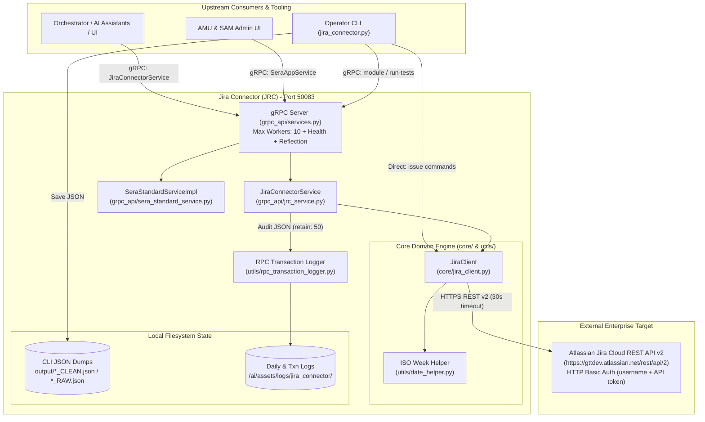

# Jira Connector (JRC) - Architecture & Design Document

**Doc_Type:** Architecture & Design
**Category:** (C) Connector
**Name:** Jira Connector
**Acronym:** JRC
**Version:** 0.1.2
**Date:** 2026-07-12
**Author:** Martin Kecka & Gemini AI
**Status:** Active

---

## 1. Introduction & Purpose 📜

The **Jira Connector (JRC)** is a deterministic gateway module within the SERA/GIA ecosystem (`config/settings.yaml` -> `module_info`). Acting as the authoritative interface for interactions with Atlassian Jira Cloud (`https://gttdev.atlassian.net/rest/api/2`), JRC abstracts away the bloat, workflow transition constraints, GDPR `accountId` privacy requirements, and payload verbosity of the native Jira REST API from upstream AI assistants and orchestration services.

**Key Design Decision (Jira REST API v2 vs. v3):** JRC explicitly targets the **Jira Cloud REST API v2** (`/rest/api/2`) rather than v3. Jira API v3 mandates Atlassian Document Format (ADF)—a deeply nested JSON abstract syntax tree that is token-heavy and prone to LLM structural hallucinations. By targeting API v2, JRC sends and receives standard plain-text strings and Jira Wiki Markup while still utilizing modern v2 endpoints such as `POST /search/jql`.

Its core functional pillars include:

1. **Automated Weekly Bug Tracking & gRPC Gateway (`JiraConnectorService`):** Exposes gRPC endpoints (`CreateUniversalBug`, `GetBugsByWeek`) on port `50083` (`grpc_api/jrc_service.py`) that automatically tag and aggregate project/epic bugs by ISO calendar week (`Week_WW_YYYY` via `utils/date_helper.py` -> `get_current_week_label()`) and environment labels.
2. **LLM Context Optimization (`clean_issue`):** Strips 100+ null custom fields, avatar URLs, and UI metadata from raw Jira issue payloads (`core/jira_client.py` -> `JiraClient.clean_issue()`), flattening essential hierarchy and relational context (`subtasks`, `issuelinks`, `comments`, `components`, `fix_versions`, and `customfield_10015` -> `start_date`).
3. **Smart GDPR Name-to-AccountId Resolution:** Translates human-readable display names, email addresses, or raw IDs into strict Atlassian `accountId` strings via a two-stage probe across `/user` and `/user/search` (`core/jira_client.py` -> `JiraClient.resolve_user_to_account_id()`).
4. **Dynamic Workflow Transition & Audit Labeling Engine:** Resolves human-readable status names (e.g., `"Done"`, `"In Progress"`) into issue-specific internal workflow transition IDs via `/issue/{key}/transitions` (`JiraClient.transition_issue()`), and automatically injects the `"sera-ai"` audit label into every issue creation and update (`JiraClient.create_issue()`, `JiraClient.update_issue()`).

---

## 2. Architecture & Ecosystem Integration 🏗️

JRC operates as a headless, multi-threaded Python gRPC server (`grpc_api/services.py` -> `serve()`) listening on `0.0.0.0:50083` with `max_workers=10`. It registers four gRPC services on the same port:
1. **`jira_connector.JiraConnectorService`** (`grpc_api/jrc_service.py`): Domain RPCs for automated bug creation and weekly bug retrieval.
2. **`sera.standard.v1.SeraAppService`** (`grpc_api/sera_standard_service.py`): Universal SERA observability, deep health, changelog, and documentation contract.
3. **`grpc.health.v1.Health`**: Standard gRPC health checking protocol reporting `SERVING` for both `jira.connector.JiraConnectorService` and `sera.standard.SeraAppService`.
4. **`grpc.reflection.v1alpha.ServerReflection`**: Live protobuf descriptor reflection enabling zero-proto `grpcurl` introspection and automated testing (`cli/commands/test_cmds.py`).

* **Upstream Callers:**
  * **Downstream Dashboards, AI Assistants & Orchestrator:** Call `JiraConnectorService` (`CreateUniversalBug`, `GetBugsByWeek`) over gRPC (`:50083`), passing `username` and `client_application` in invocation metadata.
  * **Application Management Utility (AMU) & Sera Admin Module (SAM):** Poll `SeraAppService` (`GetAppInfo`, `GetDeepHealth`, `GetChangelog`, `GetDocs`) to monitor `jrc-grpc.service` status and verify TCP/HTTPS reachability to `gttdev.atlassian.net:443` (`jira_api_prod`).
  * **Operator / Developer CLI (`jira_connector.py`):** Executes direct `JiraClient` operations (`issue` command group), `SeraAppService` health checks (`module` group), and `grpcurl` integration test suites (`run-tests`).
* **Downstream Targets (Outbound HTTPS REST, Port `443`):**
  * **Atlassian Jira Cloud REST API v2 (`https://gttdev.atlassian.net/rest/api/2`):** Authenticated via HTTP Basic Auth (`requests.auth.HTTPBasicAuth(username, api_token)`) over a persistent `requests.Session` with a `30`-second default timeout.



---

## 3. Module File Map 📂

```plaintext
/ai/jira_connector
├── __init__.py                        # Package root marker
├── jira_connector.py                  # Main CLI & daemon entrypoint; runs bootstrap_helper, loads YAML config, initializes logging
├── bootstrap_helper.py                # Self-healing venv manager; installs requirements.txt and re-execs via os.execv
├── requirements.txt                   # Python dependencies (grpcio, grpcio-health-checking, grpcio-reflection, requests, PyYAML, thefuzz, click)
├── README.md                          # Repository overview and links to central SERA guides
├── cli/                               # Click-based Command Line Interface
│   ├── jrc_cli.py                     # Root CLI group; initializes JiraClient in ctx.obj and registers issue, module, run-tests, start-grpc-server
│   └── commands/                      # CLI subcommand modules
│       ├── issue_cmds.py              # 'issue' group: get, search, create-subtask, comment-add, comment-delete, transition, assign, bulk-upload
│       ├── module_cmds.py             # 'module' group: SERA Standard introspection commands (info, health)
│       ├── schema_cmds.py             # Legacy OpenAPI schema CLI module (fetch, find)
│       └── test_cmds.py               # 'run-tests' command: automated end-to-end grpcurl test suite for CreateUniversalBug & GetBugsByWeek
├── config/                            # Configuration files
│   └── settings.yaml                  # Master runtime configuration (system_services, external_services.jira, logging, transaction_logging, paths)
├── core/                              # Core business logic and Jira REST API v2 client
│   └── jira_client.py                 # JiraClient: HTTPBasicAuth session, clean_issue parser, accountId resolver, transitions, universal bug workflows
├── docs/                              # Module documentation
│   ├── CHANGELOG.yaml                 # Structured release history parsed by SeraStandardServiceImpl and AMU
│   └── jrc_design.md                  # Symlink to /ai/assets/guides/tool_guides/jrc_design.md
├── grpc_api/                          # gRPC server and protobuf definitions
│   ├── __init__.py                    # Package marker
│   ├── generate_stubs.py              # Pre-flight mtime checker and grpc_tools.protoc compiler for jrc_service.proto & sera_standard.proto
│   ├── services.py                    # Multi-servicer gRPC server bootstrapper (JiraConnectorService, SeraAppService, Health, ServerReflection)
│   ├── jrc_service.py                 # JiraConnectorServiceServicer implementation with _handle_rpc audit wrapper
│   ├── sera_standard_service.py       # Standardized SERA v1.2-universal observability service implementation
│   └── protos/                        # Protocol Buffer contracts
│       └── jrc_service.proto          # RPC definitions (CreateUniversalBug, GetBugsByWeek) for package jira_connector
└── utils/                             # Cross-cutting utilities
    ├── date_helper.py                 # get_current_week_label(): generates 'Week_WW_YYYY' ISO week strings
    ├── logging_setup.py               # MultiProcessSafeDailyLogger (14-day retention) and console/file handler initialization
    └── rpc_transaction_logger.py      # Per-RPC JSON audit file writer and sliding-window retention pruner
```

---

## 4. Core Processing Lifecycle ⚙️

### 4.1. Boot & Initialization Sequence
1. **Virtual Environment Self-Bootstrap (`jira_connector.py` -> `bootstrap_helper.bootstrap_and_reexecute_if_needed()`):**
   * Checks if `/ai/jira_connector/venv` and `venv/.installed` exist and whether `requirements.txt` has a newer modification timestamp (`needs_pip_install()`).
   * If missing or outdated, creates `venv`, upgrades `pip`, installs dependencies from `requirements.txt`, writes `venv/.installed`, and re-executes the process inside the virtual environment via `os.execv`.
2. **Configuration, Logging & Client Initialization (`jira_connector.py` -> `main()` & `cli/jrc_cli.py` -> `cli()`):**
   * Loads `config/settings.yaml` via `yaml.safe_load()`.
   * Calls `setup_logging(config)` (`utils/logging_setup.py`):
     * Attaches a `StreamHandler(sys.stderr)` at `logging.level` (`INFO`).
     * When `logging.enable_file_logging` is `true`, initializes two `MultiProcessSafeDailyLogger` file handlers writing to `/ai/assets/logs/jira_connector/jrc.log.YYYY-MM-DD` (`DEBUG` level) and `jrc_err.log.YYYY-MM-DD` (`WARNING` level) with `backup_count=14` days retention.
     * Suppresses noisy third-party loggers (`hpack`, `httpx`, `httpcore`, `urllib3`, `zeep`, `requests`) to `WARNING`.
   * Instantiates `JiraClient(config)` (`core/jira_client.py`) and stores it in Click's context (`ctx.obj['client']`).
3. **Dynamic Protobuf Stub Compilation (`cli/jrc_cli.py` -> `serve_cmd()` -> `grpc_api/generate_stubs.py` -> `check_and_generate_stubs()`):**
   * Compares modification times (`os.path.getmtime`) of `grpc_api/protos/jrc_service.proto` and `/ai/assets/protos/sera_standard/sera_standard.proto` against `/ai/assets/protos/jira_connector/generated/jrc_service_pb2.py`.
   * If missing or outdated, compiles both `.proto` files via `grpc_tools.protoc` into `/ai/assets/protos/jira_connector/generated/`, creating `__init__.py` markers along the path and inserting the generated path into `sys.path`.
4. **gRPC Server Initialization (`grpc_api/services.py` -> `serve()`):**
   * Executes `cleanup_transactions(config)` (`utils/rpc_transaction_logger.py`) to prune JSON transaction logs exceeding `retain_count: 50`.
   * Starts `grpc.server(futures.ThreadPoolExecutor(max_workers=10))` bound to `0.0.0.0:50083` with `JiraConnectorService`, `SeraStandardServiceImpl`, `HealthServicer`, and `reflection.enable_server_reflection`.

### 4.2. Inbound gRPC Request Workflow (`grpc_api/jrc_service.py`)
1. **Metadata Extraction (`_extract_metadata(context)`):** Extracts `username` (default `"unknown_caller"`) and `client_application` (default `"unknown_app"`) from gRPC invocation metadata.
2. **Unified Execution Wrapper (`_handle_rpc()`):**
   * Generates a `UUID4` `txn_id` and converts the inbound Protobuf request to a Python dictionary via `MessageToDict(request, preserving_proto_field_name=True)`.
   * Invokes `handler_func(request_dict)` against `self.jira_client`.
   * **Response Mapping:**
     * If `response_data` is a `dict` containing `"bugs"` (`GetBugsByWeek`), converts each raw Jira bug dictionary into a `google.protobuf.Struct` via `ParseDict(bug, Struct())` and appends it to `response.bugs`.
     * If `response_data` is a `str` and the response descriptor defines `bug_key` (`CreateUniversalBug`), assigns `response.bug_key = response_data`.
   * Sets `response.success = True` (or catches any exception, logs the traceback, and sets `response.success = False` and `response.error_message = str(e)`).
   * Writes a JSON audit file via `log_transaction()` in the `finally` block.

---

## 5. Detailed Business Logic, Rules & HITL 🧠

### 5.1. HTTP Basic Auth Transport & Fault Handling (`core/jira_client.py` -> `JiraClient._request()`)
* Initializes a persistent `requests.Session()` configured with `HTTPBasicAuth(self.username, self.api_token)` and JSON headers (`Accept: application/json`, `Content-Type: application/json`).
* Dispatches HTTP requests (`GET`, `POST`, `PUT`, `DELETE`) with `timeout=30` seconds (`external_services.jira.timeout_seconds`).
* Supports `suppress_logging=True` (used during silent `accountId` probing) to avoid polluting error logs on expected `404` probes.
* Returns `True` on `HTTP 204 No Content` or empty response bodies; otherwise parses and returns `response.json()`.

### 5.2. LLM Context Optimizer (`core/jira_client.py` -> `JiraClient.clean_issue()`)
Raw Jira issue objects contain over 100 custom fields and verbose REST self-links/avatars. `clean_issue(raw_issue)` extracts and flattens only high-signal fields, pruning any key whose value is `None` or `[]`:
* **Core Metadata:** `key`, `issuetype` (`fields.issuetype.name`), `summary`, `status` (`fields.status.name`), `priority` (`fields.priority.name`), `description`, `parent` (`fields.parent.key`).
* **Identity & Ownership:** `assignee` (`displayName`, defaulting to `"Unassigned"`), `assignee_id` (`accountId`), `reporter` (`displayName`), `reporter_id` (`accountId`).
* **Classification & Versions:** `labels` (`list`), `components` (list of `name` strings), `affected_versions` (from `fields.versions`), `fix_versions` (from `fields.fixVersions`).
* **Temporal Fields:** Maps locked Jira custom field `customfield_10015` -> `start_date`, alongside `due_date` (`duedate`), `created`, and `updated`.
* **Flattened Subtasks (`subtasks`):** Extracts `{key, issuetype, summary, status, assignee}` for each child subtask.
* **Normalized Issue Links (`issuelinks`):** Inspects `outwardIssue` vs. `inwardIssue` on each link and normalizes them into `{type, relation, target_key}` (e.g., `type: "Blocks"`, `relation: "blocks"`, `target_key: "GAD-42"`).
* **Flattened Comments (`comments`):** Extracts `{id, author, body, created}` from `fields.comment.comments`.

### 5.3. Smart GDPR User-to-AccountId Resolution (`core/jira_client.py` -> `JiraClient.resolve_user_to_account_id()`)
Because Atlassian Cloud enforces GDPR privacy rules that reject username or email strings in assignment payloads, `resolve_user_to_account_id(identifier)` executes a 3-step resolution cascade:
1. **Silent Raw `accountId` Probe:** Calls `GET /user?accountId={identifier}` with `suppress_logging=True`. If valid, returns `user["accountId"]` immediately.
2. **Fuzzy User Search:** Calls `GET /user/search?query={identifier}`.
   * If `results` is empty, raises `ValueError(f"Could not find any Jira user matching '{identifier}'.")`.
   * If `len(results) == 1`, returns `results[0]["accountId"]`.
3. **Multi-Match Disambiguation:** If multiple users match the search query, iterates through `results` looking for an exact case-insensitive match on `displayName` or `emailAddress`. If no exact match disambiguates the list, raises a descriptive `ValueError` listing all candidate `DisplayName (emailAddress)` pairs.

### 5.4. Dynamic Workflow State Transitions & Mandatory `"sera-ai"` Audit Labeling (`core/jira_client.py`)
* **Auto-Labeling Guardrail (`create_issue()` & `update_issue()`):**
  * On `create_issue(payload)`: Ensures `payload["fields"]["labels"]` exists and appends `"sera-ai"` if not already present before posting to `POST /issue`.
  * On `update_issue(issue_key, payload)`: Ensures `payload["update"]["labels"]` contains `{"add": "sera-ai"}` before dispatching `PUT /issue/{issue_key}`.
  * Both `assign_issue()` and `transition_issue()` invoke `self.update_issue(issue_key, {})` immediately after their primary API call so that any issue touched by JRC is stamped with the `"sera-ai"` label.
* **Dynamic Transition Resolution (`transition_issue(issue_key, target_status)`):**
  1. Queries `GET /issue/{issue_key}/transitions` to retrieve the issue's currently valid workflow transitions.
  2. Matches `target_status.lower()` against either the transition name (`t["name"]`) or the destination status name (`t["to"]["name"]`).
  3. If no valid transition matches, raises `ValueError` listing the exact `Available workflow transitions: [...]`.
  4. Posts `{"transition": {"id": transition_id}}` to `POST /issue/{issue_key}/transitions` and stamps the `"sera-ai"` label.

### 5.5. Universal Weekly Bug Tracking & Roadmap Bulk Upload
* **ISO Week Label Generator (`utils/date_helper.py` -> `get_current_week_label()`):**
  * Formats the current timestamp using `datetime.now().strftime('%V_%Y')` as `"Week_WW_YYYY"` (e.g., `"Week_44_2026"`).
* **Universal Bug Creation (`JiraClient.create_universal_bug()`):**
  * Builds a `"Bug"` creation payload linked to `project: {"key": project_key}` and `parent: {"key": epic_key}`, automatically combining `[week_label, env_label]` (plus `"sera-ai"` via `create_issue()`) and returning the newly created Jira issue key.
* **Weekly Bug Aggregation (`JiraClient.get_bugs_by_week()`):**
  * Defaults `week_label` to `get_current_week_label()` if omitted.
  * Executes `POST /search/jql` with JQL:
    `project = {project_key} AND parent = {epic_key} AND issuetype = Bug AND labels = "{week_label}" ORDER BY created DESC`
  * Requests `fields=["*all"]` (`max_results=50`) and returns `{"project": project_key, "week": week_label, "total": len(bugs), "bugs": bugs}` with full raw issue dictionaries for downstream UI rendering.
* **Hierarchical Roadmap Bulk Upload (`cli/commands/issue_cmds.py` -> `bulk_upload_cmd()`):**
  * Reads a local JSON roadmap file (`project_key`, `epic_key`, `assignee`, `stories`) and sequentially creates each `"Story"` under `epic_key`, assigns it, transitions its workflow state (if `status != "BACKLOG"`), and loops through `story["subtasks"]` to create, assign, and transition every child `"Sub-task"` under the newly created `story_key`.

### 5.6. Human-in-the-Loop (HITL) Integration
*Not applicable for this module.* JRC is a deterministic headless connector; any interactive user confirmation or disambiguation occurs upstream in calling applications or via CLI operator prompts.

---

## 6. AI, LLM & Machine Learning Execution 🤖

*Not applicable for this module.* JRC is a strictly deterministic REST/gRPC gateway and executes no LLM or machine learning models internally.

---

## 7. Data Models, State, Storage & Auditing 🗄️

JRC does not use a relational or vector database. It operates statelessly against Jira Cloud, writing CLI inspection dumps and RPC audit logs to the local filesystem.

### 7.1. File System Storage & Auditing

| Path / Directory | Producer | Retention Policy | Purpose & Structure |
| :--- | :--- | :--- | :--- |
| `output/{ISSUE_KEY}_{CLEAN\|RAW}.json` | `issue get` (`cli/commands/issue_cmds.py`) | Manual / unmanaged (`.gitignore`d) | Formatted JSON dump of single issue fetches (with optional `children` or `children_raw` arrays when `--with-children` is passed). |
| `output/search_{clean\|raw}_{YYYYMMDD_HHMMSS}.json` | `issue search` (`cli/commands/issue_cmds.py`) | Manual / unmanaged (`.gitignore`d) | Timestamped JSON output of JQL search queries. |
| `/ai/assets/logs/jira_connector/jrc.log.YYYY-MM-DD` | `MultiProcessSafeDailyLogger` (`utils/logging_setup.py`) | 14 days (`backup_count=14`) | Daily rotating application and HTTP `DEBUG` logs. |
| `/ai/assets/logs/jira_connector/jrc_err.log.YYYY-MM-DD` | `MultiProcessSafeDailyLogger` (`utils/logging_setup.py`) | 14 days (`backup_count=14`) | Daily rotating `WARNING` and `ERROR` logs. |
| `/ai/assets/logs/jira_connector/transactions/nbc_txn_<UTC>.json` | `log_transaction` (`utils/rpc_transaction_logger.py`) | Sliding window of `50` files (`retain_count: 50`) | Per-RPC JSON audit trace recording `transaction_id`, `client_application`, `username`, `timestamp_utc`, `rpc_method`, `request_payload`, `response_data`, `success`, and `error_message`. |

---

## 8. APIs, Observability & Communication Contracts 📡

### 8.1. Inbound Domain gRPC API (`jira_connector.JiraConnectorService`)
Defined in `grpc_api/protos/jrc_service.proto` and implemented in `grpc_api/jrc_service.py` (Port `50083`):

| RPC Method | Request Message | Response Message | Operational Description |
| :--- | :--- | :--- | :--- |
| **`CreateUniversalBug`** | `CreateUniversalBugRequest` (`project_key`, `epic_key`, `summary`, `description`, `env_label`) | `CreateUniversalBugResponse` (`success`, `error_message`, `bug_key`) | Creates a `Bug` issue under `project_key` and parent `epic_key`, automatically labeled with `Week_WW_YYYY`, `env_label`, and `sera-ai`. |
| **`GetBugsByWeek`** | `GetBugsByWeekRequest` (`project_key`, `epic_key`, `week_label`) | `GetBugsByWeekResponse` (`success`, `error_message`, `repeated google.protobuf.Struct bugs`) | Queries `POST /search/jql` (`fields=["*all"]`) for all `Bug` issues under `epic_key` matching `week_label` (defaults to current ISO week). |

### 8.2. Universal SERA Standard Contract (`sera.standard.v1.SeraAppService`)
JRC exposes the universal `sera.standard.v1.SeraAppService` contract (`grpc_api/sera_standard_service.py` -> `SeraStandardServiceImpl`), centrally maintained and deployed by the Application Management Utility (`amu_design.md`), for SAM UI and AMU telemetry integration (`GetAppInfo`, `GetDeepHealth`, `GetFeedback`, `GetChangelog`, `GetDocs`). In addition, `grpc_api/services.py` enables standard gRPC Health Checking (`grpc.health.v1.Health`) and Server Reflection (`grpc.reflection.v1alpha.ServerReflection`).

### 8.3. Outbound Client Contracts
* **Atlassian Jira Cloud REST API v2 (`https://gttdev.atlassian.net/rest/api/2`):**
  * **Authentication:** HTTP Basic Auth (`username` + Atlassian API `token`).
  * **Timeout:** `30` seconds (`external_services.jira.timeout_seconds`).
  * **Endpoints Consumed:**
    * `POST /search/jql`: JQL search execution.
    * `GET /issue/{key}`, `POST /issue`, `PUT /issue/{key}`, `DELETE /issue/{key}`: Core issue CRUD.
    * `PUT /issue/{key}/assignee`: Issue assignment by `accountId`.
    * `GET /issue/{key}/transitions`, `POST /issue/{key}/transitions`: Workflow transition lookup and state change.
    * `POST /issue/{key}/comment`, `DELETE /issue/{key}/comment/{id}`: Comment management.
    * `GET /user`, `GET /user/search`: GDPR `accountId` user resolution.

---

## 9. User Interface (UI) & Visualizations 🖥️

*Not applicable for this module.* JRC is a headless backend connector and CLI tool. Its health telemetry, version metadata, and documentation are displayed in the **Sera Admin Module (SAM)** dashboard.

---

## 10. Background Services & Workers 🛠️

| Worker / Service Name | Entrypoint / Location | Trigger & Schedule | Concurrency & Locking | Operational Responsibility & Retry Policy |
| :--- | :--- | :--- | :--- | :--- |
| **`jrc-grpc.service`** | `jira_connector.py start-grpc-server` -> `grpc_api/services.py:serve()` | Persistent `systemd` daemon | `futures.ThreadPoolExecutor` (`max_workers=10`) | Hosts `JiraConnectorService`, `SeraStandardServiceImpl`, `HealthServicer`, and `ServerReflection` on `0.0.0.0:50083`. Prunes transaction logs on startup via `cleanup_transactions(config)`. |

---

## 11. CLI, Tooling & Testing 💻

### 11.1. CLI Command Reference

| Command | Arguments & Options | Operational Description |
| :--- | :--- | :--- |
| **`start-grpc-server`** | *None* | Verifies/compiles Protobuf stubs, cleans up old transaction logs, and starts the JRC gRPC server on port `50083`. |
| **`module info`** | `[--grpc]` | Queries `SeraAppService.GetAppInfo` for module metadata and downstream dependencies. |
| **`module health`** | `[--grpc]` | Queries `SeraAppService.GetDeepHealth` for service health and TCP reachability to Jira Cloud (`jira_api_prod`). |
| **`issue get`** | `<issue_key> [--with-children] [--clean]` | Fetches a single issue (and optional child stories via `parent = <key>`), saves JSON to `output/`, and prints to stdout. |
| **`issue search`** | `<jql> [--max-results 10] [--clean]` | Executes a JQL search via `POST /search/jql` and saves raw or cleaned results to `output/search_*.json`. |
| **`issue create-subtask`** | `<project_key> <parent_key> <summary>` | Creates a new `Sub-task` linked to `parent_key` (auto-labeled with `sera-ai`). |
| **`issue assign`** | `<issue_key> <assignee>` | Resolves `assignee` (name, email, or `accountId`) and assigns the issue. |
| **`issue transition`** | `<issue_key> <status>` | Dynamically resolves the workflow transition ID for `<status>` and transitions the issue. |
| **`issue comment-add`** | `<issue_key> <body>` | Appends a new comment to `<issue_key>`. |
| **`issue comment-delete`** | `<issue_key> <comment_id>` | Deletes a specific comment by ID from `<issue_key>`. |
| **`issue bulk-upload`** | `<filepath> [--summary <str>]` | Uploads a hierarchical JSON roadmap file, creating, assigning, and transitioning Stories and their child Sub-tasks. |
| **`run-tests`** | *None* | Executes an automated 3-stage `grpcurl` integration test suite (`CreateUniversalBug` -> `15s` JQL index wait -> `GetBugsByWeek` verification). |

### 11.2. CLI Quick Execution Examples

```bash
# ==============================================================================
# SERVER LIFECYCLE & SERA STANDARD INTROSPECTION
# ==============================================================================
python3 jira_connector.py start-grpc-server
python3 jira_connector.py module info [--grpc]
python3 jira_connector.py module health [--grpc]

# ==============================================================================
# ISSUE RETRIEVAL & JQL SEARCH (SAVES TO output/)
# ==============================================================================
python3 jira_connector.py issue get GAD-1 --clean --with-children
python3 jira_connector.py issue search 'project = GAD AND status = "In Progress"' --max-results 20 --clean

# ==============================================================================
# ISSUE MUTATIONS, WORKFLOW TRANSITIONS & COMMENTS
# ==============================================================================
python3 jira_connector.py issue create-subtask GAD GAD-10 "Implement gRPC health probe"
python3 jira_connector.py issue assign GAD-11 "martin.kecka@gtt.net"
python3 jira_connector.py issue transition GAD-11 "In Progress"
python3 jira_connector.py issue comment-add GAD-11 "Completed initial implementation."
python3 jira_connector.py issue comment-delete GAD-11 10045

# ==============================================================================
# BULK ROADMAP UPLOAD & AUTOMATED TEST SUITE
# ==============================================================================
python3 jira_connector.py issue bulk-upload roadmap.json [--summary "Specific Story Summary"]
python3 jira_connector.py run-tests
```

---

## 12. Configuration, Security & Hardware Affinity 🔒

### 12.1. Configuration Reference (`config/settings.yaml`)

*(Note: Universal SERA boilerplate blocks—`module_info.*`, standard `logging.*`, and standard protobuf `paths.*`—are omitted below; see `conf_concept.md`.)*

| Configuration Key | Default / Production Value | Operational Purpose |
| :--- | :--- | :--- |
| `system_services.grpc` | `"jrc-grpc.service"` (`0.0.0.0:50083`, `10` workers) | Systemd unit name, bind address/port, and `ThreadPoolExecutor` worker count for `JiraConnectorService` and `SeraAppService`. |
| `external_services.jira.url` | `"https://gttdev.atlassian.net/rest/api/2"` | Target Atlassian Jira Cloud REST API v2 base URL (`dependency_name: "jira_api_prod"`, `type: "rest_api"`). |
| `external_services.jira.username` / `token` | `"martin.kecka@gtt.net"` / `"ATATT3x..."` | Atlassian Cloud service account email and API token used for `HTTPBasicAuth`. |
| `external_services.jira.timeout_seconds` | `30` | HTTP request timeout (seconds) applied to all outbound Jira REST calls. |
| `transaction_logging.enabled` | `true` | Master toggle for per-RPC JSON audit logging (`utils/rpc_transaction_logger.py`). |
| `transaction_logging.directory` / `retain_count` | `"transactions"` / `50` | Subdirectory under `logging.directory` and maximum retained JSON transaction audit files. |
| `paths.changelog_path` / `docs_path` | `"/ai/jira_connector/docs/CHANGELOG.yaml"` / `"/ai/jira_connector/docs/jrc_design.md"` | Explicit filesystem paths to the module's changelog and design document. |

### 12.2. Security & Cryptographic Key Handling
* **HTTPS Basic Auth Transport (`core/jira_client.py`):** All requests to `gttdev.atlassian.net` are encrypted over TLS (`HTTPS:443`) using `requests.auth.HTTPBasicAuth`.
* **Mandatory AI Provenance Labeling:** Every mutating issue operation (`create_issue`, `update_issue`, `assign_issue`, `transition_issue`, `create_universal_bug`) injects the `"sera-ai"` label into Jira, providing an immutable audit trail of AI-originated modifications.
* **DSN Sanitization (`grpc_api/sera_standard_service.py` -> `sanitize_dsn()`):** Strips embedded credentials from any connection strings reported in `GetDeepHealth`.

### 12.3. Hardware Affinity & Execution Boundaries
* **Compute Profile:** Lightweight, stateless CPU- and network I/O-bound gateway service.
* **Hardware Affinity:** Requires **zero GPU hardware**. Runs on standard CPU application nodes via `systemd` (`jrc-grpc.service`).

---

## 13. Error Handling & Resilience 🛡️

1. **Unified gRPC Exception Barrier (`grpc_api/jrc_service.py` -> `JiraConnectorService._handle_rpc()`):**
   * Wraps all gRPC handlers in a `try...except...finally` block. Any unhandled Python or `requests` exception is logged with a `UUID4` `txn_id` and full traceback, converted into a clean Protobuf response (`success=False`, `error_message=str(e)`), and recorded to the JSON transaction log without crashing the server thread.
2. **Silent Probe Suppression (`JiraClient._request(suppress_logging=True)`):**
   * Suppresses error log spam during speculative `/user?accountId=...` probes in `resolve_user_to_account_id()`, logging errors only if the subsequent `/user/search` fallback also fails.
3. **Ambiguous Identity & Invalid Transition Guardrails (`JiraClient`):**
   * If `/user/search` returns multiple users without an exact name/email match, `resolve_user_to_account_id()` aborts before assignment and returns the full list of candidate identities.
   * If a requested workflow state is unavailable for an issue's current workflow step, `transition_issue()` queries and returns the exact list of valid transitions from Jira rather than failing with a generic HTTP `400`.
4. **Bulk Upload Partial-Transition Resilience (`cli/commands/issue_cmds.py` -> `bulk_upload_cmd()`):**
   * Wraps individual Story and Sub-task workflow transitions in `try...except` blocks so an invalid status name on one item logs a warning (`⚠️ Could not transition Story...`) without aborting the remaining roadmap upload.

---

## 14. Future Enhancements & Roadmap 🚀

1. **Expand gRPC Contract for Full Issue Lifecycle (`jrc_service.proto`):** Expose `GetIssue`, `SearchIssues`, `CreateIssue`, `UpdateIssue`, `AssignIssue`, `TransitionIssue`, and `AddComment` over `JiraConnectorService` (matching the existing `JiraClient` methods) and align `cli/commands/test_cmds.py` (`TARGET_ADDRESS`) and `cli/jrc_cli.py` startup banner with port `50083`.
2. **HashiCorp Vault Secret Migration:** Migrate `external_services.jira.token` from `config/settings.yaml` to HashiCorp Vault (`vault-aif.gt-t.net:8200`) using the standard `VaultClient` AppRole pattern.
3. **Restore Local OpenAPI Schema Discovery (`core/discovery.py`):** Re-implement `core/discovery.py` (`fetch_jira_schema`, `lookup_schema_path`) and register `cli/commands/schema_cmds.py` in `cli/jrc_cli.py` for offline OpenAPI v2 endpoint introspection.
4. **Dynamic Custom Field Resolution:** Add a cached custom field mapping layer that translates human-readable field names (e.g., `"Start Date"`) into internal Jira field IDs (`customfield_10015`) dynamically.
