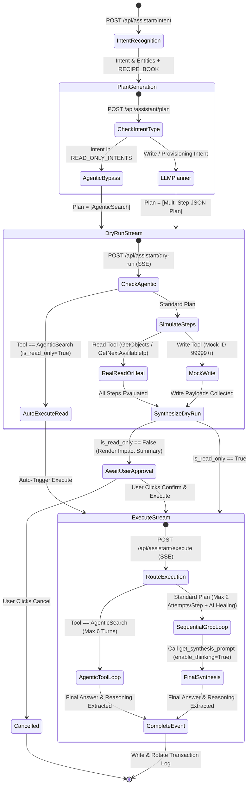

# NetBox Assistant (NBA) - Architecture & Design Document

**Doc_Type:** Architecture & Design
**Category:** (A) Assistant
**Name:** NetBox Assistant
**Acronym:** NBA
**Version:** 2.0.3
**Date:** 2026-11-01
**Author:** Martin Kecka & Gemini AI
**Status:** Active

---

## 1. Introduction & Purpose 📜

The **NetBox Assistant (NBA)** is a specialized AI-driven domain assistant within the SERA/GIA ecosystem (`config/settings.yaml` -> `module_info`), engineered to act as the primary reasoning, planning, and execution agent for enterprise NetBox automation. It operates both as an interactive, full-stack React web application served via FastAPI (`rest_api/main.py`) and as a SERA-compliant microservice (`grpc_api/services.py`) integrated with the Application Management Utility (AMU) and SERA Orchestrator.

Its core purpose is to translate high-level, natural language user requests (e.g., *"Provision a VM named 'web-03' with 2 vCPUs..."* or *"What sites do we have in Prague?"*) into verified NetBox operations. NBA separates high-level cognitive planning from low-level API syntax by partnering with its deterministic downstream counterpart, the **NetBox Connector (NBC)** (`core/connectors/nbc_connector.py` -> `NBCClient`). NBA handles intent classification, multi-step plan generation, native tool-calling loops, human-in-the-loop (HITL) dry-run confirmation, and mid-flight AI self-healing, while delegating schema-validated REST execution to NBC over gRPC.

Its core functional pillars include:

1. **Dual-Track Execution Pipeline (Logical Recipes & Native Agentic Loops):** Routes complex write and multi-step workflows through a structured Recipe + Plan Generation pipeline (`core/planner.py` -> `Planner`, `core/execution_engine.py` -> `ExecutionEngine.generate_plan()`), while dynamically routing read-only intents (`generic_get`, `count_objects`, `get_vm_ip`, `get_vm_all_ips`) into a multi-turn **Gemma Native Tool Calling** loop (`ExecutionEngine._execute_agentic_loop()`).
2. **Real-Time SSE Streaming & Interactive HITL Safety Gate:** Streams live step-by-step progress, retry states, and AI self-healing interventions to the React UI over Server-Sent Events (`rest_api/routers/assistant.py` -> `sse_formatter()`). Any plan containing mutation tools (`CreateObject`, `UpdateObject`, `DeleteObject`) is intercepted for a simulated dry run (`ExecutionEngine.dry_run()`), requiring explicit human confirmation before execution.
3. **Smart Discovery Context & Mid-Flight AI Self-Healing:** Automatically intercepts gRPC step failures during both dry runs and live execution, performs an automatic `q`-filter sample lookup in NetBox when filter keys fail, and invokes `prompts/failure_analysis_prompt.py` (`ExecutionEngine._run_failure_analysis()`) to dynamically rewrite invalid parameters or halt gracefully on unrecoverable constraint violations.
4. **Synchronized Schema Caching & Per-Transaction Auditing:** Validates local NetBox logical schemas against NBC's `GetSchemaVersions` and `GetLogicalSchemas` RPCs on startup (`NBCClient._initialize_schema_cache()`) and records an isolated, per-user JSON audit trail for every pipeline run (`utils/transaction_logger.py` -> `PipelineTransactionLogger`).

---

## 2. Architecture & Ecosystem Integration 🏗️

NBA operates as a hybrid dual-server Python application (`netbox_assistant.py` -> `main()`) hosting a FastAPI HTTP/SSE server on port `7891` (`nba-api.service`) and a SERA Standard gRPC server on port `50082` (`nba-grpc.service`).

- **Upstream Callers & Consumers:**
  * **Human Operator (via GIA Gateway & React WebUI, Port `7891`):** Users access the React SPA (`ui/src/App.jsx`) mounted at `/app/netbox_assistant`. The upstream API Gateway injects authentication headers (`X-Forwarded-User`, `X-Forwarded-Display-Name`) consumed by `rest_api/dependencies.py` -> `get_current_user()` and synchronizes global user theme preferences via `/api/auth/me`.
  * **Application Management Utility (AMU) & SAM UI (Inbound gRPC, Port `50082`):** Polls `sera.standard.SeraAppService` (`GetAppInfo`, `GetDeepHealth`, `GetFeedback`, `GetChangelog`, `GetDocs`) for service health, dependency topology, and live documentation rendering (`grpc_api/sera_standard_service.py` -> `SeraStandardServiceImpl`).
  * **SERA Orchestrator:** Delegates natural language NetBox domain tasks to NBA.
- **Downstream Dependencies:**
  * **HashiCorp Vault (`vault-aif.gt-t.net:8200`):** Authenticates via AppRole (`role_id`, `secret_id`) at engine initialization to retrieve the global LLM API Bearer token from KV v2 path `secret/haproxy/global/apps/nba-prod` (`core/clients/vault_client.py` -> `VaultClient.get_llm_key()`).
  * **AI Factory vLLM Service (`aif-llm-vllm-gemma4-31b.aif.gt-t.net`):** Executes LLM chat completions (`google/gemma-4-31B-it`) via `/v1/chat/completions` for Intent Recognition, Plan Generation, Dry-Run Synthesis, Failure Analysis, Final Answer Synthesis, and Agentic Loop tool calling (`core/llm_interface.py` -> `vLLMClient.get_chat_completion()`).
  * **NetBox Connector (`localhost:50081`, gRPC):** NBA's exclusive gateway to NetBox (`core/connectors/nbc_connector.py` -> `NBCClient`). Executes `GetSchemaVersions`, `GetLogicalSchemas`, `GetObjects`, `CreateObject`, `UpdateObject`, `DeleteObject`, and `GetNextAvailableIp` while passing caller attribution (`username`, `client_application="NBA"`) in gRPC metadata.

```mermaid
flowchart TD
    subgraph Upstream["Upstream Consumers & Gateway"]
        USER["Human Operator<br/>(Browser / React SPA)"]
        GW["GIA API Gateway<br/>(Headers: X-Forwarded-User & /api/auth/me)"]
        AMU["AMU / SAM UI<br/>(Ecosystem Telemetry Poller)"]
    end

    subgraph NBA["NetBox Assistant (NBA) - /ai/netbox_assistant"]
        subgraph WebLayer["FastAPI Server - Port 7891 (rest_api/)"]
            MAIN["FastAPI App & Static SPA Mount<br/>(rest_api/main.py)"]
            R_AST["Assistant Router (REST + SSE)<br/>(rest_api/routers/assistant.py)"]
            R_USR["Users & System Routers<br/>(users.py, system.py)"]
        end

        subgraph GrpcLayer["gRPC Server - Port 50082 (grpc_api/)"]
            SERA["SeraStandardServiceImpl<br/>(grpc_api/sera_standard_service.py)"]
        end

        subgraph CoreLayer["Core Reasoning & Execution Engine (core/)"]
            ENG["ExecutionEngine<br/>(core/execution_engine.py)"]
            PLAN["Planner & RECIPE_BOOK<br/>(core/planner.py)"]
            PROMPTS["Dynamic Prompt Builders<br/>(prompts/*.py)"]
            LLM["vLLMClient (Tenacity Retry)<br/>(core/llm_interface.py)"]
            VAULT["VaultClient (AppRole)<br/>(core/clients/vault_client.py)"]
            NBCC["NBCClient (gRPC Stub)<br/>(core/connectors/nbc_connector.py)"]
        end

        subgraph LocalDisk["Local Filesystem State"]
            DISC[("Cached Schemas & Maps<br/>(discovery/*.json, core/discovery/*.json)")]
            TXN[("Per-User Transaction Logs<br/>(/ai/assets/logs/nba_assistant/{user}/transactions/)")]
            APPLOG[("Rotating Application Logs<br/>(/ai/assets/logs/nba_assistant/nba*.log)")]
        end
    end

    subgraph Downstream["Downstream External & Ecosystem Services"]
        HV["HashiCorp Vault API<br/>(vault-aif.gt-t.net:8200)"]
        VLLM["AI Factory vLLM Endpoint<br/>(google/gemma-4-31B-it)"]
        NBC["NetBox Connector (NBC)<br/>(gRPC localhost:50081)"]
    end

    USER -->|"HTTPS / SSE"| GW
    GW -->|"Proxy /app/netbox_assistant & /api/*"| MAIN
    MAIN --> R_AST
    MAIN --> R_USR
    AMU -->|"gRPC: SeraAppService"| SERA
    R_AST --> ENG
    ENG --> PLAN
    PLAN --> PROMPTS
    ENG --> PROMPTS
    PLAN --> LLM
    ENG --> LLM
    ENG -->|"Fetch API Key on Init"| VAULT
    VAULT -->|"AppRole Login & KV v2 Read"| HV
    LLM -->|"HTTPS POST /v1/chat/completions<br/>(Bearer API Key)"| VLLM
    ENG --> NBCC
    NBCC <-->|"Sync & Read Schemas"| DISC
    PROMPTS <--|"Load object_map.json"| DISC
    NBCC -->|"gRPC: NetBoxConnectorService<br/>(Metadata: username, client_application)"| NBC
    ENG -->|"Write JSON Audit Trail"| TXN
    WebLayer --> APPLOG
    CoreLayer --> APPLOG
```

---

## 3. Module File Map 📂

```plaintext
/ai/netbox_assistant
├── bootstrap_helper.py                                     # Virtualenv & pip dependency auto-bootstrapper
├── netbox_assistant.py                                     # Main unified launcher & CLI dispatcher (main)
├── deploy.sh                                               # Production build script (npm build + systemctl restart nba-api)
├── README.md                                               # Module overview and core documentation links
├── requirements.txt                                        # Python dependencies (fastapi, uvicorn, grpcio, tenacity, hvac, pandas)
├── .gitignore                                              # Git exclusion rules
├── cli/
│   └── nba_cli.py                                          # Click CLI group (start-grpc-server, start-api-server)
├── config/
│   └── settings.yaml                                       # Master configuration (ports, Vault, NBC connector, vLLM, logging)
├── core/
│   ├── execution_engine.py                                 # Core pipeline orchestrator (ExecutionEngine, READ_ONLY_INTENTS)
│   ├── llm_interface.py                                    # vLLM HTTP client with Tenacity retry (vLLMClient)
│   ├── netbox_schema.py                                    # Static LLM reference schema dictionary (NETBOX_SCHEMA)
│   ├── planner.py                                          # Intent classifier & static recipe selector (Planner, RECIPE_BOOK)
│   ├── clients/
│   │   └── vault_client.py                                 # HashiCorp Vault AppRole client (VaultClient)
│   ├── connectors/
│   │   └── nbc_connector.py                                # gRPC client & schema cache synchronizer for NBC (NBCClient)
│   ├── database/                                           # Reserved directory for database extensions
│   ├── discovery/                                          # Runtime schema cache directory populated by NBCClient
│   │   ├── custom_field_map.json                           # Cached NetBox custom field definitions from NBC
│   │   ├── filterable_schema.json                          # Cached GET filter parameters per endpoint from NBC
│   │   ├── nbc_schema_versions.cache                       # Local cache of core_schema_version and custom_field_schema_hash
│   │   ├── object_map.json                                 # Cached NetBox object types and lookup fields from NBC
│   │   └── writable_schema.json                            # Cached POST/PATCH writable fields and choices from NBC
│   └── provisioning/                                       # Reserved directory for provisioning helpers
├── discovery/                                              # Root discovery schema directory read by plan_generation_prompt.py
│   ├── custom_field_map.json                               # Root custom field definitions map
│   ├── filterable_schema.json                              # Root filterable schema definitions
│   ├── fix_schema.json                                     # Reserved JSON cache for self-improving failure analysis rules
│   ├── name_to_id_map.json                                 # Mapping of logical relationship keys to NetBox object_type paths
│   ├── nbc_schema_versions.cache                           # Root schema version cache file
│   ├── object_map.json                                     # Root object_map read by _load_object_map_for_prompt()
│   ├── object_type_map.json                                # Shorthand plural object name to full NetBox API path map
│   ├── type_validation_schema.json                         # Field type and read_only validation schema
│   └── writable_schema.json                                # Root writable model schema
├── docs/
│   ├── CHANGELOG.yaml                                      # Structured release history parsed by AMU
│   └── nba_design.md                                       # Symlink -> /ai/assets/guides/tool_guides/nba_design.md
├── grpc_api/
│   ├── generate_stubs.py                                   # Dynamic protoc stub generator for sera_standard.proto
│   ├── sera_standard_service.py                            # SeraAppServiceServicer implementation (health & metadata)
│   └── services.py                                         # Standalone gRPC server bootstrap (serve) on port 50082
├── prompts/
│   ├── __init__.py                                         # Package marker
│   ├── dry_run_synthesis_prompt.py                         # Prompt builder for human-readable write confirmation summaries
│   ├── failure_analysis_prompt.py                          # Prompt builder for AI self-healing parameter correction
│   ├── intent_recognition_prompt.py                        # Prompt builder for intent classification and entity extraction
│   ├── plan_generation_prompt.py                           # Prompt builder for multi-step JSON execution plans
│   └── synthesis_prompt.py                                 # Prompt builder for final answer synthesis with thinking enabled
├── rest_api/
│   ├── dependencies.py                                     # FastAPI header dependency (get_current_user)
│   ├── main.py                                             # FastAPI app factory, lifespan init, routers, and React SPA mount
│   ├── schemas.py                                          # Pydantic request/response models (AnalyzeRequest, PlanRequest, etc.)
│   └── routers/
│       ├── assistant.py                                    # Core pipeline endpoints (/intent, /plan, /dry-run, /execute)
│       ├── system.py                                       # Health and public config endpoints (/health, /config)
│       └── users.py                                        # User identity endpoint (/api/users/me)
├── scripts/                                                # Maintenance and one-off testing scripts (e.g., debug_llm_payload.py)
├── tests/
│   └── test_query.txt                                      # Sample test queries
├── ui/
│   ├── index.html                                          # Root HTML shell for Vite React SPA
│   ├── package.json                                        # Frontend dependencies (React 18, MUI v5, react-markdown, Vite)
│   ├── vite.config.js                                      # Vite dev server (port 5173) and /api proxy to 127.0.0.1:7891
│   ├── public/
│   │   ├── favicon.ico                                     # Browser favicon
│   │   └── launcher-icon.svg                               # Portal launcher SVG icon
│   └── src/
│       ├── main.jsx                                        # React DOM root mount with CustomThemeProvider
│       ├── App.jsx                                         # Top bar, user auth state, GIA theme sync, and layout container
│       ├── CustomThemeProvider.jsx                         # Context provider managing 6 themes and CSS --grid-color
│       ├── ThemeContext.jsx                                # React Context definition for theme state
│       ├── theme.js                                        # MUI createTheme definitions (dark, light, pink, purple, red, blue)
│       ├── index.css                                       # Global styles and CSS background grid pattern
│       ├── pages/
│       │   └── AssistantPage.jsx                           # Main split-screen chat + inspector workflow controller
│       ├── components/
│       │   ├── chat/
│       │   │   ├── ChatMessage.jsx                         # Markdown-rendered user/assistant chat bubble component
│       │   │   ├── ExecutionLog.jsx                        # Step-by-step accordion viewer for payloads, results, and retries
│       │   │   ├── InspectorSidebar.jsx                    # Right-hand telemetry panel (Intent, Reasoning, Plan, Healing, Logs)
│       │   │   └── PlanViewer.jsx                          # Vertical timeline viewer for execution plan steps and impact summary
│       │   └── common/                                     # Reserved directory for shared UI components
│       └── services/
│           └── assistantService.js                         # Fetch & SSE stream reader client for /api/assistant/*
└── utils/
    ├── config_loader.py                                    # YAML configuration loader (load_config)
    ├── logging_setup.py                                    # Root & Uvicorn RotatingFileHandler setup (setup_logging)
    └── transaction_logger.py                               # Per-pipeline-run JSON audit logger (PipelineTransactionLogger)
```

---

## 4. Core Processing Lifecycle ⚙️

### 4.1. Boot & Initialization Sequence

1. **Process Entry & Venv Bootstrap:** Execution begins in `netbox_assistant.py` -> `main()`. It invokes `bootstrap_helper.bootstrap_and_reexecute_if_needed()` to ensure the virtual environment is active before importing application dependencies.
2. **Configuration & Logging Setup:**
   * `utils/config_loader.py` -> `load_config("config/settings.yaml")` parses the YAML configuration via `yaml.safe_load()`, exiting with code `1` on `FileNotFoundError` or parse failure.
   * `utils/logging_setup.py` -> `setup_logging(config)` initializes the root logger at `logging.DEBUG` guarded by `_LOGGING_CONFIGURED`:
     * Attaches a `stderr` `StreamHandler` at `logging.level` (`INFO`).
     * Creates `/ai/assets/logs/nba_assistant` and attaches two `RotatingFileHandler` instances: `nba_app.log` (`DEBUG` level, `maxBytes=5*1024*1024`, `backupCount=3`) and `nba_err.log` (`WARNING` level, `maxBytes=2*1024*1024`, `backupCount=3`).
     * Suppresses noisy loggers (`hpack`, `httpx`, `httpcore`, `watchdog`, `watchfiles`, `urllib3`) to `logging.WARNING` and sets `uvicorn` to `logging.INFO`.
3. **Dual-Service Launch (`netbox_assistant.py` vs. `cli/nba_cli.py`):**
   * When invoked with `start-grpc-server` or `start-api-server`, `netbox_assistant.py` delegates to `cli/nba_cli.py` -> `cli()`.
   * When invoked directly without subcommands, `netbox_assistant.py` runs `grpc_api/generate_stubs.py` -> `check_and_generate_stubs(config)` to compile `sera_standard_pb2.py` from `/ai/assets/protos/sera_standard` if missing, spawns `grpc_api/services.py` -> `serve(config)` (port `50082`) in a background daemon thread (`threading.Thread(..., daemon=True)`), and starts Uvicorn serving `rest_api.main:app` on `0.0.0.0:7891`.
4. **FastAPI Lifespan & ExecutionEngine Initialization (`rest_api/main.py` -> `lifespan()`):**
   * Adds `/ai/assets/protos/netbox_connector/generated` and its 3-level parent root to `sys.path` via `add_grpc_paths()`.
   * Instantiates `app.state.engine = ExecutionEngine(config)` (`core/execution_engine.py` -> `ExecutionEngine.__init__()`):
     1. Authenticates with HashiCorp Vault via `VaultClient(vault_cfg)` (`core/clients/vault_client.py`) using AppRole `role_id` and `secret_id`, and fetches the LLM Bearer token from `secret/haproxy/global/apps/nba-prod` (`VaultClient.get_llm_key()`).
     2. Initializes `self.llm_client = vLLMClient(alias="primary", config=config, api_key=llm_api_key)` (`core/llm_interface.py`).
     3. Initializes `self.nbc_client = NBCClient(config)` (`core/connectors/nbc_connector.py`), which opens an insecure gRPC channel to `localhost:50081` (`grpc.channel_ready_future(channel).result(timeout=5)`) and runs `self._initialize_schema_cache()`.
     4. During `_initialize_schema_cache()`, `NBCClient` calls `GetSchemaVersions` (`timeout=10`) and compares `core_schema_version` and `custom_field_schema_hash` against `core/discovery/nbc_schema_versions.cache`. On mismatch, it calls `GetLogicalSchemas` (`timeout=30`) and writes `writable_schema.json`, `filterable_schema.json`, `custom_field_map.json`, and `object_map.json` into `core/discovery/`.
     5. Initializes `self.planner = Planner(self.llm_client)` (`core/planner.py`).
5. **Router & Static SPA Mounting (`rest_api/main.py`):** Mounts `system.router`, `assistant.router`, and `users.router` both at root (`/api/...`) and under `BASE_PATH = "/app/netbox_assistant"`. Mounts compiled React assets from `ui/dist/assets` and serves `ui/dist/index.html` as a catch-all SPA fallback.

### 4.2. End-to-End Request & Execution Workflows

The frontend (`ui/src/pages/AssistantPage.jsx` -> `handleAnalyze()`) drives the backend through a sequential 4-stage HTTP/SSE pipeline exposed in `rest_api/routers/assistant.py`:

1. **Stage 1 — Intent Recognition (`POST /api/assistant/intent`):**
   * `assistant.py` -> `analyze_intent()` calls `ExecutionEngine.recognize_intent(request.query)` -> `Planner.get_intent_and_recipe(query)`.
   * `Planner` builds the prompt via `prompts/intent_recognition_prompt.py` -> `get_intent_recognition_prompt(query, self.valid_intents)` and calls `vLLMClient.get_chat_completion(..., json_mode=True, stage="Intent Recognition", enable_thinking=False)`.
   * Parses the returned JSON `{"intent": "...", "entities": {...}}`. If the returned intent is not in `RECIPE_BOOK`, falls back to `"generic_get"`. Attaches `RECIPE_BOOK[intent]` and returns `IntentResponse`.
2. **Stage 2 — Plan Generation (`POST /api/assistant/plan`):**
   * `assistant.py` -> `generate_plan()` calls `ExecutionEngine.generate_plan(query, intent, entities, recipe)`.
   * **Branch A — Read-Only Agentic Bypass:** If `intent in READ_ONLY_INTENTS` (`["generic_get", "count_objects", "get_vm_ip", "get_vm_all_ips"]`), bypasses the LLM planner and immediately returns a single-step plan: `[{"tool": "AgenticSearch", "description": "Dynamic search using Gemma Native Tool Calling.", "params": {"query": query}}]`.
   * **Branch B — Multi-Step Logical Plan Generation:** For write/provisioning intents (`provision_vm`, `provision_full_vm`, `generic_create`, `generic_update`, `generic_delete`), constructs the planning prompt via `prompts/plan_generation_prompt.py` -> `get_plan_generation_prompt()` (injecting `RECIPE_BOOK` steps, `[json]...[/json]` entities, `BASE_RULES`, `INTENT_RULES[intent]`, and all keys from `discovery/object_map.json`). Calls `vLLMClient.get_chat_completion(..., json_mode=True, stage="Plan Generation", enable_thinking=False)` and returns `execution_plan`.
3. **Stage 3 — Dry-Run Simulation & Safety Gate (`POST /api/assistant/dry-run`, SSE Stream):**
   * `assistant.py` -> `dry_run_plan()` wraps `ExecutionEngine.dry_run(query, execution_plan, username)` in `StreamingResponse(sse_formatter(generator), media_type="text/event-stream")`.
   * If `plan[0]["tool"] == "AgenticSearch"`, yields a `complete` event with `is_read_only: True` immediately.
   * Otherwise, iterates through each step in `plan`:
     * **Read Steps (`GetObjects`, `GetNextAvailableIp`):** Resolves placeholders via `_resolve_step_params()` and executes the live gRPC call against `NBCClient.execute_step()`. If the call fails, triggers up to 2 attempts with AI Self-Healing (`_run_failure_analysis()`), mutating `step["params"]` in place so the healed plan is returned to the UI.
     * **Write Steps (`CreateObject`, `UpdateObject`, `DeleteObject`):** Resolves placeholders via `_resolve_step_params()` and appends the payload to `write_payloads` without calling NBC. For `CreateObject`, synthesizes a mock result object with `"id": 99999 + i` and `"slug": name.lower().replace(" ", "-")` so downstream steps in the dry run can resolve `{{steps[i].result.id}}` or `.slug` references.
   * If `write_payloads` is empty, yields `complete` with `is_read_only: True`.
   * If `write_payloads` is non-empty, calls `prompts/dry_run_synthesis_prompt.py` -> `get_dry_run_synthesis_prompt(write_payloads)` (`enable_thinking=False`) and yields `complete` with `is_read_only: False`, the human-readable confirmation `summary`, the (potentially self-healed) `execution_plan`, and `logs`.
4. **Stage 4 — Plan Execution & Final Synthesis (`POST /api/assistant/execute`, SSE Stream):**
   * Triggered automatically by `AssistantPage.jsx` when `dryRun.is_read_only == true`, or manually when the user clicks **"Confirm & Execute"** in `InspectorSidebar.jsx`.
   * Initializes `PipelineTransactionLogger(self.config, user_id=username)` and writes the initial query and plan (`set_initial_data()`).
   * Executes either `_execute_agentic_loop()` (for `AgenticSearch`) or the step-by-step gRPC loop with AI Self-Healing, synthesizes the final response (`_synthesize_answer()`), finalizes and rotates transaction logs (`pipeline_logger.finalize()`), and yields the `complete` SSE event.



---

## 5. Detailed Business Logic, Rules & HITL 🧠

### 5.1. Intent Recognition & Recipe Selection (`core/planner.py` -> `Planner`)

- **Trigger Condition & Priority:** First stage of every user query (`POST /api/assistant/intent`).
- **Step-by-Step Logic & Recipe Matrix:**
  1. `Planner.__init__()` loads `self.valid_intents = list(RECIPE_BOOK.keys())`.
  2. `get_intent_recognition_prompt()` instructs the LLM to select the single best intent and extract structured entities (forcing general city/location/fuzzy searches into key `"q"`).
  3. If the LLM returns an unrecognized intent string, `Planner.get_intent_and_recipe()` logs a warning and defaults to `"generic_get"`.
  4. Maps the intent to one of the 9 deterministic recipes in `RECIPE_BOOK`:
     * `count_objects`: 1-step recipe using `"q"` for loose keywords and requesting total count only.
     * `get_vm_ip`: 1-step recipe fetching the VM object containing its primary IP.
     * `get_vm_all_ips`: 2-step recipe finding the VM ID, then querying associated IP addresses.
     * `provision_vm`: 1-step recipe creating a basic VM.
     * `provision_full_vm`: 7-step recipe (Find cluster with site/scope context -> Create VM -> Create interfaces -> Find parent prefix by VLAN name and cluster site context -> Get next available IP -> Assign IP to interface -> Create virtual disks).
     * `generic_get`: 1-step recipe enforcing `"q"` filter for city/location queries.
     * `generic_create`: 1-step recipe creating the requested object.
     * `generic_update`: 2-step recipe (Find target object without `output_fields` to get full state and ID -> Update object by ID).
     * `generic_delete`: 2-step recipe (Find target object ID -> Delete object by ID).

### 5.2. Logical Plan Generation & Dynamic Intent Rules (`prompts/plan_generation_prompt.py`)

- **Trigger Condition & Priority:** Invoked by `ExecutionEngine.generate_plan()` whenever `intent not in READ_ONLY_INTENTS`.
- **Step-by-Step Logic:**
  1. Loads all available NetBox API endpoints from `discovery/object_map.json` via `_load_object_map_for_prompt()`.
  2. Wraps extracted `entities` in `[json]\n...\n[/json]` tags and combines `BASE_RULES` with intent-specific overrides from `INTENT_RULES`:
     * **Available Tools Contract:** Restricts the LLM to `GetObjects(object_type, filters, output_fields, count_only)`, `CreateObject(object_type, object_data)`, `UpdateObject(object_type, object_id, object_data)`, `DeleteObject(object_type, object_id)`, and `GetNextAvailableIp(prefixId)`.
     * **`provision_full_vm` Rules:** Prohibits `output_fields` on cluster lookup; enforces NetBox v4 cluster scope path `{{steps[0].result[0].scope.slug}}` (instead of `site.slug`) when looking up prefixes by VLAN; mandates `UpdateObject` on `"ipam/ip-addresses"` with `"assigned_object_type": "virtualization.vminterface"`; enforces logical field `"vlan"` for `mode: "access"` interfaces; and flattens custom fields to the root of `object_data`.
     * **`generic_get` & `count_objects` Rules:** Enforces `"q"` filter for locations/keywords, omits `output_fields` by default, and requires `"count_only": true` for counting.

### 5.3. Native Agentic Search Loop (`core/execution_engine.py` -> `ExecutionEngine._execute_agentic_loop()`)

- **Trigger Condition & Priority:** Executed during `execute_plan()` when `plan[0].get("tool") == "AgenticSearch"` (all intents in `READ_ONLY_INTENTS`).
- **Step-by-Step Logic:**
  1. Bypasses static multi-step planning and constructs an OpenAI-compatible `tools` specification exposing `GetObjects` (`object_type`, `filters`, `output_fields`, `count_only`).
  2. Initializes conversation history with a system prompt instructing the model to iteratively search NetBox using `GetObjects` and summarize the result.
  3. Loops for up to `max_turns = 6`:
     * Yields SSE progress `{event: "progress", state: "executing", step: turn + 1, attempt: 1, tool: "Agentic Loop"}`.
     * Calls `vLLMClient.get_chat_completion(messages, json_mode=False, tools=tools, enable_thinking=True, stage="Agentic Loop")`.
     * **If `tool_calls` are returned:** Parses `tc["function"]["arguments"]`, invokes `self.nbc_client.execute_step("GetObjects", args, username=username)`, logs the step to `PipelineTransactionLogger`, and appends a `role: "tool"` message back into `messages`. If `NBCClient` returns an error (`success == False`), appends `{"error": error_msg}` as the tool output and yields SSE state `"healing"` (`tool: "Agentic Self-Correction"`) so the LLM can adjust its filters on the next turn.
     * **If no `tool_calls` are returned:** Extracts `final_answer` from `response["content"]` and `reasoning` from `response.get("reasoning")` / `response.get("reasoning_content")` (or strips `<think>(.*?)</think>` tags via `re.search(r'<think>(.*?)</think>', final_answer, re.DOTALL | re.IGNORECASE)`), finalizes the transaction log, and yields the `complete` SSE event.
  4. If `6` turns are exhausted without a final answer, finalizes the transaction log with an error and yields `"Max tool turns exceeded."`.

### 5.4. Placeholder Resolution Engine (`core/execution_engine.py` -> `ExecutionEngine._resolve_step_params()`)

- **Trigger Condition & Priority:** Executed prior to every step in `dry_run()` and `execute_plan()`.
- **Step-by-Step Logic:**
  1. Serializes `params` to a JSON string and extracts all step references using the exact regex:
     $$\text{Regex: } \texttt{\textbackslash\{\textbackslash\{steps\textbackslash[(\textbackslash d+)\textbackslash]\textbackslash.result(?:\textbackslash[(\textbackslash d+)\textbackslash])?\textbackslash.([\textbackslash w\textbackslash.-]+)\textbackslash\}\textbackslash\}}$$
  2. Validates that `step_idx < len(previous_results)` and that `previous_results[step_idx]` is neither `None` nor an empty list `[]`.
  3. Indexes into `target_obj[int(item_idx_str)]` if an explicit array index `[N]` is provided; otherwise, if `target_obj` is a non-empty `list`, automatically unwraps `target_obj[0]`.
  4. Traverses dot-separated `prop_path` keys:
     * **NetBox v4 Site/Scope Alias Fallback:** If traversing a `dict` where `key == 'site'` and `'site'` is absent from `value` while `'scope'` is present, transparently rewrites `key = 'scope'`.
  5. **ID Integer Coercion:** If `prop_path.endswith('.id')` and `value is not None`, casts `value = int(float(value))` to prevent float serialization issues from protobuf `Struct` numbers.
  6. Replaces `f'"{full_placeholder}"'` with `json.dumps(value)` and parses the resulting JSON string back into a Python dictionary.

### 5.5. Smart Discovery Context & AI Self-Healing (`core/execution_engine.py` -> `_run_failure_analysis()`)

- **Trigger Condition & Priority:** Triggered when `NBCClient.execute_step()` returns `success == False` on `attempt == 0` (out of `range(2)`) during either `dry_run()` or `execute_plan()`.
- **Step-by-Step Logic:**
  1. **Smart Discovery Context Injection:** If the failed tool is `"GetObjects"` and `"Invalid filter key"` appears in `step_error`, extracts the first filter value `str(list(bad_filters.values())[0])` and issues a fallback `GetObjects` call to `NBCClient` using `"filters": {"q": search_val}`. If results are returned, serializes the first two objects (`discovery_resp["data"][:2]`) as `discovery_context` so the LLM can inspect where the target value actually resides (e.g., inside `custom_fields` or under `slug`).
  2. Yields an SSE progress event with `state: "healing"`.
  3. Calls `prompts/failure_analysis_prompt.py` -> `get_failure_analysis_prompt(query, plan, step, error, discovery_context)` (`json_mode=True`, `enable_thinking=False`).
  4. **Decision Branch:**
     * **Unrecoverable Error:** If the LLM returns `{"error": "unrecoverable", "reason": "..."}` (such as a NetBox unique constraint violation), aborts the pipeline immediately, logs the failure, and yields a `complete` SSE event with `success: False`.
     * **Self-Healed Retry:** Otherwise, replaces `step["params"] = analysis`, appends `{"error": step_error, "correction": analysis}` to `step_log["retries"]`, and immediately executes `attempt == 1`.

### 5.6. HITL & Learning Loops

- **Interactive Dry-Run Approval Gate:** Any execution plan that generates non-empty `write_payloads` during `ExecutionEngine.dry_run()` sets `is_read_only: False` and generates a natural-language bulleted confirmation prompt via `prompts/dry_run_synthesis_prompt.py`. In the React UI (`ui/src/components/chat/InspectorSidebar.jsx`), `requiresAction` activates an orange **"APPROVAL REQUIRED"** banner with **"Cancel"** and **"Confirm & Execute"** buttons, blocking all NetBox mutations until the operator explicitly approves.
- **Self-Healing Transparency:** Any automatic parameter repairs performed during dry run or live execution are surfaced to the operator in the **"AI Self-Healing Applied"** accordion (`InspectorSidebar.jsx`) and inside individual step retry blocks (`ExecutionLog.jsx`).

---

## 6. AI, LLM & Machine Learning Execution 🤖

NBA relies on the AI Factory's vLLM service (`core/llm_interface.py` -> `vLLMClient`) hosting `google/gemma-4-31B-it`. Authentication is handled via a Bearer API key fetched from HashiCorp Vault (`secret/haproxy/global/apps/nba-prod`).

### 6.1. `vLLMClient` Configuration & Retry Mechanics

- **Endpoint & Transport:** `https://aif-llm-vllm-gemma4-31b.aif.gt-t.net/v1/chat/completions` (`ssl_verify: False`, `timeout_seconds: 180`, `max_tokens: 32768`, `temperature: 0.2`).
- **Resilience Decorator:** `vLLMClient.get_chat_completion()` is decorated with `@retry(stop=stop_after_attempt(3), wait=wait_fixed(2))` from `tenacity`, automatically retrying transient HTTP or network failures up to 3 times with a 2-second fixed wait.
- **Health Readiness Check (`vLLMClient.is_ready()`):** Probes `GET {base_url}/health` (`timeout=5`) with an automatic fallback to `GET {base_url}/v1/models`.

### 6.2. Pipeline Stage Prompt & Model Parameter Matrix

| Pipeline Stage | Prompt Module & Function | `json_mode` | `enable_thinking` | `tools` Passed | Output Parsing & Validation |
| :--- | :--- | :--- | :--- | :--- | :--- |
| **Intent Recognition** | `prompts/intent_recognition_prompt.py` -> `get_intent_recognition_prompt()` | `True` | `False` | `None` | `json.loads()` expecting `{"intent": str, "entities": dict}`; invalid intents fallback to `"generic_get"`. |
| **Plan Generation** | `prompts/plan_generation_prompt.py` -> `get_plan_generation_prompt()` | `True` | `False` | `None` | `json.loads()` expecting `{"execution_plan": List[Dict]}` with `tool`, `params`, and `description`. |
| **Dry Run Synthesis** | `prompts/dry_run_synthesis_prompt.py` -> `get_dry_run_synthesis_prompt()` | `False` | `False` | `None` | Plaintext/Markdown bulleted summary prefixed with `"Before I proceed, please confirm the following actions:"`. |
| **Failure Analysis (Self-Healing)** | `prompts/failure_analysis_prompt.py` -> `get_failure_analysis_prompt()` | `True` | `False` | `None` | `json.loads()` returning either corrected `params` dict or `{"error": "unrecoverable", "reason": str}`. |
| **Agentic Search Loop** | `core/execution_engine.py` -> `_execute_agentic_loop()` | `False` | `True` | `[GetObjects]` | Native `tool_calls` array (`max_turns=6`) followed by final Markdown `content` + `<think>` / `reasoning` extraction. |
| **Final Answer Synthesis** | `prompts/synthesis_prompt.py` -> `get_synthesis_prompt()` | `False` | `True` | `None` | Extracts `reasoning` from `reasoning` / `reasoning_content` fields or `<think>...</think>` regex, returning `(content, reasoning)`. |

---

## 7. Data Models, State, Storage & Auditing 🗄️

### 7.1. Database Schemas

Not applicable for this module. NBA is stateless with respect to relational databases (PostgreSQL/SQLAlchemy) and persists all operational schemas and transaction audit logs directly on the local filesystem.

### 7.2. State Enumerations

- **Frontend Pipeline Processing States (`ui/src/pages/AssistantPage.jsx` -> `processingState`):**
  * `'intent'`: *"Analyzing Intent & Extracting Entities..."*
  * `'plan'`: *"Generating Logical Execution Plan..."*
  * `'dry-run'`: *"Dry Run Simulation Step X [Tool]..."*
  * `'executing'`: *"Execution Step X [Tool]..."*
  * `null`: Idle or awaiting user confirmation.
- **SSE Progress Stream States (`core/execution_engine.py`):** `'dry-run'`, `'executing'`, `'healing'`, `'complete'`, `'error'`.
- **Step Execution Log Statuses (`ExecutionLog.jsx`):** `'pending'`, `'success'`, `'failed'`.
- **Transaction Log Lifecycle Statuses (`utils/transaction_logger.py`):** `'running'`, `'completed'`, `'failed'`.
- **SERA Deep Health Statuses (`grpc_api/sera_standard_service.py`):** `'HEALTHY'`, `'DEGRADED'`, `'DOWN'`.

### 7.3. In-Memory Caching & Thread Safety

- **FastAPI Application Singleton (`rest_api/main.py` -> `app.state.engine`):** Holds the single initialized `ExecutionEngine` instance (including `vLLMClient`, `NBCClient` gRPC channel, and `Planner`) across all HTTP requests.
- **Schema Cache Synchronization (`core/connectors/nbc_connector.py` -> `NBCClient._initialize_schema_cache()`):** Validates `core/discovery/nbc_schema_versions.cache` against NBC on startup and updates local JSON schema files only when `core_schema_version` or `custom_field_schema_hash` changes.

### 7.4. File System Storage & Auditing

| File / Directory Path | Format | Retention / Lifecycle | Purpose & Owning Module |
| :--- | :--- | :--- | :--- |
| `discovery/*.json` & `core/discovery/*.json` | JSON | Updated on startup when NBC schema version/hash changes | Local copies of `writable_schema.json`, `filterable_schema.json`, `custom_field_map.json`, and `object_map.json` (`core/connectors/nbc_connector.py`, `prompts/plan_generation_prompt.py`). |
| `core/discovery/nbc_schema_versions.cache` | JSON | Updated on schema sync | Stores `core_schema_version` and `custom_field_schema_hash` from NBC (`NBCClient._save_local_versions()`). |
| `/ai/assets/logs/nba_assistant/nba_app.log` | Log Text | `5 MB` max size, `3` backups (`RotatingFileHandler`) | Root application `DEBUG`+ log (`utils/logging_setup.py` -> `setup_logging()`). |
| `/ai/assets/logs/nba_assistant/nba_err.log` | Log Text | `2 MB` max size, `3` backups (`RotatingFileHandler`) | Root application `WARNING`+ error log (`utils/logging_setup.py` -> `setup_logging()`). |
| `/ai/assets/logs/nba_assistant/{user_id}/transactions/nba_txn_{YYYYMMDD_HHMMSS}_{uuid8}.log` | JSON | Last `50` files per user (`retain_count: 50`) | Per-pipeline-run audit trail capturing `transaction_id`, `username`, `start_time`, `end_time`, `status`, `user_question`, `generated_execution_plan`, per-step `resolved_grpc_payload` / `result` / `error`, and `final_answer` (`utils/transaction_logger.py` -> `PipelineTransactionLogger`). |

---

## 8. APIs, Observability & Communication Contracts 📡

### 8.1. Inbound REST & SSE API (`rest_api/`)

All endpoints are mounted both at root (`/api/...`) and under `/app/netbox_assistant/api/...` (`rest_api/main.py`):

| HTTP Method & Path | Request Schema / Headers | Response Schema / Format | Operational Description |
| :--- | :--- | :--- | :--- |
| `GET /api/system/health` | None | `{"status": "ok", "service": "NetBox Assistant"}` | Lightweight liveness probe (`rest_api/routers/system.py`). |
| `GET /api/system/config` | None | `{"app_name": "NetBox Assistant", "version": "2.0.0"}` | Returns public metadata for the frontend (`rest_api/routers/system.py`). |
| `GET /api/users/me` | `X-Forwarded-User`, `X-Forwarded-Display-Name` | `{"username": str, "display_name": str}` | Extracts authenticated user identity from Gateway headers (`rest_api/routers/users.py`). |
| `POST /api/assistant/intent` | `AnalyzeRequest` (`query: str`) | `IntentResponse` (`intent: str`, `entities: dict`, `recipe: List[str]`) | Classifies user query intent, extracts structured entities, and selects the corresponding `RECIPE_BOOK` steps (`rest_api/routers/assistant.py`). |
| `POST /api/assistant/plan` | `PlanGenerateRequest` (`query`, `intent`, `entities`, `recipe`) | `PlanGenerateResponse` (`execution_plan: List[Dict]`) | Generates either a single-step `AgenticSearch` plan (for read-only intents) or a multi-step logical JSON plan (`rest_api/routers/assistant.py`). |
| `POST /api/assistant/dry-run` | `PlanRequest` (`query`, `execution_plan`) + User Headers | `text/event-stream` (SSE: `progress` & `complete` events) | Executes read steps against NBC (with AI self-healing), simulates write payloads with mock IDs (`99999+i`), and synthesizes a confirmation summary (`rest_api/routers/assistant.py`). |
| `POST /api/assistant/execute` | `ExecuteRequest` (`query`, `execution_plan`) + User Headers | `text/event-stream` (SSE: `progress` & `complete` events) | Executes the approved multi-step plan or multi-turn `AgenticSearch` loop against NBC, logs the transaction, and synthesizes the final answer (`rest_api/routers/assistant.py`). |

### 8.2. Universal SERA Standard Contract (`SeraAppService`)

NBA exposes the universal `sera.standard.SeraAppService` gRPC contract (`GetAppInfo`, `GetDeepHealth`, `GetFeedback`, `GetChangelog`, `GetDocs`) on port `50082` via `grpc_api/sera_standard_service.py` -> `SeraStandardServiceImpl`—centrally maintained and deployed by the Application Management Utility (`amu_design.md`)—for SAM UI and AMU telemetry integration, alongside standard `grpc.health.v1.Health` and `grpc.reflection.v1alpha.ServerReflection` services (`grpc_api/services.py`).

### 8.3. Outbound Client Contracts

| Target System | Client Class / Method | Protocol & Endpoint | Timeout & Security / Metadata |
| :--- | :--- | :--- | :--- |
| **HashiCorp Vault API** | `core/clients/vault_client.py` -> `VaultClient.get_llm_key()` | HTTPS REST (`https://vault-aif.gt-t.net:8200`) | AppRole login (`role_id`, `secret_id`), KV v2 read (`secret/haproxy/global/apps/nba-prod`), `verify_ssl=False`, proxies disabled (`{"http": None, "https": None}`). |
| **AI Factory vLLM Service** | `core/llm_interface.py` -> `vLLMClient.get_chat_completion()` | HTTPS REST (`https://aif-llm-vllm-gemma4-31b.aif.gt-t.net/v1/chat/completions`) | `timeout_seconds=180`, `ssl_verify=False`, Header: `Authorization: Bearer {api_key}`, `@retry(stop=stop_after_attempt(3), wait=wait_fixed(2))`. |
| **NetBox Connector (NBC)** | `core/connectors/nbc_connector.py` -> `NBCClient.execute_step()` | gRPC (`localhost:50081`) | Channel ready timeout `5s`; RPC timeouts: `10s` (`GetSchemaVersions`), `30s` (`GetLogicalSchemas`), `60s` (`execute_step`). Metadata: `[('username', username), ('client_application', 'NBA')]`. |

---

## 9. User Interface (UI) & Visualizations 🖥️

NBA features a responsive React 18 and Material UI v5 single-page application (`ui/src/`) built with Vite and served from `/app/netbox_assistant/`.

1. **Top Navigation Bar & Ecosystem Theme Synchronization (`ui/src/App.jsx`, `CustomThemeProvider.jsx`, `theme.js`):**
   * Displays the **NBA NetBox Assistant** brand header, authenticated user greeting (`Welcome, {display_name}`), a 6-theme palette selector dropdown (`dark`, `light`, `pink`, `purple`, `red`, `blue`), and a conditional Login (`/login`) / Logout (`/logout`) button.
   * Synchronizes the user's selected theme across the SERA ecosystem on startup via `GET /api/auth/me` and persists changes via `PUT /api/auth/me/theme`, dynamically updating the CSS background grid variable `--grid-color`.
2. **Split-Screen Workspace (`ui/src/pages/AssistantPage.jsx`):**
   * **Left Pane — Conversational Chat Stream (`flex: 1.5`):** Renders user queries and Markdown-formatted assistant responses (`ui/src/components/chat/ChatMessage.jsx` using `react-markdown`), live inline stage spinners (`getProgressText()`), and an auto-expanding multiline input box (`Enter` to submit, `Shift+Enter` for newline).
   * **Right Pane — Real-Time Inspector Sidebar (`flex: 1`, `ui/src/components/chat/InspectorSidebar.jsx`):** Provides complete operational transparency through 4 collapsible sections:
     * **Intent Analysis Accordion:** Displays the detected intent chip and raw JSON extracted `entities`.
     * **Synthesis Reasoning Accordion:** Renders the LLM's internal `<think>` / `reasoning` chain in a purple-tinted monospace block whenever available.
     * **Execution Plan & Impact Summary (`ui/src/components/chat/PlanViewer.jsx`):** Displays an info banner for auto-executing read-only plans or an orange **Impact Summary** card for write plans, followed by a vertical timeline of steps with color-coded tool icons (`Create` green, `Update` orange, `Delete` red, `Search` blue) and expandable JSON parameter payloads.
     * **AI Self-Healing Applied Accordion:** Highlights any step failures that were automatically repaired mid-flight, showing the original NBC error in red and the AI-injected JSON fix in green.
     * **Live Execution Logs (`ui/src/components/chat/ExecutionLog.jsx`):** Renders per-step accordions with status chips (`success` green, `repaired` warning orange, `failed` red), auto-expanding any failed or self-healed steps to show retries, request payloads, and NetBox response objects.
   * **Sticky Approval Footer (`InspectorSidebar.jsx`):** When `dryRunResult && !dryRunResult.is_read_only && !processingState`, locks a bottom action bar with **"Cancel"** and **"Confirm & Execute"** buttons.

---

## 10. Background Services & Workers 🛠️

| Worker / Service Name | Entrypoint / Location | Trigger & Schedule | Concurrency & Locking | Operational Responsibility & Retry Policy |
| :--- | :--- | :--- | :--- | :--- |
| **`nba-api.service`** | `netbox_assistant.py` / `cli/nba_cli.py:start_api_server` -> `uvicorn.run("rest_api.main:app")` | Managed by `systemd` (continuous daemon on `0.0.0.0:7891`) | Single Uvicorn process with threadpool execution for synchronous FastAPI endpoints and SSE generators | Serves the REST/SSE API (`/api/assistant/*`, `/api/users/me`, `/api/system/*`) and static React bundle (`ui/dist`). Restarted by `deploy.sh`. |
| **`nba-grpc.service` / Embedded gRPC Thread** | `cli/nba_cli.py:start_grpc_server` or `netbox_assistant.py:main()` -> `grpc_api/services.py:serve()` | Standalone `systemd` unit or daemon `threading.Thread` inside `netbox_assistant.py` (`0.0.0.0:50082`) | `futures.ThreadPoolExecutor(max_workers=10)` | Hosts `SeraAppService`, `Health`, and `ServerReflection` for AMU deep health polling and documentation retrieval. |

---

## 11. CLI, Tooling & Testing 💻

### 11.1. CLI Command Reference

Defined in `netbox_assistant.py`, `cli/nba_cli.py`:

| Command / Script | Arguments & Options | Operational Description |
| :--- | :--- | :--- |
| `netbox_assistant.py` (default launcher) | `--port <INT>`, `--host <TEXT>`, `--reload` | Compiles gRPC stubs if needed, spawns the SERA Standard gRPC server (`50082`) in a background daemon thread, and starts the FastAPI Uvicorn server (`7891`). |
| `netbox_assistant.py start-api-server` | `--port <INT>`, `--host <TEXT>`, `--reload` | Click command (`cli/nba_cli.py`) that starts only the FastAPI backend server via Uvicorn on the configured host and port (`0.0.0.0:7891`). |
| `netbox_assistant.py start-grpc-server` | None | Click command (`cli/nba_cli.py`) that verifies/generates protobuf stubs (`check_and_generate_stubs`) and starts the standalone SERA Standard gRPC server on `0.0.0.0:50082`. |
| `deploy.sh` | None | Production deployment script that runs `npm ci` / `npm install` and `npm run build` in `ui/`, reloads `systemd`, restarts `nba-api.service`, and verifies active status on port `7891`. |

### 11.2. CLI Quick Execution Examples

```bash
# --- Production Deployment & Service Management ---
/ai/netbox_assistant/deploy.sh
sudo systemctl status nba-api.service
sudo systemctl status nba-grpc.service

# --- Unified & Standalone Server Launchers ---
/ai/netbox_assistant/netbox_assistant.py --host 0.0.0.0 --port 7891
/ai/netbox_assistant/netbox_assistant.py start-api-server --port 7891 --reload
/ai/netbox_assistant/netbox_assistant.py start-grpc-server
```

---

## 12. Configuration, Security & Hardware Affinity 🔒

### 12.1. Configuration Reference (`config/settings.yaml`)

| Configuration Key | Purpose | Default / Production Value |
| :--- | :--- | :--- |
| `module_info.name` | Human-readable module name reported via `GetAppInfo` | `"NetBox Assistant"` |
| `module_info.version` | Module semantic version (overridden by `CHANGELOG.yaml` in `SeraAppService`) | `"2.0.3"` |
| `module_info.acronym` | Ecosystem module identifier passed as `client_application` to NBC | `"NBA"` |
| `module_info.category` | Ecosystem functional classification | `"Assistant"` |
| `module_info.description` | Summary description reported to AMU | `"An AI-powered assistant that translates natural language requests into automated NetBox tasks."` |
| `system_services.grpc.service_name` | Systemd unit name for the SERA Standard gRPC service | `"nba-grpc.service"` |
| `system_services.grpc.service_type` | Protocol type reported to AMU | `"grpc"` |
| `system_services.grpc.host` | Bind address for gRPC server | `"0.0.0.0"` |
| `system_services.grpc.port` | Listening port for gRPC server | `50082` |
| `system_services.api.service_name` | Systemd unit name for the FastAPI server | `"nba-api.service"` |
| `system_services.api.service_type` | Service classification reported to AMU | `"api"` |
| `system_services.api.host` | Bind address for FastAPI server | `"0.0.0.0"` |
| `system_services.api.port` | Listening port for FastAPI server | `7891` |
| `external_services.vault.dependency_name` | Vault dependency identifier in `GetDeepHealth` | `"vault-aif_api"` |
| `external_services.vault.type` | Dependency type classification | `"rest_api"` |
| `external_services.vault.url` | HashiCorp Vault endpoint URL | `"https://vault-aif.gt-t.net:8200"` |
| `external_services.vault.role_id` | Vault AppRole Role ID | `"b67471e8-5293-61b1-0939-dee907e88331"` |
| `external_services.vault.secret_id` | Vault AppRole Secret ID | `"886206c3-5902-c8d5-98ed-9739e0f9c25a"` |
| `vault_paths.llm_api_key` | KV v2 path containing the global LLM `secret` key | `"secret/haproxy/global/apps/nba-prod"` |
| `connectors.nbc.host` | Target host for NetBox Connector gRPC server | `"localhost"` |
| `connectors.nbc.port` | Target port for NetBox Connector gRPC server | `50081` |
| `connectors.nbc.timeout_seconds` | Default RPC timeout for NBC calls | `60` |
| `llm_engines.primary.provider` | LLM inference engine provider type | `"vllm"` |
| `llm_engines.primary.base_url` | Base URL for the AI Factory vLLM instance | `"https://aif-llm-vllm-gemma4-31b.aif.gt-t.net"` |
| `llm_engines.primary.api_endpoint` | OpenAI-compatible chat completions path | `"/v1/chat/completions"` |
| `llm_engines.primary.model` | Target model identifier | `"google/gemma-4-31B-it"` |
| `llm_engines.primary.timeout_seconds` | HTTP request timeout for LLM calls | `180` |
| `llm_engines.primary.ssl_verify` | Toggles TLS certificate verification | `false` |
| `llm_engines.primary.max_tokens` | Maximum generation token limit | `32768` |
| `llm_engines.primary.enable_thinking` | Default reasoning mode (`"disable"` overridden per prompt stage) | `"disable"` |
| `logging.level` | Console `stderr` log threshold | `"INFO"` |
| `logging.directory` | Base directory for application and transaction logs | `"/ai/assets/logs/nba_assistant"` |
| `logging.enable_file_logging` | Enables `RotatingFileHandler` log files | `true` |
| `logging.app_log_filename` | Filename for application logs | `"nba.log"` |
| `logging.error_log_filename` | Filename for warning/error logs | `"nba_err.log"` |
| `transaction_logging.enabled` | Enables per-run JSON transaction audit logs | `true` |
| `transaction_logging.directory` | Subdirectory under `logging.directory/{user_id}/` | `"transactions"` |
| `transaction_logging.retain_count` | Maximum transaction log files kept per user | `50` |
| `paths.shared_assets_path` | Path to shared `/ai/assets` directory | `"/ai/assets"` |
| `paths.generated_stubs_path` | Directory containing compiled NBC and SERA protobuf stubs | `"/ai/assets/protos/netbox_connector/generated"` |
| `user_context.username` | Fallback username when Gateway headers are absent | `"local_user"` |
| `user_context.display_name` | Fallback display name when Gateway headers are absent | `"Local User"` |

### 12.2. Security & Cryptographic Key Handling

- **Vault AppRole LLM Token Retrieval (`core/clients/vault_client.py` -> `VaultClient`):** NBA authenticates to `https://vault-aif.gt-t.net:8200` using AppRole credentials (`role_id`, `secret_id`) over an isolated `requests.Session` with environment proxies disabled (`session.proxies = {"http": None, "https": None}`) and `verify=False`. `VaultClient.get_llm_key()` strips the leading `secret/` prefix and reads KV v2 path `haproxy/global/apps/nba-prod` (`mount_point="secret"`), extracting `response['data']['data'].get('secret')` and injecting it as `Authorization: Bearer {self.api_key}` in `vLLMClient._get_auth_headers()`.
- **Gateway Identity Attribution (`rest_api/dependencies.py` -> `get_current_user()`):** Extracts `X-Forwarded-User` and `X-Forwarded-Display-Name` headers injected by the GIA API Gateway and propagates the authenticated `username` into every NBC gRPC call's metadata (`NBCClient._get_metadata()`) and per-user transaction log directory (`PipelineTransactionLogger`).
- **DSN Sanitization (`grpc_api/sera_standard_service.py` -> `sanitize_dsn()`):** Strips embedded credentials from any database or cache URLs reported in `GetDeepHealth`.

### 12.3. Hardware Affinity & Execution Boundaries

- **Execution Profile:** Lightweight CPU-bound orchestration and web server process. All heavy LLM inference is offloaded over HTTPS to the GPU-backed AI Factory cluster (`aif-llm-vllm-gemma4-31b.aif.gt-t.net`).
- **Memory & Concurrency Footprint:** Runs as a single Uvicorn process (`port 7891`) and a 10-worker gRPC `ThreadPoolExecutor` (`port 50082`). Local memory usage is minimal (~100–150 MB), holding only the FastAPI app state, gRPC channel stubs, and prompt templates.

### 12.4. Operational Setup / Instrumentation SOP

Not applicable for this module. Provided `nbc-grpc.service` is listening on `localhost:50081` and Vault (`vault-aif.gt-t.net:8200`) is reachable, `deploy.sh` and `netbox_assistant.py` automatically build the React frontend, compile missing gRPC stubs, synchronize NetBox schemas, and start the services.

---

## 13. Error Handling & Resilience 🛡️

1. **Graceful Startup Degradation (`rest_api/main.py` -> `lifespan()`, `rest_api/routers/assistant.py` -> `get_engine()`):** If `ExecutionEngine(config)` fails to initialize during FastAPI startup (e.g., NBC gRPC server is down or unreachable within the `5s` channel timeout), `lifespan()` logs a `CRITICAL` traceback without crashing Uvicorn. Subsequent requests to `/api/assistant/*` are cleanly intercepted by `get_engine()`, which returns HTTP `503 Service Unavailable` with `"The Execution Engine failed to initialize. Check backend connectivity logs for gRPC or LLM connection issues."`.
2. **SSE Exception Encapsulation (`rest_api/routers/assistant.py` -> `sse_formatter()`):** Wraps generator execution in a `try...except` block so any unhandled runtime exception mid-stream is formatted and yielded as a structured SSE error event (`data: {"event": "error", "data": {"message": str(e)}}\n\n`) rather than abruptly dropping the HTTP connection.
3. **Tenacity LLM Retry Policy (`core/llm_interface.py` -> `vLLMClient.get_chat_completion()`):** Automatically retries failed or timed-out vLLM API requests up to 3 times with a 2-second fixed backoff (`@retry(stop=stop_after_attempt(3), wait=wait_fixed(2))`).
4. **Two-Tier AI Self-Healing with Smart Discovery (`core/execution_engine.py`):**
   * **Structured Plan Healing (`dry_run()` & `execute_plan()`):** Intercepts NBC gRPC errors, performs an automatic `q`-filter discovery query if a `GetObjects` filter key was rejected, and invokes `_run_failure_analysis()` to rewrite the failed step's parameters and retry automatically.
   * **Agentic Loop Self-Correction (`_execute_agentic_loop()`):** Feeds NBC tool errors directly back into the `role: "tool"` message content across up to `6` turns, allowing `gemma-4-31B-it` to self-correct invalid filter keys or empty queries autonomously.
5. **NetBox v4 `site` -> `scope` Automatic Alias Resolution (`core/execution_engine.py` -> `_resolve_step_params()`):** Transparently rewrites `.site` placeholder lookups to `.scope` when resolving dictionary keys on NetBox v4 cluster objects, preventing `KeyError` crashes if the LLM hallucinates legacy NetBox v3 attribute paths.
6. **Per-User Transaction Log Rotation (`utils/transaction_logger.py` -> `PipelineTransactionLogger._rotate_logs()`):** Automatically prunes the oldest `nba_txn_*.log` files per user directory upon pipeline completion whenever the file count exceeds `retain_count` (`50`), preventing disk exhaustion.

---

## 14. Future Enhancements & Roadmap 🚀

The following initiatives define the strategic architectural roadmap for the NetBox Assistant, expanding its autonomous capabilities, multi-turn conversational reasoning, analytical data processing, and human-guided active learning:

### 14.1. Formal Orchestrator Tooling & gRPC Contract Implementation
Formalize the inbound gRPC service interface for the NetBox Assistant itself (`nba_service.proto`), enabling it to register seamlessly with the SERA Orchestrator according to the standard `tools.d/netbox_assistant.yaml` contract. This will allow other ecosystem assistants and multi-agent workflows to invoke NBA as an autonomous high-level sub-agent for complex network automation tasks.

### 14.2. Stateful Multi-Turn Dialogues & Interactive Disambiguation
Enhance the conversational session architecture to maintain execution state across multiple user turns, enabling the assistant to pause mid-plan to ask targeted clarification questions (e.g., *"Multiple sites named 'US-WEST' were found across regions—which site code should be used for this allocation?"*) rather than failing or defaulting to generic search fallbacks.

### 14.3. Dynamic RAG-Driven Recipe Generation
Expand the static recipe architecture beyond the hardcoded `RECIPE_BOOK` (`core/planner.py`) by integrating a dynamic Retrieval-Augmented Generation (RAG) vector pipeline. This will allow the planner to synthesize novel, multi-step provisioning recipes dynamically from internal standard operating procedure (SOP) documentation, Confluence runbooks, and evolving engineering guidelines.

### 14.4. Visual Plan Graph & Interactive Timeline Representation
Upgrade the React UI execution viewer (`ui/src/components/chat/PlanViewer.jsx`) from a linear vertical list into an interactive Directed Acyclic Graph (DAG) and dependency flowchart. This visual upgrade will make multi-step parallel dependencies, resource allocation cascades, and mid-flight healing interventions immediately intuitive for human operators during the dry-run review stage.

### 14.5. Self-Improving Failure Analysis & Persistent Correction Cache
Create an adaptive, closed-loop feedback engine to reduce planning and parameter errors over time:
* **Persistent Correction Cache (`discovery/fix_schema.json`):** While NBC provides schema-aware error feedback that allows the AI to heal failures on the fly, this requires an additional LLM round-trip. When `ExecutionEngine._run_failure_analysis()` successfully corrects an invalid parameter (e.g., remapping `host` $\rightarrow$ `device` or resolving unescaped custom fields), it will persist the validated rule into `discovery/fix_schema.json`.
* **Prompt Injection Feedback Loop:** During initial plan generation (`prompts/plan_generation_prompt.py`), the contents of `fix_schema.json` will be dynamically injected as high-priority negative constraints and rule hints, increasing first-pass accuracy and eliminating redundant reactive corrections.

### 14.6. In-Memory Analytical Post-Processing Engine (The "Panda" Tool)
Eliminate LLM token context bottlenecks when processing massive datasets returned by broad `GetObjects` queries:
* **Dedicated Data Analysis Tool (`AnalyzeData`):** Introduce an internal analytical tool powered by `pandas` (already available in `requirements.txt`) that loads large query result lists into an in-memory `DataFrame` for high-speed local filtering, grouping, and aggregation.
* **Two-Step Analytical Planning:** The Intent Recognition engine (`core/planner.py`) will identify post-filtering intents (e.g., *"list all VMs where custom field X is empty"*), generating a two-step plan: a broad `GetObjects` query followed by a targeted `AnalyzeData` step with AI-generated parameters (`{"input": "{{steps[0].result}}", "filter": "custom_fields.cs_group == null"}`).
* **Efficient Synthesis:** The final pre-processed `DataFrame` (e.g., a concise top-10 list or scalar count) is fed directly to the Final Answer Synthesis stage, minimizing token usage and speeding up user-facing response times.

### 14.7. Human-in-the-Loop Guided Correction & Active Teaching Loop
Transform runtime failure recovery into an interactive human-in-the-loop (HITL) active learning mechanism:
* **Interactive UI Intervention:** When an execution step fails, the React frontend (`AssistantPage.jsx` / `InspectorSidebar.jsx`) will pause the SSE stream and surface the failed step, NBC's schema error message, and the AI's proposed correction.
* **Operator Override & Rule Teaching:** The operator can either accept the AI recommendation or supply a manual correction directly in the UI. Human-validated corrections are not only used to immediately retry the failed step, but are also automatically committed to `discovery/fix_schema.json`. This turns everyday human overrides into a continuous training loop that permanently improves future autonomous plan generations.

