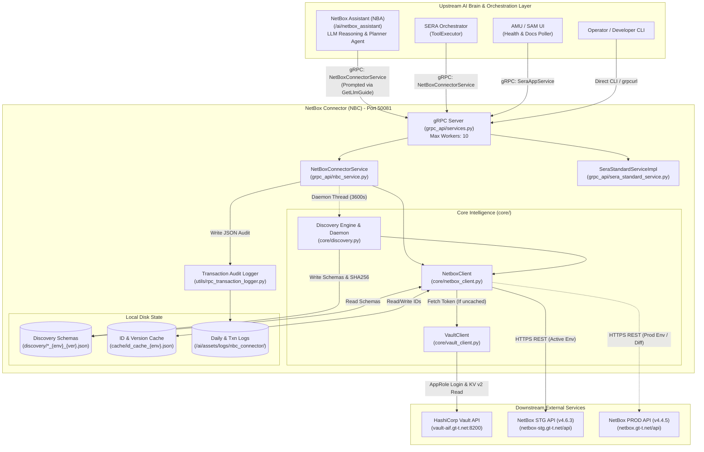
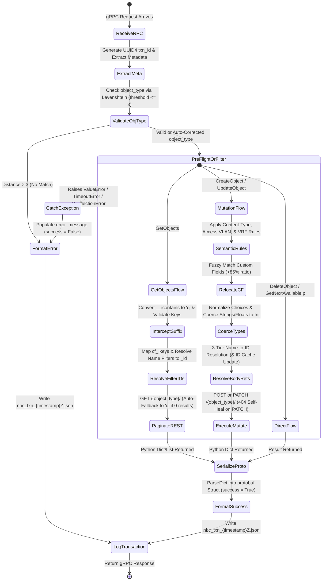

# NetBox Connector (NBC) - Architecture & Design Document

**Doc_Type:** Architecture & Design
**Category:** (C) Connector
**Name:** NetBox Connector
**Acronym:** NBC
**Version:** 1.2.5
**Date:** 2026-11-01
**Author:** Martin Kecka & Gemini AI
**Status:** Active

---

## 1. Introduction & Purpose 📜

The **NetBox Connector (NBC)** is a deterministic, schema-aware gRPC automation gateway within the SERA/GIA ecosystem (`config/settings.yaml` -> `module_info`). Acting as the single authoritative bridge to the enterprise NetBox REST API (`netbox_stg` and `netbox_prod`), NBC functions as a **Smart Connector (an advanced MCP-style tool provider)** purpose-built to empower the **NetBox Assistant (NBA)** (`/ai/netbox_assistant`) and the central SERA Orchestrator.

Unlike generic raw data connectors, NBC is engineered around an LLM-first interaction model. Because NetBox's enterprise REST API imposes strict relational constraints, numeric foreign keys, dynamic custom fields, and version-specific schema differences (v4.4.x vs. v4.6.x), raw endpoints are brittle and token-expensive for direct model consumption. NBC serves as an intelligent intermediary ("better MCP"): it publishes an authoritative prompt specification (`GetLlmGuide`) instructing upstream reasoning models how to construct high-level logical intents using human-readable names and semantic relationships, while NBC's internal engine deterministically transforms, validates, and executes those plans against NetBox.

Its core functional pillars include:

1. **Multi-Track Schema & Custom Field Discovery:** Automated startup and periodic background introspection of the target NetBox OpenAPI `/schema/` and `/extras/custom-fields/` endpoints, compiling version-tagged local JSON schemas (`core/discovery.py` -> `run_version_based_discovery()`, `run_custom_field_discovery()`).
2. **Pre-Flight Transformation Engine:** A multi-stage payload normalization pipeline (`core/netbox_client.py` -> `NetboxClient._transform_writable_payload()`) that executes semantic rules (context-aware VLAN resolution and cross-VRF IP assignment validation), fuzzy custom field relocation (`thefuzz`), choice label normalization, and string-to-integer type coercion.
3. **Three-Tier Name-to-ID Resolution:** An intelligent reference resolver (`core/netbox_client.py` -> `NetboxClient._resolve_name_to_id()`) backed by a persistent local ID cache (`cache/id_cache_{env}.json`) that translates human-readable object names and string lists into numeric NetBox primary keys.
4. **Auto-Healing Query & Mutation Resilience:** Automatic interception of hallucinated Django filter suffixes (`__icontains` -> `q`), zero-result fuzzy query fallbacks (`core/netbox_client.py` -> `NetboxClient.get_objects()`), and stale-ID `404` self-healing during `PATCH` updates (`NetboxClient.update_object()`).

---

## 2. Architecture & Ecosystem Integration 🏗️

NBC operates as a headless, multi-threaded Python gRPC server (`grpc_api/services.py` -> `serve()`) listening on port `50081`. It exposes both its domain-specific `netbox_connector.NetBoxConnectorService` contract and the ecosystem-wide `sera.standard.SeraAppService` observability contract.

* **Upstream Callers (Inbound gRPC, Port `50081`):**
  * **Primary Consumer — NetBox Assistant (NBA, `/ai/netbox_assistant`) & Orchestrator:** Directly drives NBC as its smart tool execution gateway. NBA's planner agent consumes NBC's prompt instructions (`GetLlmGuide`) and issues high-level CRUD, IP allocation, and discovery RPCs (`GetObjects`, `CreateObject`, `UpdateObject`, `DeleteObject`, `GetNextAvailableIp`, `GetLlmGuide`) while passing caller attribution (`username`, `client_application`) via gRPC metadata (`grpc_api/nbc_service.py` -> `NetBoxConnectorService._extract_metadata()`).
  * **Application Management Utility (AMU) & SAM UI:** Polls `SeraAppService` (`GetAppInfo`, `GetDeepHealth`, `GetChangelog`, `GetDocs`) for ecosystem topology mapping, dependency health matrices, and documentation rendering (`grpc_api/sera_standard_service.py` -> `SeraStandardServiceImpl`).
  * **Operator / Developer CLI:** Direct or `--grpc` command execution via Click CLI (`netbox_connector.py`) for schema discovery, manual test runs, and cache maintenance.
* **Downstream Targets (Outbound HTTPS REST):**
  * **HashiCorp Vault (`vault-aif.gt-t.net:8200`):** Authenticates via AppRole (`role_id` / `secret_id`) on startup to dynamically fetch the shared NetBox API token from KV v2 mount `secret/netbox/external/shared/gia_ai` (`core/vault_client.py` -> `VaultClient.get_netbox_token()`).
  * **NetBox Staging (`netbox-stg.gt-t.net/api`, v4.6.3) & Production (`netbox.gt-t.net/api`, v4.4.5):** Executes authenticated REST operations (`GET`, `POST`, `PATCH`, `DELETE`) using a persistent `requests.Session` with SSL verification disabled (`core/netbox_client.py` -> `NetboxClient._request()`).



---

## 3. Module File Map 📂

```plaintext
/ai/netbox_connector
├── bootstrap_helper.py                                     # Virtualenv & pip dependency auto-bootstrapper
├── netbox_connector.py                                     # Main CLI & service entrypoint (load_config, main)
├── README.md                                               # Repository overview and external documentation links
├── requirements.txt                                        # Python package dependencies (grpcio, requests, thefuzz, hvac)
├── .gitignore                                              # Git ignore rules for cache, logs, and compiled pyc files
├── cli/
│   ├── nbc_cli.py                                          # Click root group (start-grpc-server, clean)
│   └── commands/
│       ├── discover_cmds.py                                # Discovery CLI (init, custom-fields, diff-schemas)
│       ├── module_cmds.py                                  # SERA Standard CLI client (module info, module health)
│       └── test_cmds.py                                    # End-to-end gRPC test runner command (run-tests)
├── config/
│   └── settings.yaml                                       # Master configuration (gRPC, Vault, NetBox URLs, logging)
├── core/
│   ├── discovery.py                                        # OpenAPI & custom field schema generator and diff engine
│   ├── netbox_client.py                                    # NetBox REST client, Pre-Flight Engine, and ID resolver
│   └── vault_client.py                                     # HashiCorp Vault AppRole client (VaultClient)
├── discovery/
│   ├── custom_field_map_netbox_prod_4.4.5.hash             # SHA256 digest of PROD custom fields
│   ├── custom_field_map_netbox_prod_4.4.5.json             # Distilled custom field definitions & choices for PROD
│   ├── custom_field_map_netbox_stg_4.6.3.hash              # SHA256 digest of STG custom fields
│   ├── custom_field_map_netbox_stg_4.6.3.json              # Distilled custom field definitions & choices for STG
│   ├── filterable_schema_netbox_prod_4.4.5.json            # Valid GET query parameters per endpoint for PROD
│   ├── filterable_schema_netbox_stg_4.6.3.json             # Valid GET query parameters per endpoint for STG
│   ├── writable_schema_netbox_prod_4.4.5.json              # Valid POST/PATCH fields, types, and choices for PROD
│   └── writable_schema_netbox_stg_4.6.3.json               # Valid POST/PATCH fields, types, and choices for STG
├── docs/
│   ├── CHANGELOG.yaml                                      # Local release history parsed by AMU
│   ├── nbc_design.md                                       # Symlink /ai/assets/guides/tool_guides/nbc_design.md
│   └── nbc_llm_guide.md                                    # Symlink /ai/assets/guides/llm_guides/nbc_llm_guide.md
├── grpc_api/
│   ├── __init__.py                                         # Package marker
│   ├── generate_stubs.py                                   # Dynamic protoc compiler (check_and_generate_stubs)
│   ├── nbc_service.py                                      # NetBoxConnectorServiceServicer implementation
│   ├── sera_standard_service.py                            # SeraAppServiceServicer implementation (health & metadata)
│   ├── services.py                                         # gRPC server bootstrap, health servicer, and reflection
│   └── protos/
│       └── nbc_service.proto                               # Protobuf v3 contract for NetBoxConnectorService
├── scripts/                                                # Maintenance and one-off testing scripts (e.g., debug_llm_payload.py)
├── static/
│   ├── discovery_overrides.json                            # Manual schema overrides and semantic rule bindings
│   └── netbox_objects.json                                 # Canonical NetBox API paths and lookup field aliases
├── tests/
│   └── tests.py                                            # Standalone grpcurl integration test suite
└── utils/
    ├── logging_setup.py                                    # Root logger and MultiProcessSafeDailyLogger setup
    ├── rpc_transaction_logger.py                           # Per-RPC JSON audit trail writer and retention cleaner
    └── string_matching.py                                  # Dependency-free Levenshtein distance and object_type fixer
```

---

## 4. Core Processing Lifecycle ⚙️

### 4.1. Boot & Initialization Sequence

1. **Process Entry & Venv Bootstrap:** Execution begins at `netbox_connector.py` -> `main()`. Before importing domain packages, the script invokes `bootstrap_helper.bootstrap_and_reexecute_if_needed()` to ensure the Python virtual environment is active and all packages in `requirements.txt` are installed.
2. **Configuration Loading:** `netbox_connector.py` -> `load_config()` reads `config/settings.yaml` via `yaml.safe_load()`. If the file is missing or malformed, it prints `[FATAL]` to `sys.stderr` and exits with code `1`.
3. **Logging Initialization:** `utils/logging_setup.py` -> `setup_logging(config)` configures the root logger (`logging.DEBUG` level) guarded by the module-level singleton flag `_LOGGING_CONFIGURED`:
   * **Console Handler:** Attaches a `StreamHandler(sys.stderr)` at the configured `logging.level` (`INFO`).
   * **Daily Rotating File Handlers:** When `logging.enable_file_logging` is `true`, instantiates two `MultiProcessSafeDailyLogger` handlers writing to `/ai/assets/logs/nbc_connector/nbc.log.YYYY-MM-DD` (`DEBUG` level) and `nbc_err.log.YYYY-MM-DD` (`WARNING` level), pruning files older than `backup_count_days` (`14`).
   * **Noisy Logger Suppression:** Explicitly clamps `hpack`, `httpx`, `httpcore`, `urllib3`, `zeep`, and `requests` loggers to `logging.WARNING`.
4. **Dynamic gRPC Stub Compilation:** When `cli/nbc_cli.py` -> `start_grpc_server()` is invoked, it calls `grpc_api/generate_stubs.py` -> `check_and_generate_stubs(config)`:
   * Compares file modification times (`os.path.getmtime()`) of `grpc_api/protos/nbc_service.proto` and `/ai/assets/protos/sera_standard/sera_standard.proto` against compiled `_pb2.py` targets in `/ai/assets/protos/netbox_connector/generated`.
   * If missing or outdated, creates `__init__.py` files along the target tree and invokes `grpc_tools.protoc.main()` to compile `_pb2.py` and `_pb2_grpc.py` stubs, injecting both `generated_stubs_path` and its parent root into `sys.path`.
5. **Transaction Log Pruning & Startup Discovery:** `grpc_api/services.py` -> `serve(config)` runs `cleanup_transactions(config)` to trim the transaction audit folder to `retain_count` (`50`). It then instantiates a temporary `NetboxClient(config, active_env)` and executes `core/discovery.py` -> `run_version_based_discovery()`:
   * Queries NetBox `GET /api/status/` for `netbox-version` and compares it against `cache/netbox_version_{service_name}.cache`.
   * If the version changed or `writable_schema_{env}_{ver}.json` / `filterable_schema_{env}_{ver}.json` are missing on disk, executes `run_full_discovery()` (`GET /api/schema/` with a `120s` timeout). Otherwise, skips core OpenAPI parsing and runs `run_custom_field_discovery()` to ensure fresh custom field mappings.
6. **Servicer Registration & Daemon Spawn:** `serve()` creates a `grpc.server` backed by a `ThreadPoolExecutor(max_workers=10)`:
   * Registers `NetBoxConnectorService(config)` (`grpc_api/nbc_service.py`), which initializes `self.nb_client = NetboxClient(config, active_env)` and spawns the daemon thread `self.discovery_thread` (`_run_periodic_discovery()`) sleeping on `self._stop_event.wait(3600)`.
   * Registers `SeraStandardServiceImpl(config)`, standard gRPC `HealthServicer` (marking both services `SERVING`), and `reflection.enable_server_reflection()`.
   * Binds to `0.0.0.0:50081` (`server.add_insecure_port()`) and blocks on `server.wait_for_termination()`.

### 4.2. Inbound gRPC Request Lifecycle

Every domain data RPC (`GetObjects`, `CreateObject`, `UpdateObject`, `DeleteObject`, `GetNextAvailableIp`) routes through the unified wrapper `grpc_api/nbc_service.py` -> `NetBoxConnectorService._handle_rpc()`:

1. **Context & Transaction Setup:** Generates a UUID4 `txn_id`, extracts `username` (default `"unknown_caller"`) and `client_application` (default `"unknown_app"`) from `context.invocation_metadata()`, and converts the protobuf request into a Python `dict` via `MessageToDict(request, preserving_proto_field_name=True)`.
2. **Fuzzy Object Type Auto-Correction:** If `'object_type'` is present in `request_dict`, passes it to `utils/string_matching.py` -> `correct_object_type(original_type, self.nb_client.netbox_objects, threshold=3)`:
   * Strips `-`, `/`, and `_` separators and computes `levenshtein_distance()` against all keys in `static/netbox_objects.json`.
   * If the minimum distance is `<= 3`, snaps `request_dict['object_type']` to the canonical NetBox path; if no match is within threshold, aborts immediately with `response.success = False` and logs the failed transaction.
3. **Client Handler Execution:** Invokes the target `self.nb_client` method (`get_objects`, `create_object`, `update_object`, `delete_object`, or `get_next_available_ip`).
4. **Protobuf Struct Serialization:** Converts the returned Python `list` or `dict` back into protobuf `google.protobuf.Struct` messages via `ParseDict(item, Struct())` and sets `response.success = True`.
5. **Exception Interception & Audit Logging:** Catches `ValueError` (HTTP `400` / validation errors), `(TimeoutError, ConnectionError)`, and generic `Exception`, populating `response.error_message` while keeping the gRPC transport status `OK`. The `finally` block unconditionally writes a timestamped JSON audit file via `utils/rpc_transaction_logger.py` -> `log_transaction()`.



---

## 5. Detailed Business Logic, Rules & HITL 🧠

### 5.1. Multi-Track Schema & Custom Field Discovery Engine (`core/discovery.py`)

* **Trigger Condition & Priority:** Executed synchronously at server startup (`services.py` -> `serve()` -> `run_version_based_discovery()`), periodically every `3600s` in a background thread (`nbc_service.py` -> `_run_periodic_discovery()`), or manually via CLI (`./netbox_connector.py discover init`).
* **Step-by-Step Logic & Submodule Matrix:**
  1. **Writable Model Mapping (`_build_object_to_model_map()`):** Iterates over `openapi_data["paths"]`, selecting endpoints matching `/api/.../` without `{id}` that support `post`. Extracts the schema reference from `requestBody.content['application/json'].schema`—supporting both NetBox 4.4.x direct `$ref` strings and NetBox 4.6.x `oneOf[0]['$ref']` arrays—while excluding `extras/tags`, `extras/custom-fields`, and `extras/jobs`.
  2. **Writable Schema Generation (`_discover_writable_schema()`):** Inspects `components.schemas[model_name].properties` for each mapped endpoint. Extracts `type`, `readOnly`, and `description`. If an `"enum"` key is present, marks `"type": "choice"` and parses human-readable labels from the Markdown description using the exact regex:
     $$\text{Regex: } \texttt{\textbackslash* `([\^{}`]+)` - ([\^{}\textbackslash n]+)}$$
     Merges manual field overrides and `semantic_rules` from `static/discovery_overrides.json` and writes `discovery/writable_schema_{service_name}_{version}.json`.
  3. **Filterable Schema Generation (`_discover_filterable_schema()`):** Scans `get.parameters` for all collection endpoints, ignoring pagination/meta keys (`{'limit', 'offset', 'q', 'ordering', 'created_by_request', 'modified_by_request', 'updated_by_request'}`). Strips `__` lookup suffixes to consolidate base field names, infers `'integer'` type if any parameter starts with `base_field + '__g'` or `base_field + '__l'`, and writes `discovery/filterable_schema_{service_name}_{version}.json`.
  4. **Custom Field & Content-Type Discovery (`run_custom_field_discovery()`):**
     * Fetches `extras/custom-field-choice-sets` to map choice set IDs to their `extra_choices` value lists.
     * Fetches `extras/custom-fields` and resolves NetBox content types by querying `core/object-types` with an automatic `404` HTTP fallback to legacy `extras/object-types` ( normalizing `virtualization.virtualmachine` -> `virtualization/virtual-machines`).
     * Writes the sorted map to `discovery/custom_field_map_{service_name}_{version}.json` and writes its SHA256 hex digest (`hashlib.sha256()`) to the corresponding `.hash` file.

### 5.2. Pre-Flight Writable Transformation Pipeline (`core/netbox_client.py` -> `NetboxClient._transform_writable_payload()`)

* **Trigger Condition & Priority:** Executed as Stage 1 of every `create_object()` and `update_object()` call before reference resolution.
* **Step-by-Step Logic:**
  1. **Smart Content-Type Coercion (v4 Optimized):** Inspects `transformed_data["assigned_object_type"]`. If the lowercase string contains both `"virtual"` and `"interface"`, normalizes it to `"virtualization.vminterface"`. If it contains `"dcim"` and `"interface"`, normalizes it to `"dcim.interface"`.
  2. **Semantic Rule — Context-Aware Access VLAN Resolution (`interface_mode_logic`):** Triggered on `virtualization/interfaces` when `mode == "access"` and either `"vlan"` or `"untagged_vlan"` is present in the payload (`static/discovery_overrides.json`):
     * Pops the logical `vlan` / `untagged_vlan` string name from the payload.
     * Extracts the parent `virtual_machine` or `device` ID from the payload and queries NetBox (`get_objects()`) to retrieve the parent object's `site.slug`.
     * Invokes `_resolve_name_to_id("ipam/vlans", vlan_value, filters={"site": site_slug})` to isolate the site-specific VLAN ID and assigns it to `transformed_data["untagged_vlan"]`. Raises `ValueError` if the parent has no site or the VLAN cannot be uniquely resolved.
  3. **Semantic Rule — Cross-VRF IP Assignment Validation:** Triggered on `ipam/ip-addresses` when `assigned_object_type` (containing `"interface"`), `assigned_object_id`, and `address` are provided:
     * Fetches the target interface (`virtualization/interfaces` or `dcim/interfaces`) by ID to extract `iface_vrf_id` (`vrf.id` or `None` for global table).
     * Computes the network CIDR via `str(ipaddress.ip_interface(ip_address_str).network)` and queries `ipam/prefixes` for matching prefixes, selecting the longest-prefix match via `max(prefix_objs, key=lambda p: int(p['prefix'].split('/')[1]))`.
     * Compares `iface_vrf_id` against `prefix_vrf_id`. If `iface_vrf_id != prefix_vrf_id`, raises `ValueError("VRF Mismatch...")` to block cross-VRF IP pollution before contacting NetBox.
  4. **Custom Field Relocation & Fuzzy Matching:** Iterates over all payload keys:
     * Keys present in `schema_fields` are kept at the top level of `final_payload`.
     * Unknown keys are compared against every key and `label` in `self.custom_field_map` using `thefuzz.fuzz.token_set_ratio()`.
     * If `highest_ratio > 85`, relocates the key into `final_payload["custom_fields"][best_match_key]` (automatically wrapping string values into `[value]` if the custom field type is `"multiselect"`).
     * If `highest_ratio <= 85`, raises a `ValueError` listing all valid core fields.
  5. **Choice Normalization & Numeric Coercion:**
     * For schema fields with `type == "choice"`, builds a case-insensitive map of display labels to API enum keys (`{str(v).lower(): k}`) and replaces display strings (e.g., `"Active"` -> `"active"`).
     * For schema fields with `type in ("integer", "number")`, coerces digit strings (`value.isdigit()`) and `float` values (from protobuf `Struct` number serialization) into Python `int`.

### 5.3. Three-Tier Name-to-ID Resolution Engine (`core/netbox_client.py` -> `NetboxClient._resolve_body_references()`, `_resolve_name_to_id()`)

* **Trigger Condition & Priority:** Executed as Stage 2 of `create_object()` and `update_object()` for all payload keys present in `self.name_to_id_map` (built from `static/netbox_objects.json` -> `field_name_for_id_lookup`), excluding primary literal fields `{'prefix', 'address'}`. Supports both single strings (`str`) and lists of strings (`List[str]`, such as `tagged_vlans`).
* **Step-by-Step Resolution Cascade (`_resolve_name_to_id()`):**
  1. **Tier 0 — Local ID Cache Lookup:** If no `context_filters` are supplied and `self.id_cache[object_type][name]` exists, returns the cached integer ID immediately without network I/O.
  2. **Tier 1 — Exact `name` Filter Lookup:** Calls `get_objects(object_type, {'name': name, **context_filters}, suppress_filter_resolution=True)`. If `len(tier1_results) == 1`, updates the ID cache (`_update_cache_from_object()`) and returns `tier1_results[0]['id']`.
  3. **Tier 2 — Configured Lookup Field:** If Tier 1 fails or returns 0/multiple results, checks `netbox_objects.json` for `field_name_for_id_lookup` (e.g., `slug`, `model`, `cid`, `label`). If different from `'name'`, queries `get_objects(object_type, {lookup_field: name, **context_filters}, suppress_filter_resolution=True)`. Returns the ID if `len(tier2_results) == 1`.
  4. **Tier 3 — Case-Insensitive `q` Search Fallback:** Queries `get_objects(object_type, {'q': name, **context_filters}, suppress_filter_resolution=True)`. Returns the ID if `len(tier3_results) == 1`.
  5. **Deterministic Failure Outputs:** If `results` is empty across all tiers, raises `ValueError("Object not found...")`. If `len(results) > 1`, raises `ValueError("Ambiguous result: Found N objects... IDs found: [...]")`.

### 5.4. Smart Query Filter Processing & Auto-Fallback (`core/netbox_client.py` -> `NetboxClient.get_objects()`)

* **Trigger Condition & Priority:** Executed on every `GetObjects` RPC call and internal client query.
* **Step-by-Step Logic:**
  1. **Hallucinated Suffix Interception:** Scans filter keys for `__`. If the suffix is in `['icontains', 'contains', 'startswith', 'endswith', 'iexact', 'regex', 'iregex']`, pops the key and appends its string value to `filters['q']`.
  2. **Filter Key Whitelist Validation:** Verifies that each `base_key` exists in `filterable_schema[object_type]`, `f"{base_key}_id"`, `self.name_to_id_map`, `self.custom_field_map`, `self.custom_field_label_to_name_map`, or equals `'q'`. Otherwise raises `ValueError("Invalid filter key...")`.
  3. **Filter Key & Reference Transformation (when `suppress_filter_resolution=False`):**
     * Custom field names or labels are rewritten to `cf_{internal_name}`.
     * String values on relationship keys (`key in self.name_to_id_map`) where `f"{key}_id"` is valid are resolved to numeric IDs via `_resolve_name_to_id()` (passing any sibling valid filter keys as `context_filters`) and rewritten to `f"{key}_id": resolved_id`.
     * Numeric `int`/`float` values on relationship keys are automatically rewritten to `f"{key}_id": int(value)`.
     * **Prefix Semantic Rule:** When querying `ipam/prefixes` with both `vlan` and `site` in `original_filters`, deletes `site_id` from the final query after resolving `vlan_id` so prefixes assigned to the VLAN without a redundant direct site tag are still returned.
  4. **Pagination & Zero-Result Fuzzy Auto-Fallback:**
     * Iterates through paginated NetBox responses (`response_data["next"]`), upgrading `http://` pagination links to `https://` when `self.api_url` uses HTTPS.
     * If `all_results` is empty (`0` matches) and `count_only` is `False`, checks `original_filters` for strict keys `['name', 'slug', 'description']`. Converts any string values on those keys into `fallback_params['q']`, strips the strict keys, and automatically re-executes the paginated GET query.

### 5.5. HITL & Learning Loops

* **Headless Operation (No Interactive UI HITL):** Interactive Human-in-the-Loop (HITL) intervention is not applicable directly within NBC, as it operates as a deterministic, headless backend connector.
* **Downstream Exception Escalation & Self-Healing Loops:** When NBC encounters an unresolvable ambiguity (`ValueError: Ambiguous result...`) or missing reference (`ValueError: Object not found...`), it returns a structured error payload (`success = False`, `error_message = ...`) to the upstream NetBox Assistant (NBA) or Orchestrator. As defined in `docs/nbc_llm_guide.md` (Section 5, Rule 3), the NBA reasoning model uses this structured feedback to self-correct by invoking `GetObjects` with narrower context filters (`site`, `tenant`) or escalating to the human operator in the chat interface.
* **Stale-ID Self-Healing on Update (`NetboxClient.update_object()`):** If a `PATCH /{object_type}/{object_id}/` request raises an `HTTPError` with status code `404` and `'name'` is present in `data`, NBC automatically invokes `_resolve_name_to_id()` to locate the replacement object ID in NetBox, updates `id_cache`, and recursively retries `update_object()`.

---

## 6. AI, LLM & Machine Learning Execution 🤖

Not applicable internally for model hosting. NBC is a strictly deterministic, rule- and schema-driven execution gateway that does not execute local LLM inference. However, it operates as a **Smart Connector ("better MCP")** designed specifically to partner with the upstream reasoning engine of the **NetBox Assistant (NBA)** in `/ai/netbox_assistant` (and the SERA Orchestrator). 

NBC serves its machine-readable system prompt instructions (`docs/nbc_llm_guide.md`) dynamically via the `GetLlmGuide` RPC to the NBA ContextBuilder. This contract instructs the LLM on exact parameter formats, relationship resolution rules, negative constraints, and step-chaining placeholders (`{{steps[n].result.id}}`), while NBC uses deterministic fuzzy matching (`thefuzz` token set ratio and Levenshtein distance) to reliably translate high-level LLM outputs into compliant NetBox REST API calls.

---

## 7. Data Models, State, Storage & Auditing 🗄️

### 7.1. Database Schemas

Not applicable for this module. NBC is stateless with respect to relational databases (PostgreSQL/SQLAlchemy) and persists all operational schemas, caches, and transaction audits as structured files on the local filesystem.

### 7.2. State Enumerations

While NBC owns no SQL tables, it evaluates and emits the following canonical status strings:
* **SERA Deep Health Statuses (`grpc_api/sera_standard_service.py` -> `GetDeepHealth()`):**
  * `'HEALTHY'`: All `system_services` are `'running'` and all dependencies in `dependency_health_matrix` return `'OK'`.
  * `'DEGRADED'`: Any systemd service is not `'running'` or any non-critical dependency check fails.
  * `'DOWN'`: Any PostgreSQL dependency is `'DOWN'`, the sole external dependency of a connector is `'DOWN'`, or a production external dependency (`'prod'` in name/env) is `'DOWN'`.
* **Dependency Probe Statuses (`check_tcp_ping()`):** `'OK'`, `'DOWN'`, `'UNKNOWN'`.
* **Systemd Service Statuses (`systemctl is-active`):** `'running'`, `'stopped'`, `'unknown'`.

### 7.3. In-Memory Caching & Thread Safety

* **Vault Token Class-Level Cache (`core/netbox_client.py` -> `NetboxClient._cached_vault_token`):** Class attribute caching the shared NetBox API token across `NetboxClient` instantiations so background discovery threads do not re-authenticate with Vault on every cycle.
* **Vault Secret Instance Cache (`core/vault_client.py` -> `VaultClient._secret_cache`):** Dictionary keyed by `f"{mount_point}:{path}"` caching KV v2 secret responses in memory.
* **Persistent Name-to-ID Cache (`core/netbox_client.py` -> `self.id_cache`):** Loaded into memory from `cache/id_cache_{service_name}.json` at `NetboxClient.__init__()` and flushed to disk (`_save_id_cache()`) whenever `_update_cache_from_object()` discovers a new or changed `name -> id` mapping (inspecting top-level keys `['name', 'label', 'username', 'cid', 'prefix', 'model', 'slug']` and nested relationship dictionaries).
* **Daemon Thread Synchronization (`grpc_api/nbc_service.py` -> `self._stop_event`):** Uses a `threading.Event()` primitive to coordinate clean shutdown of the periodic custom field discovery daemon thread (`self.discovery_thread`).

### 7.4. File System Storage & Auditing

| File / Directory Path | Format | Retention / Lifecycle | Purpose & Owning Module |
| :--- | :--- | :--- | :--- |
| `discovery/writable_schema_{env}_{ver}.json` | JSON | Regenerated on NetBox version change or `discover init` | Defines writable models, fields, types, choices, and semantic rules (`core/discovery.py`). |
| `discovery/filterable_schema_{env}_{ver}.json` | JSON | Regenerated on NetBox version change or `discover init` | Defines valid GET filter query keys and types per endpoint (`core/discovery.py`). |
| `discovery/custom_field_map_{env}_{ver}.json` | JSON | Refreshed every `3600s` by daemon thread & on startup | Maps custom field internal names to labels, types, content types, and choices (`core/discovery.py`). |
| `discovery/custom_field_map_{env}_{ver}.hash` | Plaintext (SHA256) | Updated alongside `custom_field_map` JSON | 64-character SHA256 hex digest served via `GetSchemaVersions` (`core/discovery.py`). |
| `cache/netbox_version_{env}.cache` | Plaintext | Updated on startup version check | Stores the last seen `netbox-version` string (e.g., `4.6.3`, `4.4.5`) (`core/netbox_client.py`). |
| `cache/id_cache_{env}.json` | JSON | Persistent; cleared via `./netbox_connector.py clean` | Nested dictionary `{object_type: {name: id}}` accelerating `_resolve_name_to_id()`. |
| `/ai/assets/logs/nbc_connector/nbc.log.YYYY-MM-DD` | Log Text | 14 days (`backup_count_days: 14`) | Daily rotating application debug/info log (`utils/logging_setup.py` -> `MultiProcessSafeDailyLogger`). |
| `/ai/assets/logs/nbc_connector/nbc_err.log.YYYY-MM-DD` | Log Text | 14 days (`backup_count_days: 14`) | Daily rotating warning/error log (`utils/logging_setup.py` -> `MultiProcessSafeDailyLogger`). |
| `/ai/assets/logs/nbc_connector/transactions/nbc_txn_*.json` | JSON | Last 50 files (`retain_count: 50`) | Per-RPC audit trail containing `transaction_id`, `client_application`, `username`, `timestamp_utc`, `rpc_method`, `request_payload`, `response_data`, and `error_message` (`utils/rpc_transaction_logger.py`). |

---

## 8. APIs, Observability & Communication Contracts 📡

### 8.1. Inbound Domain gRPC API (`netbox_connector.NetBoxConnectorService`)

Defined in `grpc_api/protos/nbc_service.proto` and implemented in `grpc_api/nbc_service.py` -> `NetBoxConnectorService`:

| RPC Method | Request Message | Response Message | Operational Description |
| :--- | :--- | :--- | :--- |
| `GetObjects` | `GetObjectsRequest` (`object_type`, `filters`, `output_fields`, `count_only`) | `GetObjectsResponse` (`success`, `error_message`, `repeated Struct objects_data`) | Searches NetBox objects with filter validation, custom field/name-to-ID filter conversion, server-side `fields` selection, `count_only` (`limit=1`), and zero-result fuzzy `q` fallback. |
| `CreateObject` | `CreateObjectRequest` (`object_type`, `Struct object_data`) | `CreateObjectResponse` (`success`, `error_message`, `Struct object_data`) | Executes Pre-Flight Transformation and 3-tier reference resolution before issuing `POST /{object_type}/` and updating `id_cache`. |
| `UpdateObject` | `UpdateObjectRequest` (`object_type`, `int32 object_id`, `Struct object_data`) | `UpdateObjectResponse` (`success`, `error_message`, `Struct object_data`) | Transforms and resolves partial update fields before issuing `PATCH /{object_type}/{id}/` with automatic `404` stale-ID self-healing by name. |
| `DeleteObject` | `DeleteObjectRequest` (`object_type`, `int32 object_id`) | `DeleteObjectResponse` (`success`, `error_message`) | Issues `DELETE /{object_type}/{int(object_id)}/` and returns `success = True` on HTTP `204`. |
| `GetNextAvailableIp` | `GetNextAvailableIpRequest` (`int32 prefix_id`) | `GetNextAvailableIpResponse` (`success`, `error_message`, `Struct ip_address_data`) | Issues `POST /ipam/prefixes/{prefix_id}/available-ips/` with `{}` to allocate and return the next free IP in the prefix. |
| `GetSchemaVersions` | `GetSchemaVersionsRequest` (Empty) | `GetSchemaVersionsResponse` (`success`, `error_message`, `core_schema_version`, `custom_field_schema_hash`) | Reads `cache/netbox_version_{env}.cache` and `discovery/custom_field_map_{env}_{ver}.hash` for lightweight client cache validation. |
| `GetLogicalSchemas` | `GetLogicalSchemasRequest` (Empty) | `GetLogicalSchemasResponse` (`writable_schema`, `filterable_schema`, `custom_field_map`, `object_map`) | Parses and returns the 4 active JSON schema/map files as `google.protobuf.Struct` objects. |
| `GetLlmGuide` | `GetLlmGuideRequest` (Empty) | `GetLlmGuideResponse` (`success`, `error_message`, `markdown_content`) | Reads and returns the raw Markdown content of `/ai/assets/guides/llm_guides/nbc_llm_guide.md`. |

### 8.2. Universal SERA Standard Contract (`SeraAppService`)

NBC exposes the universal `sera.standard.SeraAppService` gRPC contract (`GetAppInfo`, `GetDeepHealth`, `GetFeedback`, `GetChangelog`, `GetDocs`) via `grpc_api/sera_standard_service.py` -> `SeraStandardServiceImpl`—centrally maintained and deployed by the Application Management Utility (`amu_design.md`)—for SAM UI and AMU telemetry integration, alongside standard `grpc.health.v1.Health` and `grpc.reflection.v1alpha.ServerReflection` services (`grpc_api/services.py`).

### 8.3. Outbound Client Contracts

| Target System | Client Class / Method | Protocol & Endpoint | Timeout & Security / Headers |
| :--- | :--- | :--- | :--- |
| **HashiCorp Vault API** | `core/vault_client.py` -> `VaultClient` | HTTPS REST (`https://vault-aif.gt-t.net:8200`) | AppRole login (`client.auth.approle.login`), KV v2 read (`secret/netbox/external/shared/gia_ai`), `verify=False`, proxies disabled (`{"http": None, "https": None}`). |
| **NetBox STG API** | `core/netbox_client.py` -> `NetboxClient._request()` | HTTPS REST (`https://netbox-stg.gt-t.net/api`) | Default `30s` (`120s` for `/schema/`), `verify=False`, headers: `Authorization: Token {api_token}`, `Content-Type: application/json`, `Accept: application/json; indent=4`. |
| **NetBox PROD API** | `core/netbox_client.py` -> `NetboxClient._request()` | HTTPS REST (`https://netbox.gt-t.net/api`) | Default `30s` (`120s` for `/schema/`), `verify=False`, same token & headers as STG. |

---

## 9. User Interface (UI) & Visualizations 🖥️

Not applicable directly within this module. NBC is a headless backend gRPC smart connector; its health telemetry, dependency matrix, changelog, and documentation are consumed and rendered upstream by the **SAM UI** (via AMU), while its network inventory capabilities are surfaced to end users through the **NetBox Assistant (NBA)** WebUI and chat interface (`/ai/netbox_assistant`) alongside the SERA Orchestrator.

---

## 10. Background Services & Workers 🛠️

| Worker / Service Name | Entrypoint / Location | Trigger & Schedule | Concurrency & Locking | Operational Responsibility & Retry Policy |
| :--- | :--- | :--- | :--- | :--- |
| **`nbc-grpc.service`** | `netbox_connector.py start-grpc-server` -> `grpc_api/services.py:serve()` | Managed by `systemd` (continuous daemon) | `futures.ThreadPoolExecutor(max_workers=10)` | Hosts `NetBoxConnectorService`, `SeraAppService`, `Health`, and `ServerReflection` on `0.0.0.0:50081`. Aborts startup (`sys.exit(1)`) if initial discovery fails. |
| **Periodic Custom Field Discovery Thread** | `grpc_api/nbc_service.py` -> `NetBoxConnectorService._run_periodic_discovery()` | Spawned as `daemon=True` thread in `NetBoxConnectorService.__init__()`; runs every `3600s` (`custom_field_interval_seconds`) | Controlled by `self._stop_event` (`threading.Event()`) | Instantiates a fresh `NetboxClient` for `active_netbox_env` and executes `run_custom_field_discovery()` to update `custom_field_map_*.json` and `.hash`. On exception, logs error and waits `60s` before next loop evaluation. |

---

## 11. CLI, Tooling & Testing 💻

### 11.1. CLI Command Reference

Defined in `cli/nbc_cli.py`, `cli/commands/discover_cmds.py`, `cli/commands/module_cmds.py`, and `cli/commands/test_cmds.py`:

| Command | Arguments & Options | Operational Description |
| :--- | :--- | :--- |
| `start-grpc-server` | None | Compiles protobuf stubs if needed (`check_and_generate_stubs`), runs startup transaction cleanup and version-based discovery, and starts the gRPC server on port `50081`. |
| `clean` | `--force` (flag) | Deletes and recreates the `cache/` directory (clearing cached NetBox versions and `id_cache_{env}.json`). Prompts for confirmation unless `--force` is passed. |
| `run-tests` | None | Executes the live end-to-end `grpcurl` integration test suite against `localhost:50081` covering Scenarios 1 through 6 (`cli/commands/test_cmds.py`). |
| `discover init` | `--env <TEXT>` (optional, e.g., `netbox_prod`) | Runs `run_full_discovery(client)` for the specified `--env` (or `active_netbox_env` if omitted), regenerating writable, filterable, and custom field schemas. |
| `discover custom-fields` | `--env <TEXT>` (optional, e.g., `netbox_prod`) | Runs `run_custom_field_discovery(client)` exclusively to refresh `custom_field_map_{env}_{ver}.json` and `.hash`. |
| `discover diff-schemas` | None | Fetches live OpenAPI schemas from both `netbox_prod` (Old) and `netbox_stg` (New), builds writable schemas in memory, and prints color-coded endpoint and field additions, removals, and type modifications. |
| `module info` | `--grpc` (flag) | Calls local `SeraAppServiceStub.GetAppInfo()` and prints module metadata, version, and downstream dependencies (or raw JSON with `--grpc`). |
| `module health` | `--grpc` (flag) | Calls local `SeraAppServiceStub.GetDeepHealth()` and prints overall health and per-dependency status checks (or raw JSON with `--grpc`). |

### 11.2. CLI Quick Execution Examples

```bash
# --- Service Lifecycle & Workspace Maintenance ---
/ai/netbox_connector/netbox_connector.py start-grpc-server
/ai/netbox_connector/netbox_connector.py clean --force

# --- Schema Discovery & Cross-Environment Diffing ---
/ai/netbox_connector/netbox_connector.py discover init
/ai/netbox_connector/netbox_connector.py discover init --env netbox_prod
/ai/netbox_connector/netbox_connector.py discover custom-fields --env netbox_stg
/ai/netbox_connector/netbox_connector.py discover diff-schemas

# --- SERA Standard Health & Metadata Diagnostics ---
/ai/netbox_connector/netbox_connector.py module info
/ai/netbox_connector/netbox_connector.py module health
/ai/netbox_connector/netbox_connector.py module health --grpc

# --- End-to-End Integration Testing & Standalone Scripts ---
/ai/netbox_connector/netbox_connector.py run-tests
/ai/netbox_connector/tests/tests.py
```

---

## 12. Configuration, Security & Hardware Affinity 🔒

### 12.1. Configuration Reference (`config/settings.yaml`)

*(Note: Universal SERA boilerplate blocks—`module_info.*`, standard `logging.*`, and standard protobuf `paths.*`—are omitted below; see `conf_concept.md`.)*

| Configuration Key | Purpose | Default / Production Value |
| :--- | :--- | :--- |
| `system_services.grpc` | Systemd unit, bind address/port, and `ThreadPoolExecutor` worker count | `"nbc-grpc.service"` (`0.0.0.0:50081`, `10` workers) |
| `external_services.vault` | HashiCorp Vault endpoint URL and AppRole credentials (`role_id`, `secret_id`) | `"https://vault-aif.gt-t.net:8200"` (`dependency_name: "vault-aif_api"`) |
| `external_services.netbox_stg` | Staging NetBox base API URL and HTTP request timeout | `"https://netbox-stg.gt-t.net/api"` (`timeout: 30s`, `dependency_name: "netbox_stg_api"`) |
| `external_services.netbox_prod` | Production NetBox base API URL and HTTP request timeout | `"https://netbox.gt-t.net/api"` (`timeout: 30s`, `dependency_name: "netbox_prod_api"`) |
| `vault_paths.netbox` | KV v2 secret path containing the shared NetBox `token` | `"netbox/external/shared/gia_ai"` |
| `active_netbox_env` | Active target profile (`netbox_stg` or `netbox_prod`) used by gRPC server | `"netbox_stg"` |
| `discovery.custom_field_interval_seconds` | Sleep interval for background custom field discovery thread | `3600` |
| `transaction_logging.enabled` | Toggles per-RPC JSON audit file creation | `true` |
| `transaction_logging.directory` / `retain_count` | Subdirectory under `logging.directory` and maximum retained RPC JSON files | `"transactions"` / `50` |
| `paths.llm_guide_path` | File path read by `GetLlmGuide` RPC | `"/ai/assets/guides/llm_guides/nbc_llm_guide.md"` |

### 12.2. Security & Cryptographic Key Handling

* **Dynamic Vault Token Retrieval (`core/vault_client.py` -> `VaultClient`):** Static NetBox API tokens are omitted from `config/settings.yaml`. On initialization, `NetboxClient.__init__()` checks for a static `"token"` key and, when absent, instantiates `VaultClient(vault_cfg)` using AppRole credentials (`role_id`, `secret_id`). `VaultClient.get_secret()` strips leading `secret/` prefixes and reads KV v2 secret `netbox/external/shared/gia_ai` (`mount_point="secret"`), extracting `data['data']['data']['token']` and caching it in `NetboxClient._cached_vault_token`.
* **DSN Credential Sanitization (`grpc_api/sera_standard_service.py` -> `sanitize_dsn()`):** When reporting connection metadata in `GetDeepHealth`, `sanitize_dsn()` parses URLs via `urllib.parse.urlparse()` and strips any embedded passwords while preserving `username@hostname:port`.
* **TLS & Proxy Isolation:** Both `VaultClient` and `NetboxClient` suppress `urllib3.exceptions.InsecureRequestWarning` and operate with `verify=False` to accommodate internal enterprise self-signed certificates. `VaultClient` explicitly sets `session.proxies = {"http": None, "https": None}` to bypass environment proxy interception.

### 12.3. Hardware Affinity & Execution Boundaries

* **Execution Profile:** Purely CPU-bound, lightweight I/O service. Requires zero GPU allocation.
* **Concurrency & Memory Footprint:** Runs within a single Python process utilizing a 10-worker `ThreadPoolExecutor` for gRPC request handling plus 1 background daemon thread for periodic custom field discovery. In-memory state is limited to parsed JSON schema dictionaries (~30 MB total across writable, filterable, and custom field maps) and the local `id_cache`.

### 12.4. Operational Setup / Instrumentation SOP

Not applicable for this module. Standard deployment requires only valid AppRole access to `vault-aif.gt-t.net:8200` and network reachability to the target NetBox API (`netbox-stg.gt-t.net` or `netbox.gt-t.net`); all gRPC stubs (`check_and_generate_stubs`) and schema files (`run_version_based_discovery`) self-initialize automatically on first startup.

---

## 13. Error Handling & Resilience 🛡️

1. **Application-Level gRPC Error Encapsulation (`grpc_api/nbc_service.py` -> `_handle_rpc()`):** Never crashes the gRPC channel on domain or NetBox errors. Catches `ValueError` (HTTP `400` validation rejections, ambiguous name resolutions, VRF mismatches, invalid filter keys), `TimeoutError`, `ConnectionError`, and generic `Exception`, returning a structured protobuf response with `success = False` and a detailed `error_message` string so upstream LLM agents can self-correct.
2. **NetBox Version 4.4.x vs. 4.6.x Dual-Compatibility (`core/discovery.py`):**
   * **OpenAPI Schema Polymorphism (`_build_object_to_model_map()`):** Seamlessly handles both NetBox 4.4.5 direct `$ref` schema pointers and NetBox 4.6.3 `oneOf: [{'$ref': ...}]` polymorphic array structures.
   * **Object-Types Endpoint Fallback (`run_custom_field_discovery()`):** Queries NetBox 4.6+ `core/object-types` first and catches `requests.exceptions.HTTPError` (`status_code == 404`) to automatically fall back to legacy NetBox 4.4 `extras/object-types`.
3. **Stale ID Cache 404 Self-Healing (`core/netbox_client.py` -> `NetboxClient.update_object()`):** If an object is deleted and recreated in NetBox with a new numeric ID, an `UpdateObject` (`PATCH`) call using a stale ID catches the `404` `HTTPError`, resolves the current ID via `_resolve_name_to_id()` using `data['name']`, updates `id_cache`, and transparently retries the `PATCH` call.
4. **Zero-Result Strict Filter Auto-Fallback (`core/netbox_client.py` -> `NetboxClient.get_objects()`):** When an exact-match filter on `name`, `slug`, or `description` yields `0` results from NetBox, NBC automatically converts those strict filters into a fuzzy `q` search parameter and re-runs the query before returning an empty list.
5. **HTTPS Pagination Link Upgrade (`core/netbox_client.py` -> `NetboxClient.get_objects()`):** Prevents mixed-content redirect failures behind reverse proxies by inspecting `response_data.get("next")` and rewriting `http://` to `https://` whenever `self.api_url` begins with `https://`.
6. **Extended Discovery Timeout & Daemon Fault Isolation:** `NetboxClient.get_openapi_schema()` overrides the default `30s` timeout with `custom_timeout=120` to prevent timeouts when downloading massive OpenAPI specs. In `NetBoxConnectorService._run_periodic_discovery()`, unhandled exceptions during scheduled custom field refreshes are caught, logged with tracebacks, and throttled via `self._stop_event.wait(60)` without terminating the daemon thread.

---

## 14. Future Enhancements & Roadmap 🚀

The following capabilities define the planned evolution of the NetBox Connector as an intelligent, high-performance Smart Connector within the SERA/GIA ecosystem, addressing enterprise scale, latency optimization, and automated cache consistency:

### 14.1. Webhook-Driven Cache Invalidation
Expose an inbound webhook listener endpoint so NetBox can push real-time object creation, rename, and deletion events directly to NBC. This enables proactive, instant invalidation of `cache/id_cache_{env}.json` and immediate custom field schema refreshes rather than waiting for a `404` cache miss or relying on the periodic `3600s` discovery polling interval.

### 14.2. Bulk Mutation RPCs (`BulkCreateObjects` / `BulkUpdateObjects`)
Extend `nbc_service.proto` and `NetboxClient` to support batch `POST` and `PATCH` list payloads in a single atomic gRPC transaction. This will drastically reduce network round-trips and serialization overhead during large-scale automated infrastructure provisioning workflows (e.g., bulk VM spin-up or multi-prefix allocations).

### 14.3. Expanded Pre-Flight Semantic Rules
Add domain-specific pre-flight transformation rules in `static/discovery_overrides.json` and `_transform_writable_payload()` for complex physical DCIM and Circuit constructs. Target enhancements include automated cable terminations (`dcim/cables`), power feed phase balancing verification, and rack elevation collision checks prior to payload dispatch to NetBox.

### 14.4. Per-Request Dynamic Environment Routing
Allow upstream callers (NBA or Orchestrator) to pass an optional target environment override (`netbox_prod` vs. `netbox_stg`) directly in the gRPC request message or invocation metadata (`x-use-preprod: true` or `x-target-env: prod`), enabling side-by-side multi-environment workflows without requiring global reboots or configuration edits in `config/settings.yaml`.
