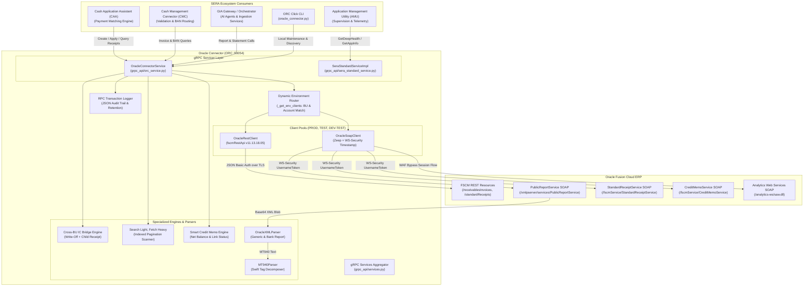
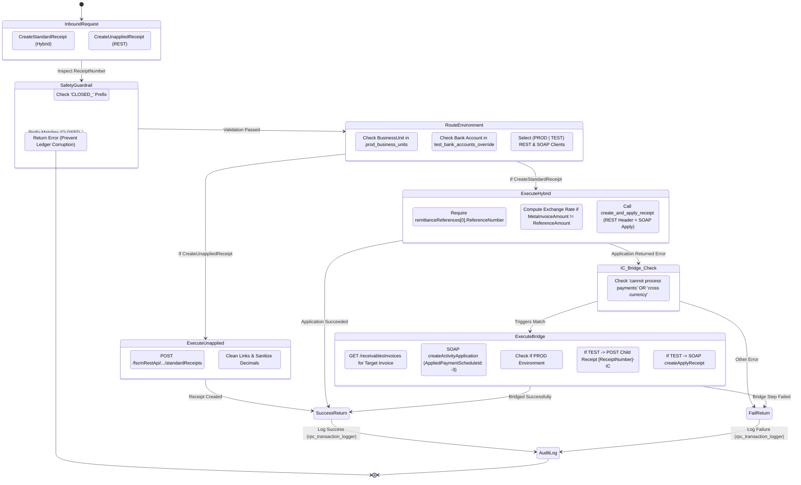
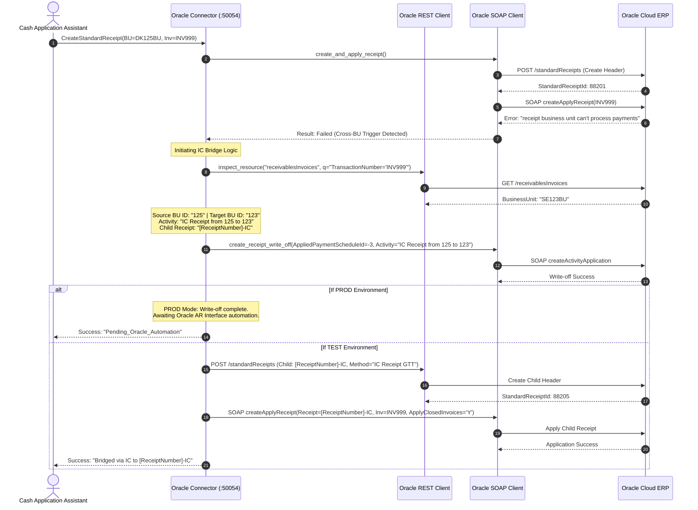
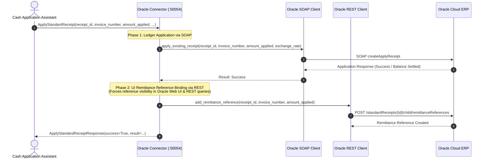

# Oracle Connector (ORC) - Architecture & Design Document

**Doc_Type:** Architecture & Design
**Category:** (C) Connector
**Name:** Oracle Connector
**Acronym:** ORC
**Version:** 1.2.5
**Date:** 2026-10-30
**Author:** Martin Kecka & Gemini AI
**Status:** Active

---

## 1. Introduction & Purpose 📜

The **Oracle Connector (ORC)** is a mission-critical, hybrid integration microservice within the SERA/GIA enterprise AI ecosystem. It serves as the authoritative, protocol-agnostic integration gateway between downstream SERA automation systems—most prominently the **Cash Application Assistant (CAA)** and **Cash Management Connector (CMC)**—and **Oracle Cloud ERP** (Oracle Fusion Cloud Financials, Accounts Receivable, and Cash Management).

Global enterprise ERP systems present a notoriously fragmented integration landscape. Oracle Fusion Cloud divides its capabilities across two disparate protocol domains: modern, lightweight **REST APIs** (designed for high-throughput transactional queries and creation of business objects such as Invoices and Standard Receipts) and legacy, heavyweight **SOAP Web Services** secured via WS-Security (required for complex transactional operations such as receipt applications, credit memo balance applications, write-offs, BI Publisher batch reporting, and Oracle Analytics reporting). 

ORC abstracts this fundamental ERP dichotomy behind a unified, high-performance **gRPC interface** (`oracle_connector.OracleConnectorService`) on port `50054`. AI agents and downstream orchestration microservices never interact with raw Oracle REST JSON schemas, XML payloads, or WS-Security SOAP headers directly; ORC acts as an intelligent protocol router, schema translator, and data normalizer.

Its primary functional pillars include:
- **Hybrid Protocol Gateway:** Intelligently routes incoming requests between Oracle REST APIs and SOAP services based on transaction requirements, orchestrating multi-step hybrid flows (e.g., creating a receipt header via REST, then applying it to invoices via SOAP).
- **Automated Cross-BU Inter-Company (IC) Bridging:** Detects Oracle cross-business-unit and cross-currency settlement constraints during payment application, dynamically executing write-offs on the source receipt against Inter-Company clearing accounts and orchestrating child receipts in the target business unit.
- **"Search Light, Fetch Heavy" Discovery Engine:** Overcomes severe Oracle REST query limitations (such as the inability to filter parent receipts by child invoice remittance references) via an indexed customer account pagination algorithm that scans lightweight payloads before performing targeted deep-fetches.
- **Smart Credit Memo Analysis & Lifecycle:** Evaluates BI Publisher credit memo application histories, performing mathematical net balance reconciliations and categorizing application linkages into operational states (`ACTIVE`, `HISTORY`, `CONTRIBUTING`) to enable automated credit memo applications and unapplications.
- **Analytics & BI Publisher Execution Engine:** Executes BI Publisher batch reporting (`PublicReportService`) and Oracle Analytics Web Services (`saw.dll`), implementing a custom 3-phase session lifecycle (Logon via `nQSessionService`, Execute Query via `xmlViewService`, Logoff) and HTTP Authorization header suppression to bypass Oracle Cloud Web Application Firewall (WAF) 403 restrictions.
- **Dynamic ERP Introspection & Cataloging:** Built-in discovery tooling (`RestCatalogInspector` and `wsdl_inspector`) that crawls Oracle FSCM REST Catalogs (`/describe`) and SOAP WSDLs, generating local schemas and human-readable documentation without requiring manual ERP portal exploration, alongside recursive BI Publisher catalog hierarchy browsing via SOAP.
- **Global ERP Safety Guardrails:** Defense-in-depth validation intercepting and rejecting invalid synthetic placeholder payloads (such as `CLOSED_` receipt prefixes) before they can reach and compromise Oracle accounting ledgers.

---

## 2. Architecture & Ecosystem Integration 🏗️

ORC is engineered as a headless, modular Python service composed of client communication abstractions (`OracleRestClient`, `OracleSoapClient`), specialized XML and MT940 data parsers, introspection inspectors, a Click CLI management tool, and a dual-servicer gRPC daemon exposing both domain business operations and SERA ecosystem standard telemetry.

### 2.1. Core Architectural Principles & Touchpoints

- **Protocol Agnosticism for Consumers:** Downstream callers (CAA, CMC, GIA Orchestrator) interact solely via compiled Protobuf contracts (`orc.proto`). The underlying complexity of whether Oracle requires REST, SOAP, XML, or multi-step coordination is encapsulated entirely inside ORC.
- **Dynamic Dual-Environment Routing & Multi-Environment Targeting:** ORC maintains simultaneous client connection pools for both **Oracle PROD** (`oracle_prod`) and **Oracle TEST** (`oracle_test`), and additionally supports the **Oracle DEV-TEST** (`oracle_dev_test`) environment. Incoming gRPC requests specify a `business_unit`; ORC dynamically evaluates this against `oracle_erp.prod_business_units` in `config/settings.yaml` (with optional bank account overrides in `test_bank_accounts_override`), ensuring that production traffic and test simulation traffic remain strictly partitioned without requiring server restarts. At the CLI level, commands support dynamic environment targeting via the `--env [test|prod|dev_test]` option (default: `prod`) and the convenient `--test` boolean shortcut flag.
- **Config Fallback Compatibility:** To accommodate both universal v1 and legacy configurations, ORC's gRPC server and CLI stub lookups seamlessly resolve service binding settings from `system_services.grpc` with fallback compatibility to the legacy `grpc_server` configuration block.
- **Deterministic Financial Execution:** ORC performs zero non-deterministic or probabilistic operations. All payload generation, balance calculations, currency conversions, and SOAP envelope constructions follow deterministic business rules.
- **Cash Application Assistant (CAA):** Primary operational consumer. CAA invokes ORC to retrieve open invoices by Billing Account Number (BAN), query receipt statuses, create unapplied receipts, create standard receipts, apply receipts to invoices, and execute credit memo applications/unapplications.
- **Application Management Utility (AMU):** SERA ecosystem supervisor. Interacts with ORC's standard gRPC service (`SeraAppService`) on port `50054` to poll health matrix dependencies, systemd status (`orc-grpc.service`), and version telemetry from `CHANGELOG.yaml`.
- **Oracle Cloud ERP (External Service):**
  - **PROD:** `https://eckv.fa.us2.oraclecloud.com:443`
  - **TEST:** `https://eckv-test.fa.us2.oraclecloud.com:443`
  - **DEV-TEST:** `https://eckvdev-test.fa.us2.oraclecloud.com/`

### 2.2. Ecosystem Integration & Data Flow



---

## 3. Module File Map 📂

An exhaustive structural breakdown of the `/ai/oracle_connector` repository scope:

```plaintext
/ai/oracle_connector
├── bootstrap_helper.py                             # Runtime environment bootstrap; auto-activates project virtualenv and re-executes interpreter
├── cache/                                          # Local persistent cache for offline master data and raw statement extracts
│   ├── bank_accounts.json                          # Cached Oracle master bank accounts mapping (filtered by report_processors)
│   └── bank_stmt_*.mt940                           # Cached MT940 statement extracts from BI Publisher for offline validation
├── cli/                                            # Command-line interface definitions and command sub-groups
│   └── orc_cli.py                                  # Click CLI master module; implements discover, master-data, receipts, invoices, credit-memos, reports (run, run-analytics, browse, bank-statements), and module commands
├── config/                                         # Central application configuration
│   └── settings.yaml                               # Ecosystem v1-universal configuration (Oracle PROD/TEST endpoints, credentials, BU routing, gRPC settings)
├── core/                                           # Core communication clients, inspection tools, and processing engines
│   ├── parsers/                                    # Raw ERP output syntax parsers
│   │   ├── mt940_parser.py                         # Swift MT940 parser decomposing tags (:20:, :25:, :60F:, :61:, :86:, :62F:) into BSI data models
│   │   └── oracle_xml_parser.py                    # High-throughput XML parser for BI Publisher reports (generic and MT940 addenda decomposition)
│   ├── report_processors.py                        # Post-processing filters for master data reports (filtering inactive BUs, dummy banks, and POBO accounts)
│   ├── rest_client.py                              # OracleRestClient; handles JSON Basic Auth interactions, resource inspection, and "Search Light, Fetch Heavy" loops
│   ├── rest_inspector.py                           # RestCatalogInspector; downloads and indexes Oracle FSCM/HCM/CRM REST Catalogs (/describe)
│   ├── soap_client.py                              # OracleSoapClient; wraps Zeep with WS-Security for BI Publisher, AR Receipts, Credit Memos, and custom session-based Analytics reports
│   └── wsdl_inspector.py                           # Inspects SOAP WSDL files and generates human-readable capability reports
├── discovery/                                      # Local cache of introspected Oracle API definitions and WSDL schemas
│   ├── oracle_fscm_v11.13.18.02.json               # Full downloaded Oracle FSCM REST API catalog schema
│   ├── PublicReportService.wsdl                    # Introspected WSDL for BI Publisher PublicReportService
│   ├── StandardReceiptService.wsdl                 # Introspected WSDL for Accounts Receivable StandardReceiptService
│   ├── summary_rest_fscm.txt                       # Generated summary of FSCM REST resources, titles, and paths
│   ├── summary_soap_PublicReportService.txt        # Generated capability report for BI Publisher SOAP operations
│   └── summary_soap_StandardReceiptService.txt     # Generated capability report for AR Standard Receipt SOAP operations
├── docs/                                           # Documentation and release history
│   ├── CHANGELOG.yaml                              # Structured YAML release history parsed by AMU and SeraStandardService
│   ├── context.txt                                 # Packaged codebase snapshot
│   └── orc_design.md -> /ai/assets/guides/tool_guides/orc_design.md # Symlink to central master design document
├── grpc_api/                                       # gRPC interface layer and server entrypoints
│   ├── generate_stubs.py                           # Dynamic Protobuf compiler generating Python stubs on server startup
│   ├── orc_service.py                              # Implementation of OracleConnectorServiceServicer (11 domain business RPCs)
│   ├── protos/                                     # Protocol buffer definition files
│   │   └── orc.proto                               # Service definition for OracleConnectorService RPCs
│   ├── sera_standard_service.py                    # SERA ecosystem standard gRPC service (SeraAppService) for AMU health and telemetry
│   └── services.py                                 # Multi-servicer gRPC aggregator binding OracleConnectorService and SeraAppService to port 50054
├── oracle_connector.py                             # Master application entrypoint; loads config, sets up logging, delegates to Click CLI
├── README.md                                       # High-level project summary
├── requirements.txt                                # Python runtime package dependencies (zeep, requests, click, protobuf, grpcio, pandas, pyyaml)
├── scripts/                                        # Dumping ground for one-time operational, repair, and test scripts (ephemeral, not part of runtime)
├── test/                                           # Comprehensive integration, unit, and QA simulation test suites
└── utils/                                          # Common system utilities
    ├── logging_setup.py                            # Timed rotating file handlers and console logging setup (orc_app.log, orc_err.log)
    └── rpc_transaction_logger.py                   # Structured JSON transaction auditor with automatic retention pruning (retain_count: 200)
```

---

## 4. Core Processing Lifecycle ⚙️

ORC supports seven core runtime execution lifecycles: **Boot & Initialization**, **Standard/Unapplied Receipt Lifecycle**, **Cross-BU Inter-Company (IC) Bridging**, **Existing Receipt Application & UI Remittance Reference Synchronization**, **"Search Light, Fetch Heavy" Discovery**, **Smart Credit Memo Lifecycle**, and **BI Publisher Execution**.

### 4.1. Boot & Initialization Sequence

1. **Environment Bootstrap (`bootstrap_helper.bootstrap_and_reexecute_if_needed`):** When `oracle_connector.py` is invoked, it verifies execution inside the designated virtual environment (`/ai/oracle_connector/venv`), dynamically re-executing under the project venv interpreter if launched from the system Python.
2. **Configuration & Logging (`utils/logging_setup.py`):** `load_config()` loads `config/settings.yaml`. `setup_logging()` configures the root logger with a console `StreamHandler` and two `TimedRotatingFileHandler` instances rotating at midnight (`orc_app.log` at `DEBUG`, `orc_err.log` at `WARNING`, `backupCount=14`). Verbose third-party libraries (`zeep`, `urllib3`, `requests`) are clamped to `WARNING`.
3. **gRPC Stub Generation (`grpc_api/generate_stubs.check_and_generate_stubs`):** When `start-grpc-server` is executed, ORC inspects modification timestamps (`os.path.getmtime`) of `orc.proto` and `sera_standard.proto` against compiled stubs in `/ai/assets/protos/oracle_connector/generated`. If missing or outdated, `grpc_tools.protoc` compiles them and initializes `__init__.py` markers up the tree.
4. **Dual Client Pool Initialization (`grpc_api/orc_service.py`):** `OracleConnectorService` instantiates two pairs of `OracleRestClient` and `OracleSoapClient`:
   - `clients['prod']`: Configured with `external_services.oracle_prod` credentials and endpoints.
   - `clients['test']`: Configured with `external_services.oracle_test` credentials and endpoints.
5. **gRPC Servicer Aggregation (`grpc_api/services.py`):** The gRPC daemon binds to `0.0.0.0:50054` using a thread pool of `10` workers, registering `OracleConnectorService`, `SeraAppService`, standard `HealthServicer`, and Server Reflection.

### 4.2. Workflow A: Standard & Unapplied Receipt Lifecycle



1. **Safety Guardrail Check:** `CreateStandardReceipt` and `CreateUnappliedReceipt` inspect incoming receipt numbers. If `str(receipt_number).upper().startswith('CLOSED_')`, the call is immediately aborted with a safety block message, preventing synthetic CAA placeholders from corrupting Oracle ledgers.
2. **Dynamic Client Resolution (`_get_env_clients`):** Routes to PROD or TEST client instances based on `request.business_unit` and `request.remittance_bank_account_number`.
3. **Execution Pattern:**
   - **`CreateUnappliedReceipt` (REST-Only):** Posts a clean JSON receipt payload directly to `/fscmRestApi/resources/{version}/standardReceipts`. Strips empty/null fields, captures the generated `StandardReceiptId`, cleans Oracle hateoas `links`, sanitizes decimal and date formats, and returns.
   - **`CreateStandardReceipt` (Hybrid):** Validates that `remittanceReferences[0].ReferenceNumber` is populated. Calculates exchange rates if `MetaInvoiceAmount` differs from `ReferenceAmount`. Calls `OracleSoapClient.create_and_apply_receipt()`, which executes a REST POST to create the receipt header, pauses `1` second for internal Oracle database replication, and invokes `StandardReceiptService.createApplyReceipt` via SOAP to apply the receipt to the invoice. If successful, returns immediately. If cross-BU errors occur, transitions to Workflow B.

### 4.3. Workflow B: Cross-BU Inter-Company (IC) Bridge Engine



1. **Trigger Condition:** Occurs when `create_and_apply_receipt` fails with errors containing `"receipt business unit can't process payments"` or `"cross currency"`.
2. **Target BU Discovery:** ORC queries `receivablesInvoices` for `target_inv` to dynamically determine the invoice's parent `BusinessUnit` (e.g., `SE123BU`).
3. **Activity Construction:** Calls `_extract_bu_id` to parse digits from source and target BU names (e.g., `DK125BU` -> `125`, `SE123BU` -> `123`), constructing the standard Oracle activity string: `IC Receipt from 125 to 123`.
4. **Parent Write-Off:** Invokes `StandardReceiptService.createActivityApplication` with `AppliedPaymentScheduleId = -3` to write off the parent receipt amount against the Inter-Company activity clearing account.
5. **Environment-Specific Completion:**
   - **PROD:** In production, automated Oracle interface jobs generate and apply the child receipt from clearing entries. ORC marks the bridge status as `"Pending_Oracle_Automation"` and returns success with the expected child receipt number (`[ReceiptNumber]-IC`).
   - **TEST:** In test environments where interface daemons are inactive, ORC completes the loop manually: creates child receipt `[ReceiptNumber]-IC` in the target BU via REST (`ReceiptMethod: "IC Receipt GTT"`), and applies it to the target invoice via SOAP `createApplyReceipt` with `ApplyClosedInvoices = 'Y'`.

### 4.4. Workflow C: Existing Receipt Application & UI Remittance Reference Synchronization



1. **Trigger Condition:** Executed when CAA matches an existing unapplied cash receipt against an open customer invoice (`ApplyStandardReceipt` RPC).
2. **Phase 1: SOAP Ledger Application:**
   - Calls `soap_client.apply_existing_receipt(receipt_id, invoice_number, invoice_apply_amount, receipt_date, receipt_apply_amount, exchange_rate)`.
   - Constructs a SOAP XML envelope targeting `StandardReceiptService` (`/fscmService/StandardReceiptService?WSDL`).
   - Invokes `createApplyReceipt` with `ApplyClosedInvoices = 'Y'` and dynamically computed currency exchange rates if multi-currency settlement applies.
   - Oracle AR adjusts open invoice balances and records foreign exchange gain/loss in the general ledger.
3. **Phase 2: Oracle UI Remittance Reference Binding:**
   - **The Oracle ERP UI Disconnect:** In Oracle Cloud ERP, SOAP `createApplyReceipt` writes to the financial ledger tables (`AR_RECEIVABLE_APPLICATIONS_ALL`), but intentionally leaves the REST child collection `remittanceReferences` empty. Consequently, human collectors inspecting the receipt in the Oracle Cloud Web UI cannot see which invoice the receipt is linked to without digging into sub-ledger distributions.
   - **Remittance Reference Injection:** To bridge this visibility gap, ORC immediately dispatches a secondary REST call via `rest_client.add_remittance_reference()`:
     - URL: `POST /fscmRestApi/resources/{version}/standardReceipts/{receipt_id}/child/remittanceReferences`
     - Payload:
       ```json
       {
         "ReceiptMatchBy": "Transaction Number",
         "ReferenceNumber": "<invoice_number>",
         "ReferenceAmount": <amount_applied>
       }
       ```
   - This ensures full operational parity: the payment is settled in the accounting ledger, and human users immediately see the linked invoice on the Oracle receipt screen.

### 4.5. Workflow D: "Search Light, Fetch Heavy" Receipt Discovery

1. **BAN Resolution (`FindReceiptByInvoice`):** If the incoming request lacks a Customer Account Number (BAN), ORC queries `rest_client.get_invoice(invoice_number)`, resolving `BillToCustomerNumber` directly from invoice metadata.
2. **Indexed Pagination Scan (`find_receipt_by_invoice_loop`):** Oracle REST does not support querying `standardReceipts` filtered by child `remittanceReferences.ReferenceNumber`. Querying all receipts would cause severe timeouts. ORC executes an indexed pagination loop:
   - Queries `GET /standardReceipts` with `q="CustomerAccountNumber='{ban}'"`, `orderBy="CreationDate:desc"`, `limit=50`, and `fields="StandardReceiptId,ReceiptNumber,CreationDate,remittanceReferences"`.
   - Iterates client-side through each returned receipt's `remittanceReferences` list to find a match for `invoice_ref`.
   - Continues up to `max_pages=10` (`500` receipts).
3. **Targeted Deep Fetch:** Upon locating the match, ORC executes `rest_client.get_standard_receipt_details(StandardReceiptId)` with `expand="remittanceReferences,standardReceiptDFF"`, fetching the full, heavy payload only for the confirmed receipt ID.

### 4.6. Workflow E: Smart Credit Memo Analysis & Lifecycle

1. **Report Retrieval (`GetCreditMemoDetails`):** Calls `soap_client.get_credit_memo_report(trx_number)`, executing the BI Publisher report `/Custom/Financials/Receivables/GTT AR Credit Memo Report.xdo` via SOAP.
2. **Generic XML Parsing:** `OracleXMLParser.parse_generic()` converts the raw XML into a list of row dictionaries.
3. **REST Fallback for New/Unapplied CMs:** If the BI Publisher report returns zero rows, ORC queries REST `receivablesCreditMemos` for `TransactionNumber='{trx_num}'`. If found, returns a valid response indicating the CM exists but has no historical applications.
4. **Net Balance & Status Tagging Engine:**
   - Groups report rows by `APPLIED_CUSTOMER_TRX_ID` and calculates `invoice_balances[inv_id] = sum(AMOUNT_APPLIED)`.
   - If `abs(balance) <= 0.009`, marks all rows for that invoice with `ORC_LINK_STATUS = 'HISTORY'` (fully unapplied or reversed).
   - If `abs(balance) > 0.009`, sets `ORC_LINK_STATUS = 'CONTRIBUTING'` for all positive rows, and designates the row with the highest `RECEIVABLE_APPLICATION_ID` as `ORC_LINK_STATUS = 'ACTIVE'`.
5. **Application / Unapplication:**
   - **`ApplyCreditMemo`:** Resolves `CustomerTransactionId` for both CM and Invoice via REST, then calls `soap_client.apply_credit_memo_by_ids()` invoking `CreditMemoService.processApplyOnAccountCreditMemo`.
   - **`UnapplyCreditMemo`:** Calls `soap_client.unapply_credit_memo()` with `ReceivableApplicationId` and reversal date, invoking `CreditMemoService.processUnapplyOnAccountCreditMemo`.

### 4.7. Workflow F: BI Publisher & Analytics Report Execution, Catalog Browsing

1. **Generic BI Publisher Execution (`reports run` CLI / `run_generic_report`):** Constructs a SOAP XML envelope targeting `PublicReportService` (`/xmlpserver/services/PublicReportService`). Decodes Base64 `<reportBytes>` into raw UTF-8/Latin-1 strings and passes them to `OracleXMLParser` for tabular formatting.
2. **Oracle Analytics Report Execution with Session-Based WAF Bypass (`reports run-analytics` CLI / `run_analytics_report`):**
   Executes analytical queries against Oracle Analytics Web Services (`/analytics-ws/saw.dll?WSDL`). To prevent Oracle Cloud Web Application Firewall (WAF) 403 Forbidden rejections, ORC executes a custom 3-phase session lifecycle with endpoint separation and HTTP Authorization header suppression:
   - **Phase 1: Session Logon (`#logon`):** Posts to the Session Service handler (`?SoapImpl=nQSessionService`) with user credentials, intentionally omitting the HTTP `Authorization` header so gateway security rules do not flag the request. Dynamically extracts `sessionID` from the XML response.
   - **Phase 2: Query Execution (`#executeXMLQuery`):** Posts the report query to the XML View Service handler (`?SoapImpl=xmlViewService`), passing the `sessionID`, escaped `reportPath`, output format `SAWRowsetSchemaAndData`, and `maxRowsPerPage` pagination threshold.
   - **Phase 3: Session Logoff (`#logoff`):** Dispatches `#logoff` to `?SoapImpl=nQSessionService` using the active `sessionID` to cleanly invalidate the session on Oracle servers and release resources.
3. **Catalog Browsing (`reports browse` CLI / `browse_catalog`):**
   - Invokes SOAP `PublicReportService.getFolderContents` with technical credentials.
   - Supports recursive catalog indexing (`-r` / `--recursive`) defaulting to `/` (Shared Folders) or specific paths, traversing child folders and formatting the catalog structure into clean tabular console output (`TYPE | NAME` with tree indentation).

---

## 5. Detailed Business Logic, Rules & HITL 🧠

ORC operates as a deterministic integration layer. **Interactive Human-in-the-Loop (HITL) workflows are not applicable for this module**; all payment ambiguity resolution, approval gates, and exception workflows occur downstream in CAA. However, ORC enforces strict business logic, safety rules, and validation algorithms.

### 5.1. Dynamic Environment Routing & BU Classification

Every inbound gRPC request must specify a `business_unit` (and optionally a `remittance_bank_account_number`). ORC's `_get_env_clients()` method resolves the active target environment:
- **Account Override Check:** If `bank_account` matches an entry in `oracle_erp.test_bank_accounts_override`, routes unconditionally to **TEST**.
- **BU Production Membership:** If `business_unit` exists in `oracle_erp.prod_business_units`, routes to **PROD**.
- **Default Fallback:** If `business_unit` is missing or not in `prod_business_units`, logs a warning and safely defaults to **TEST**.

Currently configured Production Business Units (`29` active units):
`DK125BU`, `SE123BU`, `BG131BU`, `CH67BU`, `RO76BU`, `BE129BU`, `AT68BU`, `CZ57BU`, `GB01ABU`, `NL59BU`, `DE22BU`, `FR112BU`, `IT61BU`, `TR155BU`, `FI127BU`, `NL72BU`, `HK139BU`, `ES60BU`, `US06BU`, `IE38BU`, `US07BU`, `HU78BU`, `NO75BU`, `CA53BU`, `IN35BU`, `NL54BU`, `AU148BU`, `MX86BU`, `SG149BU`.

### 5.2. Global ERP Safety Guardrail for 'CLOSED_' Placeholders

To protect Oracle accounting ledgers from corrupted state machine entries generated during internal CAA batch simulations or payment placeholder generation:
- `CreateStandardReceipt` and `CreateUnappliedReceipt` inspect `receipt_number`.
- If `receipt_number.upper().startswith('CLOSED_')`:
  - Logs a critical error: `❌ Security/Logic Block: Attempted to create a receipt with a 'CLOSED_' prefix`.
  - Rejects execution immediately with `response.success = False`.
  - Zero network calls are dispatched to Oracle Cloud ERP.

### 5.3. Cross-BU Inter-Company (IC) Bridge Mechanics

| Step | Operation | Parameters & Logic |
| :--- | :--- | :--- |
| **1. Trigger Detection** | Error String Matching | Inspects SOAP error text for `"receipt business unit can't process payments"` or `"cross currency"`. |
| **2. Target BU Lookup** | REST Invoice Inspection | Queries `receivablesInvoices` for `target_inv` to extract target `BusinessUnit`. |
| **3. Identifier Parsing** | Regex Digit Extraction | `_extract_bu_id()` extracts digits: `re.search(r'([A-Z]{2})(\d+)', bu_name)`. Defaults to `"00"` if unparsed. |
| **4. Activity Mapping** | Dynamic Naming | Constructs `activity_name = f"IC Receipt from {src_id} to {tgt_id}"`. Child number: `f"{receipt_num}-IC"`. |
| **5. Parent Write-Off** | SOAP `createActivityApplication` | Writes off parent receipt amount with `AppliedPaymentScheduleId = -3` and `ReceivableTrxName = activity_name`. |
| **6. Child Creation (TEST)** | REST `standardReceipts` | Creates child receipt in target BU with `ReceiptMethod = "IC Receipt GTT"` and `RemittanceBankAccountNumber = activity_name`. |
| **7. Child Application (TEST)** | SOAP `createApplyReceipt` | Applies child receipt to target invoice with `ApplyClosedInvoices = 'Y'` and exchange rate mapping. |

### 5.4. "Search Light, Fetch Heavy" Pagination Algorithm

```python
# Algorithmic Parameters
page_size = 50
max_pages = 10  # Maximum 500 candidate receipts scanned

# Lightweight Query
params = {
    "q": f"CustomerAccountNumber='{ban}'",
    "orderBy": "CreationDate:desc",
    "limit": page_size,
    "offset": offset,
    "expand": "remittanceReferences",
    "fields": "StandardReceiptId,ReceiptNumber,CreationDate,remittanceReferences",
    "onlyData": "true"
}

# Client-Side Match: Iterate remittanceReferences for ReferenceNumber == invoice_ref
# Deep Fetch: Call get_standard_receipt_details(StandardReceiptId) ONLY upon confirmed match
```

### 5.5. Smart Credit Memo Net Balancing & Link Status Engine

The BI Publisher credit memo report returns all historical application and unapplication rows. ORC reconciles these into three distinct operational link statuses:

| Status Code | Condition | Meaning | Downstream Handling |
| :--- | :--- | :--- | :--- |
| **`ACTIVE`** | `abs(net_balance) > 0.009` and row has highest `RECEIVABLE_APPLICATION_ID` among positive applications | The currently active, legally binding application of the CM against the invoice balance. | Eligible for `UnapplyCreditMemo` operations. |
| **`CONTRIBUTING`** | `abs(net_balance) > 0.009` and row is a historical component of the current active balance | A valid historical application step contributing to the active net balance. | Preserved for financial audit trail. |
| **`HISTORY`** | `abs(net_balance) <= 0.009` | Fully reversed, unapplied, or zero-sum historical application. | Ignored for active payment matching. |

### 5.6. Master Data Account Mapping Filtering Rules (`process_account_mapping_report`)

When master bank accounts are queried from Oracle BI Publisher (`master-data bank-accounts` CLI), ORC purges non-operational records:
1. **Inactive Business Units:** Drops any record where `'INACTIVE'` appears in `BU_NAME`.
2. **Junk Keyword Exclusion:** Drops records containing keywords in bank, branch, or account names:
   `MISAPPLIED`, `DUMMY`, `WRITE-OFF`, `ZERO PAYMENT`, `IC RECEIPT`, `CROSS LEDGER`.
3. **Pre-Acquisition Branches:** Drops records containing `'PRE ACQ'` in `BANK_BRANCH_NAME`.
4. **POBO Accounts:** Drops Payments-On-Behalf-Of accounts containing `'(POBO-'` in `BANK_ACCOUNT_NAME`.

### 5.7. Currency Exchange Rate Calculation & Multi-Currency Settlement

In international cash applications handled by `CreateStandardReceipt` and `ApplyStandardReceipt`, receipts may be remitted in a currency distinct from the invoice billing currency (e.g., a EUR bank wire settling a USD invoice).

1. **Exchange Rate Derivation:** When `MetaInvoiceAmount` is provided in the reference metadata and differs from `ReferenceAmount`:
   $$\text{ExchangeRate} = \frac{\text{ReferenceAmount}}{\text{MetaInvoiceAmount}}$$
2. **Oracle Application Parameters:** ORC injects this rate into the SOAP `createApplyReceipt` request:
   - `ApplyClosedInvoices`: Set to `'Y'` to allow closing out partial residual balances.
   - `ExchangeRate`: The computed cross-currency conversion factor.
3. **Ledger Impact:** Oracle Financials uses this explicit rate to calculate and post the realized foreign currency gain or loss into the appropriate GL variance accounts without requiring human journal entries.

### 5.8. Post-Application Oracle UI Remittance Reference Binding

A critical integration nuance occurs when receipts are applied via SOAP `StandardReceiptService`:
1. **The Disconnect:** Calling SOAP `createApplyReceipt` successfully links the receipt to the invoice in the sub-ledger accounting tables (`AR_RECEIVABLE_APPLICATIONS_ALL`). However, Oracle Cloud ERP does *not* automatically generate the corresponding record in the REST `remittanceReferences` child collection.
2. **Impact on Users:** Human collectors opening the Oracle Cloud Web UI see the receipt marked as `APPLIED`, but the "Remittance References" grid remains blank, causing confusion during audit and dispute reviews.
3. **ORC Remediation:** Immediately upon receiving a successful response from SOAP `createApplyReceipt`, `ApplyStandardReceipt` dispatches a REST call via `rest_client.add_remittance_reference()`:
   - Endpoint: `POST /fscmRestApi/resources/{version}/standardReceipts/{receipt_id}/child/remittanceReferences`
   - Attributes:
     - `ReceiptMatchBy`: `"Transaction Number"`
     - `ReferenceNumber`: `<invoice_number>`
     - `ReferenceAmount`: `<amount_applied>`
4. **Result:** Full operational and visual parity across both Oracle ERP backend ledgers and the frontend Oracle Web UI.

---

## 6. Machine Learning, AI & Heuristics 🤖

*Not applicable for this module.*

ORC functions strictly as a deterministic ERP protocol gateway, compiled Protobuf communication broker, and structured XML/JSON transformer. AI/LLM operations (such as remittance advice interpretation using Gemma-4-31B-it and automated invoice reconciliation algorithms) are isolated downstream within the **Cash Application Assistant (CAA)** and central **GIA Orchestrator** to guarantee strict auditability, deterministic accounting compliance, and predictable ERP mutation latency.

---

## 7. Data Models, State, Storage & Auditing 🗄️

ORC is architected as a stateless microservice; it does not maintain a dedicated relational database. All long-term transactional records and accounting ledgers reside within **Oracle Cloud ERP**. Local persistence is restricted to filesystem caches, introspected schema catalogs, and structured JSON transaction audit logs.

### 7.1. State & Storage Architecture

| Storage Location | File / Directory Format | Purpose & Lifecycle |
| :--- | :--- | :--- |
| **`cache/bank_accounts.json`** | JSON Array | Master bank accounts snapshot exported via `master-data bank-accounts --save`. Used for offline account routing inspection. |
| **`cache/bank_stmt_*.mt940`** | Swift MT940 Text | Cached bank statement extracts retrieved from BI Publisher for offline parser validation. |
| **`discovery/oracle_fscm_*.json`** | JSON Schema Catalog | Introspected Oracle FSCM REST API catalog downloaded via `discover init --api fscm`. |
| **`discovery/*.wsdl`** | XML WSDL Definitions | Downloaded SOAP WSDL schemas for `PublicReportService` and `StandardReceiptService`. |
| **`discovery/summary_*.txt`** | Plaintext Reports | Human-readable inspection summaries detailing available services, ports, operations, and REST endpoints. |
| **`/ai/assets/logs/orc_connector/`** | Timed Rotating Logs | Application debug logs (`orc_app.log`) and error logs (`orc_err.log`), retained for `14` days. |
| **`/ai/assets/logs/orc_connector/transactions/`** | Structured JSON Logs | Detailed RPC execution audit logs capturing requests, responses, and errors. Retained via sliding window (`retain_count: 200`). |

### 7.2. RPC Transaction Auditing (`utils/rpc_transaction_logger.py`)

Whenever `transaction_logging.enabled` is `true` in `settings.yaml`, ORC logs inbound gRPC requests and outbound responses to timestamped files:
- **File Pattern:** `cmc_txn_YYYY-MM-DDTHH-MM-SS-mmmZ.json`
- **Schema:**
  ```json
  {
    "timestamp_utc": "2026-10-23T13:20:15.123Z",
    "rpc_method": "CreateStandardReceipt",
    "success": true,
    "request_payload": { ... },
    "response_data": { ... },
    "error_message": null
  }
  ```
- **Automatic Pruning:** `cleanup_transactions()` executes on each log event. If file count exceeds `transaction_logging.retain_count` (`200`), the oldest transaction files are automatically deleted.

### 7.3. Status Enumerations & Codes

- **`ORC_LINK_STATUS`:** `'ACTIVE'` (binding current application), `'CONTRIBUTING'` (positive historical leg), `'HISTORY'` (net zero / reversed).
- **Receipt Statuses:** `'UNAPPLIED'` (funds posted to ledger without invoice linkage), `'APPLIED'` (linked to invoice balance), `'Pending_Oracle_Automation'` (parent written off in PROD, child pending interface job).

---

## 8. APIs, Observability & Communication Contracts 📡

ORC exposes two gRPC services on `0.0.0.0:50054` alongside standard gRPC Health Checking (`grpc.health.v1.Health`) and Server Reflection.

### 8.1. `oracle_connector.OracleConnectorService` RPC Contract (`grpc_api/protos/orc.proto`)

| RPC Method | Request Message | Response Message | Underlying Protocol | Description |
| :--- | :--- | :--- | :--- | :--- |
| `GetBankStatements` | `GetBankStatementsRequest` | `GetBankStatementsResponse` | **SOAP (BIP)** | Executes BI Publisher MT940 statement report, decomposes Swift tags, and returns structured statement summaries and transactions. |
| `CreateStandardReceipt` | `CreateStandardReceiptRequest` | `CreateStandardReceiptResponse` | **Hybrid (REST + SOAP)** | Validates payload, creates receipt header via REST, applies to invoice via SOAP, and automatically executes Cross-BU IC Bridge upon routing error. |
| `CreateUnappliedReceipt` | `CreateUnappliedReceiptRequest` | `CreateUnappliedReceiptResponse` | **REST** | Creates an unapplied AR cash receipt header in Oracle without invoice linkage. Enforces `CLOSED_` prefix block. |
| `GetStandardReceipts` | `GetStandardReceiptsRequest` | `GetStandardReceiptsResponse` | **REST** | Retrieves standard receipt details by ID or batch receipt numbers, expanding remittance references and descriptive flexfields (DFF). |
| `FindReceiptByInvoice` | `FindReceiptByInvoiceRequest` | `FindReceiptByInvoiceResponse` | **REST** | Resolves customer BAN from invoice, then executes indexed "Search Light, Fetch Heavy" pagination loop to locate matching receipt. |
| `GetCreditMemoDetails` | `GetCreditMemoDetailsRequest` | `GetCreditMemoDetailsResponse` | **SOAP (BIP) + REST** | Fetches BI Publisher CM history report, runs net balancing engine to compute `ORC_LINK_STATUS`, and falls back to REST verification if empty. |
| `ApplyCreditMemo` | `ApplyCreditMemoRequest` | `ApplyCreditMemoResponse` | **Hybrid (REST + SOAP)** | Resolves CustomerTransactionId for CM and Invoice via REST, then calls SOAP `CreditMemoService` to apply the balance. |
| `UnapplyCreditMemo` | `UnapplyCreditMemoRequest` | `UnapplyCreditMemoResponse` | **SOAP** | Unapplies a specific receivable application ID on a given GL reversal date via `CreditMemoService`. |
| `FindInvoicesByBan` | `FindInvoicesByBanRequest` | `FindInvoicesByBanResponse` | **REST** | Queries open or all invoices for a customer account using Oracle finder `invoiceSearch;BillToCustomerNumber={ban}`. |
| `GetInvoiceDetails` | `GetInvoiceDetailsRequest` | `GetInvoiceDetailsResponse` | **REST** | Resolves invoice ID and retrieves detailed invoice headers, balance amounts, and billing attributes. |
| `ApplyStandardReceipt` | `ApplyStandardReceiptRequest` | `ApplyStandardReceiptResponse` | **Hybrid (SOAP + REST)** | Applies an existing unapplied receipt to an invoice via SOAP `createApplyReceipt` and attaches a REST remittance reference for UI visibility. |

### 8.2. Universal SERA Standard Contract (`sera.standard.v1.SeraAppService` on `:50054`)

ORC implements the universal SERA standard contract (`sera.standard.v1.SeraAppService` in `grpc_api/sera_standard_service.py`), centrally maintained and deployed by the Application Management Utility (`amu_design.md`). It exposes standardized endpoints (`GetAppInfo`, `GetDeepHealth`, `GetFeedback`, `GetChangelog`, `GetDocs`) enabling AMU and the SAM UI to self-discover ORC's metadata, deep dependency health matrix (`oracle_erp_prod`, `oracle_erp_test`), changelog history, and design documentation.

---

## 9. User Interface (UI) & Visualizations 🖥️

*Not applicable for this module.*

ORC is a headless backend integration service. User-facing receipt matching views, manual receipt creation forms, and credit memo exploration tools are hosted upstream within the **Cash Application Assistant (CAA)** web UI. Operational module telemetry, deep health matrix probes, and service supervision are rendered in the **Sera Admin Module (SAM)** web interface via AMU.

---

## 10. Background Services & Workers 🛠️

| Worker / Service Name | Entrypoint / Location | Trigger & Schedule | Concurrency & Locking | Operational Responsibility & Retry Policy |
| :--- | :--- | :--- | :--- | :--- |
| **`orc-grpc.service`** | `./oracle_connector.py start-grpc-server`<br/>(`grpc_api.services.serve`) | Continuous gRPC daemon listening on `0.0.0.0:50054`. | `futures.ThreadPoolExecutor(max_workers=10)`. Independent worker thread per inbound request. | Systemd-managed daemon (`Restart=always`, `RestartSec=5s`). Routes to dual PROD/TEST client pools, catches Oracle REST/SOAP transport exceptions, logs audit trails, and returns structured gRPC error messages without crashing the server. |

---

## 11. CLI, Tooling & Testing 💻

### 11.1. CLI Command Reference

All CLI commands are executed via `./oracle_connector.py <command>`. **All commands accept the global `--env [test|prod|dev_test]` option (default: `prod`) to target specific Oracle Cloud environments, as well as the `--test` boolean shortcut flag (equivalent to `--env test`).**

| Command | Arguments & Options | Operational Description |
| :--- | :--- | :--- |
| **`start-grpc-server`** | *None* | Automatically verifies/generates Protobuf stubs and starts the dual gRPC daemon on the configured `system_services.grpc` (or `grpc_server`) host and port. |
| **`clean`** | `--force` (flag) | Cleans and resets temporary `discovery/` and `cache/` workspace directories without interactive confirmation. |
| **`discover init`** | `--api [fscm\|hcm\|crm]` (default: fscm) | Downloads WSDLs and REST catalog JSON, generating capability summaries in `discovery/`. |
| **`discover list`** | *None* | Lists all cached Oracle REST resources from the downloaded catalog. |
| **`discover search`** | `<keyword>` (argument) | Searches cached REST resources by keyword in name or canonical path. |
| **`discover inspect`** | `<resource_name>` (argument)<br/>`--live` (flag) | Displays detailed schema, attributes, and child collections. With `--live`, queries Oracle for 1 live record. |
| **`master-data business-units`** | *None* | Fetches all active Business Units from Oracle REST (`/receivablesBusinessUnits`). |
| **`master-data bank-accounts`** | `--save` (flag)<br/>`--raw` (flag) | Runs BI Publisher bank accounts report, applies filtering rules (excluding inactive/dummy/POBO accounts), and saves to `cache/bank_accounts.json`. |
| **`receipts fetch`** | `-n` / `--receipt-number <str>` (required) | Locates a receipt by Receipt Number and fetches full details with expanded remittance references and DFF. |
| **`receipts list`** | `--starts-with <str>`<br/>`--limit <int>` (default: 10) | Lists recent receipts ordered by `CreationDate:desc`, optionally filtered by Receipt Number prefix. |
| **`receipts create`** | `-f` / `--payload <path>` (required) | Creates a standard receipt via local JSON payload file. |
| **`receipts search-by-ref`** | `--ban <str>` (required)<br/>`--invoice <str>` (required)<br/>`--limit <int>` (default: 50)<br/>`--pages <int>` (default: 10) | Executes indexed "Search Light, Fetch Heavy" pagination loop to locate the receipt covering a specific invoice for a customer BAN. |
| **`receipts find-by-invoice`** | `-n` / `--invoice-number <str>` (required) | Automatically queries invoice metadata to resolve the customer BAN, then scans candidate receipts to locate payment. |
| **`invoices fetch`** | `-n` / `--invoice-number <str>` (required) | Retrieves invoice header, balance amount, currency, and line status via REST. |
| **`invoices list-by-ban`** | `--ban <str>` (required)<br/>`--full` (flag)<br/>`--start-date <str>`<br/>`--end-date <str>` | Lists open invoices for a customer account (BAN) using the Oracle finder query. |
| **`credit-memos info`** | `--trx <str>` (required) | Runs BI Publisher CM report and displays reconciled smart link statuses (`ACTIVE`, `HISTORY`, `CONTRIBUTING`). |
| **`credit-memos apply`** | `--cm <str>` (required)<br/>`--inv <str>` (required)<br/>`--amount <float>` (required)<br/>`--date <str>` (optional, YYYY-MM-DD) | Resolves CustomerTransactionIds and applies credit memo balance to an invoice via SOAP. |
| **`credit-memos unapply`** | `--cm <str>` (required)<br/>`--inv <str>` (required)<br/>`--date <str>` (optional, YYYY-MM-DD) | Scans the BI Publisher report to dynamically resolve the `ReceivableApplicationId`, then unapplies the linkage via SOAP. |
| **`reports run`** | `<report_path>` (argument)<br/>`-o` / `--output <file>` (optional) | Executes arbitrary BI Publisher report via SOAP `PublicReportService` and saves the raw XML payload to disk. |
| **`reports run-analytics`** | `<report_path>` (argument)<br/>`--max-rows <int>` (default: 1000)<br/>`-o` / `--output <file>` (optional) | Executes Oracle Analytics report via SOAP with custom session-based WAF bypass (`nQSessionService` / `xmlViewService`), saving raw XML. |
| **`reports bank-statements`** | `--start-date <str>` (required)<br/>`--end-date <str>` (required)<br/>`--account <str>` (required)<br/>`-o` / `--output <file>` (optional) | Runs BI Publisher bank statement report and exports raw MT940 data to disk. |
| **`reports browse`** | `[folder_path]` (argument, default: `/`)<br/>`-r` / `--recursive` (flag) | Recursively browses BI Publisher catalog folder contents via SOAP API (`PublicReportService.getFolderContents`), rendering hierarchical tabular output. |
| **`module info`** | `--grpc` (flag) | Queries local `SeraAppService` via gRPC to display module metadata and downstream dependencies. |
| **`module check-health`** | `--grpc` (flag) | Queries local `SeraAppService` via gRPC to execute deep connectivity health checks against Oracle ERP endpoints. |

### 11.2. CLI Quick Execution Examples

```bash
# ==============================================================================
# CORE OPERATIONAL & DISCOVERY COMMANDS
# ==============================================================================

# Start the gRPC daemon (uses host and port from config/settings.yaml)
./oracle_connector.py start-grpc-server

# Check module health and telemetry probes (optionally with raw gRPC JSON)
./oracle_connector.py module check-health
./oracle_connector.py module check-health --grpc
./oracle_connector.py module info --grpc

# Dynamic environment targeting (--env test, --env dev_test, or shortcut --test)
./oracle_connector.py --test module check-health
./oracle_connector.py --env dev_test receipts list --limit 5

# Clean temporary discovery and cache artifacts without prompt
./oracle_connector.py clean --force

# Initialize discovery catalog for FSCM REST and SOAP WSDLs
./oracle_connector.py discover init --api fscm

# Search and inspect REST resources
./oracle_connector.py discover search "standardReceipts"
./oracle_connector.py discover inspect "standardReceipts" --live

# Fetch Business Units and master bank accounts
./oracle_connector.py master-data business-units
./oracle_connector.py master-data bank-accounts --save

# ==============================================================================
# TRANSACTIONAL & ERP OPERATIONS (RECEIPTS, INVOICES, CREDIT MEMOS)
# ==============================================================================

# Fetch standard receipt by receipt number
./oracle_connector.py receipts fetch --receipt-number "REC_104859"

# List recent receipts starting with prefix
./oracle_connector.py receipts list --starts-with "WIRE48" --limit 20

# Create standard receipt from JSON payload file
./oracle_connector.py receipts create --payload ./valid_receipt_payload.json

# Find a receipt covering a specific invoice for a customer BAN (TEST env)
./oracle_connector.py --test receipts search-by-ref --ban "T174216" --invoice "IN100482" --limit 50 --pages 10

# Find payment for an invoice with automatic BAN resolution
./oracle_connector.py receipts find-by-invoice --invoice-number "IN100482"

# Fetch invoice details by invoice number
./oracle_connector.py invoices fetch --invoice-number "IN100482"

# Query open invoices for a customer BAN
./oracle_connector.py invoices list-by-ban --ban "T174216" --full

# Inspect credit memo applications and smart link status
./oracle_connector.py credit-memos info --trx "CM7731045"

# Apply a credit memo to an open invoice balance
./oracle_connector.py credit-memos apply --cm "CM7731045" --inv "IN100482" --amount 250.00 --date "2026-10-23"

# Unapply a credit memo application (dynamically resolves link ID from report)
./oracle_connector.py credit-memos unapply --cm "CM7731045" --inv "IN100482" --date "2026-10-23"

# ==============================================================================
# REPORTING & BI PUBLISHER CATALOG COMMANDS
# ==============================================================================

# Run arbitrary BI Publisher report and save raw XML
./oracle_connector.py reports run "/Custom/Financials/Cash Management/GTT Bank Accounts Report.xdo" -o "cache/accounts.xml"

# Run Oracle Analytics report with session-based WAF bypass
./oracle_connector.py reports run-analytics "/shared/Custom/Financials/AR Reconciliation" --max-rows 500

# Extract MT940 bank statement report for an account and date range
./oracle_connector.py reports bank-statements --start-date "2026-10-01" --end-date "2026-10-20" --account "600888692019"

# Browse BI Publisher catalog folders recursively via SOAP
./oracle_connector.py reports browse / -r
./oracle_connector.py reports browse "/Custom/Financials" -r
```

---

## 12. Configuration, Security & Hardware Affinity 🔒

### 12.1. Configuration Reference (`config/settings.yaml`)

| Configuration Key | Type | Default / Configured Value | Purpose |
| :--- | :--- | :--- | :--- |
| `module_info.name` | `str` | `"Oracle Connector"` | Human-readable module name reported to AMU. |
| `module_info.version` | `str` | `"1.2.5"` | Module version (dynamically resolved from `docs/CHANGELOG.yaml`). |
| `module_info.category` | `str` | `"Connector"` | SERA architectural category. |
| `module_info.acronym` | `str` | `"ORC"` | 3-letter module identifier. |
| `system_services.grpc.service_name` | `str` | `"orc-grpc.service"` | Systemd unit name checked by `GetAppInfo` / `GetDeepHealth`. |
| `system_services.grpc.host` | `str` | `"0.0.0.0"` | Bind address for inbound ORC gRPC server (fallback to `grpc_server.host`). |
| `system_services.grpc.port` | `int` | `50054` | Listening port for `OracleConnectorService` and `SeraAppService` (fallback to `grpc_server.port`). |
| `system_services.grpc.max_workers` | `int` | `10` | Thread pool worker count for gRPC server. |
| `oracle_erp.prod_business_units` | `list[str]` | `[DK125BU, SE123BU, ...]` | List of Business Units routed to Oracle Production (all others default to TEST). |
| `oracle_erp.test_bank_accounts_override` | `list[str]` | `[]` (optional) | Specific bank accounts routed unconditionally to TEST regardless of BU. |
| `external_services.oracle_prod.url` | `str` | `"https://eckv.fa.us2.oraclecloud.com:443"` | Base URL for Oracle Cloud Production. |
| `external_services.oracle_prod.username` | `str` | `"Sera-AI"` | Technical service account for Oracle Production. |
| `external_services.oracle_prod.rest_version` | `str` | `"11.13.18.05"` | Oracle FSCM REST API version. |
| `external_services.oracle_prod.bank_statement.wsdl_path` | `str` | `"/xmlpserver/services/PublicReportService?WSDL"` | BI Publisher SOAP WSDL relative path. |
| `external_services.oracle_prod.bank_statement.report_path` | `str` | `"/Custom/Financials/Cash Management/GTT Bank Statement Report.xdo"` | Path to GTT Bank Statement BI Publisher report. |
| `external_services.oracle_prod.ar_receipt.wsdl_path` | `str` | `"/fscmService/StandardReceiptService?WSDL"` | Accounts Receivable Standard Receipt SOAP WSDL path. |
| `external_services.oracle_prod.create_apply_receipt.wsdl_path` | `str` | `"/fscmService/CreateAndApplyReceiptService?WSDL"` | Combined Create & Apply Receipt SOAP WSDL path. |
| `external_services.oracle_prod.analytics_ws.wsdl_path` | `str` | `"/analytics-ws/saw.dll?WSDL"` | Oracle Analytics Web Services SOAP WSDL path. |
| `external_services.oracle_test.url` | `str` | `"https://eckv-test.fa.us2.oraclecloud.com:443"` | Base URL for Oracle Cloud Test. |
| `external_services.oracle_test.username` | `str` | `"Sera-AI"` | Technical service account for Oracle Test. |
| `external_services.oracle_test.analytics_ws.wsdl_path` | `str` | `"/analytics-ws/saw.dll?WSDL"` | Oracle Analytics Web Services SOAP WSDL path (TEST). |
| `external_services.oracle_dev_test.url` | `str` | `"https://eckvdev-test.fa.us2.oraclecloud.com/"` | Base URL for Oracle Cloud Dev-Test environment. |
| `external_services.oracle_dev_test.username` | `str` | `"Sera-AI"` | Technical service account for Dev-Test. |
| `paths.wsdl_cache_dir` | `str` | `"discovery"` | Directory storing downloaded SOAP WSDLs and summaries. |
| `paths.json_cache_dir` | `str` | `"cache"` | Directory storing exported JSON master data. |
| `paths.proto_source_dir` | `str` | `"grpc_api/protos"` | Directory containing `orc.proto`. |
| `paths.sera_proto_source_dir` | `str` | `"/ai/assets/protos/sera_standard"` | Directory containing `sera_standard.proto`. |
| `paths.generated_stubs_path` | `str` | `"/ai/assets/protos/oracle_connector/generated"` | Output directory for compiled `orc_pb2` and `sera_standard_pb2` stubs. |
| `logging.level` | `str` | `"INFO"` | Console logging threshold (`orc_app.log` always logs at `DEBUG`). |
| `logging.directory` | `str` | `"/ai/assets/logs/orc_connector"` | Output directory for rotating log files. |
| `logging.backup_count_days` | `int` | `14` | Log file retention window in days. |
| `transaction_logging.enabled` | `bool` | `true` | Master toggle for structured JSON transaction logging. |
| `transaction_logging.directory` | `str` | `"transactions"` | Subdirectory for timestamped JSON audit files. |
| `transaction_logging.retain_count` | `int` | `200` | Maximum number of transaction audit logs retained before pruning. |

#### Configured Production Business Units (`oracle_erp.prod_business_units`)

Currently 29 active production business units:
`DK125BU`, `SE123BU`, `BG131BU`, `CH67BU`, `RO76BU`, `BE129BU`, `AT68BU`, `CZ57BU`, `GB01ABU`, `NL59BU`, `DE22BU`, `FR112BU`, `IT61BU`, `TR155BU`, `FI127BU`, `NL72BU`, `HK139BU`, `ES60BU`, `US06BU`, `IE38BU`, `US07BU`, `HU78BU`, `NO75BU`, `CA53BU`, `IN35BU`, `NL54BU`, `AU148BU`, `MX86BU`, `SG149BU`.

### 12.2. Security & Authentication Architecture

- **WS-Security Timestamp Skew Compensation:** Oracle SOAP services strictly reject timestamps outside acceptable skew. `UsernameTokenWithTimestamp` injects `Created` at `now - 5 minutes` and `Expires` at `now + 10 minutes`.
- **Transport Security:** All communication with Oracle Cloud ERP occurs over TLS (`HTTPS:443`).
- **Global ERP Safety Guardrail:** Rejects any receipt number containing the `CLOSED_` prefix before dispatching requests to Oracle, preventing synthetic CAA placeholder leaks from corrupting ERP ledgers.
- **Oracle Analytics Session Authentication & WAF Bypass:** Queries against Oracle Analytics Web Services (`saw.dll`) bypass Oracle Cloud WAF rules by omitting HTTP `Authorization` headers during transport, managing dynamic sessions (`#logon` and `#logoff`) via `nQSessionService`, and executing XML queries through `xmlViewService`.
- **RPC Transaction Auditing:** Mutating operations (`CreateStandardReceipt`, `CreateUnappliedReceipt`, `ApplyCreditMemo`, `UnapplyCreditMemo`, `ApplyStandardReceipt`) record structured request/response JSON payloads in `/ai/assets/logs/orc_connector/transactions/` with sliding-window retention.

### 12.3. Hardware Affinity & Execution Boundaries

- **Compute Profile:** CPU- and network I/O-bound proxy service.
- **Hardware Requirements:** Requires **no GPU hardware affinity**. Runs on standard on-premise application nodes alongside CAA and CMC with minimal memory footprint (~150MB resident memory).

---

## 13. Error Handling & Resilience 🛡️

1. **Cross-BU IC Bridging Auto-Recovery:** When `create_and_apply_receipt` encounters Oracle cross-business-unit or cross-currency restrictions (`"receipt business unit can't process payments"` or `"cross currency"`), ORC automatically inspects the target invoice, calculates BU identifiers, writes off the parent receipt against the Inter-Company clearing account (`AppliedPaymentScheduleId: -3`), and orchestrates the child receipt in the target BU.
2. **ERP Safety Guardrail for 'CLOSED_' Placeholders:** Defense-in-depth validation proactively intercepts and blocks receipt numbers with `CLOSED_` prefixes, preventing test/simulation placeholder leakage into production accounting.
3. **Clock Skew Tolerant WS-Security:** `UsernameTokenWithTimestamp` overrides default Zeep behavior, compensating for cloud server clock skew (`-5m` creation, `+10m` expiration) to eliminate intermittent SOAP authentication rejections.
4. **"Search Light, Fetch Heavy" Pagination Protection:** Limits client-side receipt scans to `max_pages=10` (`500` records) filtered by indexed `CustomerAccountNumber='{ban}'`, preventing long-running requests from timing out while locating invoice remittance references.
5. **Audited Transaction Retention & Auto-Pruning:** `cleanup_transactions()` enforces `retain_count: 200`, automatically pruning the oldest JSON transaction files to prevent filesystem bloat.
6. **SOAP Fault XML Noise Stripping (`_parse_soap_error`):** Oracle SOAP operations return verbose XML faults enveloped in `<MESSAGE>` elements with cluttered internal database exception call-stacks (`ARP_PROCESS_APPLICATION`, `CM_APPLICATIONORA`, `ORA-20001`, `FND_GENERIC_MULTI_MESSAGE`). ORC strips this noise via regular expressions, deduplicates error fragments, and returns only clean, human-readable `<TEXT>` content so downstream assistants receive actionable financial errors.
7. **Post-Application UI Remittance Reference Binding:** Because Oracle SOAP `createApplyReceipt` writes to the accounting ledger without writing to the REST `remittanceReferences` child collection, ORC executes an immediate secondary REST call (`add_remittance_reference`) to bind the remittance reference to the receipt, ensuring full operational visibility in the Oracle Cloud ERP Web UI and REST queries.
8. **Multi-Currency Realized Gain/Loss Variance Handling:** For cross-currency applications, ORC dynamically computes the FX conversion factor (`ReferenceAmount / MetaInvoiceAmount`) and passes `ApplyClosedInvoices = 'Y'` to SOAP `createApplyReceipt`, allowing Oracle AR to calculate and post realized exchange rate gains/losses without manual reconciliation.
9. **Oracle Analytics WAF 403 Bypass Resilience:** When querying Oracle Analytics Web Services (`saw.dll`), Oracle Cloud WAF inspects inbound requests and blocks standard basic auth payloads. ORC isolates session management to `?SoapImpl=nQSessionService` and query execution to `?SoapImpl=xmlViewService`, while suppressing the HTTP `Authorization` header. Furthermore, session logoff is unconditionally dispatched in a `try...finally` lifecycle to prevent session exhaustion on Oracle servers.

---

## 14. Future Enhancements & Roadmap 🚀

The ORC's development roadmap aligns with the **SERA Smart Connector Pattern** (Category C), aiming to transform it from a static protocol gateway into an intelligent, self-describing asset for the AI ecosystem.

### 14.1. Formalize AI-Centric Discoverability
The ORC must formally register its capabilities with the central GIA Orchestrator, ensuring that Assistants can dynamically understand how to query Oracle without hard-coded logic paths:
- **Tool Definition Contract:** Create a `tools.d/oracle_connector.yaml` configuration file. This will map complex gRPC methods (e.g., `FindReceiptByInvoice`) to simplified, LLM-readable descriptions and input schemas.
- **Dynamic Schema Exposure (`GetResourceDefinition` RPC):** The current `discover` CLI module serves human developers. A future enhancement will expose a `GetResourceDefinition` RPC. This allows an LLM to query the connector (e.g., *"What are the required fields for a Standard Receipt?"*), enabling the AI to self-correct payload errors during runtime.

### 14.2. Enforce User Identity Auditing (Header-Based RBAC)
Adhering to the SERA **Header-Based RBAC** standard (Section 6.6), the ORC must ensure that actions taken in Oracle Cloud are traceable to the specific human or agent initiating them:
- **Inbound Header Logging:** Update `grpc_api/services.py` and `grpc_api/orc_service.py` to capture the `X-Forwarded-User` and `X-Client-ID` headers from the gRPC context.
- **Transaction Context:** While the technical connection to Oracle Cloud uses a service account (`Sera-AI`), the internal transaction logs (`utils/rpc_transaction_logger.py`) must record the `X-Forwarded-User`. This creates an immutable bridge between the generic Oracle user and the specific SERA operator for audit purposes.

### 14.3. Transaction Replay, Adaptive Pagination & Self-Healing
Given the complexity of the "Search Light, Fetch Heavy" pattern and the potential for transient Oracle REST errors, the system requires a mechanism to recover from partial failures:
- **Replay RPC (`ReplayTransaction`):** Implement a `ReplayTransaction` RPC that accepts a Transaction ID from the audit logs. It will reconstruct the exact payload and logic path used in a failed attempt, allowing for "Safe Retry" without user re-entry.
- **Adaptive Pagination:** Enhance the `find_receipt_by_invoice_loop` to be "adaptive." If Oracle experiences heavy traffic or high latency, the loop dynamically throttles request rates, adapts page sizes, and applies exponential backoff instead of failing hard on transient timeouts.

### 14.4. Asynchronous BI Publisher Report Queueing
Transition heavy BI Publisher batch reporting calls (such as multi-month or annual statement extractions in `GetBankStatements`) from synchronous SOAP calls that risk 120-second gateway timeouts to an asynchronous job polling model using Oracle's Scheduling Service (`scheduleReport`), delivering parsed results via callback hooks or polling handles.

### 14.5. Unified High-Throughput Swift MT940 Parser Engine
Replace the placeholder MT940 parsing logic in `core/parsers/mt940_parser.py` with the production-tested Swift MT940 dialect engine deployed in the Bank Statement Ingestor (BSI), standardizing tag extraction (`:20:`, `:25:`, `:60F:`, `:61:`, `:86:`, `:62F:`) and structured data outputs directly into `BsiStatementFile` and `BsiTransaction` schemas.