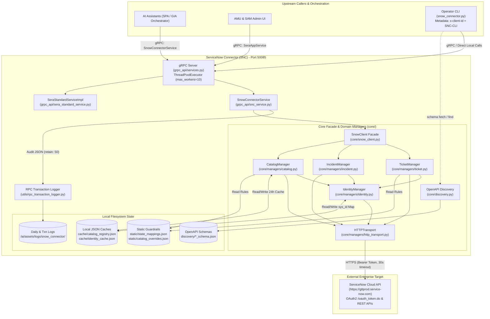
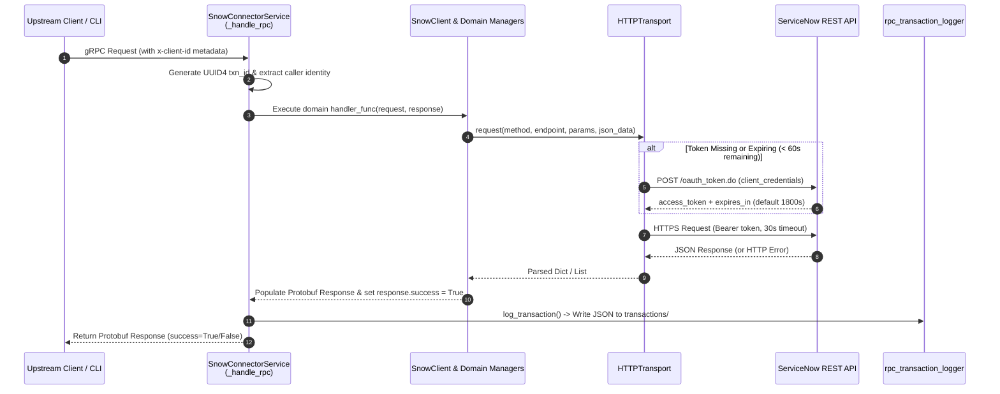

# ServiceNow Connector (SNC) - Architecture & Design Document

**Doc_Type:** Architecture & Design
**Category:** (C) Connector
**Name:** ServiceNow Connector
**Acronym:** SNC
**Version:** 0.1.4
**Date:** 2026-07-12
**Author:** Martin Kecka & Gemini AI
**Status:** Active

---

## 1. Introduction & Purpose 📜

The **ServiceNow Connector (SNC)** is a deterministic, domain-driven gRPC gateway module within the SERA/GIA ecosystem (`config/settings.yaml` -> `module_info`). Acting as the authoritative abstraction layer over the enterprise ServiceNow REST API (`https://gttprod.service-now.com`), SNC shields upstream AI assistants, orchestrators, and administrative tools from the latency, deep table polymorphism, raw 32-character `sys_id` foreign keys, and nested variable structures of native ServiceNow endpoints.

Instead of forcing upstream AI agents or microservices to construct brittle ServiceNow Table API queries (`sc_req_item` vs. `sc_task` vs. `incident`), manage OAuth2 token lifecycles, or traverse multi-table join hierarchies (`sc_item_option_mtom`, `sys_journal_field`, `sysapproval_approver`), SNC executes all schema translations, identity lookups, guardrail validations, and local fast-caching deterministically.

Its core functional pillars include:

1. **Domain-Driven Facade Architecture:** A clean `SnowClient` facade (`core/snow_client.py` -> `SnowClient`) backed by five specialized domain managers: `HTTPTransport`, `IdentityManager`, `TicketManager`, `IncidentManager`, and `CatalogManager`.
2. **Unified & Explicit ITIL Lifecycle Management:** Supports both polymorphic task operations across `incident`, `sc_task`, `sc_req_item`, `sc_request`, `change_request`, and `problem` (`core/managers/ticket.py` -> `TicketManager`) and strongly-typed explicit lifecycle RPCs for Incidents (`CreateIncident`, `GetIncident`, `UpdateIncident`, `ResolveIncident`) and Service Catalog Requests (`CreateRequest`, `GetRequest`, `UpdateRequest`, `ResolveRequest`).
3. **Local Service Catalog Fast-Registry & Dynamic Routing:** Downloads active ServiceNow catalog items into a 24-hour TTL local JSON cache (`cache/catalog_registry.json`) for sub-millisecond search (`core/managers/catalog.py` -> `CatalogManager.list_catalog_items()`), automatically detects Record Producers vs. standard catalog items to route between `/submit_producer` and `/order_now`, and auto-traces generated child `RITM` and `SCTASK` records.
4. **Smart Bidirectional Identity Resolution & Local Guardrails:** Automatically resolves human-readable emails, usernames (with automatic `@gtt.net` fallback), and group names into 32-character ServiceNow `sys_id` hashes while persisting reverse `sys_id` -> display name mappings in `cache/identity_cache.json` (`core/managers/identity.py` -> `IdentityManager`). Enforces pre-flight state translations (`static/state_mappings.json`) and per-item mandatory variable/identity overrides (`static/catalog_overrides.json`).

---

## 2. Architecture & Ecosystem Integration 🏗️

SNC operates as a headless, multi-threaded Python gRPC server (`grpc_api/services.py` -> `serve()`) listening on `0.0.0.0:50085` with `max_workers=10`. It exposes both its domain-specific `snow_connector.SnowConnectorService` contract (`grpc_api/snc_service.py`) and the universal `sera.standard.v1.SeraAppService` observability contract (`grpc_api/sera_standard_service.py`).

* **Upstream Callers (Inbound gRPC, Port `50085`):**
  * **SE Provisioning Assistant (SPA), GIA Orchestrator & Downstream AI Agents:** Invoke `SnowConnectorService` RPCs to inspect queues, audit tickets, create/resolve incidents, and submit or fulfill Service Catalog requests.
  * **Application Management Utility (AMU) & Sera Admin Module (SAM):** Poll `SeraAppService` (`GetAppInfo`, `GetDeepHealth`, `GetChangelog`, `GetDocs`) to track SNC service health (`snc-grpc.service`), verify TCP reachability to `gttprod.service-now.com:443` (`servicenow_api_prod`), and render live documentation.
  * **Operator / Developer CLI (`snow_connector.py`):** Connects to `localhost:50085` via `CallerIDInterceptor` (`cli/commands/common.py`), injecting `x-client-id: SNC-CLI` into outbound gRPC metadata. (Note: `schema fetch`, `schema find`, and `ticket trace` instantiate `SnowClient` / `core.discovery` directly in-process).
* **Downstream Targets (Outbound HTTPS REST, Port `443`):**
  * **ServiceNow Production (`https://gttprod.service-now.com`):** Authenticates via OAuth2 `client_credentials` grant (`POST /oauth_token.do`) and interacts with the ServiceNow Table API (`/api/now/table/*`), Service Catalog API (`/api/sn_sc/servicecatalog/items/*`), and OpenAPI schema discovery endpoint (`/api/now/openapi`).



---

## 3. Module File Map 📂

```plaintext
/ai/snow_connector
├── __init__.py                        # Package root marker
├── snow_connector.py                  # Main CLI & daemon entrypoint; runs bootstrap_helper, loads YAML config, initializes logging
├── bootstrap_helper.py                # Self-healing venv manager; installs requirements.txt and re-execs via os.execv
├── requirements.txt                   # Python dependencies (grpcio, protobuf, requests, PyYAML, thefuzz, click)
├── README.md                          # Repository overview and links to central SERA guides
├── cli/                               # Click-based Command Line Interface
│   ├── snc_cli.py                     # Root CLI group with NestedHelpGroup, --grpc flag, and start-grpc-server command
│   └── commands/                      # Domain-segregated CLI subcommand modules
│       ├── common.py                  # Shared get_stub() factory and CallerIDInterceptor ('x-client-id': 'SNC-CLI')
│       ├── admin_cmds.py              # 'admin' group: get-roles
│       ├── discovery_cmds.py          # 'schema' group: fetch (table/api OpenAPI schemas) and find (local keyword search)
│       ├── group_cmds.py              # 'queue' group: list (active group tickets) and stats (multi-dimensional queue metrics)
│       ├── incident_cmds.py           # 'incident' group: explicit lifecycle commands (create, get, update, resolve)
│       ├── module_cmds.py             # 'module' group: SERA Standard introspection commands (info, health)
│       ├── req_cmds.py                # 'req' group: catalog & RITM tools (sync, list-items, order, get-variables, get-approvals)
│       ├── request_cmds.py            # 'request' group: explicit catalog fulfillment commands (create, get, update, resolve)
│       └── ticket_cmds.py             # 'ticket' group: polymorphic task tools (get, update, list-notes, add-note, trace, assigned-to, choices)
├── config/                            # Configuration files
│   └── settings.yaml                  # Master runtime configuration (system_services, external_services.servicenow, logging, paths)
├── core/                              # Core business logic and ServiceNow API integration
│   ├── snow_client.py                 # SnowClient facade unifying all 5 domain managers
│   ├── discovery.py                   # OpenAPI schema downloader (fetch_snow_schema) and local path searcher (search_local_schemas)
│   └── managers/                      # Domain-Driven Design (DDD) manager implementations
│       ├── http_transport.py          # HTTPTransport: OAuth2 token caching/refresh, requests.Session pooling, error extraction
│       ├── identity.py                # IdentityManager: User/group sys_id resolution and persistent cache/identity_cache.json
│       ├── catalog.py                 # CatalogManager: 24h catalog_registry.json sync, catalog_overrides.json enforcement, producer routing
│       ├── incident.py                # IncidentManager: Explicit incident creation, retrieval, resolution, and task closure
│       └── ticket.py                  # TicketManager: Prefix-to-table routing, hierarchy tracing, MTOM variable extraction, queue stats
├── docs/                              # Module documentation
│   ├── CHANGELOG.yaml                 # Structured release history parsed by SeraStandardServiceImpl and AMU
│   └── snc_design.md                  # Symlink to /ai/assets/guides/tool_guides/snc_design.md
├── grpc_api/                          # gRPC server and protobuf definitions
│   ├── __init__.py                    # Package marker
│   ├── generate_stubs.py              # Pre-flight mtime checker and grpc_tools.protoc compiler for snc_service.proto & sera_standard.proto
│   ├── services.py                    # Dual-servicer gRPC server bootstrapper (SnowConnectorService + SeraStandardServiceImpl)
│   ├── snc_service.py                 # SnowConnectorServiceServicer implementation with unified _handle_rpc wrapper
│   ├── sera_standard_service.py       # Standardized SERA v1.2-universal observability service implementation
│   └── protos/                        # Protocol Buffer contracts
│       └── snc_service.proto          # 20 domain RPC definitions and message schemas for package snow_connector
├── scripts/                           # Maintenance and one-off testing scripts (e.g., debug_llm_payload.py)
├── static/                            # Static JSON guardrail and translation dictionaries
│   ├── catalog_overrides.json         # Per-catalog-item mandatory variable rules and user/group sys_id resolution fields
│   └── state_mappings.json            # Human-readable state string to integer code mappings for sc_task, incident, sc_req_item, sc_request
└── utils/                             # Cross-cutting logging and auditing utilities
    ├── logging_setup.py               # MultiProcessSafeDailyLogger (14-day retention) and console/file handler initialization
    └── rpc_transaction_logger.py      # Per-RPC JSON audit file writer and sliding-window retention pruner
```

---

## 4. Core Processing Lifecycle ⚙️

### 4.1. Boot & Initialization Sequence
1. **Virtual Environment Self-Bootstrap (`snow_connector.py` -> `bootstrap_helper.bootstrap_and_reexecute_if_needed()`):**
   * Checks if `/ai/snow_connector/venv` and `venv/.installed` exist and whether `requirements.txt` has a newer modification timestamp (`needs_pip_install()`).
   * If missing or outdated, creates the virtual environment, upgrades `pip`, installs each package in `requirements.txt`, writes `venv/.installed`, and re-executes the process inside the virtual environment using `os.execv(venv_python, [venv_python, "-u"] + sys.argv)`.
2. **Configuration & Logging Setup (`snow_connector.py` -> `main()`):**
   * Loads `config/settings.yaml` via `yaml.safe_load()`.
   * Invokes `setup_logging(config)` (`utils/logging_setup.py`):
     * Configures a `StreamHandler(sys.stdout)` set to `INFO` when `'start-grpc-server' in sys.argv`, or `WARNING` during interactive CLI execution to keep terminal output clean.
     * When `logging.enable_file_logging` is `true`, attaches two `MultiProcessSafeDailyLogger` handlers writing to `/ai/assets/logs/snow_connector/snc.log.YYYY-MM-DD` (`DEBUG` level) and `snc_err.log.YYYY-MM-DD` (`WARNING` level) with `backup_count=14` days automatic pruning.
     * Suppresses noisy third-party loggers (`hpack`, `httpx`, `httpcore`, `urllib3`, `zeep`, `requests`) to `WARNING`.
3. **Dynamic Protobuf Stub Compilation (`cli/snc_cli.py` -> `start_grpc_server()` -> `grpc_api/generate_stubs.py` -> `check_and_generate_stubs()`):**
   * Compares file modification times (`os.path.getmtime`) of `grpc_api/protos/snc_service.proto` and `/ai/assets/protos/sera_standard/sera_standard.proto` against `/ai/assets/protos/snow_connector/generated/snc_service_pb2.py` and `sera_standard_pb2.py`.
   * If stubs are missing or older than their source `.proto` files, creates the output directory hierarchy (ensuring `__init__.py` exists in every parent folder) and compiles both contracts via `grpc_tools.protoc`. Aborts server startup with exit code `1` if compilation fails.
4. **gRPC Server & Catalog Pre-Warming (`grpc_api/services.py` -> `serve()`):**
   * Calls `cleanup_transactions(config)` (`utils/rpc_transaction_logger.py`) to prune old JSON transaction files exceeding `retain_count: 50`.
   * Instantiates `grpc.server(futures.ThreadPoolExecutor(max_workers=10))`.
   * Initializes `SnowConnectorService(config)` (`grpc_api/snc_service.py`), which constructs `SnowClient(config)` (`core/snow_client.py`) and immediately triggers a non-forced catalog synchronization (`self.snow_client.sync_catalog(force=False)`). If `cache/catalog_registry.json` is missing or older than 24 hours (`86400s`), SNC downloads all active catalog items from ServiceNow on boot; exceptions are logged without crashing the server.
   * Registers both `SnowConnectorService` and `SeraStandardServiceImpl` on `0.0.0.0:50085` and blocks on `server.wait_for_termination()`.

### 4.2. Inbound gRPC Request & Transaction Auditing Workflow
Every domain RPC on `SnowConnectorService` is routed through the unified `_handle_rpc()` wrapper (`grpc_api/snc_service.py` -> `SnowConnectorService._handle_rpc()`):



---

## 5. Detailed Business Logic, Rules & HITL 🧠

### 5.1. OAuth2 Transport & Error Extraction (`core/managers/http_transport.py` -> `HTTPTransport`)
* **Token Lifecycle Management (`get_valid_token()`):**
  * Caches `self._access_token` and `self._token_expires_at` in memory.
  * Reuses the cached token as long as `time.time() < (self._token_expires_at - 60)` (60-second safety buffer before expiration).
  * When expired or uninitialized, sends a `POST` request to `{instance_url}/oauth_token.do` with form data `grant_type=client_credentials`, `client_id`, and `client_secret`. Computes `_token_expires_at = time.time() + int(data.get("expires_in", 1800))`.
* **Session Pooling & Structured Fault Parsing (`request()`):**
  * Executes all REST calls over a persistent `requests.Session()` with `Authorization: Bearer {token}`, `Accept: application/json`, `Content-Type: application/json`, and `timeout=30` seconds (`default_timeout`).
  * Returns `{}` immediately on HTTP `204 No Content`.
  * On non-2xx responses (`not response.ok`), parses the response JSON for ServiceNow's structured error envelope (`js['error']['message']` and optional `js['error']['detail']`) and raises a `RuntimeError(f"ServiceNow API Error {response.status_code}: {err_msg}")`.

### 5.2. Smart Bidirectional Identity Resolution (`core/managers/identity.py` -> `IdentityManager`)
ServiceNow relational fields require 32-character hexadecimal `sys_id` values on write, and often return raw 32-character `sys_id` strings inside catalog variable tables on read. `IdentityManager` bridges this gap in both directions:

1. **Forward User Resolution (`resolve_user_sys_id(identifier)`):**
   * **Fast-Path:** If `len(identifier) == 32` and contains no spaces or `@`, returns `identifier` directly as an already-valid `sys_id`.
   * **Primary Lookup:** Queries `GET /api/now/table/sys_user` with `sysparm_query=sys_id={ident}^ORemail={ident}^ORuser_name={ident}`, `sysparm_fields=sys_id`, `sysparm_limit=1`.
   * **Domain Fallback:** If no match is found and `"@" not in identifier`, automatically retries the query with `f"{identifier}@gtt.net"`.
   * Raises `ValueError(f"User '{identifier}' not found in ServiceNow.")` if both lookups return empty.
2. **Forward Group Resolution (`resolve_group_sys_id(group_name)`):**
   * **Fast-Path:** If `len(group_name) == 32` and contains no spaces, returns `group_name` directly.
   * **Lookup:** Queries `GET /api/now/table/sys_user_group` with `sysparm_query=name={group_name}`, `sysparm_fields=sys_id`, `sysparm_limit=1`. Raises `ValueError` if not found.
3. **Reverse `sys_id` to Display Name Resolution (`resolve_display_name_from_sys_id(sys_id)`):**
   * Triggered when extracting catalog variables (`TicketManager.get_ticket_variables()`) whenever a value is exactly 32 alphanumeric characters (`len(str(val)) == 32 and str(val).isalnum()`).
   * **Step 1 (Disk Cache Check):** Checks `self._identity_cache` (loaded from `/ai/snow_connector/cache/identity_cache.json`). Returns immediately on cache hit.
   * **Step 2 (User Probe):** Queries `GET /api/now/table/sys_user/{sys_id}?sysparm_fields=name`. If found, caches `sys_id -> name` to `cache/identity_cache.json` and returns `name`.
   * **Step 3 (Group Probe):** Queries `GET /api/now/table/sys_user_group/{sys_id}?sysparm_fields=name`. If found, caches `sys_id -> name` to `cache/identity_cache.json` and returns `name`.
   * **Step 4 (Negative Cache Fallback):** If neither table matches (e.g., the 32-char string is a non-identity reference), caches `sys_id -> sys_id` to prevent repeated failed API lookups on subsequent calls.

### 5.3. Polymorphic Ticket Management & Deep Tracing (`core/managers/ticket.py` -> `TicketManager`)
* **Prefix-to-Table Routing (`_get_table_from_prefix(ticket_number)`):**
  Maps ticket number prefixes (case-insensitive) to their concrete ServiceNow tables for `PATCH` updates:
  * `SCTASK*` -> `sc_task`
  * `RITM*` -> `sc_req_item`
  * `REQ*` -> `sc_request`
  * `INC*` -> `incident`
  * `CHG*` -> `change_request`
  * `PRB*` -> `problem`
  * All others -> `task`
* **State Guardrail Translation (`update_ticket_status()`):**
  * When `updates["state"]` is not an integer string (`not state_val.lstrip('-').isdigit()`), loads `static/state_mappings.json` and looks up `state_maps[table][state_val.lower()]`:
    * **`sc_task` / `sc_req_item`:** `"open": 1`, `"work in progress": 2`, `"closed complete": 3`, `"closed incomplete": 4`, `"closed skipped": 7`.
    * **`incident`:** `"new": 1`, `"in progress": 2`, `"on hold": 3`, `"resolved": 6`, `"closed": 7`, `"canceled": 8`.
    * **`sc_request`:** `"open": 1`, `"work in progress": 2`, `"closed complete": 3`, `"closed incomplete": 4`, `"closed cancelled": 4`, `"closed rejected": 4`.
  * If the state string is not recognized for the target table, aborts before calling ServiceNow with `RuntimeError("Local Guardrail: Unknown state string '...' for table '...'. Valid options: ...")`.
  * Maps `resolution_code` to ServiceNow's `close_code` field, resolves `assignment_group` and `assigned_to` via `IdentityManager`, and dispatches `PATCH /api/now/table/{table}/{ticket_sys_id}`.
* **Hierarchical Ticket Tracing (`get_ticket_hierarchy(ticket_number)`):**
  1. Queries `/api/now/table/sc_req_item` with `sysparm_query=request.number={ticket_number}^ORnumber={ticket_number}` and `sysparm_display_value=true`.
  2. Appends any returned `RITM` records whose number differs from `ticket_number` to `children`.
  3. Collects all matched `RITM` numbers and queries `/api/now/table/sc_task` using `^OR`-joined `request_item.number={num}` clauses, appending all child `SCTASK` records to `children`.
* **Catalog Variable Extraction (`get_ticket_variables(ticket_data)`):**
  1. Resolves the parent `RITM` `sys_id`: starts with `ticket_data["sys_id"]`, or extracts the trailing `sys_id` from `ticket_data["request_item"]["link"]` (for `SCTASK` records) or `ticket_data["parent"]["link"]` (if `parent.display_value` starts with `"RITM"`).
  2. Queries `/api/now/table/sc_item_option_mtom` with `sysparm_query=request_item.sys_id={ritm_sys_id}` and `sysparm_fields=sc_item_option.item_option_new.name,sc_item_option.value`.
  3. Iterates over the MTOM rows, passing any 32-character alphanumeric value through `IdentityManager.resolve_display_name_from_sys_id()` so raw user/group `sys_id`s inside variables are returned as human-readable names.
* **Journal Entries, Emails & Approvals:**
  * `get_ticket_journal_entries(sys_id)`: Queries `/api/now/table/sys_journal_field` for `element_id={sys_id}^elementINwork_notes,comments`.
  * `get_ticket_work_notes(ticket_number)`: Queries `sys_journal_field` for `element=work_notes`; if empty, falls back to the main ticket record's `work_notes` field.
  * `get_ticket_emails(sys_id)`: Queries `/api/now/table/sys_email` for `instance={sys_id}`.
  * `get_request_approvals(ritm_number)`: Resolves the `RITM` `sys_id`, fetches individual approvers from `/api/now/table/sysapproval_approver` (`sysapproval={ritm_sys_id}`), and fetches group approvals from `/api/now/table/sysapproval_group` (`parent={ritm_sys_id}`), tagging group records with `"_table": "sysapproval_group"`.
* **Queue Statistics Engine (`get_group_stats(group_name, table="task", person_filter=None)`):**
  * Fetches active tickets (`assignment_group.name={group_name}^active=true`), optionally filters case-insensitively by `assigned_to` display value (`person_filter`), and computes a 5-dimensional aggregation dictionary:
    * `total_active` and `unassigned` counts.
    * `by_type`: Grouped by `sys_class_name`.
    * `by_state`: Grouped by `state` display value.
    * `by_assignee`: Grouped by `assigned_to` display value.
    * `by_age`: Parses `sys_created_on` (fallback `opened_at`) using `"%Y-%m-%d %H:%M:%S"` against `datetime.utcnow()` and buckets tickets into `< 7 days`, `7 - 30 days`, `30 - 90 days`, `90 - 365 days`, and `> 1 year`.

### 5.4. Explicit Incident & Request Domain Handlers (`core/managers/incident.py` -> `IncidentManager`)
* **`get_incident_explicit(incident_number)`:** Queries `GET /api/now/table/incident` with `number={incident_number}` and `sysparm_display_value=true`.
* **`create_incident_explicit(payload)`:** Resolves `caller_id` via `resolve_user_sys_id()` and `assignment_group` via `resolve_group_sys_id()`, copies stringified `short_description`, `description`, `urgency`, `impact`, `category`, and `subcategory`, and executes `POST /api/now/table/incident`.
* **`resolve_incident_explicit(incident_number, resolution_code, close_notes)`:** Delegates to `TicketManager.update_ticket_status()` with `state="resolved"`, `resolution_code`, and `close_notes`.
* **`resolve_request_task_explicit(task_number, close_notes)`:** Delegates to `TicketManager.update_ticket_status()` with `state="closed complete"` and `close_notes`.

### 5.5. Service Catalog Registry, Overrides & Producer Routing (`core/managers/catalog.py` -> `CatalogManager`)
* **24-Hour Fast-Sync Registry (`sync_catalog(force=False)`):**
  * Checks `/ai/snow_connector/cache/catalog_registry.json`. If `force=False` and the file's modification time (`os.path.getmtime`) is less than `86400` seconds (24 hours) old, skips the download.
  * Otherwise queries `GET /api/now/table/sc_cat_item?sysparm_query=active=true&sysparm_display_value=true` and writes `{"last_synced": ..., "items": [...]}` to `cache/catalog_registry.json`.
* **Local Search & Name-to-SysID Resolution (`list_catalog_items()`, `_resolve_catalog_item_sys_id()`):**
  * Searches `name` and `short_description` case-insensitively in memory from `cache/catalog_registry.json`.
  * `_resolve_catalog_item_sys_id(identifier)` accepts either a 32-character `sys_id` or an exact case-insensitive catalog item `name`.
* **Pre-Flight Override Guardrails (`static/catalog_overrides.json`):**
  * During both `get_catalog_item_variables()` and `order_catalog_item()`, SNC inspects `static/catalog_overrides.json` keyed by `item_sys_id`:
    * `3d84a924ff802e10cde1fc557c4fd9bf` (**"Generic System Engineering Request"**): Enforces `required_fields: ["requested_for", "gtt_business_justification", "description", "priority"]` and auto-resolves `resolve_user_fields: ["requested_for", "requested_by"]`.
    * `3f1dd0320a0a0b99000a53f7604a2ef9` (**"Create Incident"**): Enforces `required_fields: ["caller_id", "urgency", "assignment_group", "short_description", "description"]`, auto-resolves `resolve_user_fields: ["caller_id"]`, and auto-resolves `resolve_group_fields: ["assignment_group"]`.
  * If any `required_fields` key is missing or empty during `order_catalog_item()`, SNC raises `RuntimeError("Local Guardrail: Missing mandatory fields for this catalog item: ...")` before contacting ServiceNow.
* **Dynamic Record Producer vs. Standard Order Routing (`order_catalog_item()` & `snc_service.py`):**
  * Inspects the item's `sys_class_name` in `cache/catalog_registry.json`.
  * **Record Producer (`'producer' in cls_val`):** Sends `POST /api/sn_sc/servicecatalog/items/{item_sys_id}/submit_producer` with `{"variables": variables}`.
  * **Standard Catalog Item:** Sends `POST /api/sn_sc/servicecatalog/items/{item_sys_id}/order_now` with `{"sysparm_quantity": 1, "variables": variables}`.
  * **Post-Order Auto-Tracing (`OrderCatalogItem` & `CreateRequest` in `grpc_api/snc_service.py`):** When an order returns a `request_number`, SNC sleeps for `2` seconds (`time.sleep(2)`) to allow ServiceNow's asynchronous workflow engine to generate child records, then calls `get_ticket_hierarchy(req_num)` and returns all generated `RITM` and `SCTASK` structures directly in `response.child_tasks`.

### 5.6. Human-in-the-Loop (HITL) Integration
*Not applicable for this module.* SNC is a deterministic headless connector. Interactive human approvals and exception handling occur either upstream in AI Assistants (such as SPA) or within ServiceNow's native approval workflows (inspected via `GetRequestApprovals`).

---

## 6. AI, LLM & Machine Learning Execution 🤖

*Not applicable for this module.* The SNC service (`core/`, `grpc_api/`, `cli/`) is a 100% deterministic gRPC-to-REST translation gateway and performs no LLM inference during runtime operations.

---

## 7. Data Models, State, Storage & Auditing 🗄️

SNC is stateless with respect to relational databases (it uses no PostgreSQL or SQLite database), relying instead on in-memory token caching and structured local JSON files for low-latency lookups and audit trails.

### 7.1. Local File System Storage & Caches

| File Path | Managed By | Retention / TTL | Structure & Purpose |
| :--- | :--- | :--- | :--- |
| `cache/catalog_registry.json` | `CatalogManager` (`core/managers/catalog.py`) | 24-hour TTL (`86400s` mtime check; bypassed via `--force`) | Stores `{"last_synced": "<ISO8601>", "items": [...]}` containing all active `sc_cat_item` records for instant local catalog search and `sys_class_name` producer detection. |
| `cache/identity_cache.json` | `IdentityManager` (`core/managers/identity.py`) | Persistent on-disk dictionary | Key-value dictionary mapping 32-character `sys_id` strings to human-readable `sys_user` or `sys_user_group` display names (`{"<sys_id>": "<Display Name>"}`). |
| `static/state_mappings.json` | `TicketManager` (`core/managers/ticket.py`) | Static version-controlled config | Maps lowercase human-readable state names (e.g., `"work in progress"`, `"resolved"`) to table-specific integer state codes across `sc_task`, `incident`, `sc_req_item`, and `sc_request`. |
| `static/catalog_overrides.json` | `CatalogManager` (`core/managers/catalog.py`) | Static version-controlled config | Keyed by catalog item `sys_id`; defines `required_fields`, `resolve_user_fields`, and `resolve_group_fields` guardrails enforced before order submission. |
| `discovery/{api_type}_{api_id}_schema.json` | `fetch_snow_schema` (`core/discovery.py`) | On-demand via `schema fetch` CLI | Stores downloaded ServiceNow OpenAPI specifications (`/api/now/openapi?t={api_type}&id={api_id}`) for local endpoint keyword searching (`schema find`). |
| `/ai/assets/logs/snow_connector/snc.log.YYYY-MM-DD` | `MultiProcessSafeDailyLogger` (`utils/logging_setup.py`) | 14 days (`backup_count=14`) | Daily rotating application debug and outbound HTTP trace logs (`DEBUG` level). |
| `/ai/assets/logs/snow_connector/snc_err.log.YYYY-MM-DD` | `MultiProcessSafeDailyLogger` (`utils/logging_setup.py`) | 14 days (`backup_count=14`) | Daily rotating warning and error logs (`WARNING` and above). |
| `/ai/assets/logs/snow_connector/transactions/nbc_txn_<UTC>.json` | `log_transaction` (`utils/rpc_transaction_logger.py`) | Sliding window of `50` files (`retain_count: 50`) | Per-RPC JSON audit record capturing `transaction_id`, `client_application`, `username`, `timestamp_utc`, `rpc_method`, `success`, and `error_message`. |

---

## 8. APIs, Observability & Communication Contracts 📡

### 8.1. Inbound Domain gRPC API (`snow_connector.SnowConnectorService`)
Defined in `grpc_api/protos/snc_service.proto` and implemented in `grpc_api/snc_service.py` (Port `50085`):

| RPC Method | Request Message | Response Message | Operational Description |
| :--- | :--- | :--- | :--- |
| **`GetUserRoles`** | `GetUserRolesRequest` (`user_identifier`) | `GetUserRolesResponse` (`success`, `error_message`, `repeated roles`) | Resolves user `sys_id` and returns all assigned role display values from `sys_user_has_role`. |
| **`GetTicket`** | `GetTicketRequest` (`ticket_number`, `include_notes`, `include_emails`) | `GetTicketResponse` (`ticket_data`, `work_notes`, `emails`, `variables`, `child_tasks`) | Fetches composite ticket record from `task`, plus optional journal entries, emails, MTOM catalog variables, and child `RITM`/`SCTASK` hierarchy. |
| **`UpdateTicketWorkNote`** | `UpdateTicketWorkNoteRequest` (`ticket_number`, `work_note`, `is_customer_visible`) | `UpdateTicketWorkNoteResponse` (`success`, `error_message`) | Appends a customer-visible `comments` entry (`is_customer_visible=true`) or internal `work_notes` entry (`false`). |
| **`GetTicketWorkNotes`** | `GetTicketWorkNotesRequest` (`ticket_number`) | `GetTicketWorkNotesResponse` (`notes`) | Fetches `work_notes` entries from `sys_journal_field` (with fallback to the ticket's `work_notes` field). |
| **`GetRequestApprovals`** | `GetRequestApprovalsRequest` (`ritm_number`) | `GetRequestApprovalsResponse` (`pending_approvers`) | Fetches user approvals (`sysapproval_approver`) and group approvals (`sysapproval_group`) for a `RITM`. |
| **`ListGroupTickets`** | `ListGroupTicketsRequest` (`group_name`, `table`, `date_from`, `date_to`) | `ListGroupTicketsResponse` (`tickets`) | Lists active tickets assigned to `group_name` with optional table and creation date bounds. |
| **`GetGroupQueueStats`** | `GetGroupQueueStatsRequest` (`group_name`, `table`, `person_filter`) | `GetGroupQueueStatsResponse` (`stats`) | Computes active queue aggregations (total, unassigned, by type, by state, by age bucket, by assignee). |
| **`GetUserTickets`** | `GetUserTicketsRequest` (`user_identifier`) | `GetUserTicketsResponse` (`tickets`) | Resolves user `sys_id` and lists all active tickets (`assigned_to={sys_id}^active=true`) across `task`. |
| **`SyncCatalog`** | `SyncCatalogRequest` (`force`) | `SyncCatalogResponse` (`message`) | Synchronizes active `sc_cat_item` records to `cache/catalog_registry.json` (respecting 24h TTL unless `force=true`). |
| **`ListCatalogItems`** | `ListCatalogItemsRequest` (`query`) | `ListCatalogItemsResponse` (`items`) | Searches `cache/catalog_registry.json` by substring match on `name` or `short_description`. |
| **`OrderCatalogItem`** | `OrderCatalogItemRequest` (`item_sys_id`, `variables`) | `OrderCatalogItemResponse` (`request_number`, `request_sys_id`, `child_tasks`) | Validates `catalog_overrides.json`, routes to `/submit_producer` or `/order_now`, sleeps `2s`, and traces child tasks. |
| **`GetCatalogVariables`** | `GetCatalogVariablesRequest` (`item_identifier`) | `GetCatalogVariablesResponse` (`variables`) | Fetches catalog item variable definitions from ServiceNow and applies mandatory flags from `catalog_overrides.json`. |
| **`UpdateTicketStatus`** | `UpdateTicketStatusRequest` (`ticket_number`, `state`, `assignment_group`, `assigned_to`, `close_notes`, `priority`, `resolution_code`, `category`, `subcategory`) | `UpdateTicketStatusResponse` (`success`, `error_message`) | Translates state strings via `state_mappings.json`, resolves user/group `sys_id`s, and patches the target table record. |
| **`GetTableChoices`** | `GetTableChoicesRequest` (`table_name`, `element_name`) | `GetTableChoicesResponse` (`choices`) | Queries `sys_choice` (`inactive=false`) for valid `label` and `value` pairs on a table column. |
| **`CreateIncident`** | `CreateIncidentRequest` (`caller_id`, `short_description`, `description`, `urgency`, `impact`, `assignment_group`, `category`, `subcategory`) | `CreateIncidentResponse` (`incident_number`, `sys_id`) | Explicitly creates a new record in `incident` with automatic `caller_id` and `assignment_group` `sys_id` resolution. |
| **`GetIncident`** | `GetIncidentRequest` (`incident_number`) | `GetIncidentResponse` (`incident_data`) | Fetches an incident record directly from `/api/now/table/incident`. |
| **`UpdateIncident`** | `UpdateIncidentRequest` (`incident_number`, `work_notes`, `comments`, `assignment_group`, `assigned_to`, `state`, `category`, `subcategory`) | `UpdateIncidentResponse` (`success`, `error_message`) | Appends work notes/comments and updates status/assignment fields on an incident. |
| **`ResolveIncident`** | `ResolveIncidentRequest` (`incident_number`, `resolution_code`, `close_notes`) | `ResolveIncidentResponse` (`success`, `error_message`) | Transitions an incident to `state="resolved"` (`6`) with `close_code` and `close_notes`. |
| **`CreateRequest`** | `CreateRequestRequest` (`catalog_item_name`, `variables`) | `CreateRequestResponse` (`request_number`, `request_sys_id`, `child_tasks`) | Orders a catalog item by name or `sys_id`, sleeps `2s`, and returns the generated `REQ` and child `RITM`/`SCTASK` hierarchy. |
| **`GetRequest`** | `GetRequestRequest` (`request_number`) | `GetRequestResponse` (`request_data`, `child_tasks`, `variables`) | Retrieves a request (`REQ` or `RITM`), its child task hierarchy, and resolved MTOM catalog variables. |
| **`UpdateRequest`** | `UpdateRequestRequest` (`task_number`, `work_notes`, `comments`, `assignment_group`, `assigned_to`) | `UpdateRequestResponse` (`success`, `error_message`) | Updates notes, comments, assignment group, or assignee on a `RITM` or `SCTASK`. |
| **`ResolveRequest`** | `ResolveRequestRequest` (`task_number`, `close_notes`) | `ResolveRequestResponse` (`success`, `error_message`) | Closes a `RITM` or `SCTASK` with `state="closed complete"` (`3`) and `close_notes`. |

### 8.2. Universal SERA Standard Contract (`sera.standard.v1.SeraAppService`)
SNC implements the universal `sera.standard.v1.SeraAppService` contract (`grpc_api/sera_standard_service.py` -> `SeraStandardServiceImpl`), centrally maintained and deployed by the Application Management Utility (`amu_design.md`), providing standardized `GetAppInfo`, `GetDeepHealth`, `GetFeedback`, `GetChangelog`, and `GetDocs` endpoints for SAM UI and AMU telemetry integration.

### 8.3. Outbound Client Contracts
* **ServiceNow REST & OAuth2 API (`https://gttprod.service-now.com`):**
  * **Protocol:** HTTPS (`TLS`, port `443`), `timeout_seconds: 30`.
  * **Authentication:** OAuth2 `client_credentials` (`POST /oauth_token.do`) yielding a Bearer token cached in memory (`HTTPTransport`).
  * **Endpoints Consumed:**
    * `/api/now/table/{table}` (`task`, `incident`, `sc_request`, `sc_req_item`, `sc_task`, `change_request`, `problem`, `sys_user`, `sys_user_group`, `sys_user_has_role`, `sc_cat_item`, `sc_item_option_mtom`, `sys_journal_field`, `sys_email`, `sysapproval_approver`, `sysapproval_group`, `sys_choice`).
    * `/api/sn_sc/servicecatalog/items/{sys_id}/{order_now | submit_producer | variables}`.
    * `/api/now/openapi?t={table|api}&id={api_id}`.

---

## 9. User Interface (UI) & Visualizations 🖥️

*Not applicable for this module.* SNC is a headless backend gRPC microservice and CLI gateway. Its telemetry, health status, and documentation are consumed and visualized upstream by the **Sera Admin Module (SAM)** UI and **Application Management Utility (AMU)**.

---

## 10. Background Services & Workers 🛠️

| Worker / Service Name | Entrypoint / Location | Trigger & Schedule | Concurrency & Locking | Operational Responsibility & Retry Policy |
| :--- | :--- | :--- | :--- | :--- |
| **`snc-grpc.service`** | `snow_connector.py start-grpc-server` -> `grpc_api/services.py:serve()` | Persistent `systemd` daemon | `futures.ThreadPoolExecutor` (`max_workers=10`) | Hosts `SnowConnectorService` and `SeraStandardServiceImpl` on `0.0.0.0:50085`. |
| **Boot Catalog Sync & Txn Cleanup** | `grpc_api/services.py:serve()` & `SnowConnectorService.__init__()` | Executed synchronously once on gRPC server startup | Single-threaded startup hook | Prunes transaction JSON files above `retain_count: 50` (`cleanup_transactions`) and refreshes `cache/catalog_registry.json` if missing or older than 24h (`sync_catalog(force=False)`). |

---

## 11. CLI, Tooling & Testing 💻

The SNC CLI (`cli/snc_cli.py`) uses a custom `NestedHelpGroup` to display all top-level groups and nested subcommands in a single `--help` output. Most commands support the `--grpc` flag (either globally before the subcommand or locally on the subcommand) to emit raw Protobuf JSON responses.

### 11.1. CLI Command Reference

| Command | Arguments & Options | Operational Description |
| :--- | :--- | :--- |
| **`start-grpc-server`** | *None* | Verifies/compiles Protobuf stubs, prunes old transaction logs, syncs the catalog if stale (>24h), and starts the gRPC server on port `50085`. |
| **`module info`** | `[--grpc]` | Queries `SeraAppService.GetAppInfo` for version, category, and downstream dependencies. |
| **`module health`** | `[--grpc]` | Queries `SeraAppService.GetDeepHealth` for service status and TCP reachability to ServiceNow. |
| **`admin get-roles`** | `<user_identifier> [--grpc]` | Fetches all assigned ServiceNow roles for a user by email, username, or `sys_id`. |
| **`ticket get`** | `<ticket_number> [--exclude-notes] [--exclude-emails] [--grpc]` | Retrieves full ticket details, resolved MTOM catalog variables, child tasks, journal notes, and emails. |
| **`ticket update`** | `<ticket_number> [--state] [--group] [--assignee] [--priority] [--notes] [--resolution-code] [--category] [--subcategory]` | Updates polymorphic ticket state (translated via `state_mappings.json`), assignment, priority, or resolution details. |
| **`ticket list-notes`** | `<ticket_number>` | Lists activity journal entries (`work_notes`) for a specific ticket. |
| **`ticket add-note`** | `<ticket_number> <note> [--public]` | Appends an internal `work_notes` entry (default) or customer-visible `comments` entry (`--public`). |
| **`ticket trace`** | `<ticket_number> [--grpc]` | Traces and displays all child `RITM` and `SCTASK` records linked to a parent `REQ` or `RITM`. |
| **`ticket assigned-to`** | `<user_identifier>` | Lists all globally active tickets assigned to a specific user (`email`, `username`, or `sys_id`). |
| **`ticket choices`** | `<table_name> <element_name> [--grpc]` | Queries `sys_choice` to display valid integer/string values and UI labels for a table field (e.g., `sc_task state`). |
| **`incident create`** | `--caller <str> --short-desc <str> [--desc] [--urgency 3] [--impact 3] [--group] [--category] [--subcategory] [--grpc]` | Explicitly creates a new Incident record in the `incident` table. |
| **`incident get`** | `<incident_number> [--grpc]` | Retrieves core fields for a specific Incident from the `incident` table. |
| **`incident update`** | `<incident_number> [--work-notes] [--comments] [--group] [--assignee] [--state] [--category] [--subcategory] [--grpc]` | Appends work notes/comments and updates assignment or state on an active Incident. |
| **`incident resolve`** | `<incident_number> --code <str> --notes <str> [--grpc]` | Resolves an Incident (`state="resolved"`) with a mandatory resolution code and close notes. |
| **`request create`** | `<catalog_item_name> --vars <json> [--grpc]` | Submits a Service Catalog request, waits `2s`, and prints the generated `REQ` and child `RITM`/`SCTASK` numbers. |
| **`request get`** | `<request_number> [--grpc]` | Retrieves a Service Catalog request (`REQ`/`RITM`) and its associated child tasks and variables. |
| **`request update`** | `<task_number> [--work-notes] [--comments] [--group] [--assignee] [--grpc]` | Updates work notes, public comments, assignment group, or assignee on a `RITM` or `SCTASK`. |
| **`request resolve`** | `<task_number> --notes <str> [--grpc]` | Marks a specific `SCTASK` or `RITM` as `closed complete` (`3`) with close notes. |
| **`req sync`** | `[--force]` | Downloads all active catalog items from ServiceNow into `cache/catalog_registry.json`. |
| **`req list-items`** | `[--query] [--category] [--group] [--filter] [--grpc]` | Searches `cache/catalog_registry.json` with instant local filtering by category, group, or regex word-boundary text filter. |
| **`req order`** | `<item_identifier> [--vars <json>]` | Orders a catalog item or submits a record producer by `sys_id` or exact name. |
| **`req get-variables`** | `<item_identifier> [--grpc]` | Fetches and flattens nested catalog variable schemas for an item, highlighting mandatory fields. |
| **`req get-approvals`** | `<ritm_number> [--grpc]` | Displays pending and completed individual (`sysapproval_approver`) and group (`sysapproval_group`) approvals for a `RITM`. |
| **`queue list`** | `[--group "Systems Engineering"] [--type all] [--date-from YYYY-MM-DD] [--date-to YYYY-MM-DD] [--grpc]` | Lists active tickets for an assignment group grouped by `sys_class_name`. |
| **`queue stats`** | `[--group] [--table task] [--person] [--grpc]` | Displays queue statistics (total, unassigned, by type, by state, by age, by assignee). Defaults to `"Systems Engineering"` and `"AI Engineering"` if `--group` is omitted. |
| **`schema fetch`** | `<table\|api> <api_id>` | Downloads the OpenAPI schema for a table (e.g., `task`, `incident`) or API namespace (e.g., `sn_sc`) to `discovery/`. |
| **`schema find`** | `<keyword>` | Searches all locally downloaded OpenAPI JSON schemas in `discovery/` for matching endpoint paths. |

### 11.2. CLI Quick Execution Examples

```bash
# ==============================================================================
# SERVER LIFECYCLE & SERA STANDARD INTROSPECTION
# ==============================================================================
python3 snow_connector.py start-grpc-server
python3 snow_connector.py module info [--grpc]
python3 snow_connector.py module health [--grpc]

# ==============================================================================
# QUEUE ANALYTICS & USER ADMINISTRATION
# ==============================================================================
python3 snow_connector.py queue stats
python3 snow_connector.py queue stats --group "Systems Engineering" --person "Martin Kecka"
python3 snow_connector.py queue list --group "Systems Engineering" --type incident --date-from 2026-05-01
python3 snow_connector.py admin get-roles martin.kecka@gtt.net

# ==============================================================================
# STANDARD TICKET INSPECTION, TRACING & NOTES
# ==============================================================================
python3 snow_connector.py ticket get INC0147742 [--grpc]
python3 snow_connector.py ticket trace REQ0012345
python3 snow_connector.py ticket assigned-to martin.kecka@gtt.net
python3 snow_connector.py ticket choices incident state
python3 snow_connector.py ticket add-note INC0147804 "Investigating issue internally."
python3 snow_connector.py ticket add-note INC0147804 "We are working on your issue now." --public

# ==============================================================================
# EXPLICIT INCIDENT LIFECYCLE
# ==============================================================================
python3 snow_connector.py incident create \
  --caller "martin.kecka@gtt.net" \
  --short-desc "Network Switch Disconnect" \
  --desc "Core switch in Rack B is showing intermittent link failure." \
  --category "Systems Engineering" \
  --subcategory "Other" \
  --urgency "2" \
  --group "Systems Engineering"

python3 snow_connector.py incident get INC0147742 --grpc
python3 snow_connector.py incident update INC0147742 --state "in progress" --work-notes "Checking port 12."
python3 snow_connector.py incident resolve INC0147742 \
  --code "Resolved - Permanent Fix Applied" \
  --notes "Replaced damaged fiber patch cable on Port 12."

# ==============================================================================
# SERVICE CATALOG REGISTRY & EXPLICIT REQUEST LIFECYCLE
# ==============================================================================
python3 snow_connector.py req sync [--force]
python3 snow_connector.py req list-items --filter "System Engineering"
python3 snow_connector.py req get-variables "Generic System Engineering Request"
python3 snow_connector.py req get-approvals RITM0054321

python3 snow_connector.py request create "Generic System Engineering Request" \
  --vars '{"requested_for": "martin.kecka@gtt.net", "gtt_business_justification": "Testing automated flow", "priority": "3", "description": "Provision dev stack."}'

python3 snow_connector.py request get REQ0012345
python3 snow_connector.py request update SCTASK0044457 --work-notes "Provisioning VM."
python3 snow_connector.py request resolve SCTASK0044457 --notes "Environment built and verified."

# ==============================================================================
# OPENAPI SCHEMA DISCOVERY
# ==============================================================================
python3 snow_connector.py schema fetch table incident
python3 snow_connector.py schema fetch api sn_sc
python3 snow_connector.py schema find servicecatalog
```

---

## 12. Configuration, Security & Hardware Affinity 🔒

### 12.1. Configuration Reference (`config/settings.yaml`)

*(Note: Universal SERA boilerplate blocks—`module_info.*`, standard `logging.*`, and standard protobuf `paths.*`—are omitted below; see `conf_concept.md`.)*

| Configuration Key | Default / Production Value | Operational Purpose |
| :--- | :--- | :--- |
| `system_services.grpc` | `"snc-grpc.service"` (`0.0.0.0:50085`, `10` workers) | Systemd unit name, bind address/port, and `ThreadPoolExecutor` worker count for `SnowConnectorService` and `SeraAppService`. |
| `external_services.servicenow.url` | `"https://gttprod.service-now.com"` | Target ServiceNow Production instance URL (`dependency_name: "servicenow_api_prod"`, `type: "rest_api"`). |
| `external_services.servicenow.custom_api_path` | `"/api/namespace/v1"` | Custom namespace API path reference. |
| `external_services.servicenow.client_id` / `client_secret` | `"f768323a..."` / `"<secret>"` | OAuth2 `client_credentials` client ID and secret for `/oauth_token.do`. |
| `external_services.servicenow.timeout_seconds` | `30` | HTTP request timeout (seconds) applied to all ServiceNow REST and OAuth calls. |
| `transaction_logging.enabled` | `true` | Master toggle for per-RPC JSON audit logging (`utils/rpc_transaction_logger.py`). |
| `transaction_logging.directory` / `retain_count` | `"transactions"` / `50` | Subdirectory under `logging.directory` and maximum retained JSON transaction audit files. |
| `paths.changelog_path` / `docs_path` | `"/ai/snow_connector/docs/CHANGELOG.yaml"` / `"/ai/snow_connector/docs/snc_design.md"` | Explicit paths to the module's changelog and design document. |

### 12.2. Security & Cryptographic Key Handling
* **In-Memory OAuth2 Bearer Token Caching (`core/managers/http_transport.py` -> `HTTPTransport`):** OAuth2 access tokens retrieved from `https://gttprod.service-now.com/oauth_token.do` are held strictly in process memory (`self._access_token`) and refreshed 60 seconds prior to expiration; tokens are never written to disk or transaction logs.
* **Caller Identity Attribution (`cli/commands/common.py` & `grpc_api/snc_service.py`):** CLI invocations inject `x-client-id: SNC-CLI` via `CallerIDInterceptor`. `SnowConnectorService._get_caller()` extracts `x-client-id` (or falls back to `context.peer()`) and records it in both application logs and JSON transaction audit files.
* **DSN Sanitization (`grpc_api/sera_standard_service.py` -> `sanitize_dsn()`):** Strips embedded credentials from any connection strings inspected during `GetDeepHealth`.

### 12.3. Hardware Affinity & Execution Boundaries
* **Compute Profile:** Lightweight, stateless CPU- and network I/O-bound proxy daemon.
* **Hardware Affinity:** Requires **zero GPU hardware**. Runs on standard CPU application nodes via `systemd` (`snc-grpc.service`) with a minimal memory footprint.

---

## 13. Error Handling & Resilience 🛡️

1. **Unified gRPC Fault Barrier (`grpc_api/snc_service.py` -> `SnowConnectorService._handle_rpc()`):**
   * Wraps all 20 domain RPC methods in a `try...except...finally` block. Unhandled exceptions are logged with a unique `UUID4` `txn_id` and full stack trace (`exc_info=True`), converted into structured Protobuf error responses (`response.success = False`, `response.error_message = str(e)`), and audited to disk in `finally` so worker threads never crash.
2. **Pre-Flight Local Guardrails (`CatalogManager` & `TicketManager`):**
   * Validates mandatory catalog variables (`static/catalog_overrides.json`) and valid table state transitions (`static/state_mappings.json`) locally before dispatching HTTP requests, preventing ServiceNow `500 Internal Server Error` or silent state corruption.
3. **Forbidden Table Avoidance & Graceful Journal Degradation (`TicketManager`):**
   * Avoids querying restricted `sys_audit` tables (which trigger `HTTP 403` errors) and wraps secondary enrichment queries (`get_ticket_variables`, `get_ticket_journal_entries`, `get_ticket_emails`, `sysapproval_group`) in `try...except` blocks that log warnings and return empty collections if table ACLs restrict access, ensuring primary ticket retrieval (`GetTicket`) still succeeds.
4. **Negative Identity Caching (`IdentityManager.resolve_display_name_from_sys_id()`):**
   * When a 32-character alphanumeric string cannot be resolved in either `sys_user` or `sys_user_group`, `IdentityManager` caches `sys_id -> sys_id` in `cache/identity_cache.json` to prevent repeated N+1 API lookups on subsequent requests.
5. **Non-Fatal Boot Catalog Sync (`SnowConnectorService.__init__()`):**
   * Wraps the startup `self.snow_client.sync_catalog(force=False)` call in a `try...except` guard so transient ServiceNow network outages do not prevent `snc-grpc.service` from starting and serving health probes.

---

## 14. Future Enhancements & Roadmap 🚀

1. **HashiCorp Vault Secret Migration:** Migrate `external_services.servicenow.client_id` and `client_secret` from `config/settings.yaml` into HashiCorp Vault (`vault-aif.gt-t.net:8200`) using the standard `VaultClient` AppRole pattern (`secret/servicenow/external/shared/gia_ai`).
2. **Resolution Code Mapping Dictionary (`static/resolution_mappings.json`):** Externalize shorthand incident resolution codes (e.g., `"permanent fix"` -> `"Resolved - Permanent Fix Applied"`) into a dedicated `static/resolution_mappings.json` lookup table inside `TicketManager.update_ticket_status()`.
3. **LLM Tool Guide & Orchestrator Registration (`snc_llm_guide.md`):** Publish a formal LLM instruction guide (`/ai/assets/guides/llm_guides/snc_llm_guide.md`) and `GetLlmGuide` RPC to enable zero-shot tool chaining by the GIA Orchestrator.
4. **Thread-Safe File Locking on Local Caches:** Add `threading.Lock()` around `cache/identity_cache.json` and `cache/catalog_registry.json` writes to prevent concurrent file write contention under high multi-worker gRPC load.
